# Дизайн-ревью «Будет на ЕГЭ»

Смотрел живую сборку (`app/`, `pnpm build` → статический экспорт), Chromium, 1440 px и 390 px (iPhone 14/15, @2x).
Страницы: главная, банк заданий `/zadaniya/`, задание №9 `/zadaniya/9/` и его тренажёр, «Об авторе» `/about/`, «Собрать вариант» `/variant/`.
Все скриншоты лежат в [`design-crit/`](design-crit/).

Пометки:
- **[объективно]** — ошибка, которую подтвердит любой дизайнер или измерит линейка;
- **[вкус]** — моё мнение арт-директора, с ним можно спорить.

---

## 1. Первое впечатление

Первые пять секунд я вообще не вижу сайт: всё закрыто размытой серой пеленой, а сверху висит модалка «Добро пожаловать» с двумя одинаковыми синими кнопками (`01`). Закрываю её — и получаю cookie-плашку прямо на цифрах «3 800+ задач», а в правом углу синий круг «?». Три слоя поверх контента ещё до того, как я понял, что здесь вообще есть. Под ними чистый, аккуратный, но очень знакомый «SaaS-синий» лендинг. Огромный синий кристалл, срезанный левым краем экрана, выглядит дорого, но я не понимаю, при чём он здесь. Заголовок «Учителю — больше времени на учениках» сильный и человечный, вот только я школьник, и мне с первой строки дают понять, что сайт не для меня.

Внутри впечатление меняется: продукт настоящий и глубокий. Генератор, тренажёр, 40 типов заданий, бланки ЕГЭ — работы сделано на хорошую платформу. Но оформлена она как админка: тёмно-синий сайдбар, серые списки, двадцать одинаковых строк «9.4.х… Пример ⌄». Ощущение такое: **«внутри — профессор, снаружи — шаблон из конструктора»**. Остаться хочется репетитору, потому что тут реально полезно. Школьнику не хочется: его здесь ничего не радует и не зовёт.

**Одно слово сейчас — «аккуратный». Одно слово, каким должен быть, — «точный»**: как хороший чертёж, где каждая линия на своём месте и есть ровно один яркий акцент.

### Тремя глазами

**Школьник, 16 лет, с телефоном.** Открывает ссылку от репетитора. Сверху «Будет на / ЕГЭ» в две строки, рядом кнопка «Начать бесплатно» и бургер (`04`). Дальше карточка «Собрать вариант — ученик, учитель, разбор»: какой ещё вариант, какой учитель? Потом кристалл на полэкрана, потом «Учителю — …», и всё это закрывает cookie-плашка на треть экрана. Вердикт: «это для училок», закрыл. Если всё-таки дошёл до тренажёра, там нормально: графики крупные, выбор понятный. Но ни прогресса, ни серии дней, ни «ты уже решил 12 из 40». Хвалить его не за что, игры нет.

**Репетитор, ищет материалы.** Доволен, но по сайту продирается. Пункт «Собрать вариант» встречается на главной три раза (герой, блок «Только то, что будет», шапка), в шапке внутренних страниц девять пунктов, слева ещё сайдбар с двадцатью. Найдёт и вернётся, потому что генератор с тремя листами и бланками — киллер-фича. Но на `/variant/` он увидит, как налезают друг на друга подписи бланков (`19`), и подумает «сыровато».

**Коллега-дизайнер.** «Inter, синий `#1F5FD0`, радиус 12, карточки с SVG-иконкой справа — видел тысячу раз. Стекло? Где стекло? `backdrop-filter` на всей главной ровно один, в шапке. Стекло живёт только в 3D-рендерах. Зато чертежи в карточках разделов хорошие, линия в линию». И отдельно спросит: «Зачем рядом мраморный бюст, рукописная цитата Галилея, фото на вырезе и кристалл? Это четыре разных сайта».

---

## 2. Диагноз одной фразой

**У сайта нет одной визуальной идеи: четыре языка (3D-стекло, плоские чертежи, мраморные бюсты с рукописными цитатами, стоковый UI на Inter) спорят между собой, а единственный цвет, синий, разлит ровным слоем по всему, так что глазу не за что зацепиться и ничего не выглядит главным.**

Дорогие сайты выглядят дорого не за счёт эффектов. Они делают одну вещь последовательно и позволяют себе один громкий акцент на экран. Здесь эффектов много, а последовательности нет.

---

## 3. Разбор по экранам

### 3.1. Главная, десктоп 1440

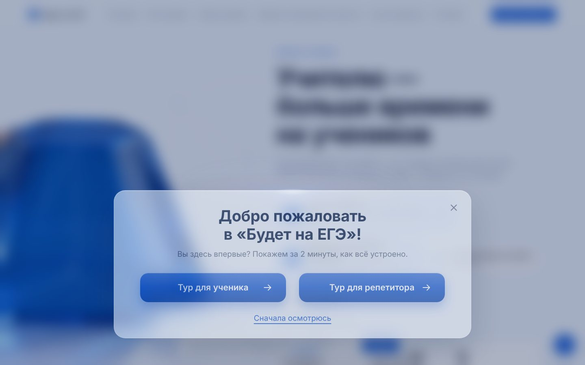
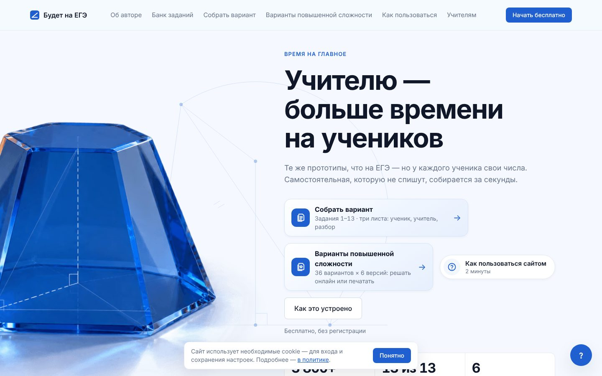

1. **Модалка онбординга на первом визите [объективно].** Что вижу: при первом заходе весь экран размыт до серой каши, по центру окно с двумя одинаковыми primary-кнопками «Тур для ученика» / «Тур для репетитора». Почему плохо: человек ещё не видел продукт, а его уже просят выбрать тур. Размытый фон даёт «мутную плёнку», а не стекло: под ним нет ни цвета, ни формы. Две равные синие кнопки означают, что главного действия нет. Как исправить: убрать модалку с первого экрана. Выбор роли сделать частью героя, двумя крупными «дверями» (см. п. 4). Если тур нужен, показывать его ненавязчивым тостом внизу справа через 20–30 с или после первого скролла, шириной 360 px и без затемнения.

2. **Три плавающих слоя поверх контента [объективно].** Cookie-плашка (`.cookie-notice`, ~560×64 px) встаёт по центру низа и перекрывает статистику «3 800+ / 13 из 13 / 6» (`18`). FAB «?» 52 px живёт отдельно. Как исправить: cookie-плашку прибить к левому нижнему углу, `max-width: 400px`, отступ 16 px, текст 13 px в две строки, кнопка «Ок» вторичная. FAB «?» на главной не нужен, в шапке уже есть «Как пользоваться». На мобильном FAB сейчас наезжает на кнопку «Понятно» (`04`).

   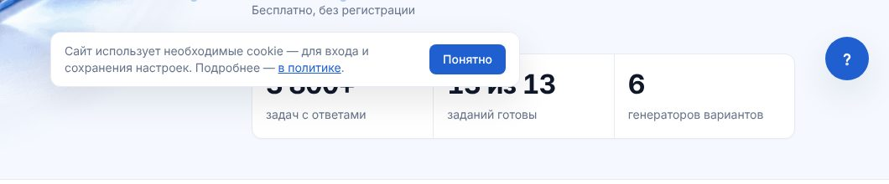

3. **Кристалл срезан и ничего не значит [вкус, но сильный].** Усечённая пирамида шириной ~520 px, срезанная левым краем на ~20%, с тонкими «чертёжными» линиями поверх. Это лучший по качеству объект на сайте, и он работает как обои. Почему плохо: срез левым краем читается как ошибка вёрстки, а не как приём (приёмом он стал бы при срезе на 40%+ или с выходом за верх). Как исправить: либо целиком в кадре и с ролью (это фигура из задачи №3 «Стереометрия»: подпишите рёбра, покажите сечение, пусть при скролле на гранях проявляется разметка), либо смелее, на 50% за край, и тогда он становится фоном, а не героем.

4. **Чертёжные линии кристалла пересекают текст [объективно].** Вертикальная линия и дуга окружности проходят сквозь лид «Те же прототипы, что на ЕГЭ — но у каждого…» и между карточками CTA. Как исправить: линии обрезать маской по колонке текста (`mask-image: linear-gradient(to right, #000 55%, transparent 62%)`) или увести под `z-index` подложки карточек.

5. **Перегруженный блок действий в герое [объективно].** Под лидом пять кликабельных объектов разного веса: две большие карточки-ссылки (446 и 354 px, разной ширины!), пилюля «Как пользоваться сайтом 2 минуты», кнопка «Как это устроено» и подпись «Бесплатно, без регистрации». Главного действия нет, а самая громкая кнопка сайта, «Начать бесплатно», живёт в шапке. Как исправить: одно primary-действие (кнопка высотой 52 px, padding 0 28 px, 17/600) и одна текстовая ссылка рядом. «Бесплатно, без регистрации» перенести под кнопку как 14/400, `color: text-secondary`. Карточки «Собрать вариант» и «Повышенная сложность» убрать из героя: они повторяются ниже через 600 px.

6. **Герой обращается только к учителю [объективно для продукта].** H1 «Учителю — больше времени на учениках», хотя у сайта две аудитории: тренажёр, диагностика и онбординг «Тур для ученика» сделаны для школьника. Как исправить: H1 про предмет, а не про роль (например «Профильная математика: каждый прототип ЕГЭ — с теорией, тренажёром и генератором»). Ниже две «двери» по 50% ширины колонки: «Я готовлюсь к ЕГЭ → тренажёр и диагностика» / «Я преподаю → варианты и бланки». Учительский слоган «больше времени на учениках» оставить второй строкой на двери учителя: там он бьёт точно.

7. **Блок «Мы взяли на себя то, что обычно забирает ваш вечер» [вкус].** Четыре колонки «01 Самостоятельные / Не спишут…». Подписи 14/400 серые, заголовки 17/500. Почему слабо: это четыре строки текста на 400 px высоты белого поля, визуально пусто. Сам текст хороший: «Не стыдно раздать» — лучшая фраза на сайте. Как исправить: показать, а не перечислить. Четыре мини-превью настоящего листа (ученик / учитель / разбор / бланк) в виде бумажных карточек 3:4, слегка повёрнутых (±1.5°), с реальными формулами. Под каждой эта короткая подпись. Так за секунду видно, что продукт реальный.

8. **Сетка разделов 01–13 [объективно + вкус].** 13 карточек 3×N, последняя одна в ряду. Карточки высотой 256 px, заголовок 17/500 сверху слева, иллюстрация справа, нижние 40% пустые. На ховере (`20`) появляется круглая стрелка, которая выровнена не по правому полю карточки (24 px), а по центру иллюстрации: висит в воздухе. Как исправить: высоту карточки уменьшить до 180 px, стрелку прижать к правому нижнему углу с тем же отступом, что у номера (24/24). 13-ю карточку растянуть на две колонки или добавить 14-ю «Часть 2 → 14–19». Номер «01» сейчас 32/600 синим: сделайте его табличными цифрами (`font-variant-numeric: tabular-nums`) и одним цветом с текстом, а синий оставьте только иллюстрации. Сейчас синий спорит сам с собой.

   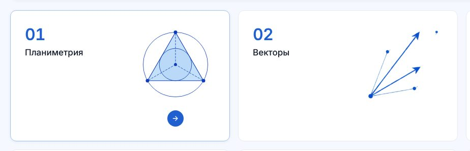

9. **Висячие предлоги [объективно].** «Только то, что будет на / экзамене», в лиде «Об авторе» «для подготовки к / ЕГЭ». Как исправить: типограф на сборке (`typograf` или свой `replace(/ (в|к|с|у|о|на|не|по|за|из|до|от|для|и|а) /g, ' $1 ')`) плюс `text-wrap: balance` для h1–h3 и `text-wrap: pretty` для абзацев.

10. **Футер [вкус].** Одна строка юридических ссылок 13 px и «Оператор персональных данных…». Это конец страницы, где сайт мог бы попрощаться. Как исправить: 3 колонки (Ученику / Учителю / О проекте), крупный wordmark 120–160 px светлым синим `blue-100` на всю ширину внизу, как делают Linear и Vercel. Юридическое — нижней строкой.

### 3.2. Главная, телефон 390

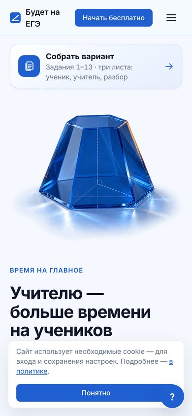

11. **Логотип ломается в две строки [объективно].** «Будет на / ЕГЭ». Как исправить: на <480 px кнопку «Начать бесплатно» в шапке убрать (она дублирует героя) или сократить до «Начать», логотипу задать `white-space: nowrap`. Шапка: 56 px высоты, логотип 15/600.

12. **Порядок блоков сломан [объективно].** Первое, что видит школьник, — карточка «Собрать вариант — ученик, учитель, разбор» над кристаллом и над H1. Как исправить: порядок «eyebrow → H1 → лид → кнопка → изображение (максимум 240 px высотой)». Сейчас кристалл съедает 600 px первого экрана.

13. **Тринадцать карточек в один столбец по 150 px [объективно].** Это ~2 100 px однообразного скролла с пустыми правыми половинами (`21`). В банке заданий (`07`) вы уже сделали две колонки, и там лучше. Как исправить: на главной тоже 2 колонки 171×132 px (номер 24/700, название 15/500, иллюстрация 56 px) или горизонтальный скролл-слайдер со `scroll-snap`.

    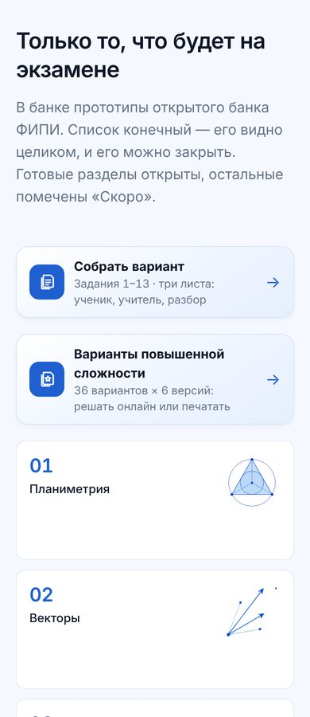

14. **Статистика 3 800+ / 13 из 13 / 6 — три строки по 100 px [вкус].** На телефоне это три пустые плитки подряд. Как исправить: один ряд из трёх ячеек, цифра 28/700, подпись 12/400.

### 3.3. Банк заданий `/zadaniya/`, десктоп

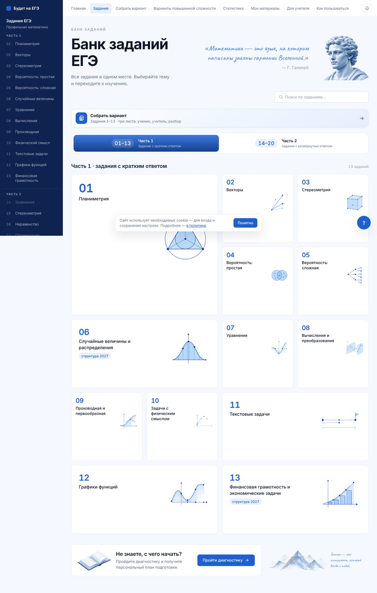

15. **Бенто без логики [объективно].** Карточка 01 «Планиметрия» занимает 2×2 (490×475 px) с иллюстрацией 140 px и 70% пустоты. 11, 12, 13 большие, 09 и 10 маленькие. Размер не связан ни с важностью, ни с количеством заданий, ни с готовностью. Бенто работает, когда размер означает что-то (Apple в бенто презентаций: крупно то, что главное). Как исправить: либо ровная сетка 4×4 (карточки 260×180), либо размер = объём раздела, и тогда в карточке видна цифра «640 задач» 13/500.

16. **Мраморный бюст + рукописная цитата Галилея [вкус + фактическая проблема].** Caveat синим курсивом, справа бюст. Почему плохо: (а) это эстетика мотивационных пабликов, она спорит с чистым UI и с 3D-стеклом главной; (б) цитата неточная: у Галилея в «Пробирных дел мастере» книга природы «написана на языке математики», а «законов гармонии Вселенной» там нет. Для математического сайта неточная цитата — удар по доверию. Как исправить: убрать бюст и цитату. Если нужна «душа» страницы, пусть это будет короткая заметка учителя на полях («Начните с №4 и №5 — это самые быстрые баллы») тем же Caveat, но терракотой и 18 px.

17. **Переключатель «Часть 1 / Часть 2» [объективно].** Активная половина — глянцевая градиентная плашка `blue-500 → blue-800` с тенью, неактивная белая. Градиент с бликом — язык кнопок 2012 года. Тень на сегмент-контроле отрывает его от подложки. Как исправить: сегмент-контрол высотой 48 px, подложка `grey-100`, активный сегмент белый, тень `0 1px 2px rgb(16 23 40 / .08)`, текст `text`. Так делает iOS, так делает Linear. Синий оставить только тексту «01–13».

18. **Блок «Не знаете, с чего начать?» [вкус].** Слева 3D-книга, справа полигональные горы и ещё одна рукописная фраза. Три стиля иллюстрации в одной полосе высотой 110 px. Как исправить: одна иллюстрация, и та же, что в системе (чертёж-линия), или никакой. Это главный CTA для новичка, поэтому шире и громче: на всю ширину, `surface-soft`, кнопка primary 52 px.

### 3.4. Задание №9 `/zadaniya/9/`

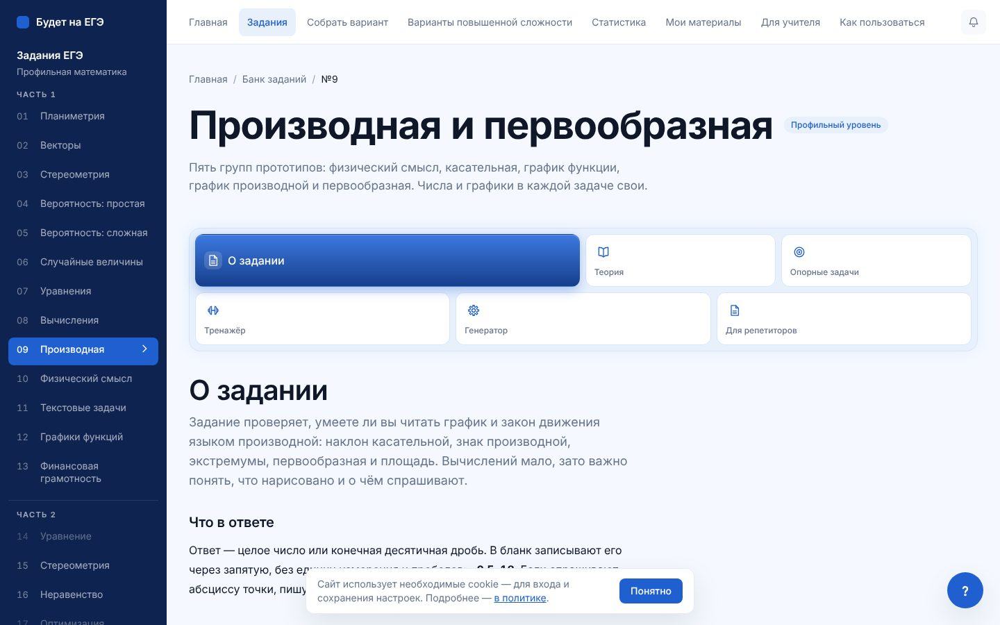

19. **Две навигации и сайдбар одновременно [объективно].** Сверху 9 пунктов, слева 22 пункта в тёмно-синем сайдбаре 240 px, ниже ещё 6 вкладок раздела. Три уровня навигации на первом экране. Тёмный сайдбар `navy-800` — самое тяжёлое пятно на странице, и он отвлекает от контента. Как исправить: сайдбар светлый (`surface` + граница 1 px `border`), номера табличными цифрами 13/500, активный пункт — заливка `blue-50` и полоска 2 px слева, без белого шеврона. Верхнюю навигацию на внутренних страницах сократить до 5 пунктов (Задания, Вариант, Статистика, Материалы, ещё…).

20. **Вкладки раздела — разнобой [объективно].** Шесть вкладок в бенто 3+3 разной ширины. Активная «О задании» — иконка и текст в строку, 17 px, градиент. Остальные — иконка сверху и подпись 13 px снизу. Активная вкладка меняет не только цвет, но и раскладку, а при переходе в «Тренажёр» (`11`) она становится маленькой: сетка прыгает. Как исправить: вкладки-строка (tabs) высотой 44 px, 15/500, иконка 18 px слева с отступом 8 px, активная с подчёркиванием 2 px `primary` или белой «таблеткой» на сером сегменте. Все одной ширины по контенту. Вкладки не должны быть визуально громче H1.

21. **H2 «О задании» повторяет название активной вкладки [объективно].** 40/600 сразу под вкладкой с тем же текстом. Как исправить: убрать, начать сразу с лида 18/400.

22. **Список типов: 40 одинаковых строк [вкус, но важный].** Строки 44 px, `blue-50`, номер 9.4.7 жирным, текст 14/600, справа «Пример ⌄». Монотонно, глазу не за что держаться. Как исправить: в каждой группе показывать мини-превью графика (у вас есть отрисовка, она отличная, см. тренажёр) 64×48 px слева от строки. Текст строки 15/500, номер 13/500 табличный, `text-tertiary`. Убрать заливку у строк (оставить разделители 1 px): заливка × 40 = шум.

23. **«Типичные ошибки» — лучшее место на странице.** См. «Что сохранить».

### 3.5. Тренажёр `/zadaniya/9/trenazher/`

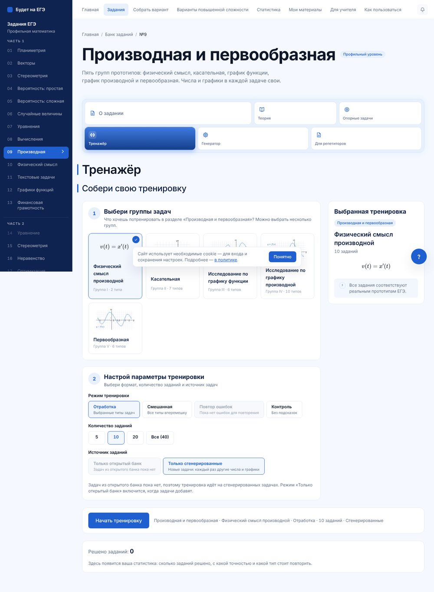

24. **Двойной заголовок с синими полосками слева [объективно].** «Тренажёр» 40 px и «Собери свою тренировку» 32 px, оба с вертикальной полосой 4 px. Два H2 подряд с декором — заголовок ничего не значит. Как исправить: один H2 «Собери тренировку», без полосы.

25. **«Ты» и «вы» вперемешку [объективно].** «Выбери группы задач» / «Пройдите диагностику» / «Нажмите на тип». Как исправить: школьнику на «ты» (тренажёр, диагностика, статистика), учителю на «вы» (вариант, бланки, «Для репетиторов»). Зафиксировать правило в `docs/` рядом с токенами.

26. **Состояния выбора слабые [объективно].** Выбранная опция «Отработка»: обводка 1 px `primary`, синий текст и почти незаметная заливка. Неактивная «Повтор ошибок» отличается от обычной только серым текстом. Как исправить: выбранная — заливка `blue-50`, обводка 2 px, галочка 16 px в правом верхнем углу (как у карточки «Физический смысл производной», где это уже сделано). Неактивная — `opacity: .5`, курсор `not-allowed`, подсказка «появится после первой ошибки» в `title` и видимым текстом.

27. **Пятая карточка-сирота [объективно].** Ряд из 4 карточек и «Первообразная» одна во втором ряду. Как исправить: 5 колонок по 150 px (ширины хватает) или 3+2 с растянутыми.

28. **Кнопка «Начать тренировку» [вкус].** Это главная кнопка всего продукта для школьника, а она 48 px высотой в обычной белой полосе, рядом строка-резюме 14 px серым. Как исправить: sticky-панель внизу экрана (как корзина), кнопка 56 px, 17/600, в терракоте или синем с иконкой «▶». Резюме превратить в чипы. Здесь должно быть ощущение «поехали», как у Duolingo на кнопке «Начать урок».

### 3.6. «Об авторе» `/about/`

29. **Коллаж в герое [вкус, сильное мнение].** Фото на вырезе + мраморный бюст + стеклянный кристалл + рукописная фраза + формула от руки + «сеть» из точек и линий на фоне. Шесть разнородных объектов. Почему плохо: читается как обложка курса из рекламы в соцсетях, а не как страница эксперта. Фото снято в студийной манере: идеальный свет, вырез, планшет в руках. Оно выглядит постановочным, почти стоковым. Для страницы «Я создала…» это проблема доверия: человек хочет увидеть живого учителя. Как исправить: одно настоящее фото в контексте (у доски, с тетрадями учеников, в гимназии), в кадре, без выреза, формат 4:5, `border-radius: 20px`. Никаких бюстов и кристаллов. Одна рукописная ремарка максимум, и она — подпись.

30. **Иконки-регалии 12 px [объективно].** «Учитель по призванию / Математическое образование / Реальный опыт / Эксперт ЕГЭ»: иконки в кружках 44 px, подписи 12/400 серые. Это самые сильные аргументы страницы, а набраны они мельче всего. Как исправить: превратить в факты с цифрами («8 лет в школе», «Эксперт ЕГЭ с 20XX», «Гимназия „Сократ“»), 20/600 + подпись 14/400. Иконки убрать.

31. **Таймлайн — хорошая идея, исполнение плоское [вкус].** 5 колонок одинаковой ширины, точки 8 px на линии 1 px. «ОлМАТ» помечен как «параллельно» пунктирной ниткой вниз, и это не читается. Как исправить: шаг ровный, линия 2 px `blue-200`, текущая точка («с 2025 Гимназия „Сократ“») 12 px, залитая терракотой. Параллельный ОлМАТ — второй дорожкой под основной.

32. **После героя страница превращается в Word [объективно].** Шесть секций подряд по схеме «H2 40 px + серый абзац 15 px», между ними фоновые полосы `ice`/`white`. Нет ни одного доказательства: ни скриншота листа, ни отзыва, ни результата учеников. Как исправить: вырезать 3 секции из 6 («Я знаю эту проблему», «Инструмент, которым хотелось бы пользоваться самой», «Что для меня важно» — это один текст). Вставить: реальный лист варианта (бумага, превью), 2–3 цитаты коллег или учеников с именами, цифры.

### 3.7. «Собрать вариант» `/variant/`

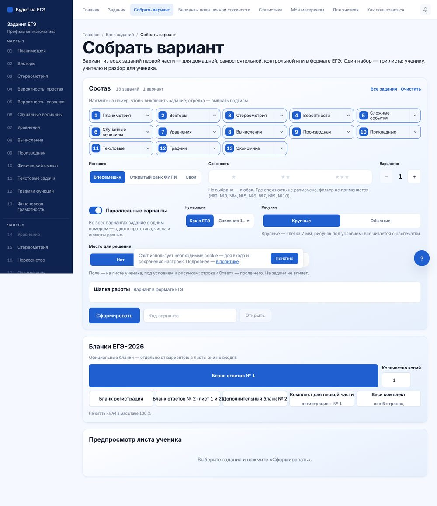

33. **Подписи бланков налезают друг на друга [объективно, баг].** «Бланк ответов № 2 (лист 1 и 2)Дополнительный бланк № 2» — текст выходит за кнопку и склеивается с соседней. Как исправить: `min-width: 0; overflow-wrap: anywhere;` и перенос внутри кнопки, или сетка `repeat(auto-fit, minmax(220px, 1fr))`.

    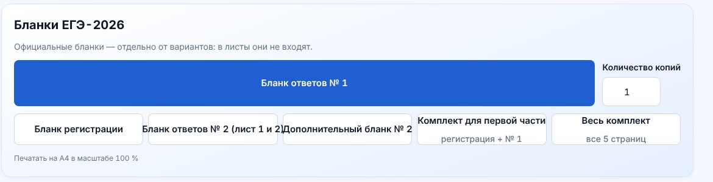

34. **Выбранный бланк выглядит как главная кнопка страницы [объективно].** «Бланк ответов № 1» — сплошная синяя полоса 950×76 px, самый тяжёлый элемент на экране, тяжелее «Сформировать». Как исправить: выбранное состояние — как в п. 26 (заливка `blue-50` + обводка 2 px + галочка). Сплошной синий только у одного действия на экране.

35. **Лид 1 136 px шириной [объективно].** ~150 знаков в строке при норме 60–75. И между H1 и лидом 0 px. Как исправить: `max-width: 64ch`, `margin-top: 12px`.

36. **Звёзды сложности почти не видны [объективно].** ★ серым `grey-300` на белом, контраст ~1.5:1. Как исправить: `grey-500` для неактивных, `amber-600` для выбранных, размер 16 px, подпись «Базовая / Средняя / Сложная» 13/500 под звёздами.

37. **Предпросмотр — пустая плашка с текстом [вкус].** «Выберите задания и нажмите „Сформировать“». Это место для вау: пусть до нажатия там стоит призрачный лист A4 (скелетон с линиями формул), а после — настоящий, с анимацией «печати» сверху вниз за 400 мс.

### 3.8. Сквозное: типографика, детали, стекло, цвет

38. **Типографическая шкала размазана [объективно].** На одной странице №9 размеры 11, 12, 13, 13.5, 13.7, 14, 15, 16, 17, 19.36 (KaTeX), 20, 40, 56 px. Между 17 и 20, 14 и 15, 13 и 14 разницу глаз не видит, это шум, а не иерархия. Как исправить: шкала из 7 ступеней — 13 / 15 / 17 / 20 / 28 / 40 / 64 (мобильный: 13 / 15 / 16 / 18 / 24 / 32 / 40). Веса только 400 / 500 / 700, без 600: так контраст «жирный заголовок — лёгкий текст» станет резче. KaTeX привести к `1.05em` от текста, а не к фиксированным 19.36 px.

39. **Inter везде [вкус, но принципиально].** Inter — хороший шрифт, но это шрифт по умолчанию всего интернета 2020-х. Кириллица у него узнаваемо «техническая». Предложения — в арт-дирекшне ниже.

40. **Радиусы [объективно].** В ходу 5, 8, 12, 16, 999 px и 50%. Кнопки 8, карточки 12, панели 16 — это нормально, но вложенные элементы не следуют правилу «внутренний = внешний − отступ». Чипы 8 px внутри панели 16 px с паддингом 20 px выглядят «острыми». Как исправить: панели 20, карточки 14, кнопки и поля 10, чипы 999. 5 px убрать.

41. **Фокус [почти хорошо].** `:focus-visible` есть, это уважение к людям. Но в шапке кольцо прилегает к тексту вплотную. Как исправить: `outline: 2px solid var(--color-primary); outline-offset: 3px; border-radius: 6px`.

42. **Стекло: где оно работает и где нет.**
    - *Работает:* 3D-рендеры. Кристалл в герое, стеклянные иллюстрации к теории вероятностей (`assets/img/probability`), стеклянный лотос в интро — по технике это уровень студии. Синее стекло + тёплая оранжевая подсветка изнутри — готовая фирменная идея.
    - *Не работает:* в интерфейсе стекла нет вообще (`backdrop-filter` — 1 элемент на главной, 0 на внутренних). Его подменяют глянцевые градиенты на активных вкладках и сегментах (`blue-500 → blue-800` + тень): это не стекло, а пластик. Размытый фон модалки онбординга — «мутная плёнка»: под ним серое, а стекло красиво только тогда, когда за ним есть цвет.
    - *Как исправить:* стекло в UI ровно в трёх местах, где под ним что-то есть. (1) Шапка при скролле над контентом: `background: rgb(245 249 255 / .72); backdrop-filter: blur(16px) saturate(1.4)`, граница снизу 1 px `rgb(255 255 255 / .6)`. (2) Нижний таб-бар на мобильном, так же. (3) Плашки поверх 3D-рендеров (подписи к кристаллу). Всё остальное — честные непрозрачные поверхности. Так делает Apple в iOS 26: стекло только на слое управления над контентом, никогда не на самом контенте.

43. **Цвет [объективно по пропорциям].** Палитра заявлена «синий + оранжевый + терракота», а в интерфейсе терракота сознательно запрещена (`tokens.css`: «В интерфейсе не используется — кнопки и ссылки синие»). В итоге на экране 95% синего и серого, и оранжевый появляется только в «Типичных ошибках» и на чертежах. Синий при этом работает всем сразу: ссылки, кнопки, номера, иконки, иллюстрации, активные вкладки, сайдбар. Когда синее всё, синее ничего не значит. Как исправить: пропорция 70 / 20 / 8 / 2. 70% — светлые нейтральные (`ice`, `white`), 20% — тёмный текст и navy, 8% — синий (только интерактив и чертежи), 2% — терракота: одна точка внимания на экран (главная кнопка тренажёра, текущий шаг, «проверяемая точка» на чертеже, отметка «сегодня»). Оранжевый — свет внутри стекла на рендерах, в UI не нужен.

44. **Анимации [вкус].** 28 `@keyframes`, `prefers-reduced-motion` уважается — отлично. Но на ключевых экранах движения не видно вовсе: карточки появляются статично, ховер — только стрелка. Предложения в арт-дирекшне.

---

## 4. Что сохранить обязательно

1. **Чертежи-иконки разделов** (треугольник с вписанной окружностью, векторы, куб, Венн, дерево, нормальное распределение). Одна толщина линии, одни точки-узлы, полупрозрачная заливка `blue-200`. Это единственный по-настоящему фирменный графический язык сайта, и он про математику, а не «про образование вообще». На нём строить всё.
2. **Графики в тренажёре и теории** (касательная терракотой, сетка, подписи `y = f(x)` курсивом KaTeX). Уровень Desmos. Терракотовая «проверяемая» прямая на синей сетке — ровно та пропорция цвета, которой не хватает остальному сайту.
3. **3D-стекло с тёплым светом внутри** (кристалл, лотос, иллюстрации к вероятности). Техника отличная. Проблема не в них, а в том, что они стоят рядом с бюстами и фото.
4. **«Типичные ошибки»** на №9: кремовые карточки с терракотовой рамкой, короткий заголовок-диагноз + объяснение с формулой. Тёплый цвет здесь значит «внимание», и это работает. Сделать этот блок шаблоном для всех разделов.
5. **Голос текстов.** «Не спишут. У каждого свои числа», «Не стыдно раздать», «Мы взяли на себя то, что обычно забирает ваш вечер». Коротко, по-человечески, без канцелярита. Редкость для образовательных сайтов, держаться за это.
6. **Мобильный нижний таб-бар** (Главная / Банк / Статистика / Ещё) и двухколоночная сетка банка на 390 px — правильные решения.
7. **Дисциплина токенов** (`tokens.css` с семантикой и запретом утилит мимо системы) и `:focus-visible`/`reduced-motion`. Это фундамент, на котором редизайн займёт недели, а не месяцы.

---

## 5. Арт-дирекшн: три направления

Во всех трёх палитра остаётся: синий `#1F5FD0`, navy `#0E2350`, терракота `#E07A2F`, оранжевый свет только в рендерах.

### Направление A. «Чертёж» (Blueprint precision)

**Настроение:** точность, ясность, уважение к предмету. Сайт как идеально оформленный чертёж на миллиметровке: белое поле, тонкие синие линии, одна терракотовая точка «вот здесь ответ».

**Как выглядит:**
- фон `#F7F9FC` с едва заметной миллиметровой сеткой 8 px (`blue-grid` на 4% непрозрачности) только в героях разделов;
- все иллюстрации — чертежи в стиле ваших иконок разделов, линия 1.5 px; 3D-стекло только одно на страницу, как «экспонат» в рамке с подписями-выносками;
- карточки без теней: граница 1 px `grey-200`, на ховере граница `blue-300` и сдвиг иллюстрации на 4 px;
- номера заданий крупно, моноширинным шрифтом, как на полях чертежа: «№ 09».

**Шрифты:** **Onest** (кириллица родная, геометричный, теплее Inter, бесплатный на Google Fonts) — заголовки 700, текст 400. **JetBrains Mono** — номера, счётчики, коды вариантов, табличные цифры. KaTeX для формул оставить.

**Анимации:** «прорисовка» — линии чертежей рисуются через `stroke-dashoffset` за 600 мс при входе в зону видимости. В герое кристалл медленно поворачивается при скролле (видео-секвенция или 2–3 кадра, 0.3° на 10 px). Переходы между вкладками 180 мс `cubic-bezier(.2,.8,.2,1)`, без пружин.

**Референсы:**
- **Linear** (linear.app): контраст крупного заголовка и мелкого серого текста, линии 1 px вместо теней, одна тёмная секция-акцент на странице;
- **Stripe** (stripe.com, страницы продуктов): анимированные схемы, которые «рисуются» при скролле;
- **Desmos** (desmos.com): как выглядит график, которому доверяешь;
- **Apple Education** (apple.com/education): один объект в кадре, много воздуха, подписи-выноски к деталям.

**Почему не будет «очередным сгенерированным лендингом»:** визуальный язык растёт из ваших собственных чертежей, а не из библиотеки иконок. Ни у кого на рынке ЕГЭ нет сайта, где каждая картинка — настоящая задача.

**Плюсы:** максимально честно предмету, дёшево в производстве (чертежи у вас уже генерируются кодом), отлично масштабируется на 13 разделов и ОГЭ/физику. Учителя оценят сразу.
**Риски:** может стать холодным и «для отличников». Подросток не улыбнётся. Лечится терракотовыми акцентами и рукописными ремарками учителя на полях.

### Направление B. «Тетрадь учителя» (Editorial warm)

**Настроение:** личная методика сильного преподавателя. Как хорошая книга-задачник от авторского издательства: бумага, поля, заметки красной (терракотовой) ручкой.

**Как выглядит:**
- фон тёплый `#FBF8F3` (бумага), синий только у интерактива;
- заголовки — антиква, крупно, с плотной трекинговой посадкой;
- терракота становится «ручкой учителя»: подчёркивания, обводка ключевого шага, ремарки Caveat на полях (одна на экран, не больше);
- листы вариантов показаны как настоящая бумага с тенью и лёгким поворотом;
- 3D-стекло почти уходит, остаётся в интро и на 404.

**Шрифты:** **Literata** или **Source Serif 4** (обе с кириллицей) для H1–H2, **Onest** или **Golos Text** для интерфейса, **Caveat** только для ремарок учителя (у вас он уже есть).

**Анимации:** спокойные. Появление блоков снизу на 8 px с проявлением за 300 мс, ремарки «дописываются» по буквам за 500 мс, подчёркивания прорисовываются слева направо.

**Референсы:**
- **Stripe Press** (press.stripe.com): как антиква делает цифровой продукт «книжным» и дорогим;
- **Brilliant** (brilliant.org): учебные карточки с иллюстрацией и коротким вопросом, тёплая подача;
- **3Blue1Brown** (3blue1brown.com): тёмные и тёплые акценты на математической графике.

**Плюсы:** сильнее всего передаёт, что за сайтом стоит конкретный учитель, а не платформа. Отлично для «Об авторе» и для доверия родителей.
**Риски:** антиква плохо живёт в плотном интерфейсе (генератор, тренажёр, 40 типов заданий). Придётся держать два режима: «журнальный» снаружи и «инструментальный» внутри. Подростку скучновато.

### Направление C. «Живое стекло» (Playful glass)

**Настроение:** игра и прогресс. Математика как предмет, который можно взять в руки: стеклянные объекты реагируют на действия ученика.

**Как выглядит:**
- 3D-стекло — главный герой: у каждого раздела свой стеклянный объект (куб для №3, кубики для №4, ваза-парабола для №7), в карточках вместо плоских иконок;
- крупные «тактильные» кнопки высотой 56 px с нижней кромкой 3 px темнее (как у Duolingo), пружинный отклик на нажатие;
- прогресс и серия дней у ученика, кольца прогресса по разделам;
- настоящий `backdrop-filter` на панелях поверх цветных рендеров.

**Шрифты:** **Unbounded** (кириллица, широкий, с характером) только для чисел и H1, **Manrope** для всего остального.

**Анимации:** пружины (`spring(1, 180, 18)`), стекло слегка покачивается при ховере (2–3°), конфетти-«осколки» стекла при правильном ответе, бейджи за серии.

**Референсы:**
- **Duolingo**: тактильные кнопки, моментальная обратная связь, серия дней;
- **Brilliant**: интерактивные объекты внутри задачи;
- **Apple Liquid Glass (iOS 26)**: где стекло уместно в UI;
- **Raycast** (raycast.com): стекло и свечение на тёмном фоне без «мутной плёнки».

**Плюсы:** максимальное вовлечение школьника, вау-моменты, у вас уже есть пайплайн 3D-рендеров.
**Риски:** дорого в производстве (по объекту на раздел × 13+), тяжело по весу страниц, быстро стареет. Учитель может счесть «несерьёзным». Легко скатиться в «эффект ради эффекта».

### Что выбрал бы я

**A «Чертёж» как основа, плюс два элемента из B и один из C.**

- Из **A** — система: Onest + JetBrains Mono, чертежи как единственный иллюстративный язык, линии вместо теней, синий только для интерактива.
- Из **B** — терракотовая «ручка учителя»: одна рукописная ремарка Caveat на экран, подчёркивания и обводка «проверяемой точки». Это даёт человечность и тот самый 2% акцента.
- Из **C** — одно 3D-стекло на страницу в роли экспоната (кристалл в герое, лотос в интро, объект раздела в его шапке), и тактильная кнопка с прогрессом только в тренажёре, где это нужно школьнику.

Почему: ваш главный актив — математически точная графика, которую генерирует код. Направление A превращает это в бренд, а не в декор. Оно дешевле всего в производстве и единственное масштабируется на ОГЭ и физику без новой иллюстрации на каждый раздел. B и C в чистом виде либо ломают инструментальную часть (B), либо требуют бюджета и стареют за год (C).

---

## 6. План

### Быстрые победы (за день, максимум эффекта)

| # | Что | Где | Эффект |
|---|---|---|---|
| 1 | Убрать модалку онбординга с первого визита, тур — тостом после скролла | `components/onboarding` | Первый экран снова виден |
| 2 | Cookie-плашка в левый нижний угол, `max-width: 400px`; FAB «?» убрать с главной | `CookieNotice.tsx`, FAB | Ничего не перекрывает цифры и кнопки |
| 3 | Починить переполнение подписей бланков (`min-width: 0`, перенос) | `/variant/` | Баг уходит |
| 4 | Выбранный бланк и опции тренажёра — `blue-50` + обводка 2 px + галочка вместо сплошного синего | `/variant/`, тренажёр | Одно primary-действие на экран |
| 5 | Лид `/variant/` — `max-width: 64ch`, `margin-top: 12px` | `section-head__lead` | Читается |
| 6 | Типограф: неразрывные пробелы после предлогов; `text-wrap: balance` у h1–h3 | глобально | Нет висячих «на», «к» |
| 7 | Мобильная шапка: `nowrap` у логотипа, убрать «Начать бесплатно»; на внутренних страницах вернуть логотип слева | `layout` | Бренд виден, шапка не ломается |
| 8 | Мобильный порядок героя: H1 → лид → кнопка → кристалл ≤ 240 px | главная | Понятно за 3 секунды |
| 9 | Мобильная сетка разделов на главной — 2 колонки как в банке | главная | −1 500 px скролла |
| 10 | Сегмент-контролы и вкладки без градиента и тени: серая подложка, белый активный | `components.css` | Уходит «пластик 2012» |
| 11 | Убрать бюст и цитату Галилея с банка; бюст, кристалл и рукописные фразы — с героя «Об авторе» | `/zadaniya/`, `/about/` | Минус два чужих стиля |
| 12 | Один H2 в тренажёре без полосок; правило «ученику — ты, учителю — вы» | тренажёр | Тон ровный |
| 13 | Звёзды сложности: `grey-500` / `amber-600`, 16 px, подписи | `/variant/` | Видно |
| 14 | Стрелка ховера карточки — в правый нижний угол, отступ 24 px; высота карточек 180 px | карточки разделов | Пиксельная аккуратность |

### Большие изменения (2–6 недель)

1. **Выбрать направление и собрать мини-гайд.** Шрифты, шкала 13/15/17/20/28/40/64, веса 400/500/700, радиусы 10/14/20, пропорция цвета 70/20/8/2, где можно стекло (3 места). Обновить `tokens.css` и `/styleguide`. Неделя.
2. **Новый герой главной с двумя «дверями»** (ученик / учитель) и одним 3D-экспонатом, который «объясняет» себя подписями и разметкой при скролле.
3. **Блок «Покажи, а не расскажи»:** реальные превью листов (ученик / учитель / разбор / бланк) вместо четырёх строк текста. И то же на «Об авторе».
4. **Навигация внутренних страниц:** светлый сайдбар, верхнее меню 5 пунктов, вкладки раздела — строкой. Одинаковый каркас для всех 19 заданий.
5. **Страница задания как шаблон:** превью-графики у каждого типа, «Типичные ошибки» во всех разделах, понятный путь «теория → опорные задачи → тренажёр».
6. **Тренажёр для подростка:** sticky-кнопка «Поехали», прогресс по разделу, серия дней, мгновенная обратная связь с анимацией (галочка + терракотовая подсветка ошибки на чертеже). Ориентир — Duolingo и Brilliant, но без маскотов.
7. **«Об авторе» заново:** настоящее фото в контексте, факты цифрами, таймлайн с двумя дорожками, доказательства (листы, отзывы с именами). Половина нынешнего текста уходит.
8. **Моушн-система:** «прорисовка» чертежей через `stroke-dashoffset`, единая кривая `cubic-bezier(.2,.8,.2,1)`, длительности 180 / 300 / 600 мс, всё за `prefers-reduced-motion`.

---

*Скриншоты в `design-crit/` сняты со сборки текущей ветки. `01` — первый визит (с онбордингом), остальные — с закрытым онбордингом, как увидит вернувшийся пользователь.*
