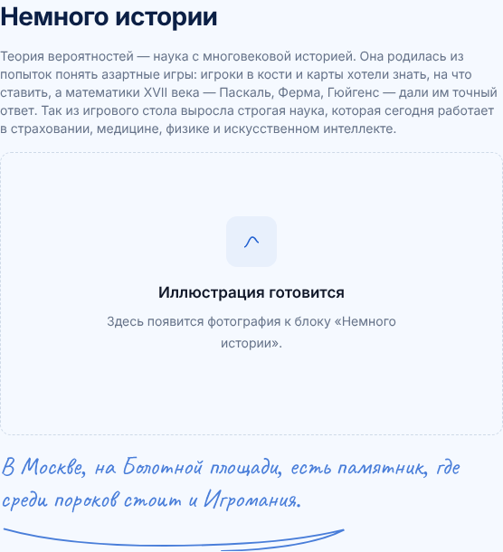
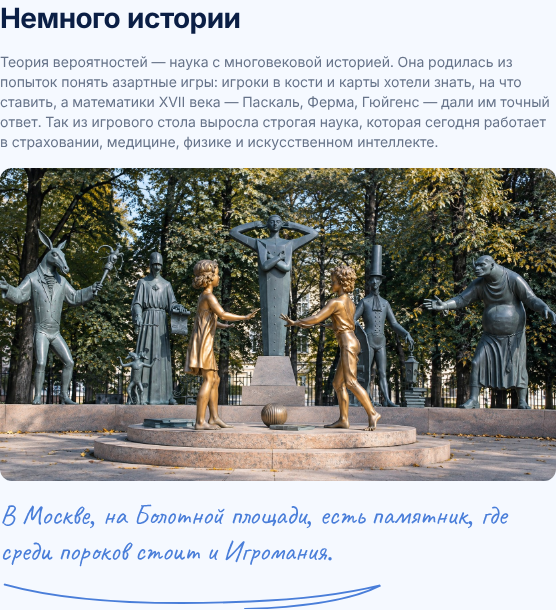

# Пропавшая иллюстрация в «Немного истории» (№4): причина, правка, проверка

## Что было

На странице «Задание №4 → О задании», в блоке «Немного истории» вместо
фотографии стояла заглушка «Иллюстрация готовится. Здесь появится
фотография к блоку «Немного истории»». Та же беда была на странице
«Задание №4 → Теория»: вместо портрета Эйлера стояло «Иллюстрация
готовится. Портрета пока нет».

| До (заглушка) | После (фото на месте) |
|---|---|
|  |  |

## Причина

Файл не удалялся и не терялся. Он на месте:
`app/public/images/zadanie-04/pamyatnik-porokam.jpg`, добавлен в репозиторий
20 сентября коммитом `d7230da9` («Add files via upload», автор — владелец
репозитория). В `.gitignore` и в `_sources` его нет, при чистке сторонних
материалов (`057b7bc8`, 5 октября) он не затрагивался: в том коммите
удалены задачники и скриншоты курса, фотографий среди них нет.

Картинка пропала **4 октября, коммитом `3b28bc9e`** («Версии в ссылках на
PDF и картинки из public/»). Он обернул адреса картинок в `assetUrl()`,
которая дописывает версию: `/images/…/pamyatnik-porokam.jpg?v=<хеш>`. Но
компоненты, решавшие, показывать ли фото или заглушку, проверяли наличие
файла через `fs.statSync(public + адрес)`, то есть искали на диске файл
с именем `…jpg?v=<хеш>`. Такого файла нет, проверка всегда возвращала
«нет», и сборка подставляла заглушку. Заглушка рендерится на сервере
при сборке, поэтому в консоли браузера ошибок не было, а в `index.html`
оказалась готовая надпись. Тот же дефект сломал портрет Эйлера
(`KakIzobrazhatSobytiya.tsx`). Ни одна проверка этого не заметила: тест
`test:asset-versions` проверяет только версии у существующих файлов.

## Правка

- `lib/assetUrl.ts`: новая функция `bezVersii()` отрезает `?v=…` и `#…`;
  обе проверки наличия файла (`OZadanii4.tsx`, `KakIzobrazhatSobytiya.tsx`)
  идут по пути без версии. Это те же правки, что в #144; коммит перенесён
  как есть, чтобы PR сливались без конфликта.
- Файлы-картинки не менялись: замена не нужна, картинки не убирались как
  сторонние.

## Происхождение фотографии

Файл загружен владельцем репозитория. На фото — скульптурная композиция
«Дети — жертвы пороков взрослых» (Болотная площадь, Москва). Скульптура
стоит в общественном месте, и статья 1276 ГК РФ разрешает её
фотографировать и использовать снимки; права на сам снимок принадлежат
фотографу.

- автор снимка: не указан
- разрешение на использование: **есть, подтверждено владельцем
  репозитория 11 октября 2026** (в чате сессии); документа в репозитории
  нет

Замена не требуется.

## Весь сайт

Проверка собранного сайта (291 страница, 289 адресов картинок):

| Страница | Блок | Что было | Состояние |
|---|---|---|---|
| `/zadaniya/4/` | «Немного истории» | заглушка «Иллюстрация готовится» | исправлено |
| `/zadaniya/4/teoriya/` | «Как изображать события», портрет Эйлера | заглушка «Портрета пока нет» | исправлено |

Других заглушек с картинкой на сайте нет. Битых картинок (адрес есть,
файла нет) нет: все 289 адресов картинок из страниц, данных роутера
и кода отвечают 200 с типом `image/*`. Надписи «Материал готовится» и
«Раздел готовится» в списке не учитывались: это заглушки текстовых
разделов, а не картинок.

## Проверка в CI

`pnpm test:illustrations` (`scripts/check-illustrations.mjs`, шаг
в `.github/workflows/check.yml` после сборки) падает, если:

1. в HTML собранных страниц есть «Иллюстрация готовится», «Портрета пока
   нет» или «Здесь появится фотография»;
2. любой адрес картинки из страниц, данных роутера (`index.txt`), кода
   и стилей отвечает не 200 или не `image/*`. Файлы `out/` отдаёт
   настоящий HTTP-сервер.

Проверено на трёх случаях:

- на `main` без правки проверка падает на четырёх заглушках;
- с правкой проходит;
- если убрать из сборки `igralnye-kosti.webp`, падает с ответом 404.

Новую заглушку для картинки нужно добавить в список `ZAGLUSHKI` в скрипте.
