# Дизайн-аудит «Будет на ЕГЭ» — взгляд студии

Этап 1 из трёх. Код не менялся. Сайт собран из ветки `main` (14.11.2026) и пройден в Chromium через
Playwright на 375 px (телефон, ×2) и 1440 px. Скриншоты «как есть» — в `docs/design-audit/`.

Оценки: **эффект** — насколько правка меняет впечатление (высокий / средний / низкий); **труд** — S (до
полудня), M (1–2 дня), L (3+ дня).

Что не трогаем (и это правильно): палитра, «Стеклянная сцена», интро первого визита, бюст и рукописные
цитаты только на «Об авторе», все существующие картинки.

---

## Главный вывод

У сайта сильные отдельные экраны («Об авторе», тарифы, шапка №3, карта-льдины) и очень слабая
**цельность**. Дорого выглядит не тот сайт, где есть красивый герой, а тот, где сотая страница собрана
теми же руками, что и первая. Сейчас это пять сайтов под одним логотипом:

1. главная — стекло, свечения, глянцевые «таблетки»;
2. банк и разделы — тёмно-синий сайдбар, плоские белые карточки, прямоугольные кнопки с радиусом 8;
3. разделы после редизайна (№3, 7, 8) — снова стекло, но с другими кнопками (`stk-btn`);
4. «Собрать вариант» — оранжевая главная кнопка, свои плитки;
5. «Повышенные» / «Ежемесячные» — третья шапка, плоские синие «таблетки».

Второе по важности: **ученик на телефоне не видит задачу**. В тренажёре после старта весь первый экран
занят заголовком раздела, плашками и восемью плитками вкладок — условие начинается на 835-м пикселе.
Это главный экран продукта, и он проигрывает собственной навигации.

Третье: на витрине живут **обещания, которых нет**: «Пройти диагностику» в банке, «Статистика» в нижней
панели, «Материалы» и «Учитель» в меню — всё ведёт в заглушку «Раздел в разработке». Плюс английская страница 404
от фреймворка.

---

## Топ-15 по соотношению «эффект / труд»

| №   | Что сделать                                                                                                                                                  | Эффект  | Труд | Раздел отчёта |
| --- | ------------------------------------------------------------------------------------------------------------------------------------------------------------ | ------- | ---- | ------------- |
| 1   | Тренажёр на телефоне: во время сессии свернуть шапку раздела и вкладки, задача — с первого пикселя экрана                                                    | высокий | M    | 9.1           |
| 2   | Своя страница 404 на русском, в стекле, с тремя выходами                                                                                                     | высокий | S    | 14.1          |
| 3   | Убрать тупики: «Пройти диагностику», «Статистика» в нижней панели, пункты меню на заглушки                                                                   | высокий | S    | 13.1          |
| 4   | Одна шапка раздела вместо шести (образец — №3) и одна строка вкладок с прокруткой вместо плиток в три ряда                                                    | высокий | L    | 6.1, 6.2      |
| 5   | Одна главная кнопка на весь сайт (глянцевая «таблетка» `--gloss`) вместо пяти видов                                                                          | высокий | M    | 1.2           |
| 6   | Главная, телефон: карточки «Мы взяли на себя…» — в одну колонку; сейчас «Самостоятельные» вылезает за карточку                                               | средний | S    | 2.3           |
| 7   | Банк заданий: убрать «бенто» с пустыми карточками 540×540; ровная сетка, иллюстрация крупнее                                                                 | высокий | M    | 5.1           |
| 8   | Полоса показателей: «180 минут» обрезается, «1 из 21 заданий готовы» работает против сайта                                                                   | средний | S    | 2.4           |
| 9   | Кнопка «?» перекрывает содержимое на каждом экране телефона — уменьшить и убрать с учебных экранов                                                           | средний | S    | 1.5           |
| 10  | Типографическая шкала: 30 разных кеглей → 9 токенов; заголовки h1 одного веса (640) на всех страницах                                                        | средний | M    | 1.3           |
| 11  | «О задании», телефон: разобранный пример без тройной вложенности карточек (+56 px ширины текста)                                                             | средний | M    | 7.1           |
| 12  | Тарифы: выровнять колонки таблицы сравнения; на телефоне первой показывать бесплатную карточку                                                               | средний | S    | 4.1, 4.2      |
| 13  | Главная: блок «путь ученика» и финальный призыв — сейчас страница обрывается списком заданий                                                                 | высокий | M    | 2.6           |
| 14  | Три переключателя «Профиль / База» на одном экране → один                                                                                                    | средний | S    | 1.6           |
| 15  | Перевести банк и оболочку кабинета на стекло главной (фон-свечения, стеклянные карточки; тёмный сайдбар — с глянцевым активным пунктом) — снимает ощущение «двух сайтов» | высокий | L    | 1.1           |

Пункты 1–3, 6, 8, 9, 12 — это неделя работы, и сайт перестаёт выглядеть недоделанным. Пункты 4, 5, 10,
15 — системные: после них он начинает выглядеть дорогим.

---

## 1. Сквозные проблемы (вся система)

### 1.1. Два визуальных мира · эффект высокий · труд L

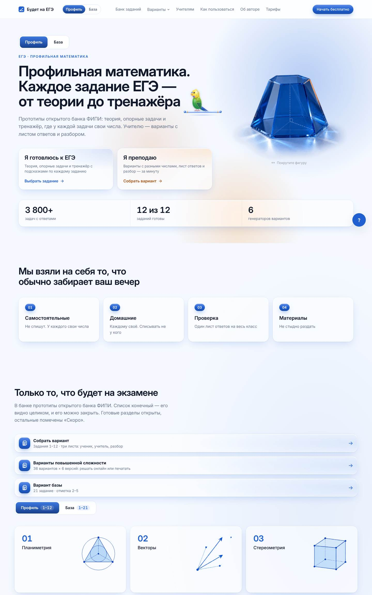 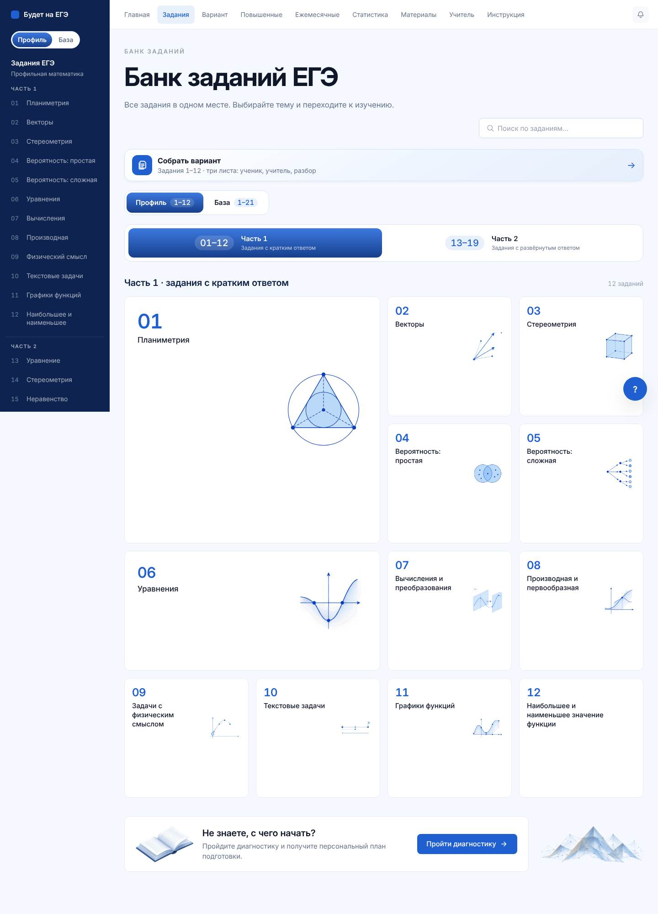

**Что.** Главная — «Стеклянная сцена»: фон со свечениями, стеклянные карточки радиусом 20, глянцевые
кнопки. Клик по «Выбрать задание» — и человек попадает в интерфейс другого продукта: тёмно-синий
сайдбар `--navy-800`, плоские белые карточки с серой рамкой, прямоугольная кнопка. Логотип тоже
меняется: в шапке главной — знак с росчерком, в сайдбаре — синий квадрат без знака.

**Почему дёшево.** Смена материала на первом же клике читается как «лендинг заказали отдельно».

**Как исправить.**

- Фон оболочки кабинета (`AppShell`): тот же, что у `.glavnaya` — `var(--color-bg)` + два
  радиальных свечения (синее 7 %, оранжевое 8 %), неподвижные.
- Карточки банка: рецепт `.glavnaya .task-card--bank` (стекло, радиус 20, `--glass-shadow`) перенести
  в базовый `.task-card--bank`.
- Сайдбар — **остаётся тёмно-синим** (решение владельца 15.11). Чтобы он перестал выглядеть
  «чужим», связать его со стеклом, не меняя цвет: активный пункт — глянцевая «таблетка» `--gloss`
  (как кнопки главной), а не плоская синяя плашка; лёгкий градиент `--navy-800 → --navy-900` сверху
  вниз и синее свечение 12 % в нижнем углу — тот же приём «свет за стеклом»; разделитель частей —
  `--color-on-brand-border`. На главной тёмный элемент уже есть — карточка «Ученик» на тарифах и
  подвал можно связать с ним тем же тёмным стеклом.
- Логотип в сайдбаре — тот же знак, что в шапке главной.

### 1.2. Пять видов главной кнопки · эффект высокий · труд M

| Где                                              | Вид                                                 | Класс                             |
| ------------------------------------------------ | --------------------------------------------------- | --------------------------------- |
| Главная, тарифы                                  | глянцевая «таблетка», радиус 999                    | `.glavnaya .btn--primary`         |
| Банк («Пройти диагностику»), №11 («Продолжить»), «Как пользоваться» | плоский синий прямоугольник, радиус 8, вес 500      | `.btn--primary`                   |
| Тренажёр («Проверить»)                           | глянец, радиус 14                                   | `.stk-btn--primary`               |
| «Собрать вариант» («Сформировать»)               | **оранжевый** глянец                                | `.var-btn--tyoplyy`               |
| «Повышенные» (фильтры «Все», «Тренировка»)       | плоская синяя «таблетка»                            | свои стили                        |

**Почему дёшево.** Кнопка — самый частый элемент; пять вариантов — признак того, что системы нет.
Оранжевая главная кнопка на «Собрать вариант» ещё и спорит с правилом «оранжевый — акцент-свечение».

**Как исправить.** Один рецепт в `styles/components.css`:

- `.btn--primary`: `background: var(--gloss)`, `box-shadow: var(--gloss-shadow)`,
  `border-radius: var(--radius-pill)`, высота 44 (`--h-control`), большая — 52, вес 600, кегль 15/16.
- `.btn--secondary`: стекло `--glass-bg-strong` + `--glass-ring`, тот же радиус.
- `.btn--ghost`: текст `--color-primary`, фон на наведении `--color-surface-soft`.
- `.stk-btn*` и `.var-btn*` становятся псевдонимами этих трёх. Оранжевая кнопка — только там, где
  действие «для учителя» стоит рядом с синим «для ученика» (двери героя), не как главная на странице.

### 1.3. Типографика вне шкалы · эффект средний · труд M

- В `tokens.css` шкала из 9 ступеней, но в CSS встречается **30 разных кеглей** в пикселях
  (14 px — 146 раз, 13 — 114, 15 — 97, плюс 12,5 / 11,5 / 13,5 / 19 / 22 / 26 / 27…). Только на главной
  — 12 кеглей. Разница 14 / 15 / 16 / 17 глазу не даёт иерархии, даёт шум.
- Вес заголовков: h1 главной — 640, h1 банка «Банк заданий ЕГЭ» — 700 и 56 px, h1 разделов — 600–640.
- Мелкий текст 11–12 px на телефоне: подписи вкладок-плиток (12), подписи показателей (12),
  рукописные подписи в теории (≈10 px Caveat — не читается).

**Как исправить.**

- Шкала текста: 12 (только метки прописными) · 14 (подписи) · 16 (основной) · 18 (лид) · 20 · 24 · 30 ·
  40 · 56. Всё, что 13 / 15 / 17 / 19, округлить: 13 → 14, 15 → 16 в тексте и 14 в подписях, 17 и 19 → 18.
- На телефоне основной текст задач и теории — 16 / 26, не меньше; подписи — не меньше 13.
- Заголовки: вес 640 и `letter-spacing: -0.02em` везде; h1 страницы на телефоне 30 / 34
  (сейчас от 30 до 38 в разных местах), на десктопе 40–44 в кабинете и 56 только в герое главной.
- Рукописные подписи (Caveat) — минимум 18 px, иначе убрать.
- `text-wrap: balance` для h1–h3 и `text-wrap: pretty` для абзацев — на весь сайт, не только на главной.

### 1.4. Радиусы и тени · эффект низкий · труд S

Токены: 6 / 8 / 12 / 16 / 999. В CSS кроме них: 14 (67 раз), 20 (27), 10, 18, 24, 28, 7, 3. Стекло
везде 20, но токена на 20 нет. Завести `--radius-2xl: 20px` (карточки-стекло) и `--radius-card: 14px`
(вложенные плашки); 10 / 18 / 7 / 28 свести к ближайшим. Правило вложенности: внешний 20 → внутренний
14 → элемент 8.

### 1.5. Кнопка «?» поверх содержимого · эффект средний · труд S

На каждом экране телефона круг 48 px лежит на содержимом: на главной — на двери «Я преподаю», в банке
— на карточке №01, в тренажёре — на «Завершить» и «Дальше», в показателях — на третьем числе
(`04-baza-375-pokazateli.jpg`). Это самый заметный «любительский» признак на мобильном.

**Как исправить.** На телефоне — 40 px, стекло вместо сплошного синего (`--glass-bg-strong`, синий
знак), `opacity .85`; во время сессии тренажёра, решения варианта и чтения теории — скрыта (помощь
остаётся в меню «Ещё»). На главной — убрать совсем: там есть пункт «Как пользоваться» в шапке.

### 1.6. Переключатели друг на друге · эффект средний · труд S

На главной «Профиль / База» стоит трижды (шапка, над заголовком, над списком заданий). В банке на
телефоне подряд: «Профиль / База» в шапке, «Профиль 1–12 / База 1–21», «Часть 1 / Часть 2» — три
сегментных переключателя на одном экране, и все глянцево-синие (`06-bank-375.jpg`). Оставить один
«Профиль / База» в шапке; «Часть 1 / Часть 2» — тихие вкладки-подчёркивания, не вторая «таблетка».

### 1.7. Шапка на телефоне без логотипа · эффект низкий · труд S

В кабинете на телефоне шапка — это «Профиль / База», колокольчик, бургер. Логотипа и названия нет:
человек, пришедший по ссылке в раздел, не видит, на каком он сайте. Слева — знак (32 px), переключатель
уровня — в меню или под заголовком.

---

## 2. Главная

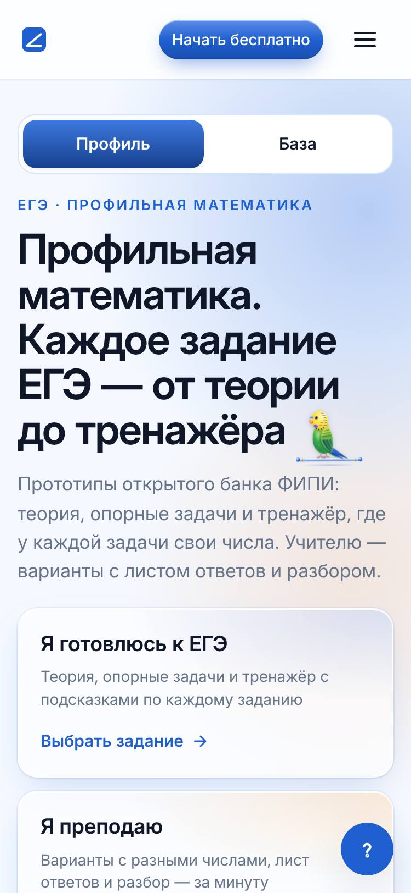

### 2.1. Герой на телефоне: кристалл — после действий, и это правильно, но первый экран «текстовый» · средний · S

Первый экран: переключатель, надзаголовок, заголовок в 4 строки (38 px), лид в 3 строки, одна дверь.
Кристалл — на втором экране. Заголовок 38 / 41 при ширине 343 даёт 4 строки по 2–3 слова.

**Исправление.** Заголовок 32 / 36 (`2rem`, `line-height: 1.12`) — три строки. Лид сократить до двух
строк на телефоне: «Теория, опорные задачи и тренажёр, где у каждой задачи свои числа.» (фраза про
учителя уходит в дверь «Я преподаю», она там уже есть). Освободится ~110 px — обе двери попадут в
первый экран. Переключатель «Профиль / База» над заголовком убрать (см. 1.6).

### 2.2. Герой 1440: кристалл мал и «прижат» · средний · S

Колонки `1.2fr / 0.8fr`, кристалл `max-width: 560px`, по факту ~400 px и висит в правом верхнем углу;
под ним 200 px пустоты до полосы показателей. Подсказка «Покрутите фигуру» — 12 px серым, её не видно.

**Исправление.** Колонки `1fr / 1fr`, кристалл до 620 px, выровнен по центру высоты блока «текст +
двери»; свечение под ним шире. Подсказка — стеклянная пилюля 13 px с иконкой, исчезает после первого
поворота (это уже есть — просто сделать её заметной).

### 2.3. «Мы взяли на себя…»: текст вылезает за карточки · средний · S

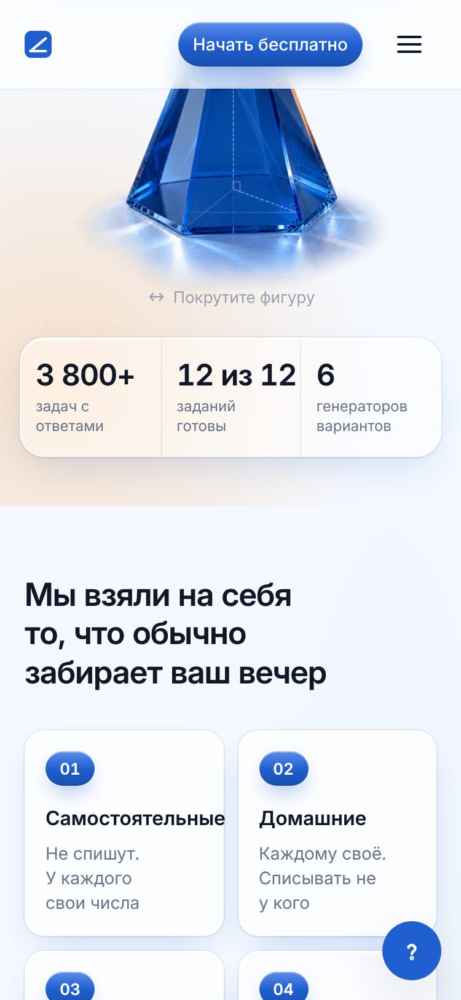

На 375 px карточки стоят в две колонки по 128 px полезной ширины. Заголовок «Самостоятельные» —
146 px: вылезает за правый край карточки. Текст «Не спишут. / У каждого / свои числа» разбит по два
слова в строке. На 1440 наоборот: четыре карточки высотой 115 px с одной строкой текста — пустые.

**Исправление.** Телефон: одна колонка, карточка — строка «номер-пилюля слева, заголовок 18 / 24 и
текст 15 / 22 справа», высота ~84 px, зазор 12. Десктоп: вместо четырёх пустых карточек — одна
стеклянная полоса из четырёх ячеек с разделителями (как полоса показателей), кегль заголовка 20.

### 2.4. Полоса показателей · средний · S

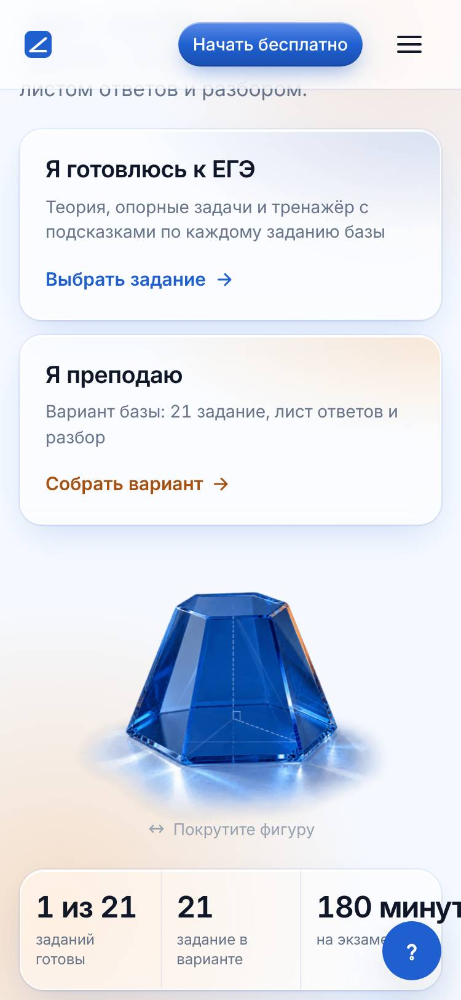

- На `/baza/` третья ячейка «180 минут» шире своей колонки (122 px при 89) — обрезана краем.
- Первая ячейка базы — «1 из 21 заданий готовы». Честно, но это первое число, которое видит человек, и
  оно говорит «сайт пустой».
- На телефоне подписи 12 px в две строки, числа 22 px — ячейки тесные.
- На 1440 полоса шириной 1216 px с тремя числами, прижатыми влево, — две трети полосы пустые.

**Исправление.** База: показатели «21 задание в варианте · 180 минут · отметка 2–5» (факты об экзамене),
а готовность — в строке под списком заданий. Числа — `clamp(22px, 6vw, 32px)`, `white-space: nowrap`
снять с «180 минут» или писать «180 мин». Десктоп: полоса по ширине левой колонки (под дверями), а не
на весь контейнер.

### 2.5. Блок «Только то, что будет на экзамене» · высокий · M

- Левый край блока не совпадает с героем: банк шире на 32 px (`#bank .wrap`), заголовок стоит на
  11 px левее заголовка выше. На 1440 это видно как «съехавшая» вертикаль.
- Три плашки «Собрать вариант / Варианты повышенной сложности / Вариант базы» на всю ширину, одна под
  другой, одинаковые — стена из трёх строк перед списком заданий, который и есть главное.
- Карточки заданий 1440: 432×258, номер и название вверху слева, иллюстрация 96 px справа, нижняя
  половина карточки пустая. На телефоне карточки разной высоты из-за 1–3 строк названия.
- У №12 нет иллюстрации — единственная пустая карточка в сетке.

**Исправление.** Контейнер — общий `--w-container`, сетка `repeat(4, 1fr)` с зазором 16 (карточка
292 px). Карточка: высота 168, иллюстрация 112 px по центру правой половины, название — 2 строки
максимум (`line-clamp: 2`), 17 / 22. Три плашки вариантов — в один ряд из трёх стеклянных карточек
(на телефоне — горизонтальная лента с прокруткой и «хвостом» следующей). Картинка для №12 — в список
для владельца (раздел 16).

### 2.6. Сторителлинг: страница обрывается · высокий · M

Сейчас: герой → четыре обещания **учителю** («…забирает ваш вечер») → список заданий → подвал. Ученик,
который пришёл с мыслью «не знаю, с чего начать», получает после героя блок не про себя, а потом —
12 одинаковых карточек без подсказки, какую открыть первой. Финального призыва нет.

**Исправление (порядок экранов, подробнее — в `motion-system.md`, раскадровка):**

1. Герой (как есть, с правками 2.1–2.2).
2. **«Как устроено каждое задание»** — путь из четырёх шагов: «О задании → Теория → Опорные задачи →
   Тренажёр», каждый шаг — стеклянная карточка с настоящим кадром интерфейса (скриншоты делает
   владелец или берём живые компоненты). Это ответ на «с чего начать».
3. Список заданий — с пометкой «Начните с №1» / «Продолжить №4» (по localStorage, это уже считается).
4. «Учителю» — нынешние четыре обещания, одной полосой, с кнопкой «Собрать вариант».
5. Финал: «Об авторе» в одну строку (портрет 96 px, имя, одна фраза, ссылка) + кнопка «Выбрать
   задание». Сейчас автор — единственный человек на сайте — на главной не появляется вовсе.

### 2.7. Попугай · низкий · S

На телефоне птица стоит в конце заголовка на уровне текста и читается как эмодзи. Держать размер
не меньше 44 px по высоте и опустить на 4 px, чтобы лапы стояли на базовой линии.

---

## 3. «Об авторе»

Лучшая страница сайта: воздух, ритм, рукопись, таймлайн. Замечания — только полировка.

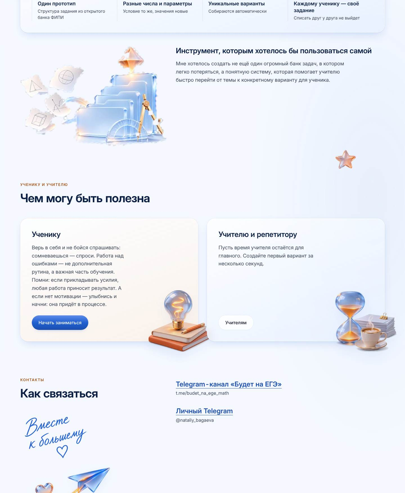

### 3.1. Картинка «папки» с рваной кромкой · средний · S

У иллюстрации в блоке «Инструмент, которым хотелось бы пользоваться самой» видна светлая зубчатая
кайма вырезки вокруг листов и папок — на голубом фоне это выглядит как плохо обтравленный PNG. Сама
картинка остаётся; нужна маска: `mask-image: radial-gradient(closest-side, #000 78%, transparent)` на
контейнере или пересохранить файл с мягким альфа-краем (делает владелец).

### 3.2. Тот же блок: текст в углу, 250 px пустоты · низкий · S

Заголовок и три строки текста прижаты к верху правой колонки, картинка слева выше текста вдвое.
`align-items: center` для строки, текст по центру высоты картинки.

### 3.3. Карточки «Ученику / Учителю» · средний · S

Лампа с книгами вылезает из карточки «Ученику» на 30 px и ложится на соседнюю карточку — получается
наезд, а не «выход за рамку». В карточке ученика 8 строк текста, у учителя 3 — правая наполовину пуста.

**Исправление.** Иллюстрации внутри своих карточек: `right: 16px; bottom: 0`, ширина 180. Текст ученику
сократить до 4 строк или дать обеим карточкам `max-width` текста 34ch и одинаковую высоту через
`grid-auto-rows: 1fr`, кнопки — по нижней линии.

### 3.4. «Как связаться»: пустая правая половина · низкий · S

Две ссылки в верхнем углу правой колонки, самолётик слева внизу. Ссылки сделать двумя стеклянными
карточками-кнопками (иконка Telegram, название, адрес) высотой 72 — колонка заполнится, и по ним
удобно попасть пальцем.

### 3.5. Стеклянные «капли» между секциями · низкий · S

Кристаллик, шар, капля, звезда по 50–70 px висят между блоками без привязки к сетке. Либо привязать к
началу секции (слева от надзаголовка, 40 px), либо оставить две из четырёх.

---

## 4. Тарифы

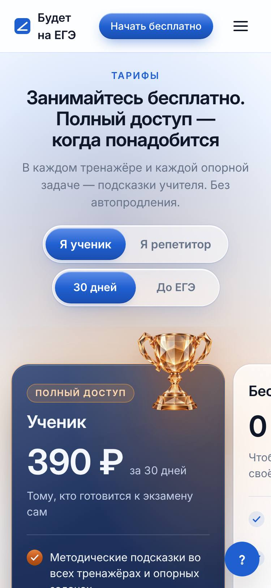 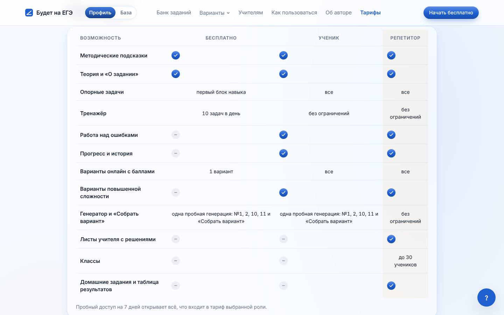

### 4.1. Телефон: заголовок «Занимайтесь бесплатно», первая карточка — 390 ₽ · средний · S

Карусель тарифов открывается на платном «Ученик»; бесплатный — за правым краем. Заголовок обещает одно,
экран показывает другое. Порядок на телефоне: «Бесплатно» → «Ученик» → «Пробный», стартовый слайд —
бесплатный; точки-индикаторы сделать 8 px и активную — «таблеткой» 20×8.

### 4.2. Таблица «Что входит»: колонки не выровнены · средний · S

В колонке «Бесплатно» галочки стоят по левому краю (x≈335), а текстовые значения («первый блок
навыка», «10 задач в день») — по центру (x≈420); в «Ученик» то же. Глаз скачет между двумя осями.
Все ячейки значений — `text-align: center`, галочки по центру колонки; колонки значений равной ширины
(`grid-template-columns: 1.4fr repeat(3, 1fr)`).

### 4.3. «Оплата скоро откроется» как главная кнопка · высокий · S (текст) / блокер запуска

На самом заметном месте самой дорогой карточки — неактивная кнопка. До включения оплаты: кнопка
«Начать бесплатно» + строка под ней «Оплата откроется [дата]. Оставьте почту — напишем». См. также
`launch-audit.md`.

### 4.4. Два переключателя друг под другом · низкий · S

«Я ученик / Я репетитор» и «30 дней / До ЕГЭ» — одинаковые «таблетки» одна под другой. Второй сделать
меньше и тише (высота 36, без глянца: активный — белая плашка с тенью) и подписать слева «Срок:».

### 4.5. Ширина страницы · низкий · S

Контент тарифов — 1056 px, главной — 1280. Кубок на тёмной карточке упирается в край. Либо расширить
до `--w-container`, либо оставить узко, но тогда три карточки — равной высоты (сейчас тёмная выше
светлых на 30 px и стоит ниже).

---

## 5. Банк заданий

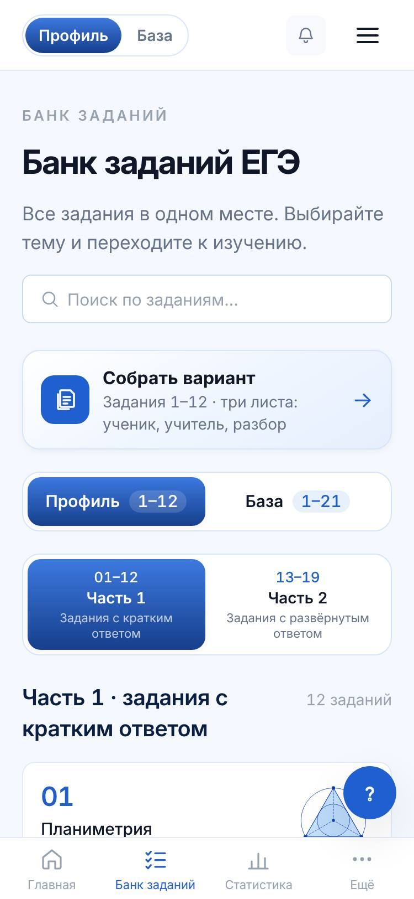

### 5.1. «Бенто» с пустыми карточками · высокий · M

На 1440 карточка №01 — 558×540 px, в ней номер, слово «Планиметрия» и иллюстрация 160 px; три четверти
площади пусты. №06 — 558×260 с тем же. Остальные — 270×260 с иллюстрацией 70 px в углу. На телефоне №01
и №06 занимают всю ширину и тоже пустые, остальные — по две в ряд, разной высоты.

**Почему дёшево.** Бенто работает, когда большая плитка несёт больше содержания. Здесь большая плитка —
та же маленькая, растянутая. Выглядит как сломанная сетка.

**Исправление.** Ровная сетка: 4 колонки на 1440, 3 на 1024, 2 на телефоне; карточка 168 px высотой,
иллюстрация 96–112 px. Если хочется акцента — большая плитка одна, «Продолжить: №4 · Тренажёр ·
3 из 10» с прогрессом (то есть с содержанием), а не №01.

### 5.2. Нет прогресса на карточках · высокий · M

Банк — домашний экран ученика, но карточки не показывают, где он был: нет ни «3 из 15 типов», ни
отметки «начато». Прогресс считается (он есть в шапках разделов). Добавить в карточку тонкую полосу
3 px по нижнему краю и подпись 13 px «начато · 20 %» / «готово».

### 5.3. Баннер «Не знаете, с чего начать?» ведёт в заглушку · высокий · S

См. 13.1. Плюс обрезанная справа картинка с горами (выходит за контейнер и режется краем окна на
1440). До появления диагностики — заменить баннер на «Начните с задания №1» со ссылкой, горы убрать.

### 5.4. Поиск · низкий · S

Поле поиска по 12 заданиям на 1440 прижато к правому краю отдельной строкой — лишняя строка и лишний
элемент (12 карточек видно целиком). Убрать на профиле; на базе (21 задание) оставить в строке заголовка.

---

## 6. Раздел задания: шапка и вкладки

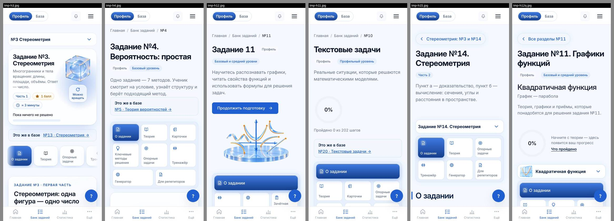

### 6.1. Шесть разных шапок у одной и той же сущности · высокий · L

Слева направо: №3, №4, «Задание 11», «Текстовые задачи», №14, подтема «Квадратичная функция».

- Заголовок: «Задание №3. Стереометрия» / «Задание №4. Вероятность: простая» / «Задание 11» (без
  названия) / «Текстовые задачи» (без номера) / «Планиметрия».
- Метки: «Часть 1 · 1 балл · ≈ 3 минуты» / «Профиль · Базовый уровень» (читается как противоречие) /
  «Профиль» справа от заголовка / «Часть 2».
- Прогресс: полоса в карточке / кольцо «0 %» на 100 px / нет.
- Иллюстрация: в стеклянной карточке справа / под кнопкой на пол-экрана / нет.
- Навигация назад: выпадающий список разделов сверху / «хлебные крошки» / пилюля «‹ Все разделы №11».
- Под лидом у №11 и №14 — пустая дыра 80–100 px.

**Исправление.** Один компонент шапки по образцу №3 (он лучший и самый компактный — 290 px):

```
[№3 Стереометрия ▾]                      ← переход между заданиями
┌ стекло ───────────────────────────────┐
│ Задание №3. Стереометрия      [картинка 96] │
│ Лид в 2 строки                              │
│ Часть 1 · 1 балл · ≈ 3 мин                  │
│ ▬▬▬▬▬▬░░░░ 4 из 15 типов                    │
└───────────────────────────────────────┘
[О задании][Теория][Опорные][Тренажёр]→   ← одна строка
```

Заголовок всегда «Задание №N. Название». Метки всегда три: часть, балл, время. «Это же в базе» —
ссылкой внутри карточки, не отдельной плашкой. Кольца «0 %» убрать.

### 6.2. Вкладки-плитки в три ряда · высокий · M

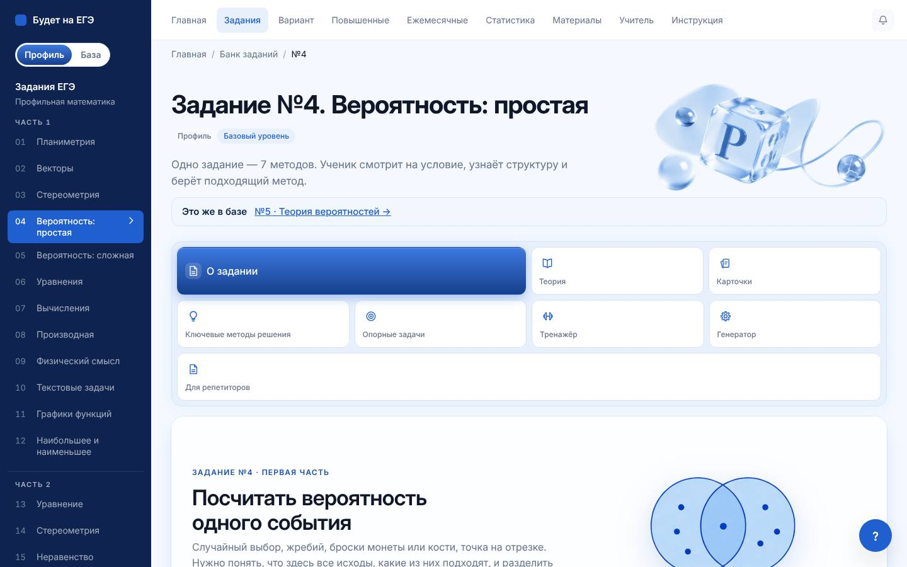

На телефоне 8 плиток занимают 230 px в три ряда (3 + 3 + 2, последняя пара шире). На 1440 — три ряда
больших пустых плиток: «О задании» шириной 560, подписи 12 px в левом нижнем углу, «Для репетиторов»
— один на всю строку. У №7 и №11 последняя плитка «Для репетиторо…» обрезана и накрыта кнопкой «?».
У №3 вкладки — одна прокручиваемая строка, у остальных — плитки: разнобой.

**Почему дёшево.** Навигация занимает больше места, чем содержимое, и выглядит как недособранная сетка.

**Исправление.** Везде одна строка: телефон — горизонтальная лента с прокруткой, пилюли высотой 40,
иконка 18 + подпись 14 / 500, активная — глянец; справа градиент-затухание 24 px как знак прокрутки;
активная вкладка автоматически прокручивается в видимую область. Десктоп — та же строка целиком (8
вкладок по ~120 px помещаются в 1136). «Для репетиторов» — последней и тише (без иконки, цвет
`--color-text-secondary`): ученику она не нужна.

### 6.3. Хлебные крошки + сайдбар + выпадающий список · низкий · S

На 1440 положение показано трижды: сайдбар (активный пункт), крошки, заголовок. Крошки на десктопе
убрать; на телефоне оставить одну ссылку «‹ Банк заданий».

---

## 7. Вкладка «О задании»

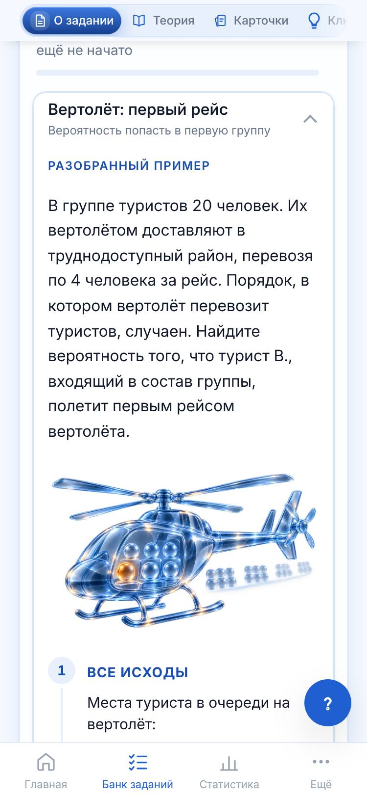

### 7.1. Тройная вложенность на телефоне · средний · M

Разобранный пример лежит в карточке типа, та — в карточке группы, та — на странице: три рамки и три
внутренних отступа. При ширине экрана 375 тексту условия остаётся ~275 px — 5–6 слов в строке,
условие на 10 строк. Шаги решения сдвинуты ещё на 40 px (номер-кружок), формулам остаётся 235 px.

**Исправление.** На телефоне (< 768): группа — без рамки и фона, только заголовок-строка с иконкой;
карточка типа — на всю ширину экрана с полями 16; внутри неё пример без собственной рамки. Номер шага
— над текстом шага, а не слева (возвращает 40 px формулам). Итого ширина текста 343 px (+25 %).

### 7.2. Сетка исходов вылезает за карточку · средний · S

В примере «Вертолёт» плитки «первый рейс / другие рейсы» идут в 4+ колонки фиксированной ширины;
четвёртая зелёная обрезана правым краем карточки. `grid-template-columns: repeat(auto-fill,
minmax(64px, 1fr))`, подпись в плитке 11 → 12 px, перенос запрещён.

### 7.3. Десктоп: пример занимает половину ширины · низкий · M

На 1440 текст примера и шаги — колонка 430 px слева, справа 600 px пустоты; картинка вертолёта
прижата влево. Образец есть в №3: чертёж слева закреплён, шаги справа. Для примеров с картинкой —
те же две колонки (картинка 40 %, шаги 60 %).

### 7.4. «Чем опасно» · низкий · S

Хороший блок. На телефоне маркеры-точки оранжевые 6 px и текст 14 / 22 — поднять до 15–16 / 24: это то,
что ученик должен прочитать, а кегль как у сноски.

### 7.5. Три числа «1 · ≈ 2 · 25» · низкий · S

Дублируют метки шапки (балл, минуты). После единой шапки (6.1) оставить в теле только то, чего в шапке
нет: «25 типов в семи группах» — строкой над списком групп.

---

## 8. «Теория», «Карточки», «Опорные задачи»

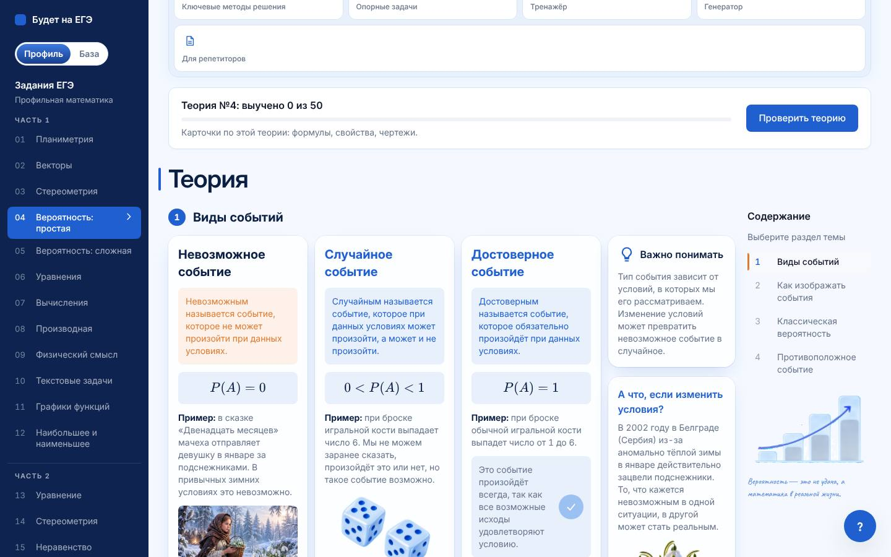

### 8.1. Теория на 1440: четыре узкие колонки · средний · M

Карточки определений по 193 px полезной ширины: 17–20 знаков в строке, определение из одной фразы
растягивается на 5 строк, пример — на 6. Читать колонку такой ширины тяжело; норма для учебного текста
— 45–75 знаков.

**Исправление.** Три определения — в ряд по 280–300 px (сетка `repeat(3, 1fr)` на всю ширину
содержимого, «Важно понимать» — под ними полосой), либо содержание (правая колонка 200 px) убрать в
выпадающую кнопку «Содержание», как на телефоне, и отдать ширину тексту.

### 8.2. Рукописные подписи 10 px · низкий · S

«Зима не кончится никогда…», «Вероятность — это не удача…» набраны Caveat ≈ 10–11 px — не читаются
ни на телефоне, ни на десктопе. Минимум 18 px (Caveat оптически мельче Inter на треть) или убрать.
Замечу: по условиям рукопись — фирменный приём «Об авторе»; в теории её лучше заменить обычной
подписью 13 px курсивом PT Serif (шрифт уже подключён).

### 8.3. Блок «Теория №4: выучено 0 из 50» перед теорией · средний · S

Первое, что видит ученик на вкладке «Теория», — плашка с прогрессом карточек и кнопкой «Проверить
теорию»; сама теория начинается ниже сгиба (на телефоне — с 950-го пикселя). Плашку — в конец теории
(«Прочитали? Проверьте себя — 50 карточек»), наверху оставить только «Содержание».

### 8.4. Карточки: радио-кнопки как список · низкий · S

Выбор режима — четыре блока с радиокнопками и по три строки текста; до кнопки «Начать» два экрана.
Сделать режимы плитками 2×2 (название + число карточек), описание — одной строкой под выбранной;
«Начать» — закреплена внизу экрана.

### 8.5. Опорные задачи: хорошо, одно замечание · низкий · S

Строки блоков с иконкой, названием и прогрессом — образец для остальных списков. Заголовок группы
(«Считаем исходы» с синей чертой слева) набран 16 px, а название блока под ним — 18 px: подчинённый
элемент крупнее главного. Группа — 20 / 600, блок — 16 / 600.

---

## 9. Тренажёр

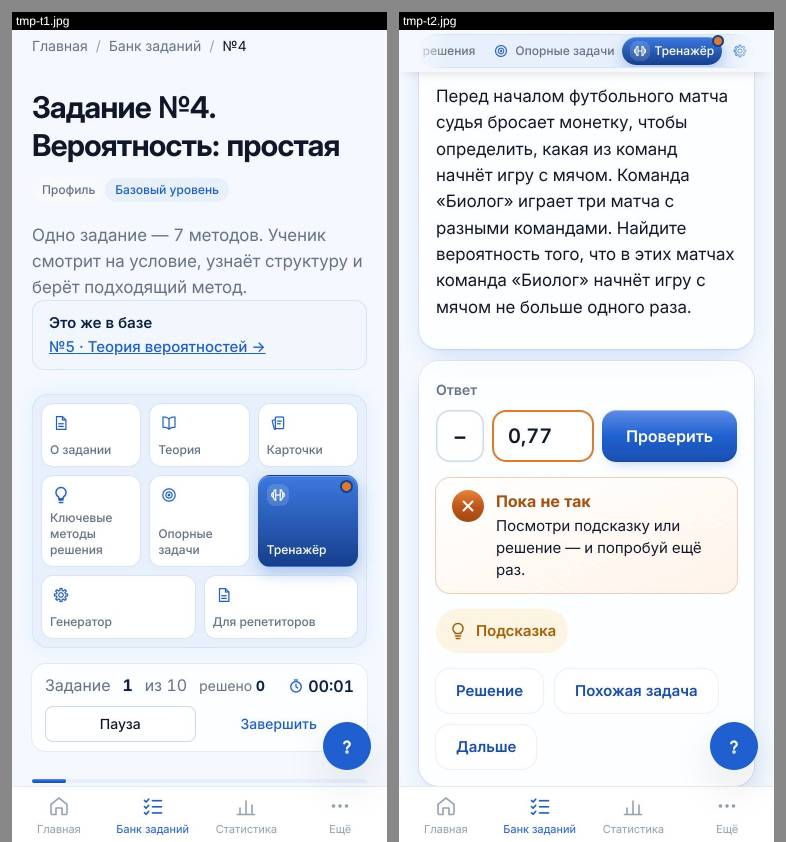

### 9.1. Задачу не видно · эффект высокий · труд M — главная правка всего аудита

Слева — экран телефона сразу после нажатия «Все методы вперемешку». На экране: крошки, заголовок в две
строки, две метки, лид в три строки, плашка «Это же в базе», восемь плиток вкладок, панель сессии.
**Условие задачи начинается на 835-м пикселе при высоте экрана 812.** Ученик каждый раз листает экран,
чтобы увидеть задачу; после проверки страница прокручивается к ответу, и условие уезжает вверх.

**Исправление.** Режим «сессия» (класс на `body`, пока тренировка идёт):

- шапка раздела, лид, «Это же в базе» и вкладки скрыты; вместо них — одна строка 48 px:
  `‹ Выйти · Задание 3 из 10 · ⏱ 02:14 · ⏸`;
- под ней полоса прогресса 3 px на всю ширину;
- условие — с 64-го пикселя; поле ответа и «Проверить» закреплены у нижнего края над клавиатурой
  (`position: sticky; bottom: 0`, стекло), нижняя навигация сайта на время сессии скрыта;
- после проверки страница не прыгает: плашка результата появляется над закреплённой панелью.

На 1440 то же: шапка сворачивается в строку, задача — по центру колонки 720 px.

### 9.2. Счётчик трижды · низкий · S

«Задание 1 из 10», «решено 0», полоса, и в карточке ещё раз «1 из 10» + метка «Прототип задания 4».
Оставить один счётчик в строке сессии; в карточке — только закладка.

### 9.3. Отклик на ответ · средний · S

Справа на снимке — неверный ответ: рамка поля оранжевая, плашка «Пока не так». Тон правильный (без
красного, без «Ошибка!»). Что поправить:

- Кнопки «Решение», «Похожая задача», «Дальше» — три одинаковых тихих, переносятся 2 + 1. Главная
  здесь одна: после неверного — «Подсказка» (глянец), после верного — «Дальше» (глянец); остальные —
  текстом. В одну строку.
- Верный ответ сейчас отличается от неверного только цветом — добавить короткое движение
  (см. `motion-system.md`, прототип на `/styleguide/motion/`).
- Поле ответа: высота 52, кегль 20, `inputmode="decimal"` — проверить, что на iOS открывается
  цифровая клавиатура с запятой.

### 9.4. Экран выбора режима · низкий · S

«Как потренируемся» — хорошие строки-карточки. «Работа над ошибками» в неактивном виде занимает столько
же места, сколько активные; сделать её строкой 48 px «Работа над ошибками — появится после первой
тренировки».

---

## 10. «Генератор» и «Для репетиторов»

### 10.1. Генератор: две панели действий на телефоне · средний · S

Под заголовком — закреплённая строка «7 задач · 1 вариант · [Сгенерировать]», и та же кнопка есть в
теле. Закреплённая строка накрывает содержимое при прокрутке и спорит с нижней навигацией (две полосы
внизу + «?»). Оставить одну: закреплённую внизу, поверх нижней навигации (навигацию на этой вкладке
скрыть — это инструмент учителя, он здесь работает, а не гуляет).

### 10.2. Предпросмотр листа на телефоне · низкий · M

Лист А4 ужат до 343 px — текст задач 9 px. Показывать не уменьшенный лист, а первую задачу в читаемом
кегле + «Открыть лист целиком» (на весь экран с масштабированием жестом — `PinchZoom` в проекте есть).

### 10.3. «Для репетиторов»: карточки файлов · низкий · S

Хорошо и понятно. Иконка скачивания 36 px — зона нажатия меньше 44; сделать всю карточку ссылкой.
Добавить под названием «PDF · 1,8 МБ · 12 стр.» — репетитор хочет знать вес до скачивания на телефон.

---

## 11. «Собрать вариант»

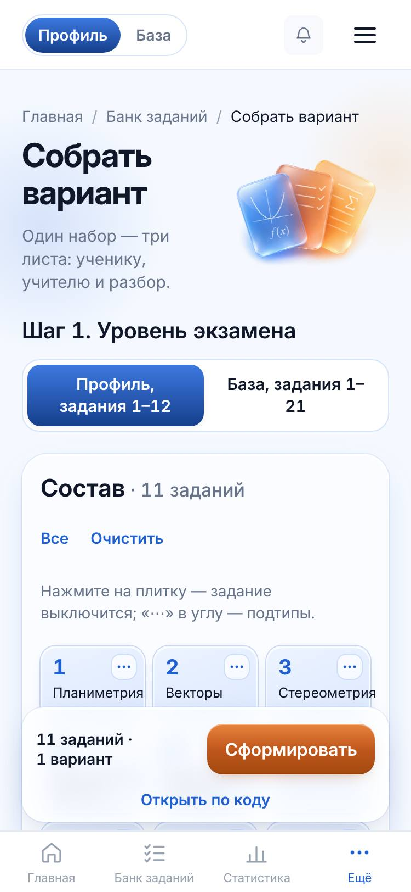

- **Оранжевая главная кнопка** «Сформировать» — см. 1.2 (синий глянец; оранжевым — только свечение
  позади).
- Плитки заданий 100 px: «Стереометрия» касается правого края плитки, «Наибольшее и наименьшее» в
  отключённой плитке — 4 строки по 11 px. Плитки — 2 в ряд на телефоне (номер 24 px + название 14 / 18
  в 2 строки) или компактный список с переключателями.
- Закреплённая панель «11 заданий · 1 вариант» лежит поверх плиток посреди экрана и закрывает второй
  ряд; её место — у нижнего края.
- «Шаг 1. Уровень экзамена» — а шага 2 на экране не видно: либо нумеровать все блоки
  («1 Уровень · 2 Состав · 3 Настройки»), либо убрать слово «Шаг».
- Настройки «Источник / Сложность / Вариантов / Листы» — четыре плашки с текстом-ссылкой и «›» разного
  цвета (синий, оранжевый). Один цвет значения — `--color-text`, стрелка серая.

---

## 12. «Варианты повышенной сложности», «Ежемесячные»

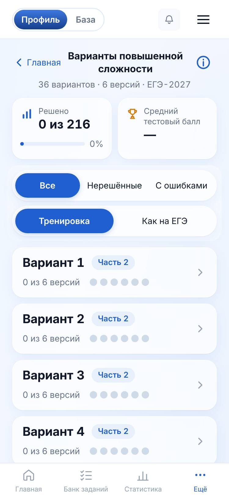

- Третья по счёту шапка страницы: «‹ Главная» слева, заголовок по центру в две строки, «i» справа.
  Привести к общей шапке страницы (заголовок слева, 30 / 34).
- **36 одинаковых строк подряд** («Вариант 1 … Вариант 36», у каждой «0 из 6 версий» и шесть серых
  точек) — 3 900 px прокрутки. Сгруппировать по 6 («Варианты 1–6» и т. д., свёрнутые, раскрыта группа
  с первым нерешённым) или сетка 3×12 компактных плиток «№ + кольцо прогресса».
- Два ряда фильтров-«таблеток» («Все / Нерешённые / С ошибками» и «Тренировка / Как на ЕГЭ») — разные
  по смыслу (фильтр и режим), одинаковые по виду. Режим — переключатель с подписью «Режим:», фильтр —
  тихие чипы.
- «Средний тестовый балл —» с прочерком и кубком до первого решения — пустой показатель. До первого
  варианта показывать одну карточку «Решите первый вариант — здесь появится балл».

---

## 13. Кабинет, вход, пустые состояния

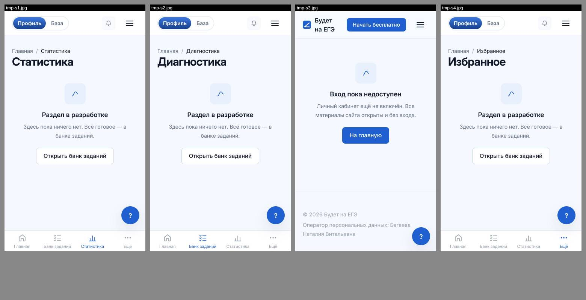

### 13.1. Семь страниц «Раздел в разработке», на них ведут главные кнопки · высокий · S

«Статистика», «Диагностика», «Избранное», «Мои задания», «Мои материалы», «Для учителя», «Настройки» —
одна и та же заглушка. При этом:

- «Статистика» — один из **трёх** пунктов нижней панели телефона;
- «Пройти диагностику» — единственная крупная кнопка в банке;
- «Статистика», «Материалы», «Учитель» — в верхнем меню на 1440;
- `/voyti/` в сборке без включённого входа — «Вход пока недоступен» (кнопка «Начать бесплатно» при этом
  честно ведёт в банк).

**Почему дёшево.** Каждый третий клик по навигации заканчивается словом «в разработке». Это сильнее
всего остального создаёт ощущение недоделанного сайта.

**Исправление.** Пункты на заглушки убрать из меню и панели до готовности (правило из `CLAUDE.md` про
заглушки — в ту же сторону). Нижняя панель: «Главная · Задания · Варианты · Ещё». Баннер диагностики —
см. 5.3.

### 13.2. Сама заглушка · средний · S

Иконка — серая «галочка вверх» в квадрате (ничего не значит), заголовок 16 px, кнопка. Если заглушки
остаются по прямым ссылкам: стеклянная карточка, иконка раздела 48 px из набора навигации, «Скоро
здесь будет статистика: решённые задачи по темам и прогноз балла» (то есть обещание, а не «ничего
нет»), кнопка «Открыть банк заданий» — глянец.

### 13.3. Карта («Привет!») · средний · M

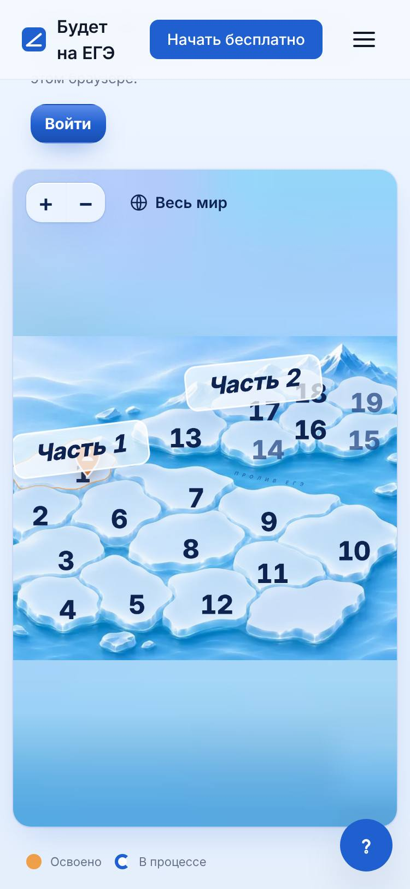

Льдины с номерами — самая тёплая находка сайта после попугая. Но: поле карты 600 px высотой, льдины
занимают среднюю треть, сверху и снизу по 150 px пустого голубого; подписи «Часть 1 / Часть 2»
наклонены и наезжают на номера 1 и 18; цифры 14, 15, 19 бледные (не начато?) — выглядят как брак
печати. Легенда из пяти пунктов мелко (12 px).

**Исправление.** Высота поля по содержимому (соотношение 4:3), стартовый масштаб — «всё видно»;
подписи частей — ровные стеклянные ярлыки над группами; недоступные льдины — полупрозрачные целиком
(льдина, не цифра); легенда — три пункта 13 px.

### 13.4. Вход · см. `launch-audit.md`

В сборке без ключей входа экран — заглушка; оформление формы входа оценено по коду
(`components/auth/auth.css`): отдельный набор полей и кнопок — привести к общим `.input` и
`.btn--primary` при унификации кнопок (1.2).

---

## 14. 404 и служебные

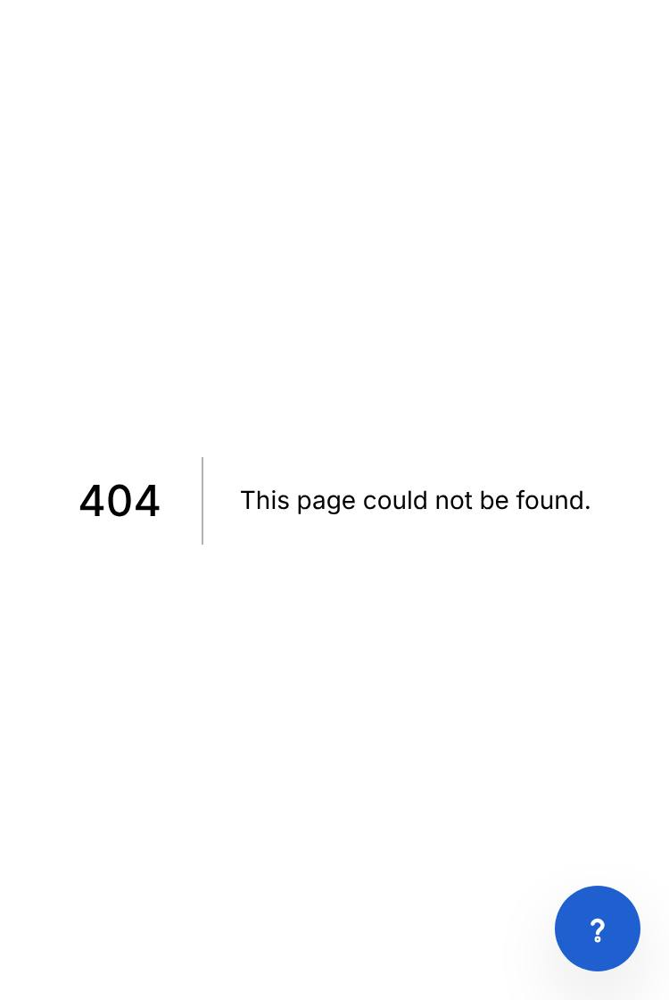

### 14.1. Страница 404 — заводская, на английском · высокий · S

«404 | This page could not be found.» чёрным по белому, без шапки и ссылок. В проекте нет
`app/not-found.tsx`. Сделать: шапка сайта, стеклянная карточка, «Такой страницы нет. Возможно, раздел
переехал», три кнопки — «Банк заданий» (глянец), «Главная», «Собрать вариант». Сюда же просится
попугай с наклонённой головой — он уже есть, новых картинок не нужно.

### 14.2. «Как пользоваться» · низкий · S

«Видеоинструкция скоро» — стеклянная карточка на пол-экрана про то, чего нет. До появления видео —
убрать блок, оставить «Пройти тур». Кнопки «Пройти тур» / «Посмотреть приветствие» — плоские
прямоугольные (см. 1.2).

### 14.3. Подвал · низкий · S

На телефоне ссылки подвала стоят с шагом 48 px и рвутся по две в строке («Пользовательское соглашение
· Тарифы», «Контакты · Telegram») — список в одну колонку с шагом 40 или две ровные колонки. Текст
«Оператор персональных данных…» 14 px светло-серым `--grey-500` на светлом фоне — контраст ниже нормы
(см. `launch-audit.md`), взять `--grey-700`.

---

## 15. Материалы, свет, глубина

- **Стекло без того, что за ним.** В кабинете стеклянные карточки (`stk-glass`) лежат на ровном
  `--color-bg`: размывать нечего, стекло читается как белая карточка с тенью. Либо под ними должны
  быть свечения (1.1), либо на этих страницах не тратить `backdrop-filter` (он дорогой на слабых
  телефонах) и использовать непрозрачный вариант.
- **Оранжевое свечение.** На главной оно есть (герой, банк), в разделах — только в плашке «Чем
  опасно». Дать каждому разделу одно тёплое пятно за иллюстрацией шапки — это и есть «оранжевый акцент»
  концепции.
- **Тени.** У стекла одна синяя тень `--glass-shadow`, у старых карточек — серые `--shadow-sm/md`.
  На одном экране (банк) встречаются обе. Серые тени — убрать, оставить синюю двухслойную.
- **Иллюстрации-значки заданий** (треугольник в круге, векторы, куб) — плоская синяя линия; обложки
  разделов — объёмное стекло (куб №3, кубик «P» №4, пьедестал №11). В банке на карточках стоят плоские,
  в шапке раздела — объёмные: связи между карточкой и разделом нет. Идеально — на карточке банка
  уменьшенная обложка раздела (картинки уже есть для №1, 3, 4, 11; остальные — список ниже).

---

## 16. Где нужны картинки (делает владелец)

| Место                                         | Что на картинке                                                            | Размер, формат          |
| --------------------------------------------- | -------------------------------------------------------------------------- | ----------------------- |
| Карточка №12 в банке и на главной             | значок в стиле остальных: кривая с отмеченными максимумом и минимумом      | SVG 96×96, линия 1,5 px |
| Обложки шапок разделов №2, 5–10, 12           | стеклянный объект в стиле куба №3 и кубика №4, прозрачный фон              | WebP/AVIF 480×480, α    |
| Главная, блок «Как устроено каждое задание»   | четыре кадра интерфейса: «О задании», «Теория», «Опорные», «Тренажёр»      | 720×900, WebP           |
| Главная, финальный блок                       | портрет автора (кадр из существующего фото, без бюста)                     | 192×192, WebP           |
| «Об авторе», «Инструмент…»                    | тот же файл папок, пересохранённый с мягким альфа-краем                    | как сейчас              |
| Пустые состояния (статистика, избранное)      | по желанию: один стеклянный объект на все (лупа, закладка)                 | 240×240, WebP, α        |
| OpenGraph-обложка                             | логотип + кристалл + «Будет на ЕГЭ» на фоне сцены                          | 1200×630, JPG           |

---

## 17. Что уже сделано хорошо (не трогать)

- Тон обратной связи: «Пока не так», подсказка вопросами, никакого красного и восклицаний.
- «Чем опасно» в каждом разделе — конкретно и по делу.
- Шапка №3 с вращаемым кубом — образец для всех разделов.
- «Об авторе»: ритм, таймлайн, рукопись.
- Карта-льдины и попугай — у сайта есть характер; их не хватает на 404 и в пустых состояниях.
- Переход вкладок через View Transitions, `prefers-reduced-motion` и `prefers-reduced-transparency`
  уже учтены — редкая аккуратность.
- Кристалл героя: статичный рендер и подгрузка three.js только по касанию.
