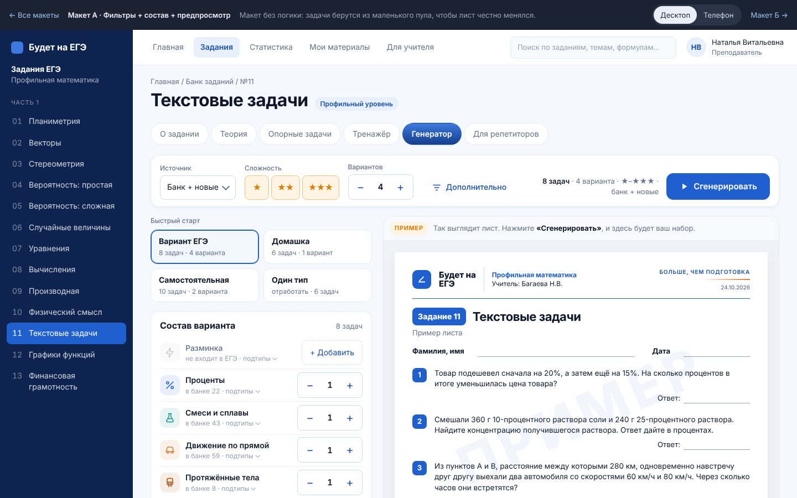
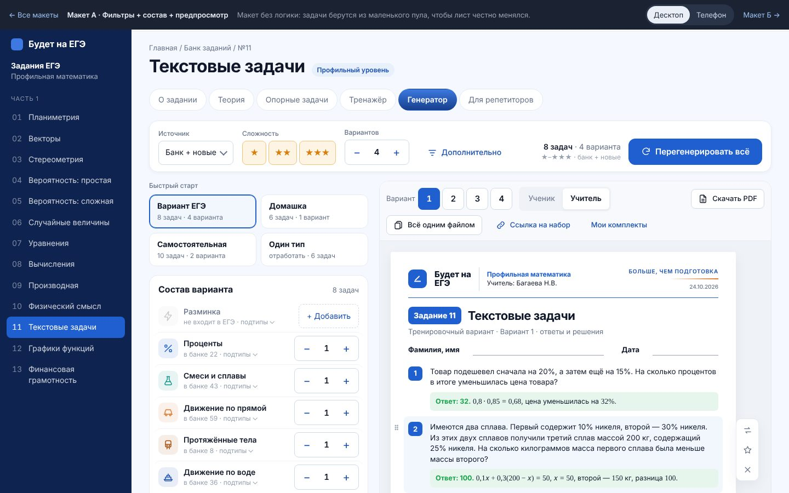
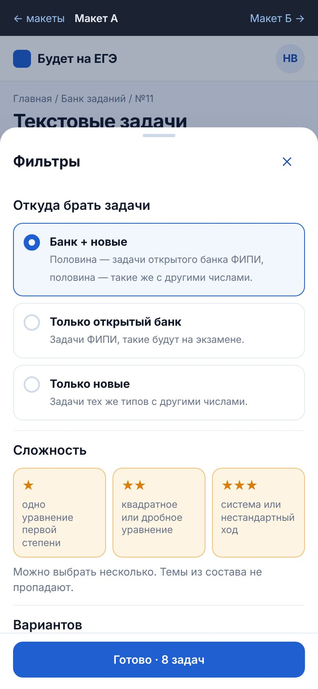
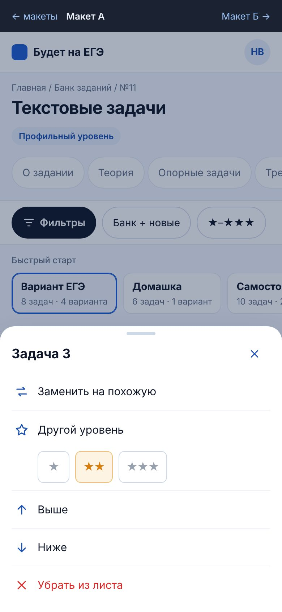
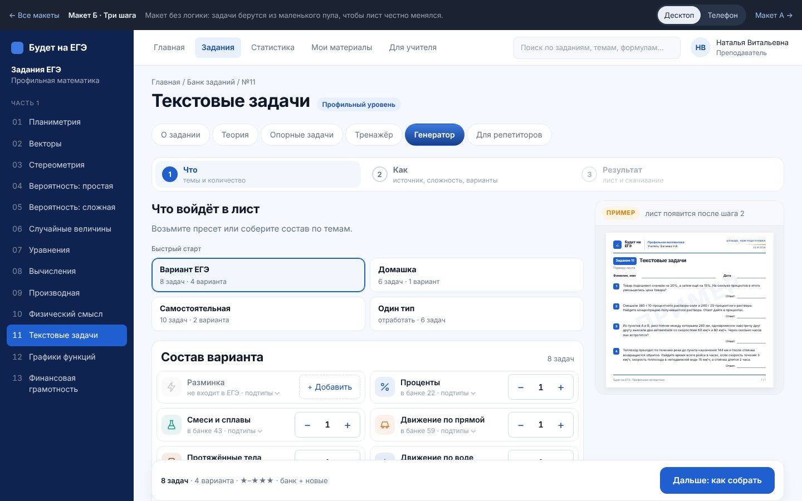
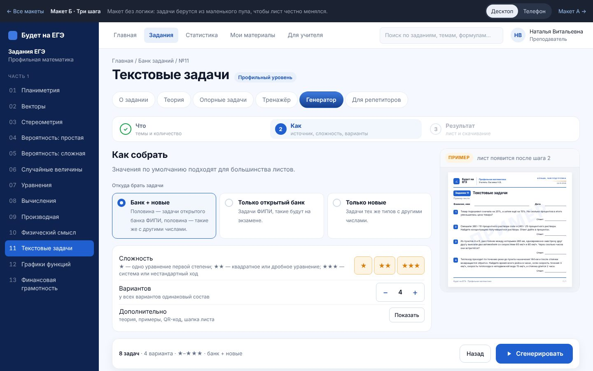
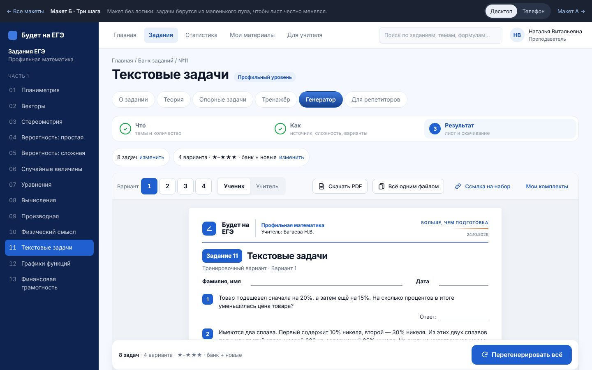
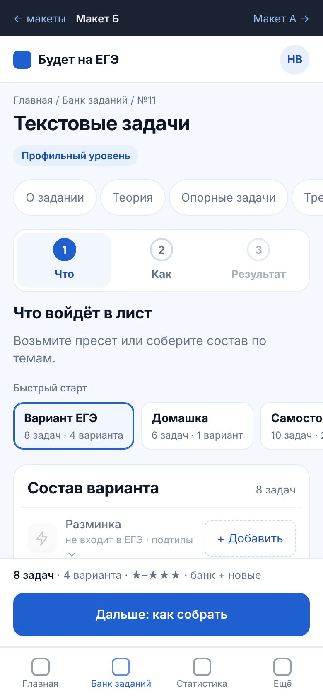
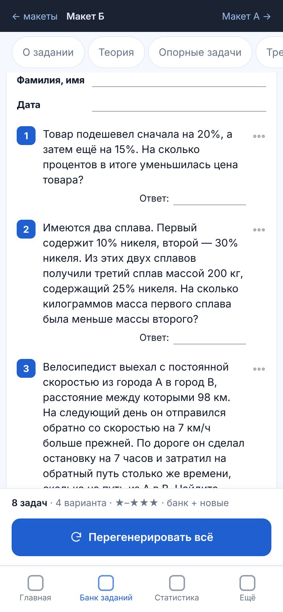

# Генератор · Этап 2 — дизайн

Дата: 24 октября 2026. Ветка `claude/generator-redesign-dg4tjq`. Исследование — в `docs/generator/01-research.md`.

**Кликабельные макеты:** https://claude.ai/artifact/AaxzeQMmZ8NpVLVyQ5WSUH (приватная страница, открывается с телефона). Исходники — в `docs/generator/mockups/`: `index.html`, `a.html`, `b.html`. Локально они открываются из папки через любой статический сервер, например `python3 -m http.server`. Снимки экранов — в `docs/generator/mockups/shots/`.

Макеты собраны на №11 «Текстовые задачи» с размерами и текстами сайта: палитра, радиусы и шрифт взяты из `app/src/styles/tokens.css`, шапка листа повторяет `design-reference/pdf-obrazec-lista.png`. Логики нет, но всё кликается. Задачи берутся из маленького пула с ответами и решениями, поэтому лист честно меняется при смене состава, уровня, источника, варианта и вида листа. Формулы набраны KaTeX, в макете в режиме MathML (внешние шрифты KaTeX внутри артефакта заблокированы). На сайте будет обычный KaTeX.

## 0. Выбор (24.10.2026)

**Выбран макет А.** По итогам обсуждения в него внесены три правки:

- **Сводка в полосе фильтров короче:** крупно «8 задач · 4 варианта», мелко под ней уровни и источник. Полная строка — в подсказке при наведении.
- **Действия над задачей больше не перекрывают текст.** При наведении справа от листа, на поле, появляется узкая колонка иконок «Заменить», «Другой уровень», «Убрать» с подсказками.
- **Окно «Фильтры» на телефоне взято из шага 2 макета Б:** заголовки разделов, источник карточками с пояснениями, сложность тремя карточками с расшифровкой уровня.

Макет Б остаётся в папке для истории.

## 1. Что решили после этапа 1

| Вопрос | Решение |
|---|---|
| Открывать генератор сразу с готовым листом | **Нет.** Остаются кнопка «Сгенерировать» и демонстрационный лист в пустом состоянии, как в требованиях. |
| Блок «Режим» (отработка / варианты) | Убираем. «Задания для отработки» становятся пресетом «Один тип». |
| Действия над задачей | Десктоп — по наведению. Телефон — тихая кнопка «⋯» 44×44 у задачи и долгое нажатие, оба способа открывают одно меню. |
| Порядок задач | Перетаскивание на десктопе, «Выше / Ниже» в меню на телефоне. |
| Живой предпросмотр | После первой генерации любое изменение настроек сразу обновляет лист, seed и замены сохраняются. |
| Ссылка на набор | В адресе состав, seed, замены и порядок. Ссылка открывает тот же лист у любого, без входа. |
| «Не больше 6–7 элементов» | Цель для полосы фильтров и кнопки, а не для всего экрана со составом. |

## 2. Как живёт предпросмотр (одинаково в А и Б)

1. **До первой генерации** в рамке лежит демонстрационный лист: настоящая шапка, четыре задачи, плашка «Пример» над листом и бледный водяной знак «ПРИМЕР». Подпись: «Так выглядит лист. Нажмите «Сгенерировать», и здесь будет ваш набор».
2. **«Сгенерировать»** собирает настоящий лист по текущим настройкам. Кнопка становится «Перегенерировать всё»: новый seed, состав тот же. Отдельной кнопки «Перегенерировать всё» в панели листа нет, чтобы не было двух кнопок с одним действием.
3. **После генерации** изменения состава, уровня, источника, числа вариантов и «Дополнительно» сразу перерисовывают лист. Сделанные замены и порядок остаются, внизу появляется короткое сообщение «Лист обновлён».

Для пункта 3 нужна маленькая правка движка, см. раздел 9.

## 3. Макет А · «Фильтры + состав + предпросмотр»



### Десктоп (1440×900)

```
┌ шапка сайта ───────────────────────────────────────────────────────────┐
│ Главная / Банк заданий / №11                                           │
│ Текстовые задачи  [Профильный уровень]                                 │
│ [О задании] [Теория] [Опорные] [Тренажёр] [Генератор] [Для репетиторов]│ ← липкие
├────────────────────────────────────────────────────────────────────────┤
│ Источник        Сложность       Вариантов                               │
│ [Банк+новые ▾]  [★][★★][★★★]    [− 4 +]   ⚙ Дополнительно              │ ← липкая
│                          8 задач · 4 варианта · ★–★★★ · банк + новые [▶ Сгенерировать] │
├──────────────────────────────┬─────────────────────────────────────────┤
│ Быстрый старт                │ [Пример] Так выглядит лист…   (до)      │
│ [Вариант ЕГЭ][Домашка]       │ Вариант [1][2][3][4]  [Ученик|Учитель]  │
│ [Самостоят.][Один тип]       │ [Скачать PDF] [Всё одним файлом]        │
│                              │ 🔗 Ссылка на набор   Мои комплекты (после)│
│ Состав варианта      8 задач │ ┌─────────── лист A4 ───────────┐       │
│ ⚡ Разминка      [+ Добавить]│ │ Будет на ЕГЭ │ Профильная мат. │       │
│ % Проценты        [− 1 +]   │ │ Задание 11  Текстовые задачи    │       │
│ ⚗ Смеси и сплавы  [− 1 +]   │ │ Фамилия, имя ______  Дата _____ │       │
│ … 9 тем, строка 52 px        │ │ 1  Товар подешевел…  Ответ: ___ │       │
│ Не больше 6 задач одного типа│ │ 2  …                            │       │
│ [Дополнительно — по кнопке]  │ └─────────────────────────────────┘ липкий│
└──────────────────────────────┴─────────────────────────────────────────┘
```

- **Полоса фильтров** стоит под вкладками раздела и липнет вместе с ними. В ней 7 элементов управления и главная кнопка: источник (выпадающий список с пояснением у каждого пункта), сложность (три переключателя, можно несколько), число вариантов (1–8), «Дополнительно». Справа сводка и «Сгенерировать».
- **Сложность** больше не выбрасывает темы из состава, как сейчас. Если у темы нет задач нужного уровня, берётся ближайший, и об этом говорит подсказка.
- **Пресеты** — четыре карточки 2×2 над составом. Пресет заполняет всё: состав, уровни, число вариантов, вид работы. Любая ручная правка снимает выделение, и над карточками появляется «своя настройка».
- **Состав** — строка на тему высотой 52 px: пиктограмма, название, «в банке N · подтипы ⌄», степпер «− N +». Тема с нулём выглядит бледно и показывает «+ Добавить». По «подтипы ⌄» под строкой раскрываются подтипы: прогрессивное раскрытие вместо 51 степпера сразу.
- **Дополнительно** раскрывается карточкой под составом: рамка с теорией, разобранные примеры (0 / 1 / 2 на тип), QR-код на ссылку, вид работы, дата, учитель.
- **Предпросмотр** справа, липкий, с прокруткой внутри. На 1440×900 шапка листа и первые задачи видны без прокрутки страницы.
- **Действия над задачей**: при наведении задача подсвечивается, справа на поле листа появляется колонка иконок «Заменить», «Другой уровень», «Убрать», слева ручка перетаскивания.



### Телефон (390×844)

| Начало | Лист после генерации | Фильтры | Меню задачи |
|---|---|---|---|
|  |  |  |  |

Подробно телефон описан в разделе 6.

## 4. Макет Б · «Три шага»

| Шаг 1 · Что | Шаг 2 · Как | Шаг 3 · Результат |
|---|---|---|
|  |  |  |

- **Прогресс сверху**: «1 Что · 2 Как · 3 Результат». Пройденный шаг отмечен галочкой, на него можно вернуться кликом. «Результат» неактивен, пока лист не собран.
- **Шаг 1 «Что»**: пресеты и состав сеткой в две колонки. Внизу липкая панель со сводкой и кнопкой «Дальше: как собрать».
- **Шаг 2 «Как»**: источник тремя карточками с пояснениями, сложность с расшифровкой, число вариантов, «Дополнительно». Внизу «Назад» и «Сгенерировать».
- **Шаги 1–2 на десктопе**: справа миниатюра листа (демонстрационного до генерации).
- **Шаг 3 «Результат»**: сверху две плашки-итога «8 задач · изменить» и «4 варианта · ★–★★★ · банк + новые · изменить», ниже большой лист с той же панелью, что в А.
- **Телефон**: шаги — три кнопки во всю ширину, миниатюры нет, панель с кнопкой прибита к низу над навигацией сайта.

| Телефон · шаг 1 | Телефон · шаг 2 | Телефон · результат |
|---|---|---|
|  |  |  |

## 5. Какой макет выбрать

Рекомендую **А**.

| | А · один экран | Б · три шага |
|---|---|---|
| Кликов до первого листа с пресетом по умолчанию | 1 | 2 («Дальше», «Сгенерировать») |
| Поменять одну настройку после генерации и увидеть лист | 1 клик, лист рядом | 2–3 клика: «изменить» → правка → «Сгенерировать» |
| Состав и лист видны одновременно (десктоп) | да | только миниатюра |
| Новичку понятно, с чего начать | пресеты и кнопка на первом экране | очень понятно: один вопрос на экран |
| Телефон одной рукой | одна прокрутка, кнопка внизу | меньше прокрутки на каждом шаге |

Почему А:

- **Учитель чаще правит, чем собирает с нуля.** Типичный сценарий — взять пресет, поменять одну тему, перегенерировать, скачать. В А это делается на одном экране, в Б каждое изменение уводит на прошлый шаг.
- **Исследование на стороне одного экрана.** Живой лист рядом с настройками есть у Canva, Kuta, MathALÉA, Dr Frost и geschichtedermathematik.de, и это самые быстрые генераторы из 30. Мастера по шагам стоят дороже: ЯКласс 9–11 кликов, Khan Academy 7–9, Maths Genie 5.
- **Б хорош только при первом визите**, а пресеты в А дают ту же подсказку «с чего начать» без лишних экранов.

Если выберете Б, всё остальное (пресеты, сводка, лист, действия, конфиг) не меняется.

## 6. Телефон

- **Порядок экрана сверху вниз:** шапка сайта (56 px) → заголовок раздела → вкладки (липкие) → чипы фильтров (липкие под вкладками) → пресеты лентой → состав → лист → панель действия → навигация сайта.
- **Полоса фильтров превращается в чипы** с горизонтальной прокруткой: «Фильтры» (тёмный, главный), «Банк + новые», «★–★★★», «4 варианта». Любой чип открывает нижний лист «Фильтры».
- **Нижний лист «Фильтры»**: источник радио-карточками с пояснениями, сложность с расшифровкой уровней, число вариантов и весь блок «Дополнительно». Внизу «Готово · 8 задач».
- **Пресеты** — горизонтальная лента карточек высотой 56 px.
- **Предпросмотр под настройками.** Лист не масштабируется как A4, а перекладывается в ширину экрана: та же шапка, номера, «Ответ: ___». Точный вид A4 даёт «Скачать PDF».
- **После «Сгенерировать»** экран сам прокручивается к листу.
- **Кнопка «Сгенерировать» прибита к низу**, над навигацией сайта: строка сводки и кнопка 52 px во всю ширину. Большой палец достаёт её без перехвата.
- **Действия над задачей**: «⋯» 44×44 справа у задачи или долгое нажатие на задачу. Меню — нижний лист: «Заменить на похожую», «Другой уровень ★ ★★ ★★★», «Выше», «Ниже», «Убрать из листа».
- **Остальные действия с листом** («Всё одним файлом», «Ссылка на набор», «Мои комплекты») — в «⋯» рядом со «Скачать PDF».
- **Ничего меньше 44 px.** Проверено скриптом в семи состояниях обоих макетов (начало, после генерации, фильтры, меню задачи, шаги Б): ни одной кнопки, поля или переключателя меньше 44 px. Горизонтальной прокрутки страницы нет ни в одном состоянии.

## 7. Обязательные пункты — где они в макетах

| Требование | Макет А | Макет Б |
|---|---|---|
| Пресеты на старте: «Домашка (6)», «Самостоятельная (10)», «Вариант ЕГЭ», «Один тип» | карточки над составом; на телефоне лента | шаг 1 |
| Пресет заполняет всё, дальше можно править | да, правка снимает выделение («своя настройка») | да |
| Сводка рядом с кнопкой, всегда видна | в липкой полосе; на телефоне в нижней панели | в липкой нижней панели |
| Лист без служебных плашек | да; источник одной строкой внизу листа учителя: «Задачи 2, 4, 6 — открытый банк ФИПИ, остальные — авторские» | да |
| «Заменить», «Убрать», «Другой уровень» по наведению / долгому нажатию | наведение; на телефоне «⋯» и долгое нажатие | то же на шаге 3 |
| Порядок перетаскиванием | десктоп; на телефоне «Выше / Ниже» | то же |
| После генерации: варианты, «Ученик / Учитель», «Скачать PDF», «Всё одним файлом», ссылка на набор, «Перегенерировать всё» | панель листа + главная кнопка | шаг 3 |
| «Дополнительно» свёрнуто: теория, примеры 0–2, QR-код, своя шапка | карточка под составом; на телефоне в «Фильтрах» | шаг 2 |
| Пустое состояние — демонстрационный лист | да | миниатюра на шагах 1–2 |
| Фильтры сверху, липкая полоса | да | фильтры на шаге 2 (в Б нет полосы по замыслу) |

## 8. Конфиг раздела

Схема и оба конфига лежат в `docs/generator/config/`: `types.ts`, `zadanie11.ts`, `zadanie13.ts`. Они проходят `tsc --strict --exactOptionalPropertyTypes --noUncheckedIndexedAccess`. На этапе 3 файлы переедут в `app/src/lib/generator/`.

Конфиг задаёт только то, чем разделы отличаются:

```ts
export interface GeneratorConfig {
  id: string;                    // '11' — в адресе набора и в «Моих комплектах»
  sheet: SheetConfig;            // шапка PDF: «Задание 11», название, учитель, виды работы, поле ответа
  topics: TopicConfig[];         // темы с иконкой, цветом, подтипами (уровень, сколько в банке), рамкой теории
  levels: LevelConfig[];         // уровни и их расшифровка словами
  sources: SourceId[];           // 'mix' | 'bank' | 'new'; один источник — фильтр скрыт
  presets: PresetConfig[];       // первый — по умолчанию; pickTopic — «Один тип»
  limits: LimitsConfig;          // не больше N одного типа, всего задач, вариантов 1–8
  extras: ExtrasConfig;          // какие пункты есть в «Дополнительно»
  defaults: …;                   // источник и «Дополнительно» по умолчанию
}
```

Движок не входит в конфиг. Страница раздела передаёт адаптер отдельно: `<Generator config={GENERATOR_11} engine={engine11} />`. Адаптер переводит состояние генератора в параметры существующих `sobratList` и `sheetQuery11`.

**№11** (`zadanie11.ts`): 9 тем (разминка помечена «не входит в ЕГЭ»), уровни ★–★★★ со словами из движка, три источника, пресеты «Вариант ЕГЭ» (8 × 1, 4 варианта), «Домашка» (6), «Самостоятельная» (10, 2 варианта), «Один тип» (6 задач выбранной темы). Ограничения: не больше 6 задач одного типа, 20 всего.

**№13** (`zadanie13.ts`): типы А «Дифференцированный платёж», Б «„Поломанный“ дифференцированный», В «Аннуитет», Г «Вклады» с буквой у названия, черновиком подтипов и уровнями «подставить в формулу / составить уравнение / неравенство или наибольшее значение». Банка ФИПИ в разметке пока нет, поэтому источник один и фильтр «Источник» скрыт. Поле ответа — место под решение на 12 строк, на страницу 2 задачи. Пресеты: «Вариант ЕГЭ» (1 задача × 4 варианта), «Домашка» (А–Г по одной), «Самостоятельная» (А–Г, 2 варианта), «Один тип» (4 задачи). Ограничения: не больше 3 одного типа и 6 всего: задачи длинные.

**Адрес набора** складывается из состояния, а код комплекта, который уже есть в `lib/komplekt`, становится seed:

```
/zadaniya/11/generator/?p=ege&n=PR1.SM1.DP1.PT1.VD1.OK1.RB1.PG1&lv=123&v=4&src=mix&seed=K7Q2M&z=PR-04_0:1,VD-05_0:2&o=…
```

Ссылка не требует входа и воспроизводит тот же лист ученика и учителя. Это проверенная схема MathALÉA и geschichtedermathematik.de.

## 9. Правка движка: задача привязана к позиции в составе

**Решение заказчика (24.10.2026): делать.** Сделано, подробности — в `03-implementation.md`.

Было: движок №11 привязывал задачу к **номеру позиции** в листе: seed задачи — `seed|вариант|позиция`, замены — «вариант.позиция». Тема, добавленная в середину состава, меняла все задачи после неё, а замены уезжали на чужие места.

Стало (адреса генератора с `ps=2`):

- **Ключ позиции** — «подтип + номер внутри подтипа», например `PR-04_0`. Новая задача — `seed|вариант|PR-04_0`, замена — «вариант.ключ» (`2.PR-04_0`).
- **Задачи банка и аналоги** берутся без повторов, у каждой позиции своё место в пуле подтипа. Поэтому задача не зависит от соседей и от порядка на листе.
- **Состав в адресе** остаётся прежним (`PR-04:2,SM-04:1`). Номер пишется, только если он не следующий по порядку: `PR-04.1:1` — после «Убрать» у первой из двух.
- **Сами генераторы задач, банк и ответы не менялись.**
- **Старые адреса** (без `ps`) и маршруты уроков собираются по прежней схеме. Напечатанные комплекты восстанавливаются теми же листами, в генераторе такой лист открывается тем же до первой правки.

## 10. Что выбрасываем из старого генератора

- **Блок «Режим»** с двумя радиокнопками и абзацами пояснений. Его закрывает пресет «Один тип», а «Варианты» — это просто число вариантов в полосе.
- **Плашки «банк» / «новая» на листе.** Ученику они не нужны; источник остаётся одной строкой в листе учителя.
- **Постоянная иконка «перегенерировать» у каждой задачи.** Действие появляется по наведению или через «⋯».
- **Блок «Комплект» над листом** с кнопками «Лист ученика», «Лист учителя», «Скачать оба», «Новый комплект». Он дублирует панель листа. Код комплекта становится «Ссылкой на набор», «Новый комплект» — главной кнопкой «Перегенерировать всё», «Мои комплекты» переезжают в меню листа.
- **«Скачать всё одним файлом» и «Скачать оба»** как два разных названия одного действия. Остаётся «Всё одним файлом».
- **Четыре элемента в строке темы** (чекбокс, аккордеон, сумма «1 задача», шеврон). Остаются название и степпер, подтипы — по раскрытию.
- **Фильтр сложности, который прячет темы из состава** и может незаметно обнулить лист.
- **Пустая рамка «Выберите типы задач и нажмите „Сгенерировать“».** Вместо неё демонстрационный лист.
- **Длинная подпись вкладки «Лист учителя (ответы и решения)»**, которая на телефоне переносится на две строки. Остаётся «Ученик | Учитель».
- **Поле «Номер листа (seed)»** в текстах №11: seed живёт в ссылке.
- **В разделах с конфигуратором в три шага** (№2, №4–10, №12) отдельные шаги «Вид работы» и «Параметры листа» уходят: вид работы и дата — в «Дополнительно», колонки и чёрно-белая печать — в настройки PDF при скачивании.
- **Одиннадцать отдельных компонентов генератора** (около 2 900 строк): остаётся один `Generator` и конфиги разделов. Старая разметка удаляется, а не прячется.

## 11. Что нужно вне компонента

- **Компактная шапка раздела на вкладке «Генератор».** Сейчас круг прогресса и описание занимают около 540 px, и на 1440×900 до генератора нужно прокручивать. В макетах шапка — одна строка с крошками и заголовком, около 100 px. Это свойство общей разметки раздела, а не новая настройка.
- **Нижняя навигация сайта на телефоне** остаётся под панелью «Сгенерировать». Вместе они занимают около 140 px. Если это окажется тесно, навигацию можно прятать при прокрутке вниз, но это решение для всего сайта.

## 12. Что осталось и следующий шаг

- ~~Ваш выбор: макет А или Б~~ — выбран А.
- ~~Ваш ответ по движку~~ — правка сделана (раздел 9).
- **Пресеты №13** собраны по вашему описанию типов. Если в ЕГЭ задача №13 одна, пресет «Вариант ЕГЭ» даёт одну задачу на вариант. Поправьте, если нужно иначе.

Этап 3 идёт: общий компонент, №11 и правка движка — в `03-implementation.md`.
