# Генератор · Этап 3 — общий компонент и №11

Дата: 24 октября 2026. Ветка `claude/generator-redesign-dg4tjq`. Макет — А из `02-design.md`.

Этот шаг закрывает пункты 3.1 и 3.2 плана: общий компонент `Generator` с конфигом раздела и подключение к №11. Сюда же вошла правка движка №11 из раздела 9 `02-design.md`: задача привязана к позиции в составе, поэтому замены не сбрасываются и задачи можно переставлять. Сюда же вошли компактная шапка раздела и «Дополнительно» с PDF (пункт 3.4). Остальные разделы — следующими шагами (раздел «Что осталось»).

## Что сделано

- **Общий компонент** `app/src/components/generator/`: полоса фильтров, пресеты, состав, предпросмотр, окна, «Мои комплекты», стили на токенах сайта.
- **Логика без React** `app/src/lib/generator/obshchiy/`: типы конфига и состояния, пресет → план по подтипам, степпер темы и подтипа, смена уровня и источника, удаление задачи, сводка, проверка ограничений.
- **№11 подключён** через адаптер `app/src/lib/zadanie11/generator11.ts`; слова и пресеты — `app/src/content/generator11.ts`.
- **Правка движка №11** (`app/src/lib/zadanie11/sheet11.ts`, схема `ps=2` в адресе). Задача привязана к ключу позиции «подтип + номер внутри подтипа» (`PR-04_0`), а не к номеру на листе; замены — по тому же ключу. Генераторы задач, банк и ответы не менялись. Старые адреса и маршруты уроков собираются по прежней схеме: проверено на 144 адресах, листы совпадают побайтно.
- **Старая разметка удалена**: прежний `Generator11.tsx` (462 строки) заменён обёрткой на 35 строк, тексты `GENERATOR_11` удалены.
- **Лист учителя при печати** — без плашек «банк» / «новая» у задач; источник — одной строкой у каждого варианта в разделе «Ответы»: «Задачи 2, 3, 5 — открытый банк ФИПИ, остальные — авторские». Маршруты уроков из «Для репетиторов» не тронуты.
- **Компактная шапка раздела** на вкладке «Генератор»: заголовок и уровень в одну строку, без вводного текста и кольца прогресса ученика. На 1440×900 генератор начинается на 184 px выше (390 px от верха вместо 574), на телефоне 390×844 — на 292 px выше, фильтры и кнопка «Сгенерировать» видны на первом экране. Остальные вкладки не изменились. Правило записано в `docs/razdel-pravila.md`.
- **Телефон, первая генерация**: экран доезжает до листа. Раньше прокрутка запускалась до того, как лист появлялся на странице, и останавливалась на полпути.
- **«Дополнительно»** — карточка под составом (на телефоне — в «Фильтрах»), всё попадает в ссылку на набор, в предпросмотр и в PDF ученика и учителя:
  - **рамка с теорией** «Повторяем»: определение и главная формула раздела из вкладки «Теория». В листе по одному типу — перед первым блоком каждого раздела, в варианте ЕГЭ — одна общая рамка, по формуле на раздел;
  - **разобранные примеры** 0 / 1 / 2: новые задачи того же подтипа с решением по этапам, их нет среди задач листа. В отработке — к каждому подтипу, в варианте ЕГЭ — на весь вариант. Одинаковы во всех вариантах и на обоих листах;
  - **QR-код** в строке названия листа (20 мм). Ведёт на лист ученика этого набора, а не в генератор: из генератора ученик одним нажатием открыл бы лист учителя с ответами;
  - **вид работы** в шапке («Домашняя работа», «Самостоятельная работа», «Контрольная работа», «Тренировочный вариант»; по умолчанию — по составу). Пресеты «Домашка» и «Самостоятельная» ставят свой вид;
  - **дата** — вписывается в поле «Дата»; пусто — пустая линия;
  - **учитель** — в шапке листа, по умолчанию «Багаева Н.В.».
  Задачи от «Дополнительно» не меняются, комплект и его отпечаток — те же. Для QR-кода добавлена библиотека `qrcode-generator` (MIT, без зависимостей); она грузится, только когда QR включён. В общем шаблоне листа (`lib/sheet`) два новых необязательных поля: QR в строке названия и рамка «в столбик» для длинных пунктов с формулами; остальные генераторы их не задают и не меняются.
- **Тур онбординга** указывает на новые блоки генератора.
- **Автотест** `pnpm test:generator` (697 проверок) и шаг в CI.

## Как ведёт себя

- **До первой генерации** — демонстрационный лист с плашкой «Пример» и водяным знаком.
- **«Сгенерировать»** собирает лист по настройкам, кнопка становится «Перегенерировать всё» (новый seed, состав тот же). На телефоне экран сам прокручивается к листу.
- **После генерации** изменения состава, уровня, источника и числа вариантов сразу пересобирают лист с тем же seed. Остальные задачи и сделанные замены остаются на местах: добавление и удаление тем, «−» и «+», «Убрать», перестановка их не трогают. «−», затем «+» возвращают ту же задачу.
- **Перестановка задач**: на компьютере — ручка слева на поле листа (перетащить мышью или ↑ ↓ с клавиатуры), на телефоне — «Выше» и «Ниже» в меню задачи. Задача переезжает вместе с местом, номера на листе печати идут по порядку.
- **Ссылка на набор** — адрес страницы. Он совпадает по формату с адресом листа печати, в нём состав, порядок, seed и замены. После перезагрузки или возвращения на вкладку открывается тот же лист. Прежние ссылки и комплекты открываются тем же листом, что был напечатан; первая правка состава переводит их на новую схему и собирает лист заново.
- **Комплект**: код комплекта = seed. «Скачать PDF» и «Всё одним файлом» отмечают комплект скачанным и кладут его в «Мои комплекты»; там же поиск по коду с бумаги.
- **Действия над задачей**: на компьютере — колонка значков на поле справа по наведению («Заменить», «Другой уровень», «Убрать»); на телефоне — «⋯» и долгое нажатие.
- **Сложность** больше не выкидывает темы из состава: если у темы нет задач выбранного уровня, берутся ближайшие и под темой появляется подсказка.

## Проверено

| Проверка | Результат |
|---|---|
| `pnpm lint`, `pnpm typecheck` | чисто |
| `pnpm test:generator` | 1190 из 1190 |
| `test:print-pages` (лист №11 с «Дополнительно» добавлен в проверку) | страниц в PDF столько же, сколько в листе, пустых нет, сырого TeX нет |
| Старые адреса №11 до и после правки движка | 144 адреса, листы совпадают |
| Браузер: замена, «+», перетаскивание, ↑ ↓, «Выше», перезагрузка, лист печати | всё на месте, ошибок в консоли нет |
| `pnpm test:komplekty --kits 40` | 560 комплектов, расхождений 0 |
| `pnpm test:zadanie11` | проблем 0 |
| `pnpm build` | собирается, вкладка генератора 11,7 кБ |
| `check-mobile-overflow /zadaniya/11/` | 22 страницы × 4 ширины, прокрутки страницы 0 |
| `test:repo-files`, `test:imports`, `test:math-markup`, `test:istochniki`, `test:trailing-slash`, `test:asset-versions` | чисто |
| Элементы меньше 44 px на телефоне | 0 во всех снятых состояниях |

Автотест проверяет:

- каждый пресет в каждом источнике даёт годный набор;
- один seed — один лист; листы ученика и учителя из тех же задач в том же порядке;
- у ученика нет ответов, решений и пометок; у учителя нет плашек, строка источника совпадает с задачами банка;
- ссылка на набор открывает то же состояние, включая замены и порядок; лист печати по ссылке совпадает с экраном;
- замена меняет только заменённые задачи, каждая следующая замена даёт новую задачу;
- добавление темы, «Убрать», перестановка, смена уровней и ещё один вариант не меняют остальные задачи; замена остаётся после добавления темы;
- степпер, уровни, источник и удаление соблюдают ограничения;
- старый адрес открывается тем же листом, что был напечатан;
- «Дополнительно» попадает в ссылку и на оба листа (рамка, примеры, QR, вид работы, дата, учитель), задачи от него не меняются, примеры не повторяют задачи листа, у задач ученика по-прежнему нет решений.

## Скриншоты

Сняты со статической сборки, `docs/generator/stage3/`.

| Десктоп | |
|---|---|
| 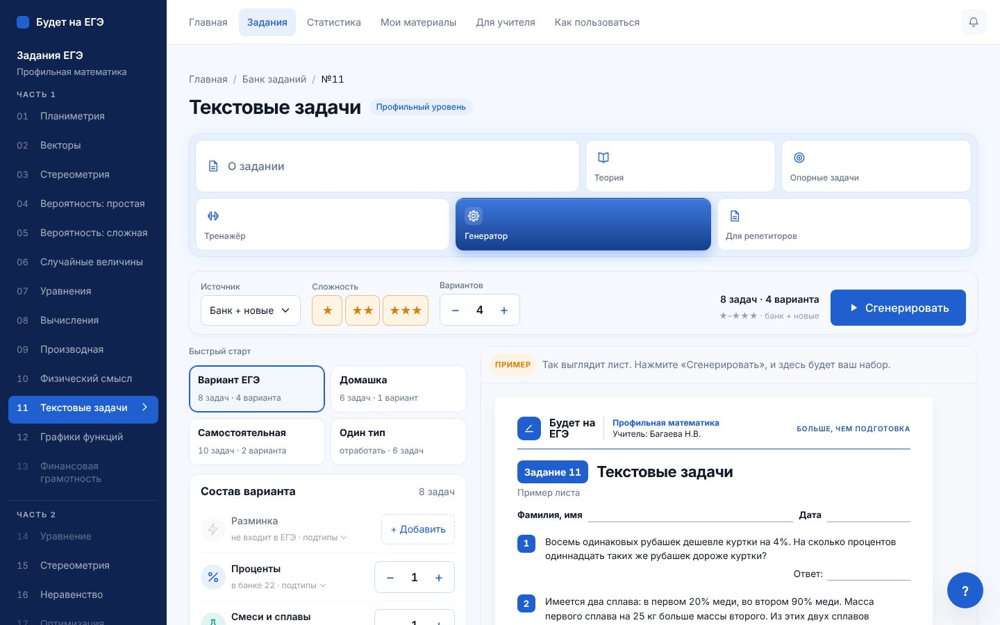 | 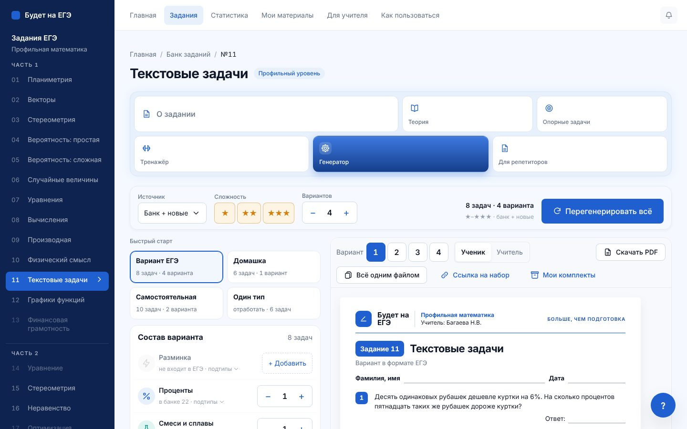 |
| 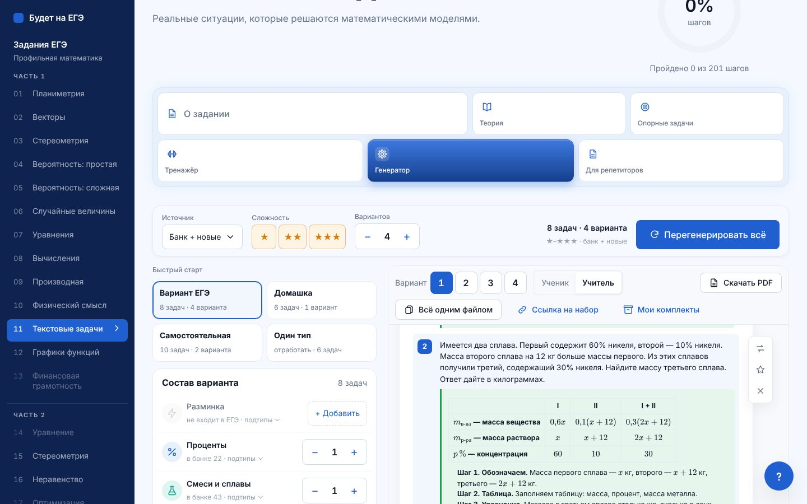 | 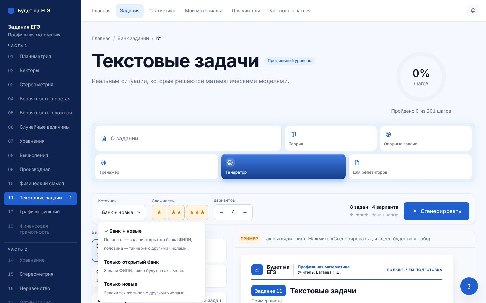 |
| 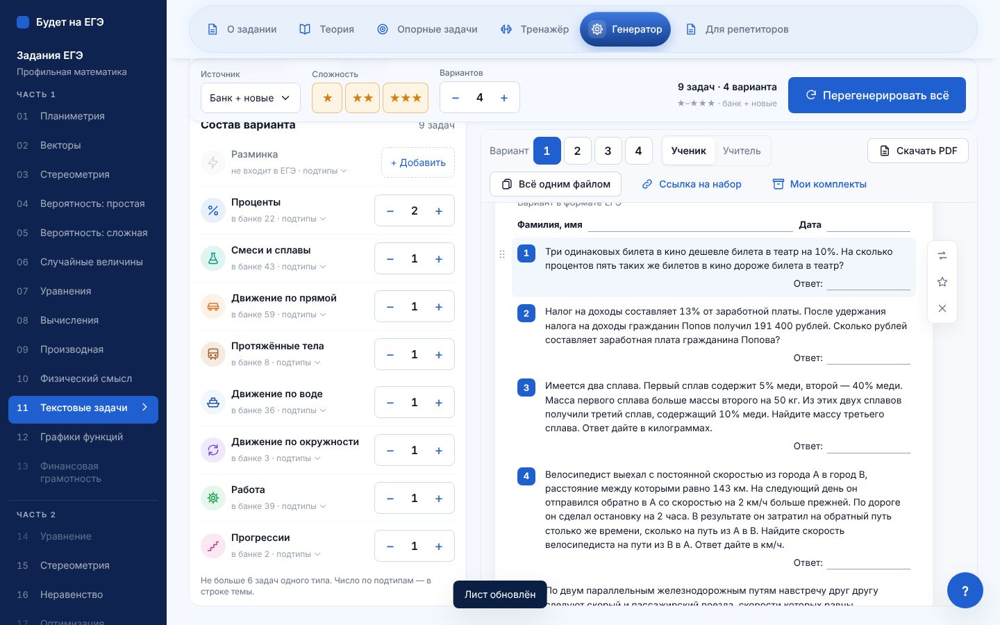 — ручка перестановки слева от задачи | 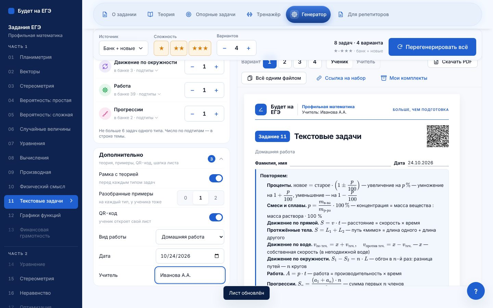 — «Дополнительно» и лист с рамкой и QR-кодом |

| PDF: рамка и QR-код | PDF: разобранный пример |
|---|---|
| 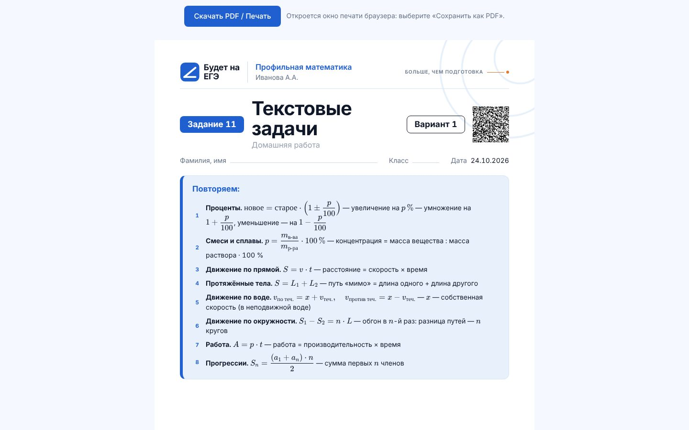 | 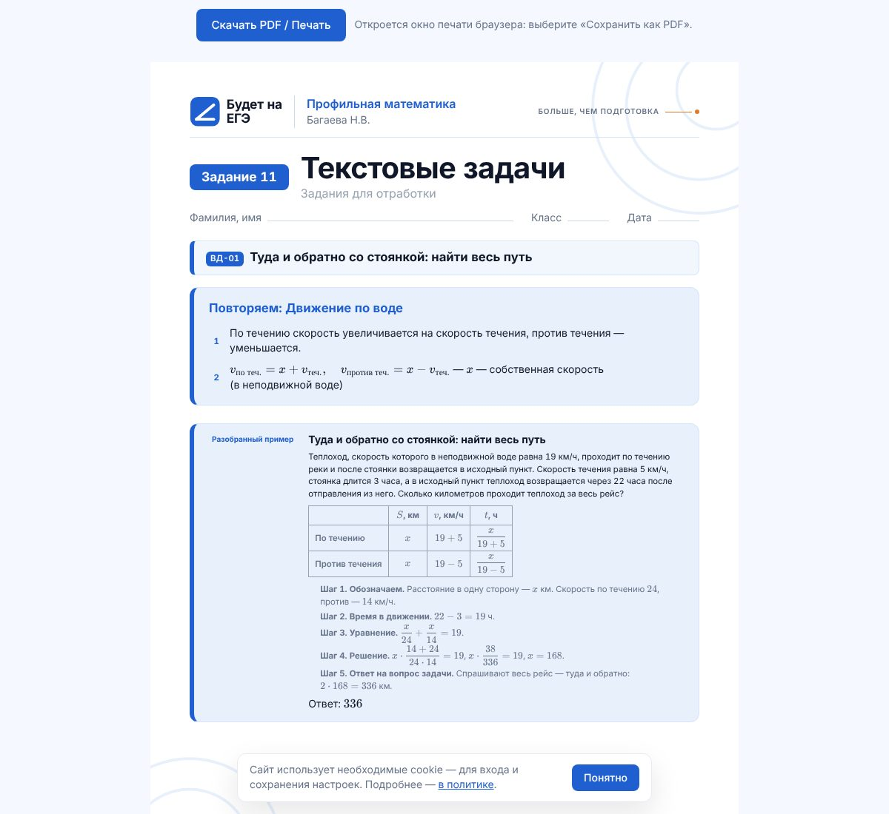 |

| Телефон: начало | лист | фильтры | меню задачи | «Дополнительно» |
|---|---|---|---|---|
| 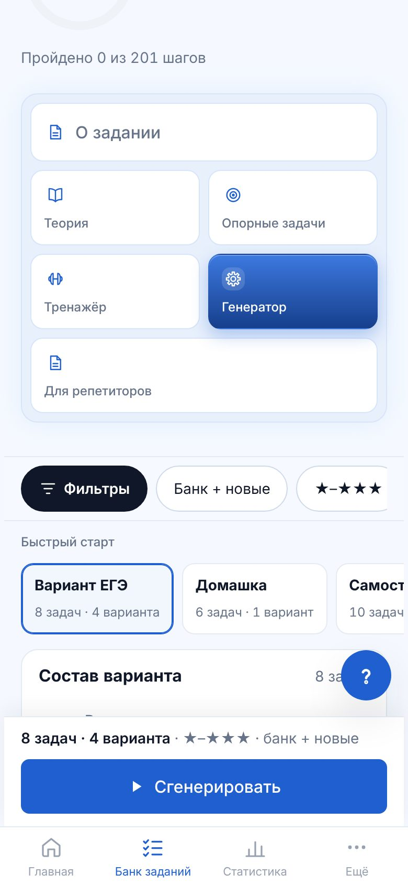 | 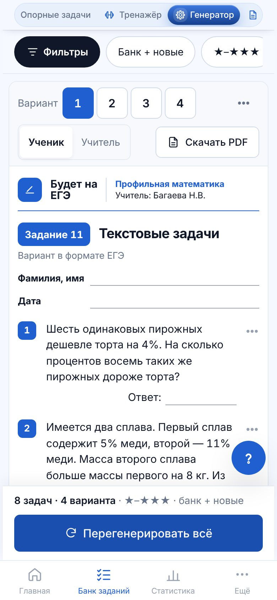 | 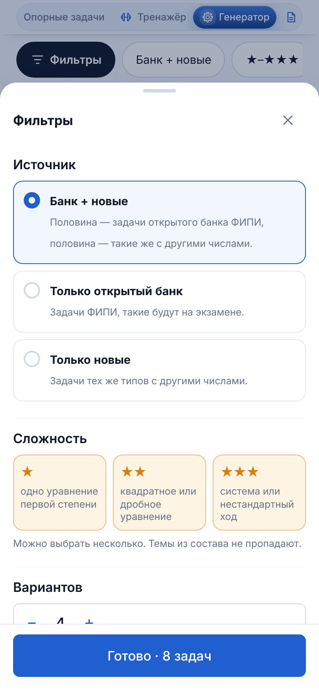 | 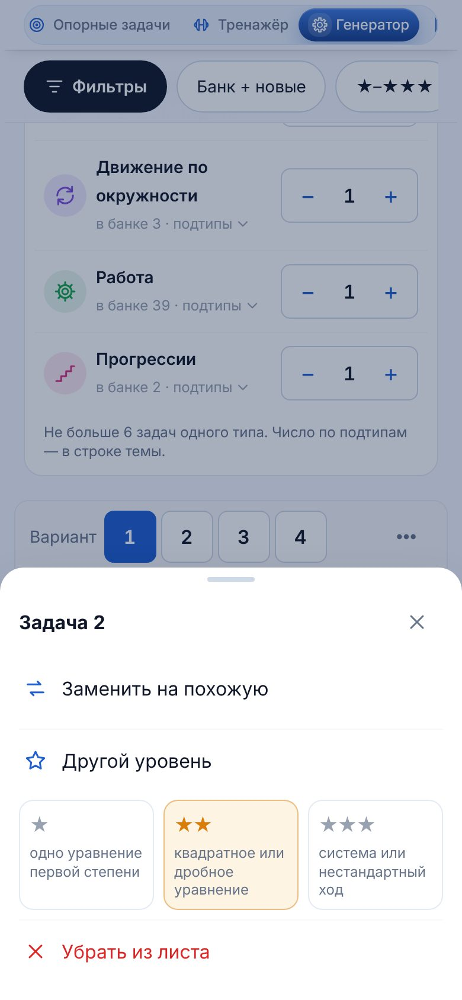 | 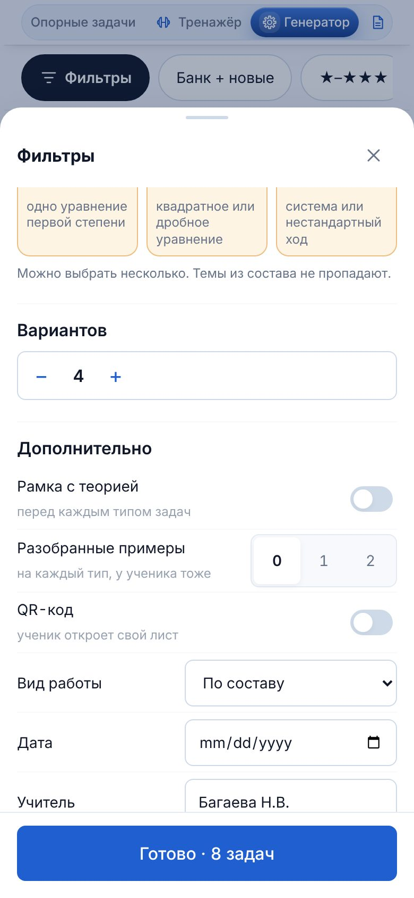 |

## Что осталось

- **Ограничения новой схемы.** Банк у подтипа маленький (1–13 задач), а задачи не повторяются, поэтому полной независимости нет. Если в листе две и больше задачи одного подтипа, смена числа вариантов может заменить вторую и следующие. Когда банк подтипа почти исчерпан, «Убрать» или «+» у того же подтипа может сменить задачу, взятую с конца банка. Пресеты такого не дают: в них подтипы не повторяются, автотест это проверяет.
- **Остальные разделы** (№1, №2, №4–10, №12, №13) — по одному шагу на раздел. Для №13 в `main` уже есть движок, банк и отдельный макет генератора (`docs/mockups/13-generator/`); при подключении его надо свести с общим компонентом. Стили `z11-gen` / `z11-a4` в `zadanie11.css` пока остаются: на них держится генератор №1, они уйдут вместе с ним.
- **Снимки исследования**: снимки чужих сайтов убраны из репозитория по правилу `check-repo-files.mjs` и лежат в приватной галерее (ссылка в `01-research.md`).
