# Генератор · Этап 3 — общий компонент и №11

Дата: 24 октября 2026. Ветка `claude/generator-redesign-dg4tjq`. Макет — А из `02-design.md`.

Этот шаг закрывает пункты 3.1 и 3.2 плана: общий компонент `Generator` с конфигом раздела и подключение к №11. Сюда же вошла правка движка №11 из раздела 9 `02-design.md`: задача привязана к позиции в составе, поэтому замены не сбрасываются и задачи можно переставлять. Сюда же вошли компактная шапка раздела, «Дополнительно» с PDF (пункт 3.4) и первые разделы пункта 3.3 — №1 «Планиметрия», №2 «Векторы», №8 «Вычисления», №9 «Производная» и №12 «Графики функций». Остальные разделы — следующими шагами (раздел «Что осталось»).

## Что сделано

- **Общий компонент** `app/src/components/generator/`: полоса фильтров, пресеты, состав, предпросмотр, окна, «Мои комплекты», стили на токенах сайта.
- **Логика без React** `app/src/lib/generator/obshchiy/`: типы конфига и состояния, пресет → план по подтипам, степпер темы и подтипа, смена уровня и источника, удаление задачи, сводка, проверка ограничений.
- **№11 подключён** через адаптер `app/src/lib/zadanie11/generator11.ts`; слова и пресеты — `app/src/content/generator11.ts`.
- **Правка движка №11** (`app/src/lib/zadanie11/sheet11.ts`, схема `ps=2` в адресе). Задача привязана к ключу позиции «подтип + номер внутри подтипа» (`PR-04_0`), а не к номеру на листе; замены — по тому же ключу. Генераторы задач, банк и ответы не менялись. Старые адреса и маршруты уроков собираются по прежней схеме: проверено на 144 адресах, листы совпадают побайтно.
- **Старая разметка удалена**: прежний `Generator11.tsx` (462 строки) заменён обёрткой на 35 строк, тексты `GENERATOR_11` удалены.
- **Лист учителя при печати** — без плашек «банк» / «новая» у задач; источник — одной строкой у каждого варианта в разделе «Ответы»: «Задачи 2, 3, 5 — открытый банк ФИПИ, остальные — авторские». Маршруты уроков из «Для репетиторов» не тронуты.
- **Компактная шапка раздела** на вкладке «Генератор»: заголовок и уровень в одну строку, без вводного текста и кольца прогресса ученика. На 1440×900 генератор начинается на 184 px выше (390 px от верха вместо 574), на телефоне 390×844 — на 292 px выше, фильтры и кнопка «Сгенерировать» видны на первом экране. Остальные вкладки не изменились. Правило записано в `docs/razdel-pravila.md`.
- **Телефон, первая генерация**: экран доезжает до листа. Раньше прокрутка запускалась до того, как лист появлялся на странице, и останавливалась на полпути.
- **«Дополнительно»** — карточка под составом (на телефоне — в «Фильтрах»), всё попадает в ссылку на набор, в предпросмотр и в PDF ученика и учителя:
  - **рамка с теорией** «Повторяем»: определение и главная формула раздела из вкладки «Теория». В листе по одному типу — перед первым блоком каждого раздела, в варианте ЕГЭ — одна общая рамка, по формуле на раздел;
  - **разобранные примеры** 0 / 1 / 2: новые задачи того же подтипа с решением по этапам, их нет среди задач листа. В отработке — к каждому подтипу, в варианте ЕГЭ — на весь вариант. Одинаковы во всех вариантах и на обоих листах;
  - **QR-код** в строке названия листа (20 мм). Ведёт на лист ученика этого набора, а не в генератор: из генератора ученик одним нажатием открыл бы лист учителя с ответами;
  - **вид работы** в шапке («Домашняя работа», «Самостоятельная работа», «Контрольная работа», «Тренировочный вариант»; по умолчанию — по составу). Пресеты «Домашка» и «Самостоятельная» ставят свой вид;
  - **дата** — вписывается в поле «Дата»; пусто — пустая линия;
  - **учитель** — в шапке листа, по умолчанию «Багаева Н.В.».
  Задачи от «Дополнительно» не меняются, комплект и его отпечаток — те же. Для QR-кода добавлена библиотека `qrcode-generator` (MIT, без зависимостей); она грузится, только когда QR включён. В общем шаблоне листа (`lib/sheet`) два новых необязательных поля: QR в строке названия и рамка «в столбик» для длинных пунктов с формулами; остальные генераторы их не задают и не меняются.
- **Тур онбординга** указывает на новые блоки генератора.
- **Автотест** `pnpm test:generator` (697 проверок) и шаг в CI.

## №1 «Планиметрия» на общем генераторе

- **Конфиг и адаптер**: `app/src/content/generator1.ts` (слова, уровни, источники, пресеты), `app/src/lib/planimetriya/generator1.ts`. Темы — блоки I–X, подтипы — прототипы. Блок X («Ещё темы курса») — только в «банк + новые» и «только новые»: задач открытого банка в нём нет.
- **Привязка к позиции** вынесена из №11 в общий модуль `app/src/lib/generator/obshchiy/klyuchi.ts` (ключи, состав в адресе, пулы банка, выбор задачи); листы №11 и №1 берут её оттуда. Листы №11 после переноса не изменились — сверено побайтно на 576 адресах новой схемы и 144 прежних. Лист №1 (`sheet1.ts`) получил ту же схему `ps=2` — это та же правка, что согласована для №11, в листе раздела; генераторы задач и чертежей не менялись. Прежние адреса №1 и уроки серии собираются как раньше — 147 адресов совпадают побайтно.
- **Чертежи в предпросмотре**: у задачи общего генератора появились чертёж условия и чертёж учителя со всеми построениями; на компьютере — справа от условия, на телефоне — над ним.
- **«Дополнительно»** у №1: рамка «Повторяем» (карточки справочника) и примеры порознь, QR-код, вид работы, дата, учитель. Прежний параметр рамки `f` по-прежнему понимается.
- **Лист учителя** из генератора — без пометок «банк» / «не из открытого банка» у задач, источник одной строкой у варианта. Прежние адреса и уроки серии пометки сохраняют.
- **Удалено**: прежний `Generator1` (574 строки), тексты `GENERATOR_1`, стили `z11-gen*` / `z11-a4*` в `zadanie11.css` и `z1-a4*` в `trenazher1.css`.
- **Рамка в варианте ЕГЭ** (девять пунктов, по карточке на блок) на листе генератора — в две колонки: в три самая широкая формула выходила за поле листа, так было и в прежнем генераторе. В общем шаблоне листа у рамки появилось необязательное число строк; прежние адреса печатаются как раньше.
- **Прежний адрес** открывается в генераторе в своём режиме листа («Варианты» или «Задания для отработки»), даже если по составу генератор выбрал бы другой: лист совпадает с напечатанным целиком.

| Десктоп: лист ученика | «Дополнительно»: рамка, пример, QR | Лист учителя |
|---|---|---|
| 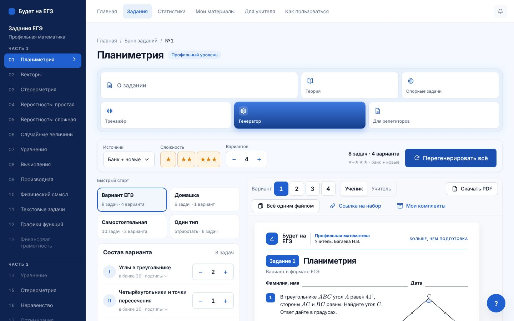 | 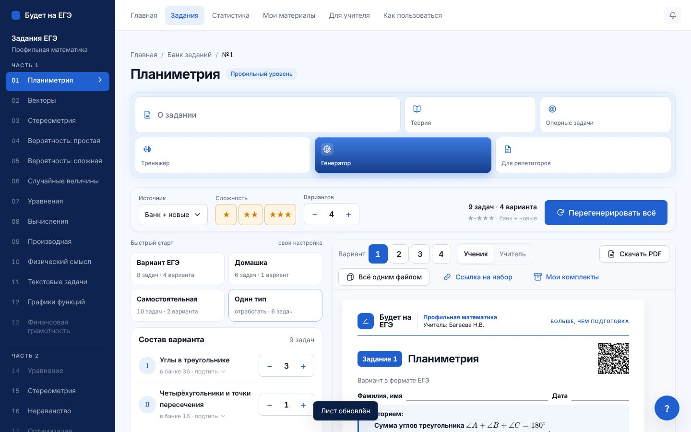 | 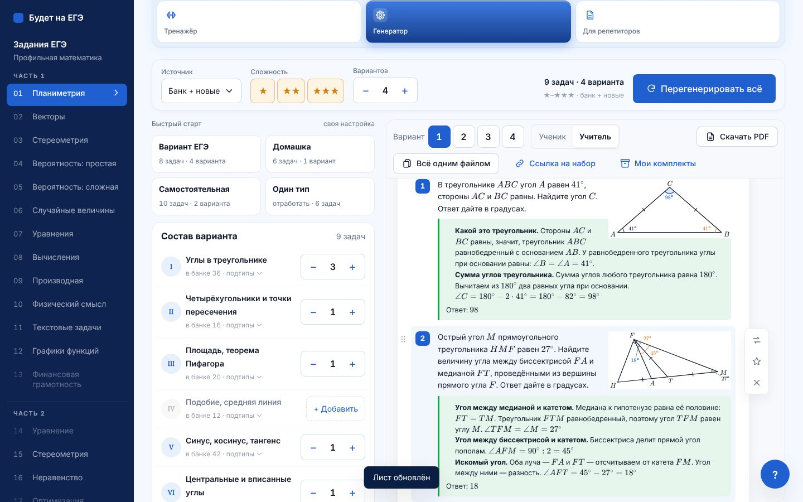 |

| Телефон: начало | Телефон: лист с чертежом | PDF учителя: рамка, пример, QR |
|---|---|---|
| 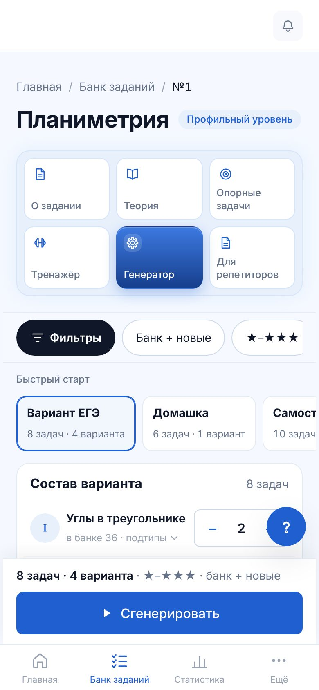 | 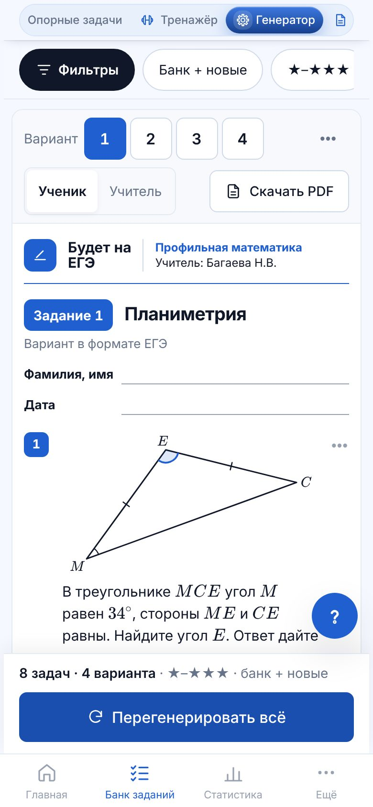 | 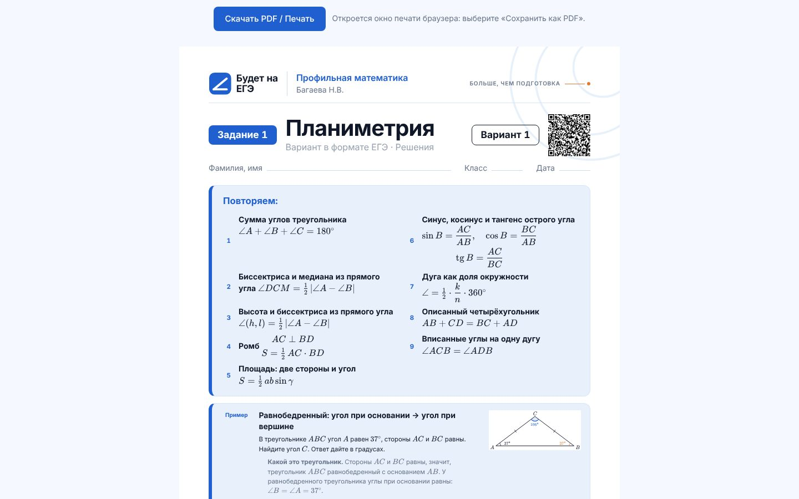 |

## №2 «Векторы» на общем генераторе

- **Конфиг и адаптер**: `app/src/content/generator2.ts`, `app/src/lib/vektory/generator2.ts`. Темы — группы A, B, C, подтипы — 19 прототипов. Задачи №2 только генерируются: источник один, его выбора на экране нет. Уровней у прототипов нет — фильтра сложности и «Другого уровня» тоже нет.
- **Общий компонент научился** тому, что нужно разделам без банка и уровней: название темы или подтипа с формулами (KaTeX, у B9 — $2\vec{a}$); конфиг без уровней; «Дополнительно» только с тем, что раздел умеет (у №2 — вид работы, дата, учитель, QR-код, без рамок и примеров); буква темы в кружке, если у раздела нет своих значков.
- **Лист №2** (`sheet2.ts`): схема `ps=2` — состав «прототип × число» с ключами позиций вместо «общее число поровну», замены, учитель в шапке, QR-код. Задачи «по рисунку» с одинаковым текстом различаются рисунком — замены сравнивают оба, каждая следующая замена не повторяет прежние. Прежние адреса и банк для репетиторов печатаются как раньше — 67 адресов совпадают побайтно.
- **Новая страница** `/zadaniya/2/pechat/vse/` — «Всё одним файлом»: листы ученика всех вариантов, затем листы с решениями и таблица ответов.
- **Пресет «Вариант ЕГЭ»** — по задаче «по рисунку» из каждой группы (A6, B5, C2), как в экзаменационном варианте.
- **Удалено**: `Generator2Screen` и `Generator2Tab`, тексты `GENERATOR_2`. Прежний шаг «своё название вида работы» не переносится: вид работы — из списка в «Дополнительно» (02-design.md, раздел 10); старая ссылка со своим названием открывается с ним до первой правки.

| Десктоп: лист ученика | «Дополнительно»: QR, вид работы, дата | Телефон |
|---|---|---|
| 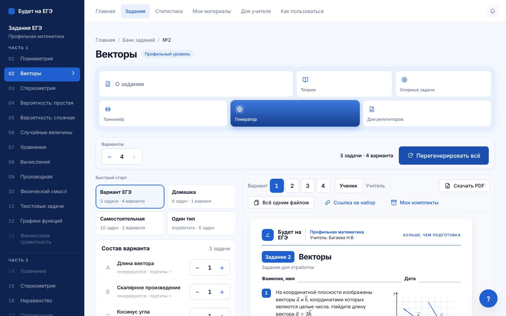 | 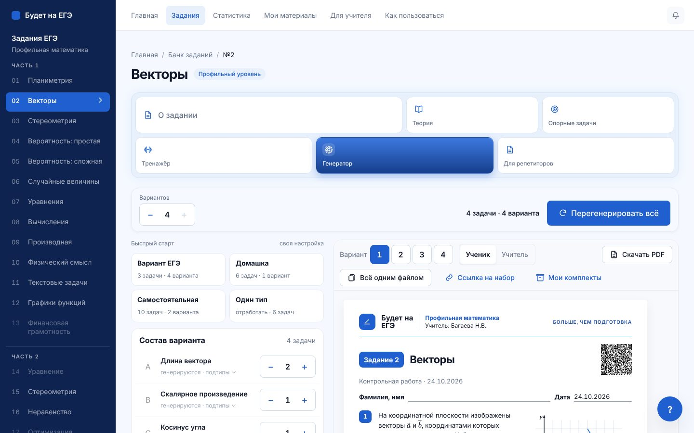 | 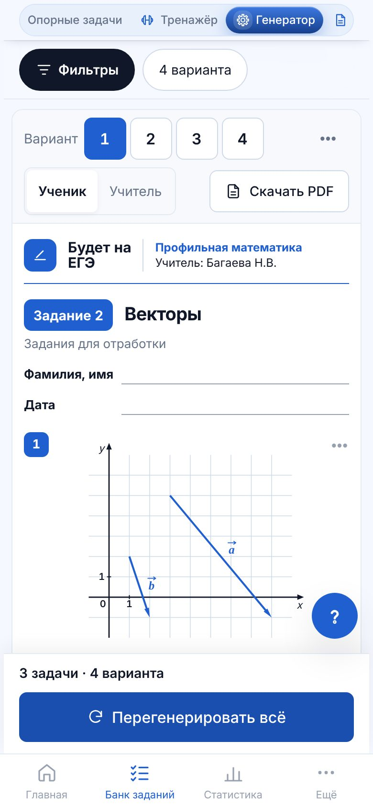 |

## №8 «Вычисления» на общем генераторе

- **Конфиг и адаптер**: `app/src/content/generator8.ts`, `app/src/lib/vychisleniya/generator8.ts`. Темы — 11 навыков S1–S11, подтипы — 26 прототипов 8.A–8.Z. Источник один: задачи только генерируются.
- **Уровень у №8 — на весь лист.** Почти каждый прототип даёт и базовую задачу (★, один шаг), и повышенную (★★, два шага или неочевидное основание): уровень — параметр генерации, а не свойство прототипа. Поэтому фильтр «Сложность» задаёт уровень всего листа: ★ — базовые, ★★ — повышенные, оба — вперемешку, как «любой» в прежнем генераторе. «Другого уровня» у отдельной задачи нет. Для этого общий компонент научился подтипу с несколькими уровнями (у прототипа в составе — «★–★★») и флагу конфига `taskLevel: false`.
- **Лист №8** (`sheet8.ts`): схема `ps=2` — состав «прототип × число» с ключами позиций вместо «общее число поровну по навыкам», до четырёх вариантов (у прежнего листа вариант был один), замены, учитель в шапке, QR-код, поле даты. Блоки листа — по навыкам, как раньше. Условий у некоторых прототипов немного (у «sin по cos» на шести задачах одного прототипа совпадения были в трёх листах из четырёх), поэтому задачи одного прототипа в варианте не повторяются: позиции считаются по возрастанию ключа и обходят условия младших. Перестановка от этого не зависит; удаление соседней задачи меняет задачу, только если та совпала бы. Прежние адреса печатаются как раньше — 146 адресов совпадают побайтно.
- **Новая страница** `/zadaniya/8/pechat/vse/` — «Всё одним файлом».
- **Пресеты**: «Домашка» — по задаче на каждый навык, «Самостоятельная» — 6 задач, 2 варианта, оба уровня, «Один навык» — 8 задач выбранного навыка.
- **Удалено**: `Generator8Screen` и `Generator8Tab`. Выбор колонок и цветной/ч-б темы не переносится, как и у №2 (02-design.md, раздел 10); старая ссылка с ними открывается с ними до первой правки.
- **Попутно исправлено** в общем компоненте: значки тем были серыми у всех разделов (ошибка в стилях из шага №2), у предпросмотра учителя №2 «Ответ» стоял дважды, подпись «Дополнительно» у №2 обещала теорию и примеры, которых у раздела нет.

| Десктоп: лист ученика | Уровни прототипов навыка | Телефон |
|---|---|---|
| 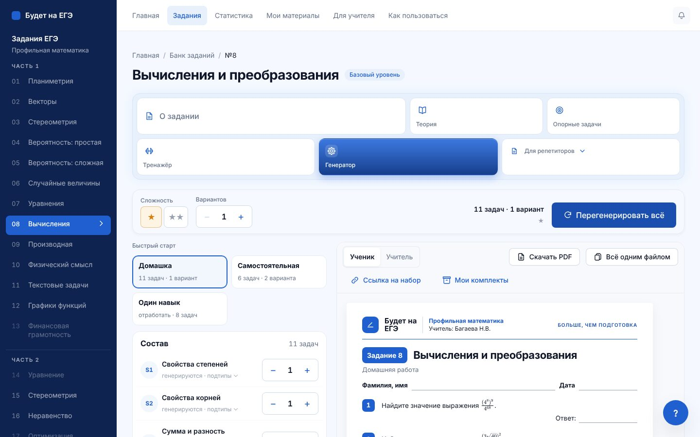 | 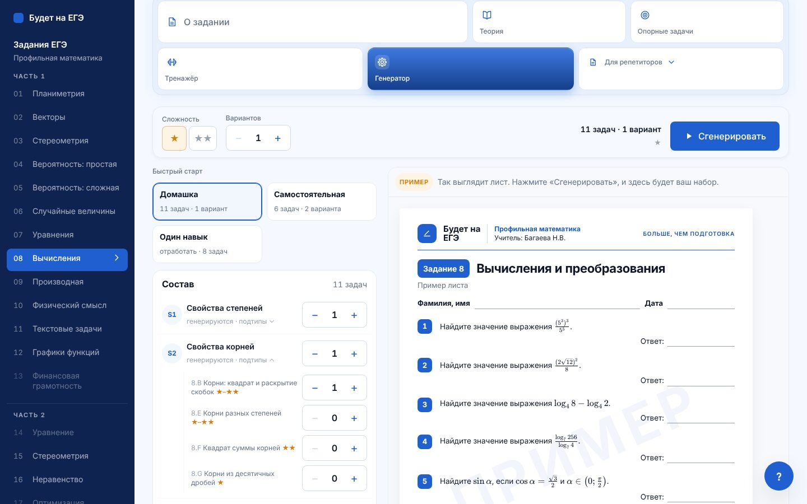 | 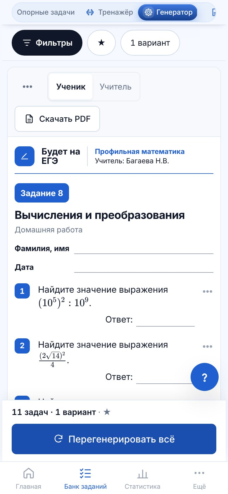 |

| Учитель: разбор в предпросмотре | PDF учителя: QR-код, дата |
|---|---|
| 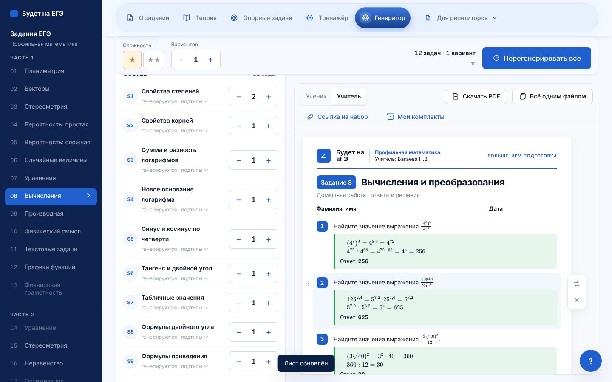 | 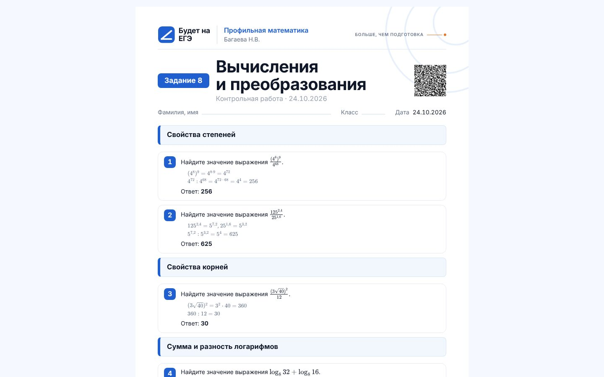 |

## №9 «Производная» на общем генераторе

- **Конфиг и адаптер**: `app/src/content/generator9.ts`, `app/src/lib/proizvodnaya/generator9.ts`. Темы — пять групп со своими миниатюрами, подтипы — 31 прототип. Уровней нет.
- **Задачи.** Банк №9 — не открытый банк ФИПИ, а 20 проверенных вариантов движка на прототип. Поэтому источник один: позиция берёт вариант банка на своём месте в порядке, который задаёт код комплекта; банк прототипа кончился — новая задача по seed позиции. Строки «банк / новая» на листе учителя нет.
- **Урок серии** — в «Дополнительно» (1–8, как у прежнего экрана): один код комплекта — серия листов, урок 2, 3, … берёт следующие задачи банка без повторов, пока они есть. Общий компонент показывает эту строку только у раздела с `extras.seriya` в конфиге.
- **«Запомни» и разобранные примеры** — раздельно: «Рамка с теорией» — рамка «Запомни» перед группой, «Разобранные примеры» — 0–2 на группу. В прежнем генераторе это была одна настройка «примеров 0–2», и рамка шла вместе с примерами; старые ссылки так и открываются.
- **Лист №9** (`sheet9.ts`): схема `ps=2` — состав «прототип × число» с ключами позиций, до четырёх вариантов (у прежнего листа вариант был один), замены, учитель в шапке, QR-код, поле даты. Лист учителя по-прежнему кусками: условие с рисунком построений неделимо, разбор переносится между этапами. Для этого шаблон листа (`lib/sheet/sheet.js`) научился готовым кускам задач у блока (`taskItems`) — у остальных листов ничего не меняется. Прежние адреса печатаются как раньше — 98 адресов совпадают побайтно; `test:seriya-9` по-прежнему проходит.
- **Предпросмотр.** Формулы листа №9 — заглушки, их набирает страница печати; адаптер набирает их KaTeX сам. У ученика — рисунок условия, у учителя — с построениями.
- **Новая страница** `/zadaniya/9/pechat/vse/` — «Всё одним файлом». Удалены `Generator9Screen` и `Generator9Tab`.
- **Попутно исправлено**: степпер в строке «Дополнительно» ломался (правило подписи строки задевало и его).

| Десктоп: лист ученика | «Дополнительно»: «Запомни», пример, урок серии | Телефон |
|---|---|---|
| 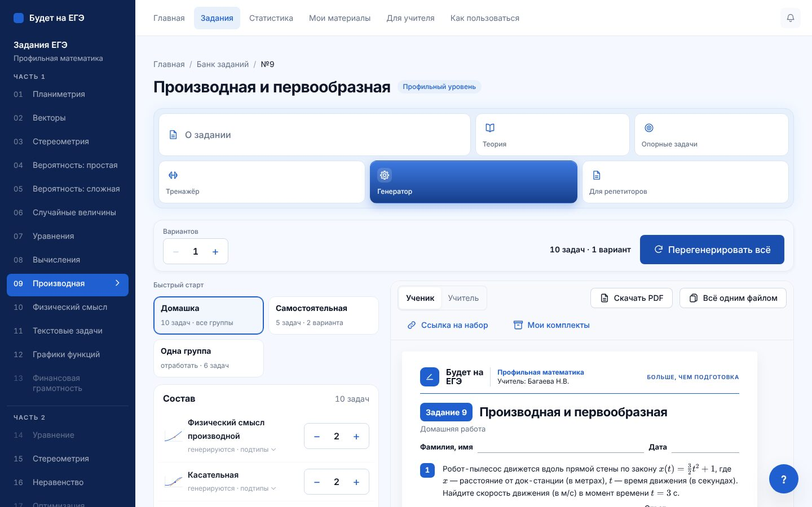 | 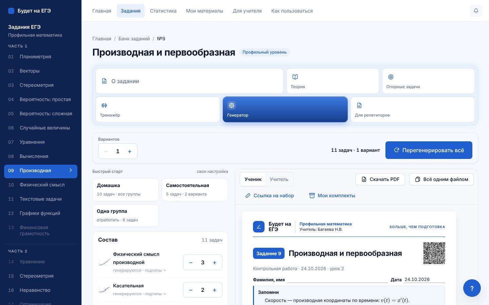 | 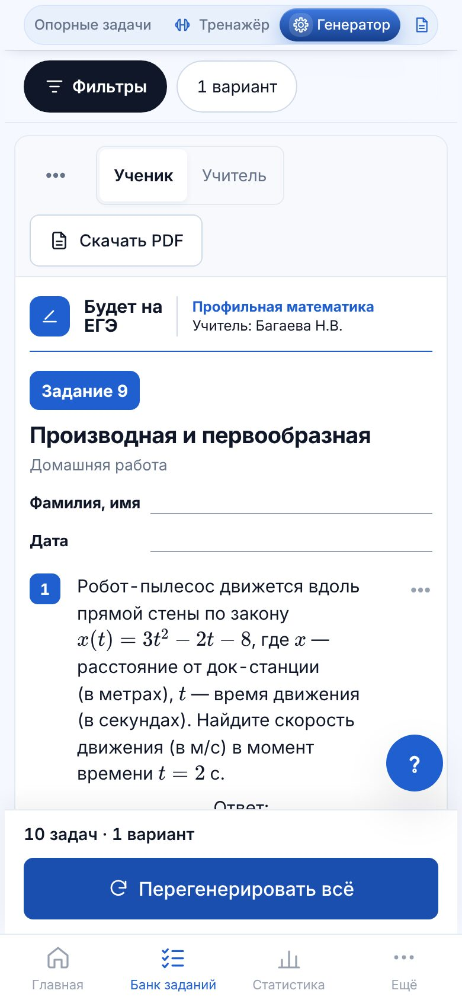 |

| Учитель: разбор этапами | PDF учителя: «Запомни», пример, QR-код |
|---|---|
| 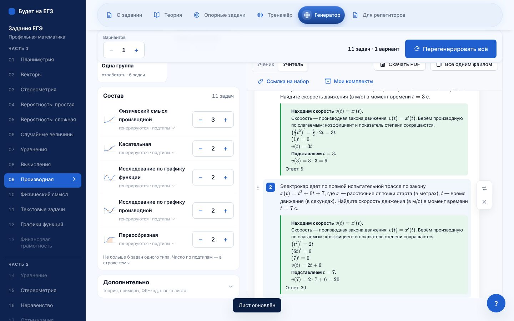 | 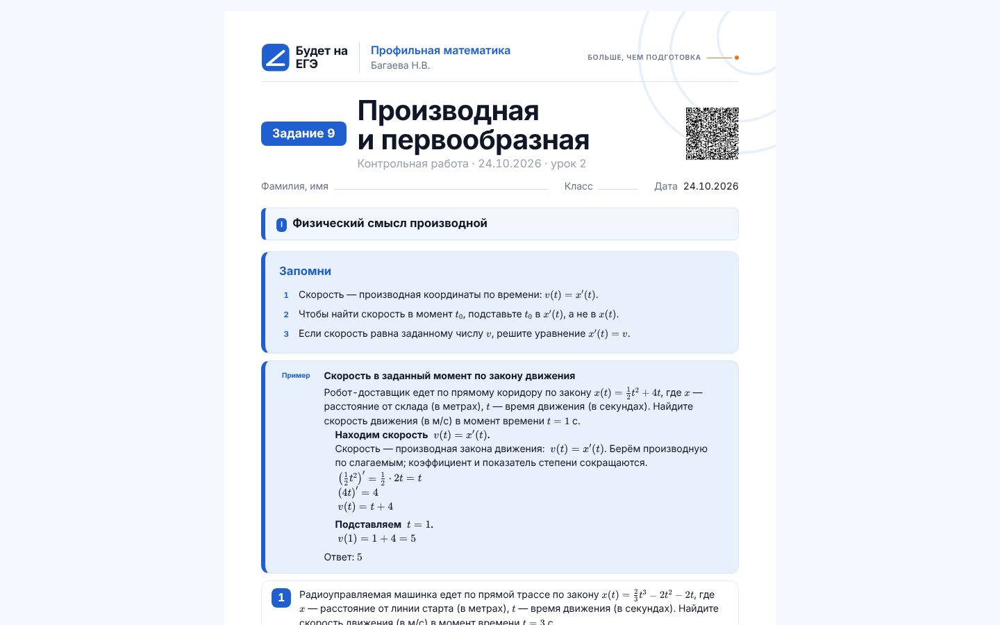 |

## №12 «Графики функций» на общем генераторе

- **Две поверхности — один адаптер.** «Генератор по всем типам» (`/zadaniya/12/generator/`) — общий компонент со всеми семью типами функций; вкладка «Генератор» подтемы — тот же конфиг с одним типом (`lib/ves12/generator12.ts` собирает конфиг на сервере из манифеста движка, `lib/ves12/engine12.ts` — адаптер в браузере). Темы — типы функций с иконками подтем, подтипы — 42 набора прототипов (12.A, 12Q.B …). Удалены `GeneratorScreen` и `GeneratorAll`.
- **Уровень — на весь лист**, как у №8: у наборов есть и «удачные» числа (★), и «неудачные» (★★), оба — вперемешку. Подписи уровней на вкладке подтемы — её («клетка — единица, целый ответ» у тригонометрии и т. д.).
- **Лист** (`lib/generatorSheet.ts`, адрес — `lib/generatorQuery.ts`): схема `ps=2` — состав «набор × число» с ключами позиций, замены, учитель, QR-код. Шаблон задачи позиции — по коду листа и ключу, один во всех вариантах: вариант 2 на том же месте — та же задача с другими числами, как у прежнего листа. Условия одного набора в варианте не повторяются; сравнивается то, что видит ученик, — условие, варианты ответа и нарисованный рисунок. Если движок не собрал набор на seed, берётся следующий seed, а если у шаблона кончились числа — другой шаблон того же уровня.
- **Подписи на листе.** Лист одной подтемы без «Запомни» и примеров — одним блоком без подписей навыков, как раньше: по подписи ученик угадал бы метод. Несколько типов или рамки — блоки по типам, «Запомни» и пример — перед первым блоком типа (как «по типам» у прежнего генератора).
- **Не перенесено**: «Вперемешку» прежнего генератора по всем типам, колонки и ч-б тема (02-design.md, раздел 10). Задачи можно переставить вручную; старая ссылка открывается с прежними настройками до первой правки.
- **Прежние адреса** подтем, генератора по всем типам и общий формат адреса с №4/№5 — без изменений: 120 адресов №12 совпадают побайтно.
- **Вкладка подтемы грузится лениво** (`Generator12Lazy`): генератор и KaTeX не идут в первую загрузку страницы темы (`test:first-load`: 191 КБ при пороге 205).
- **Новые страницы** «Всё одним файлом»: `/zadaniya/12/<подтема>/pechat/vse/` и `/zadaniya/12/generator/pechat/vse/`.
- Формулы листов №9 и №12 для предпросмотра набирает общий `lib/generator/nabrat.ts`.

| Все типы: лист ученика | «Запомни» и пример у каждого типа | Вкладка подтемы: телефон |
|---|---|---|
| 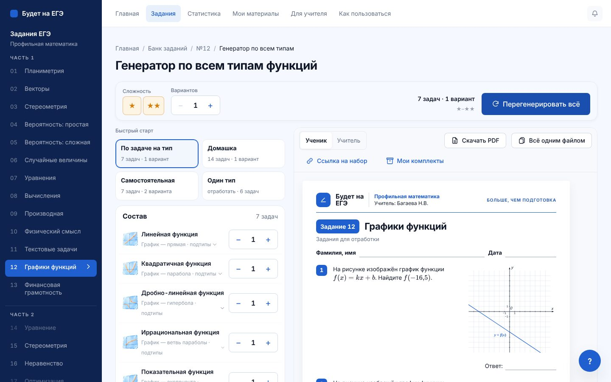 | 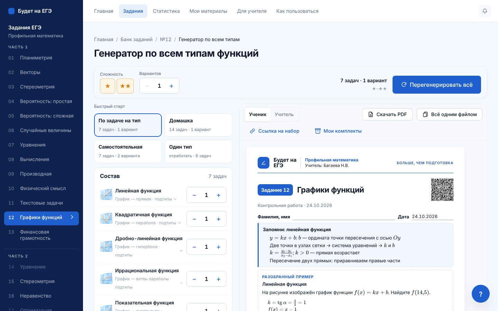 | 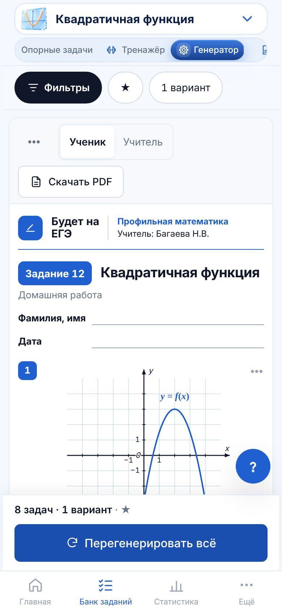 |

| Учитель: рисунок с построениями | Вкладка подтемы | PDF учителя |
|---|---|---|
| 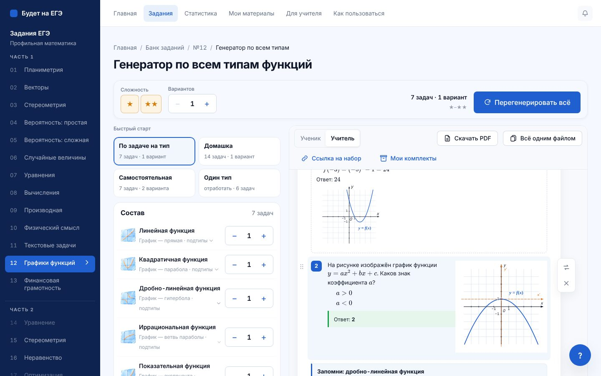 | 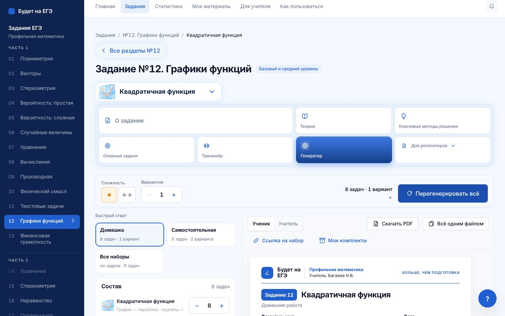 | 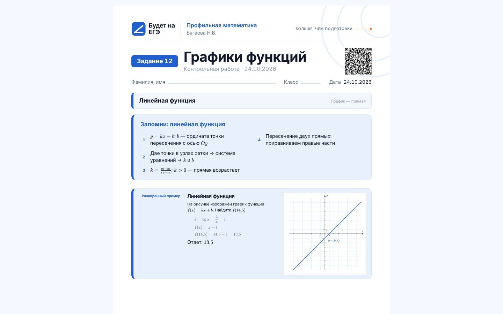 |

## №6 «Случайные величины» и №7 «Простейшие уравнения» на общем генераторе

- **Банк готовых задач — один модуль на оба раздела** (и на №10, см. ниже). Задачи не генерируются на лету: у прототипа исходные задачи (демоверсия и открытый банк ФИПИ, образцы) и аналоги, подготовленные заранее. `lib/generator/obshchiy/bank.ts` — адрес `ps=2` и подбор задач по ключам позиций, `bankEngine.ts` — адаптер общего генератора, `bankServer.ts` — индекс банка для конфига. Конфиг раздела собирается на сервере (`lib/zadanie6/generator6.ts`: темы — группы, подтипы — прототипы, «в банке N» — число исходных задач), адаптер работает в браузере (`engine6.ts`). Удалены прежние `Generator6` и `Generator7` (экран «шаблон → источник → сколько задач каждого типа»).
- **Подбор по позициям.** Позиция «прототип + номер» (ключ `P04_1`) берёт своё место в перемешанном пуле нужного источника (вариант × 12 + номер), затем свободную задачу с конца пула, затем другой источник. Остаток раздаётся по вариантам по порядку: ещё один вариант не меняет прежние, а маленький банк исходных задач расходится целиком. «Заменить» берёт следующую свободную задачу того же прототипа. «Источник»: «Только исходные» (у №7 «Только ФИПИ»), «Вперемешку», «Только аналоги»; кончились задачи источника — берётся другой.
- **«Формулировка» №6** (сюжетные / стандартные / все) — прежняя настройка; в общем компоненте для неё появился необязательный фильтр раздела рядом с источником (`GenConfig.filtr`). Шаблоны прежнего генератора — пресеты: «Весь №6», «Ожидание и дисперсия», «Диаграммы и деревья», «Только сюжетные».
- **Памятка и примеры — отдельно.** Памятка — карточки теории прототипов листа (те же, что во вкладке «Теория»), разобранные примеры — аналоги из конца пула прототипа, отложенные всегда: переключатель не меняет задачи листа, а исходные задачи (их у прототипа одна-две) остаются задачам. У прежнего листа рамка теории и примеры шли вместе и примеры брались из исходных задач — прежний адрес так и открывается.
- **Лист печати** — по-прежнему React (`List6`, `List7`): по адресу `ps=2` — задачи по позициям, шапка из «Дополнительно» (вид работы, дата, учитель, QR-код, `components/generator/ShapkaBanka.tsx`). Новые страницы «Всё одним файлом»: `/zadaniya/6/pechat/vse/`, `/zadaniya/7/pechat/vse/`.
- **Предпросмотр** собирают те же компоненты условия, разбора и карточек теории, в строку HTML (`predprosmotr6.tsx`, `renderToStaticMarkup`). Модуль грузится при первой сборке листа вместе с банком и решателями.
- **Прежние адреса** генератора (`t=P01:2&i=m&v=2&e=1&st=v&seed=…`) — без изменений: 300 адресов №6 и №7 совпадают с листом до правки. Уроки репетитора (`kod=…&u=…`) генератор не перехватывает.

| №6: лист ученика | «Формулировка» | Памятка и пример |
|---|---|---|
| 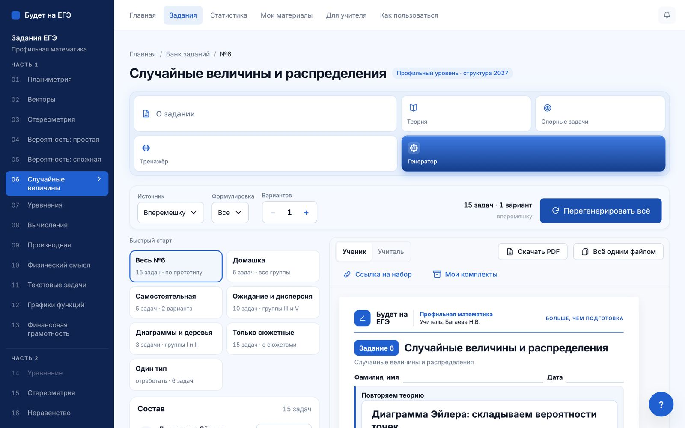 | 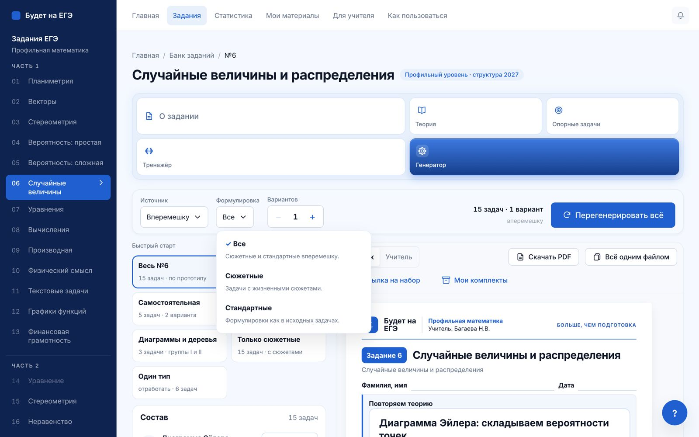 | 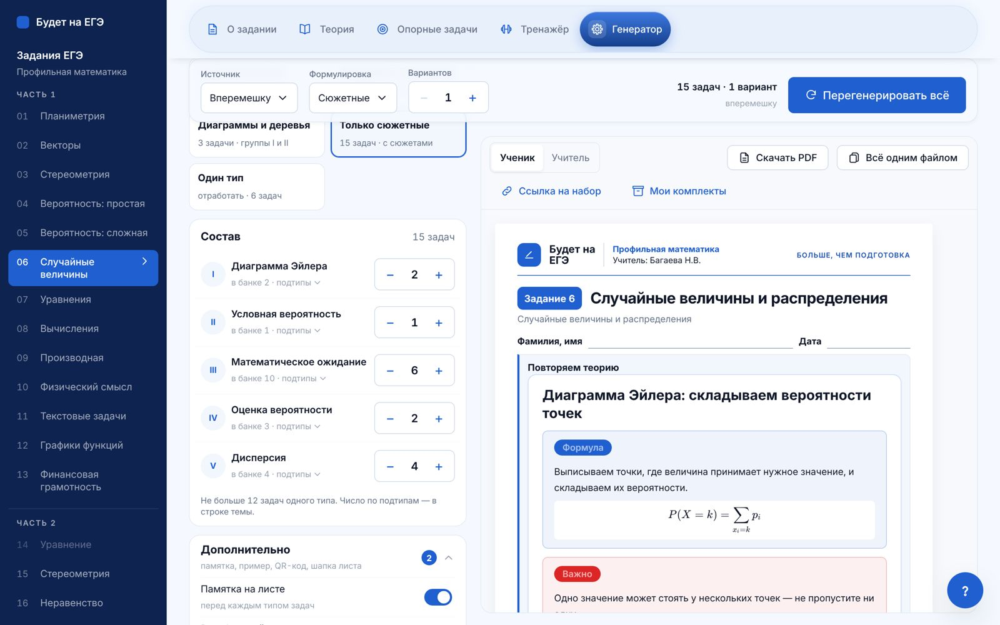 |

| №6: печать ученика | печать учителя | №7: лист ученика | №7: телефон |
|---|---|---|---|
| 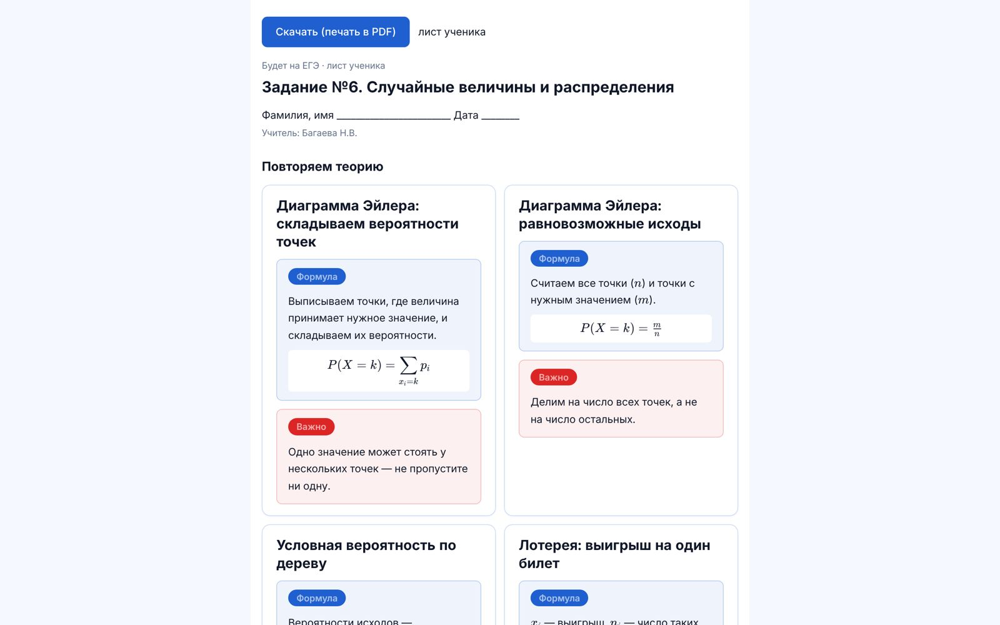 |  | 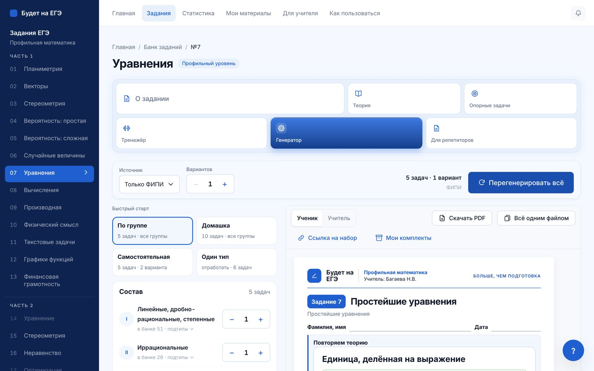 | 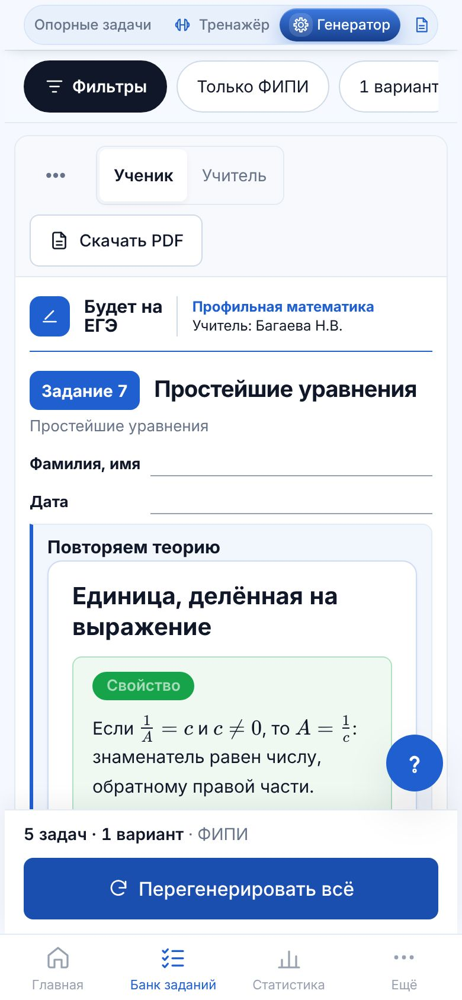 |

## №10 «Прикладные задачи» на общем генераторе

- **Тот же банковый модуль, что у №6 и №7.** Конфиг собирается на сервере (`lib/zadanie10/generator10.ts`: темы — пять групп, подтипы — 34 прототипа, «в банке N» — число задач ФИПИ, у P30–P34 «из курса» их нет), адаптер работает в браузере (`engine10.ts`), предпросмотр рисуют те же куски листа (`components/tasks/zadanie10/ChastiLista10.tsx`) в строку HTML (`predprosmotr10.tsx`). Прежний `Generator10` («сколько задач каждого типа» списком) заменён общим компонентом.
- **«Картинки сюжетов»** — прежняя настройка, теперь переключатель в «Дополнительно» (`GenConfig.extras.flag`, в адресе `fl=1`); по умолчанию выключен, чертёж моста печатается всегда. Новых настроек нет: «Источник» (только ФИПИ / вперемешку / только аналоги), варианты, памятка и примеры — те же, что у остальных разделов. Пресеты: «По группе», «Домашка», «Самостоятельная», «Один тип».
- **Памятка и примеры — как у №6 и №7**: памятка — формулы прототипов и «Важно!» разделов теории, примеры — аналоги из конца пула, задачи ФИПИ остаются вариантам.
- **Лист печати** (`List10`) — по-прежнему React. По адресу `ps=2` — задачи по позициям и шапка из «Дополнительно»; страницы `/zadaniya/10/pechat/` (ученик), `/pechat/otvety/` (учитель) и `/pechat/vse/` (всё одним файлом). Лист теперь кладётся в «Мои комплекты» с кодом комплекта (раньше у №10 комплекта не было: внизу листа печатался только seed).
- **Прежние адреса** (`/pechat/?m=g&l=uchitel&t=P01:2&i=m&v=2&e=1&k=1&s=…`) открываются тем же листом: 150 адресов совпадают с листом до правки. Вид листа прежний адрес по-прежнему берёт из `l`; генератор, открыв такой адрес, убирает `l` из ссылок, и вид листа задаёт страница. Уроки репетитора (`m=u&kod=…&u=…`) генератор не перехватывает.

## Как ведёт себя

- **До первой генерации** — демонстрационный лист с плашкой «Пример» и водяным знаком.
- **«Сгенерировать»** собирает лист по настройкам, кнопка становится «Перегенерировать всё» (новый seed, состав тот же). На телефоне экран сам прокручивается к листу.
- **После генерации** изменения состава, уровня, источника и числа вариантов сразу пересобирают лист с тем же seed. Остальные задачи и сделанные замены остаются на местах: добавление и удаление тем, «−» и «+», «Убрать», перестановка их не трогают. «−», затем «+» возвращают ту же задачу.
- **Перестановка задач**: на компьютере — ручка слева на поле листа (перетащить мышью или ↑ ↓ с клавиатуры), на телефоне — «Выше» и «Ниже» в меню задачи. Задача переезжает вместе с местом, номера на листе печати идут по порядку.
- **Ссылка на набор** — адрес страницы. Он совпадает по формату с адресом листа печати, в нём состав, порядок, seed и замены. После перезагрузки или возвращения на вкладку открывается тот же лист. Прежние ссылки и комплекты открываются тем же листом, что был напечатан; первая правка состава переводит их на новую схему и собирает лист заново.
- **Комплект**: код комплекта = seed. «Скачать PDF» и «Всё одним файлом» отмечают комплект скачанным и кладут его в «Мои комплекты»; там же поиск по коду с бумаги.
- **Действия над задачей**: на компьютере — колонка значков на поле справа по наведению («Заменить», «Другой уровень», «Убрать»; у №2 и №8 «Другого уровня» нет); на телефоне — «⋯» и долгое нажатие.
- **Сложность** больше не выкидывает темы из состава: если у темы нет задач выбранного уровня, берутся ближайшие и под темой появляется подсказка.

## Проверено

| Проверка | Результат |
|---|---|
| `pnpm lint`, `pnpm typecheck` | чисто |
| `pnpm test:generator` (№11, №1, №2, №6, №7, №8, №9, №10, №12 — оба экрана) | 8418 из 8418 |
| Прежние адреса №10 до и после правки листа | 150 адресов, листы совпадают |
| `test:prikladnye`, `test:seriya-10`, `test:illyustracii-10` | чисто |
| Прежние адреса №6 и №7 до и после правки листа | 300 адресов, листы совпадают |
| Браузер: №6 и №7 — генерация, «Формулировка», памятка и пример, замена, листы ученика, учителя и «Всё одним файлом», телефон | всё на месте, ошибок в консоли нет, прокрутки 0 |
| Прежние адреса №12 до и после правки листа | 120 адресов, листы совпадают |
| `test:ves12-site`, `test:zachyot-12`, `test:first-load`, `test:komplekty --kits 20` | чисто |
| Телефон: генератор по всем типам, линейная и квадратичная подтемы (66 страниц × 360, 390, 414) | прокрутки 0 |
| Прежние адреса №9 до и после правки листа | 98 адресов, листы совпадают |
| `test:proizvodnaya`, `test:seriya-9`, `check-mobile-overflow` (генератор и печать №9) | чисто; 7 страниц × 4 ширины, прокрутки 0 |
| Прежние адреса №8 до и после правки листа | 146 адресов, листы совпадают |
| `test:vychisleniya`, `check-mobile-overflow /zadaniya/8/` | чисто; 14 страниц × 4 ширины, прокрутки 0 (5 старых адресов `/podgotovka/` уводят на новые — их скрипт замера не дожидается) |
| `pnpm test:komplekty` (200 комплектов на генератор) | 3000 комплектов, расхождений 0 |
| Прежние адреса №2 и банк до и после правки листа | 67 адресов, листы совпадают |
| `test:vektory`, `check-mobile-overflow /zadaniya/2/` | чисто; 15 страниц × 4 ширины, прокрутки 0 |
| Прежние адреса №1 до и после правки листа | 147 адресов, листы совпадают |
| `test:planimetria`, `test:seriya-1` | чисто |
| `check-mobile-overflow /zadaniya/1/` | 43 страницы × 4 ширины, прокрутки страницы 0 |
| `test:print-pages` (листы №11, №1, №2, №8, №9 и №12 из генератора добавлены в проверку) | страниц в PDF столько же, сколько в листе, пустых нет, сырого TeX нет |
| Старые адреса №11 до и после правки движка | 144 адреса, листы совпадают |
| Браузер: замена, «+», перетаскивание, ↑ ↓, «Выше», перезагрузка, лист печати | всё на месте, ошибок в консоли нет |
| `pnpm test:komplekty --kits 40` | 560 комплектов, расхождений 0 |
| `pnpm test:zadanie11` | проблем 0 |
| `pnpm build` | собирается, вкладка генератора 11,7 кБ |
| `check-mobile-overflow /zadaniya/11/` | 22 страницы × 4 ширины, прокрутки страницы 0 |
| `test:repo-files`, `test:imports`, `test:math-markup`, `test:istochniki`, `test:trailing-slash`, `test:asset-versions` | чисто |
| Элементы меньше 44 px на телефоне | 0 во всех снятых состояниях |

Автотест проверяет:

- каждый пресет в каждом источнике даёт годный набор;
- один seed — один лист; листы ученика и учителя из тех же задач в том же порядке;
- у ученика нет ответов, решений и пометок; у учителя нет плашек, строка источника совпадает с задачами банка;
- ссылка на набор открывает то же состояние, включая замены и порядок; лист печати по ссылке совпадает с экраном;
- замена меняет только заменённые задачи, каждая следующая замена даёт новую задачу;
- добавление темы, «Убрать», перестановка, смена уровней и ещё один вариант не меняют остальные задачи; замена остаётся после добавления темы;
- степпер, уровни, источник и удаление соблюдают ограничения;
- старый адрес открывается тем же листом, что был напечатан;
- у №9: уроки 1–3 серии не повторяют задачи, урок серии возвращается из ссылки;
- у №8: уровень фильтра доходит до движка и возвращается из ссылки, задачи одного прототипа в варианте не повторяются (26 прототипов × 2 уровня × 5 seed);
- «Дополнительно» попадает в ссылку и на оба листа (рамка, примеры, QR, вид работы, дата, учитель), задачи от него не меняются, примеры не повторяют задачи листа, у задач ученика по-прежнему нет решений.

## Скриншоты

Сняты со статической сборки, `docs/generator/stage3/`.

| Десктоп | |
|---|---|
|  |  |
|  |  |
|  — ручка перестановки слева от задачи |  — «Дополнительно» и лист с рамкой и QR-кодом |

| PDF: рамка и QR-код | PDF: разобранный пример |
|---|---|
|  |  |

| Телефон: начало | лист | фильтры | меню задачи | «Дополнительно» |
|---|---|---|---|---|
|  |  |  |  |  |

## Что осталось

- **Ограничения новой схемы.** Банк у подтипа маленький (1–13 задач), а задачи не повторяются, поэтому полной независимости нет. Если в листе две и больше задачи одного подтипа, смена числа вариантов может заменить вторую и следующие. Когда банк подтипа почти исчерпан, «Убрать» или «+» у того же подтипа может сменить задачу, взятую с конца банка. Пресеты такого не дают: в них подтипы не повторяются, автотест это проверяет.
- **Вид листа печати №6, №7 и №10** — пока прежний React-лист: шапка на экране (общий шаблон листа) и в печати выглядит по-разному, задачи, памятка и примеры совпадают.
- **Остальные разделы** (№4, №5, №13) — по одному шагу на раздел. №4 и №5 — генератор по сюжетам. У №13 в `main` теперь свой генератор (`Generator13`, отдельная работа) со своим QR-кодом (`lib/qr.ts`) — его надо свести с общим компонентом и общим `lib/generator/qr.ts`.
- **Проверка печати и несколько вариантов**: `test:print-pages` сверяет число страниц PDF с колонтитулом «N / M», а у листа с несколькими вариантами нумерация своя у каждого варианта. Поэтому в проверке листы с одним вариантом; многовариантный лист проверен в браузере.
- **Снимки исследования**: снимки чужих сайтов убраны из репозитория по правилу `check-repo-files.mjs` и лежат в приватной галерее (ссылка в `01-research.md`).
