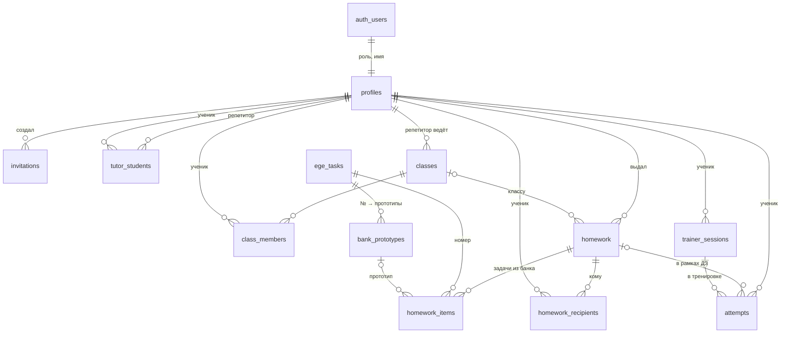

# Кабинет: роли, классы, домашние задания, тренировки

Расширение пробного кабинета. Опирается на `docs/CABINET_UX_SPEC.md`
(экраны О-3, О-4, О-8, Т-1, Т-2, У-1) и на уже готовую таблицу согласий
`supabase/migrations/20261011120000_soglasiya.sql`. Ничего из
существующих разделов не переделывается.

## 0. Исходные условия

- Сайт пока статический (`output: 'export'`, хостинг Timeweb), сервера и
  Supabase ещё нет (сессии С-1 и С-3 спецификации). Поэтому:
  - **база** пишется сейчас миграцией и проверяется тестом на временном
    PostgreSQL — так же, как согласия (`pnpm test:kabinet-sql`);
  - **экраны** работают через интерфейс `KabinetApi`
    (`app/src/lib/kabinet/api.ts`). Сейчас у него одна реализация —
    пробная, в браузере (`localApi.ts`). С сервером добавится вторая —
    поверх функций миграции; экраны не меняются.
  - Экраны кабинета — служебные страницы `page.dev.tsx`: они есть в
    `next dev` и в сборке с `KABINET=1`, а в обычной сборке их нет
    (`pnpm test:dev-pages`). Так же устроена витрина согласий: аккаунтов
    без сервера на сайте быть не должно.
- **Где хранятся данные.** Боевая база — Supabase на своём сервере в
  России (VDS Selectel, сессия С-1), бэкапы — Yandex Object Storage
  (решение 44). Зарубежных копий, реплик и CDN с персональными данными
  нет. В пробном режиме всё лежит только в браузере того, кто пробует:
  ничего никуда не отправляется.
- **Согласие и политика.** Места под тексты уже есть: страницы
  `/soglashenie/`, `/soglasie/`, `/politika/`, согласие родителя для
  младше 18 — `lib/legal/documents.ts`. Тексты — позже, от юриста.
  Регистрация по приглашению использует те же галочки (`ConsentChecks`),
  а база не создаст пользователя без них (триггер из миграции согласий).

## 1. Роли

| Роль | Кто | Как появляется |
|---|---|---|
| `admin` | только Наталья | один раз: `bootstrap_admin` (служебная функция, только сервер). Второго администратора база не создаст — уникальный индекс |
| `tutor` | репетитор | по приглашению администратора |
| `student` | ученик | по приглашению администратора или репетитора; приглашение репетитора сразу связывает ученика с ним (и с классом, если указан) |

Открытой регистрации нет: без действующего кода приглашения триггер на
`auth.users` не пропустит пользователя. Роль берётся из приглашения, а
не из формы: подменить её из браузера нельзя.

## 2. Схема базы

Миграция `supabase/migrations/20261015120000_kabinet.sql`.
Колонка `user_id` — всегда владелец строки (ученик): по ней работают
`export_my_data()` («выгрузить мои данные») и каскадное удаление
аккаунта (`delete_my_account()`).

| Таблица | Поля | Зачем |
|---|---|---|
| `profiles` | `user_id` PK → auth.users, `role`, `display_name`, `grade`, `created_at` | роль и имя |
| `invitations` | `id`, `code_hash` (сам код не хранится), `role` (student/tutor), `created_by`, `tutor_id`, `class_id`, `expires_at` (14 дней), `used_at`, `used_by`, `revoked_at` | регистрация по приглашению |
| `tutor_students` | `tutor_id`, `user_id` (ученик), `linked_at`, `ended_at` | ученик ↔ репетитор (у ученика может быть несколько) |
| `classes` | `id`, `tutor_id`, `name`, `created_at`, `archived_at` | классы и группы репетитора |
| `class_members` | `class_id`, `user_id`, `joined_at` | ученик ↔ класс; триггер: только свой ученик репетитора |
| `ege_tasks` | `no` 1–20, `name` | номера заданий ЕГЭ (сверяется с `content/tasks.ts`) |
| `bank_prototypes` | `code` PK, `task_no`, `title`, `order_index` | прототипы банка (заполняет `supabase/seed/bank_prototypes.sql`, его собирает `pnpm build:kabinet-catalog` из кода сайта) |
| `homework` | `id`, `tutor_id`, `class_id` (если классу), `title`, `note`, `due_at`, `created_at`, `closed_at` | выданное ДЗ |
| `homework_items` | `homework_id`, `position`, `task_no`, `prototype_code` (пусто — любой), `count` 1–50 | ДЗ ↔ задачи банка |
| `homework_recipients` | `homework_id`, `user_id`, `assigned_at`, `started_at`, `submitted_at` | кому выдано и статус ученика |
| `attempts` | `id`, `user_id`, `task_no`, `prototype_code`, `task_ref` (код задачи на сайте), `outcome` (right/hinted/wrong), `time_ms`, `homework_id`, `session_id`, `solved_at` | попытки ↔ ученик |
| `trainer_sessions` | `user_id`, `id`, `scope` («12:linear»), `task_no`, `status` (active/paused/finished), `total`, `solved`, `active_ms`, `state` (запись тренажёра, до 300 КБ), `homework_id`, `started_at`, `updated_at`, `finished_at` | сессии тренажёра в кабинете; одна незавершённая на раздел |
| `task_progress` (представление) | `user_id`, `task_no`, `solved`, `right`, `last_at` | прогресс по №1–20 считается из попыток, а не хранится |

Функции (security definer, проверяют роль сами):
`bootstrap_admin`, `create_invitation`, `revoke_invitation`,
`create_class`, `add_to_class`, `issue_homework`, `start_homework`,
`submit_homework`, `record_attempt`, `save_trainer_session`.
Регистрация по коду — триггер `handle_new_user_invite` на `auth.users`.

Кто что видит (RLS):

| | ученик | репетитор | админ |
|---|---|---|---|
| профили | свой + своих репетиторов | свой + своих учеников | все |
| классы | где состоит | свои | все |
| ДЗ и задачи ДЗ | выданные ему | свои | все |
| попытки, прогресс | свои | своих учеников (пока связь действует) | все |
| сессии тренажёра | свои | — | — |
| приглашения | — | свои | все |

Записывать прогресс ученик младше 18 может только после согласия
родителя: `can_save_progress()` из миграции согласий стоит в
`record_attempt` и `save_trainer_session`.

## 3. Экраны

Все — внутри `AppShell`. Главная пробного кабинета — `/kabinet/proba/`
(сам `/kabinet/` — настоящий кабинет со входом по почте, PR #174), остальные
экраны — под `/kabinet/` (служебные страницы до
появления сервера; при переезде на сервер — адреса спецификации:
`/kabinet/`, `/dlya-uchitelya/…`, `/moi-zadaniya/…`).

| Адрес | Кто | Что на экране |
|---|---|---|
| `/kabinet/proba/` | все | Нет администратора — «Первый запуск: создать аккаунт администратора» (один раз). Не вошли — «Войти» (пробный режим: выбор аккаунта этого браузера). Вошли — кабинет по роли (ниже) |
| `/kabinet/proba/` ученик | ученик | **Мои репетиторы** · **Домашние задания** (название, репетитор, срок, «решено N из M», статус) · **Мой прогресс №1–20** (решено, верно %, «ещё не решали») · **Тренировки** (незавершённые: раздел, «решено X из N», время, «на паузе»; кнопки «Продолжить», «Поставить на паузу», «Завершить тренировку»; ниже — завершённые) · **Документы** (согласия: редакция и дата, ссылки на тексты) |
| `/kabinet/proba/` репетитор | репетитор | **«Выдать домашнее задание»** (главная кнопка) · **Мои классы** (создать, число учеников) · **Ученики** (имя, классы, решено за 7 дней; «Пригласить ученика» → ссылка) · **Выданные ДЗ** (класс/ученики, срок, «сдали N из M») |
| `/kabinet/klass/?id=` | репетитор | ученики класса, добавить своего ученика, пригласить нового сразу в класс |
| `/kabinet/vydat-dz/` | репетитор | кому (класс или отмеченные ученики) · название · срок · задачи: номер 1–20 → прототип (или «любой») → сколько · «Выдать» |
| `/kabinet/dz/?id=` | ученик / репетитор | ученик: задачи ДЗ, «Решать» (открывает тренажёр задания, попытки идут в это ДЗ), «Сдать»; репетитор: таблица «ученик × задача», кто сдал |
| `/kabinet/proba/` администратор | админ | приглашения: «Пригласить репетитора», «Пригласить ученика», список (роль, кем использовано, статус, «Отозвать») · все пользователи с ролями · документы |
| `/kabinet/priglashenie/?kod=` | гость | регистрация по приглашению: роль из приглашения, имя, почта, пароль, ученику — год рождения и почта родителя, две галочки со ссылками на соглашение и согласие |

### Тренировки в кабинете

Тренажёры уже сохраняют сессию в браузере при каждом действии
(`lib/trainerSession`, ключ `budetege:trainer:<раздел>:session`), и она
не сбрасывается при переходе между разделами. Кабинет к этому
добавляет:

- список незавершённых тренировок с кнопками «Продолжить», «Поставить
  на паузу» и «Завершить тренировку» — они работают через то же
  хранилище (открытая вкладка тренажёра увидит паузу или завершение);
- завершённая тренировка (из тренажёра или из кабинета) записывается
  ученику: строка в `trainer_sessions` и попытки в `attempts` — отсюда
  прогресс по №1–20 и выполнение ДЗ.
- если тренировку открыли кнопкой «Решать» из ДЗ, её попытки
  связываются с этим ДЗ.

Попытки пишутся, только если в этом браузере вошёл ученик; гость
тренируется как раньше.

## 4. Как попробовать и чем проверено

- Попробовать: `cd app && pnpm dev` → `http://localhost:3000/kabinet/proba/`.
  Первый запуск — аккаунт администратора; дальше «Пригласить
  репетитора» → открыть ссылку → зарегистрироваться; «Сменить аккаунт»
  переключает аккаунты этого браузера. Статическая сборка с кабинетом:
  `KABINET=1 LEGAL_DRAFT=1 pnpm build`.
- `pnpm test:kabinet-sql` (он же `test:soglasiya-sql`) — база на
  временном PostgreSQL: регистрация только по приглашению, один
  администратор, роль из приглашения, чужие ученики закрыты, ДЗ только
  своим, попытки и сессии, школьник до согласия родителя прогресс не
  пишет, выгрузка и удаление каскадом.
- `pnpm test:kabinet-catalog` — каталог прототипов совпадает с банком.
- `pnpm test:kabinet-site` — весь путь в браузере: администратор →
  репетитор → класс → ученик → ДЗ → тренировка (пауза, завершение из
  кабинета и из тренажёра) → прогресс и сдача; гостю кабинет не пишется.
- `pnpm test:dev-pages` — в обычной сборке страниц кабинета нет.

## 5. Что не входит

Проверка ответов ДЗ на сервере и задачи «с числами ученика»
(`generated_tasks`, `answers` — сессия С-5), письма, статистика
учителя, теоретические зачёты. Переход на сервер: С-1 и С-3.
