# №3 Стереометрия · новая методика · этап 1 (пилот)

Пилот новой методики №3:
- глава теории «Главный приём: пространство → плоский треугольник» — целиком;
- блок опорных задач «Пространство → треугольник» — целиком.

Генератор, тренажёр и банк №3 не тронуты. Формат задач опорных с ними совместим: шаблон, запечатанный ответ, уровень, источник.

PR: #236. Ветка: `claude/stereometry-redesign-v2su1a`.

## Теория

- **Новое оглавление глав 0–10** (`content/stereo/glavy.ts`):
  - прототипы банка перераспределены по новым главам;
  - старые якоря `#teoriya-<старая глава>` ведут на новые места.
- **Глава «Главный приём: пространство → плоский треугольник»** — написана полностью, своими словами:
  - главный алгоритм ①–⑤;
  - пять примеров «две панели»: живой 3D-чертёж движка слева, плоский треугольник справа;
  - рамки «Важно», «Лайфхак» (с пересчётом на случайных числах), «Ловушка».
- Остальные главы пока показывают прежний текст — их перепишем на этапе 2.

## Опорные задачи

- Новая вкладка «Опорные задачи»: 12 блоков по 10 задач.
- Готов блок 2 «Пространство → треугольник»:
  - 10 задач по возрастанию уровня;
  - форматы: «нажми на чертеже», «выбери плоский чертёж», выбор, число.
- **«Нажми на чертеже»:**
  - новые цели касания в движке (`renderSolid` → `celi`/`vybrano`), полоса касания 22 px;
  - те же варианты продублированы кнопками — для клавиатуры и экранного диктора.
- **Подсказка** — вопросы по шагам алгоритма ①–⑤.
- **Решение** в двух видах: «словами с формулами» для ученика и «по этапам» для учителя.
- **Итог блока** со ссылкой на главу теории. Прогресс хранится в браузере ученика.
- **Ответы, подсказки и разборы** в коде сайта только запечатаны (проверка `test:secrets` — чисто).
- Авторы, пособия и сайты-источники на сайте не упоминаются. Метка источника — «банк» или «не из открытого банка».
- Рисунки — только движком стереометрии сайта.
- По №15 (задание 14) — только заметки в `docs/methodology/n15-notes.md`.

## Проверено

| Проверка | Результат |
|---|---|
| `test:stereo-metodika` (новый, в CI) | 2784 проверки: ответы двумя способами, лайфхаки на случайных примерах, чертежи движка без нарушений, KaTeX, уровни по возрастанию |
| `test:stereo-nav` | 720 |
| `test:stereo-razbory` | 460 |
| `test:stereo-engine` | 49 458 |
| `zadanie3` (банк) | нарушений нет |
| `math-markup --site` | 635 страниц, математики вне KaTeX нет |
| `secrets` | ответов в коде сайта нет |
| `check-mobile-overflow` №3 | 60 страниц, прокрутки вбок нет |
| `lint`, `typecheck` | чисто |
| CI на GitHub | зелёный |

## Снимки

Снимки: `docs/stereometry-snimki/metodika-1/`. Команда: `node scripts/snimki-stereo-metodika.mjs`.

| | Компьютер | Телефон 390 px |
|---|---|---|
| Начало главы | 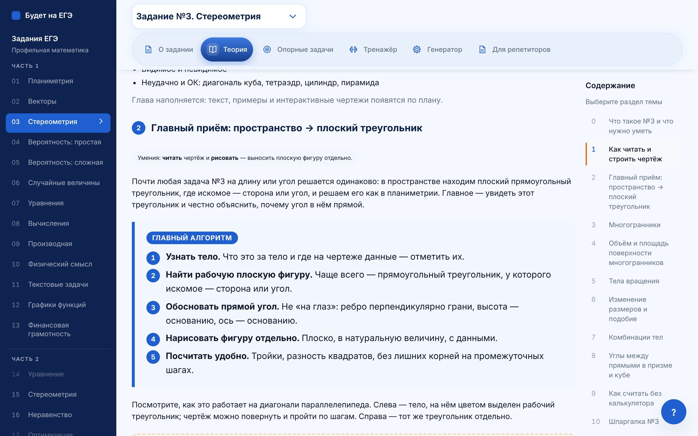 | 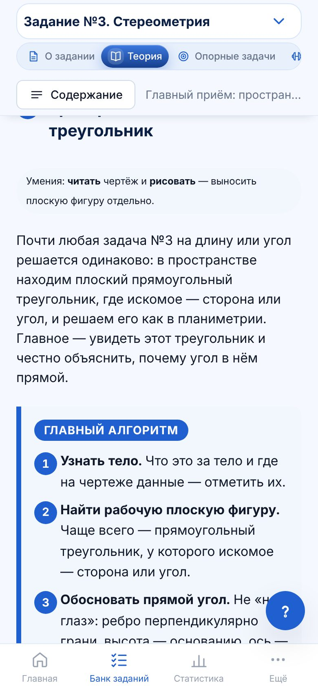 |
| Две панели | 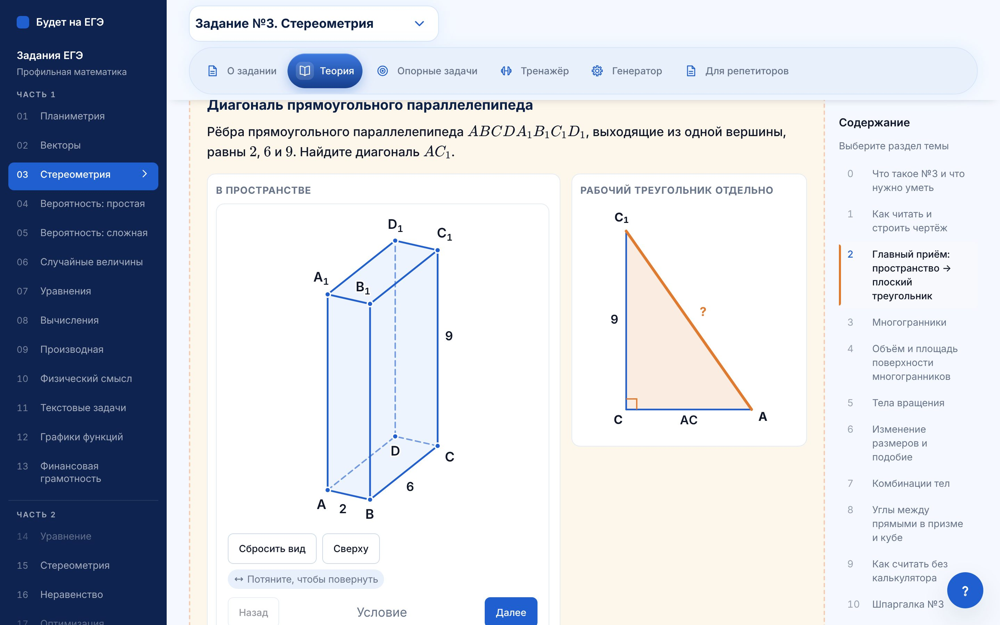 | 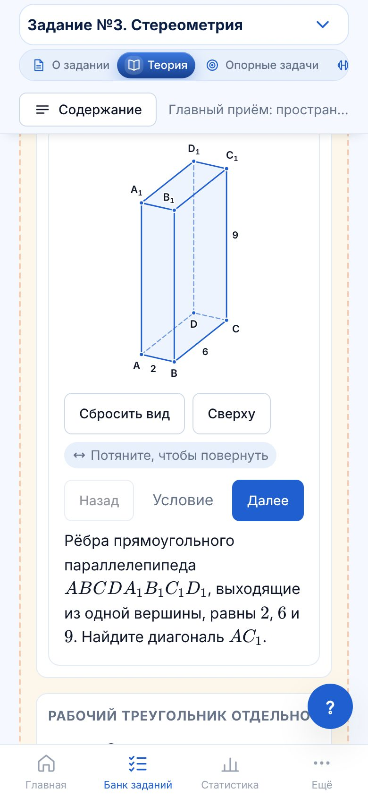 |
| «Ловушка» | 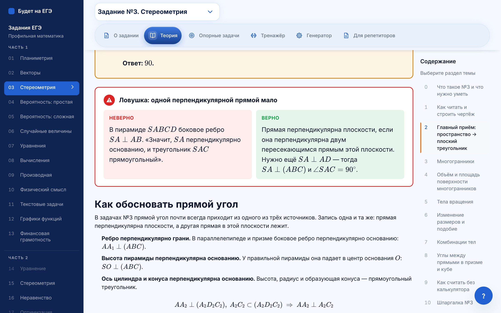 | 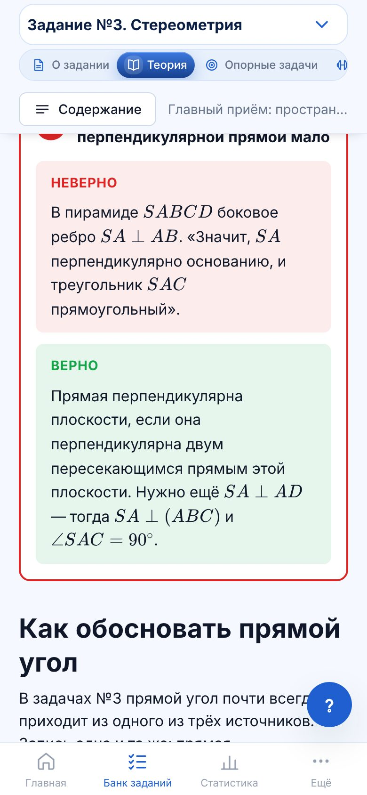 |
| Карточки блоков | 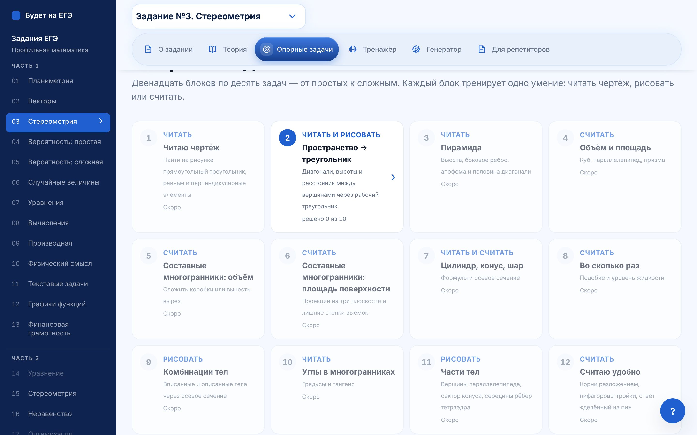 | 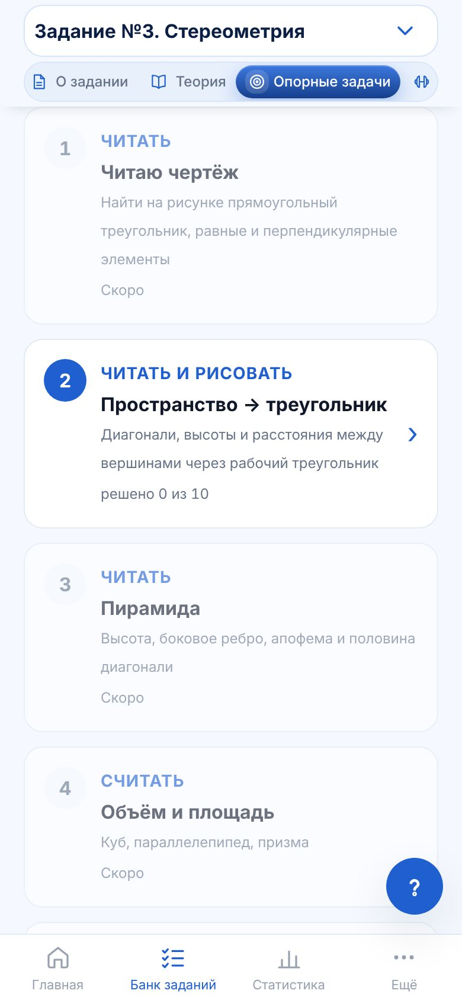 |
| «Нажми на чертеже» | 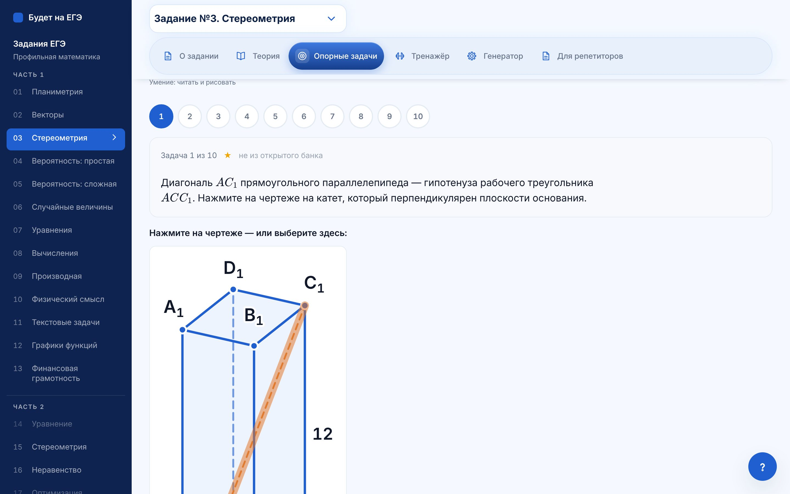 | 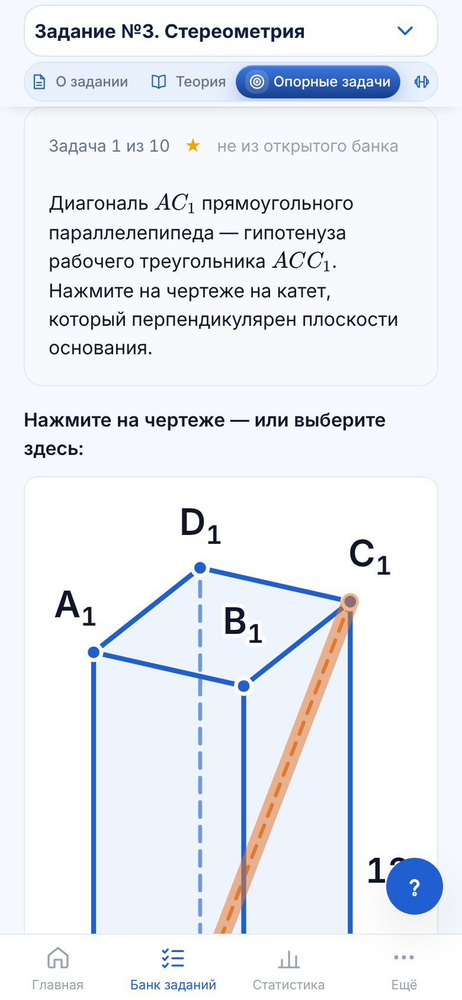 |
| Подсказка по шагам | 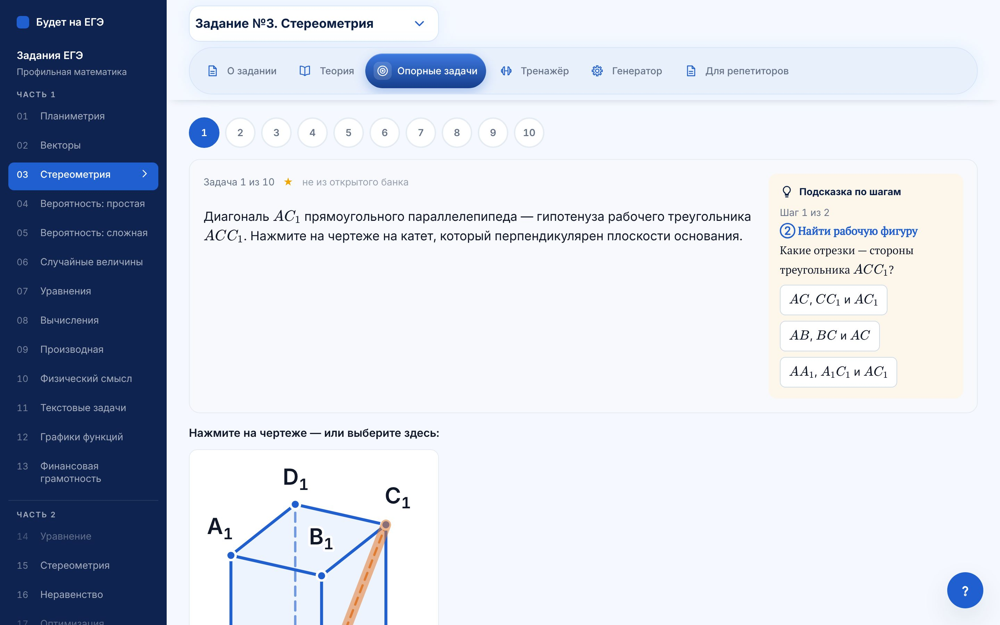 | 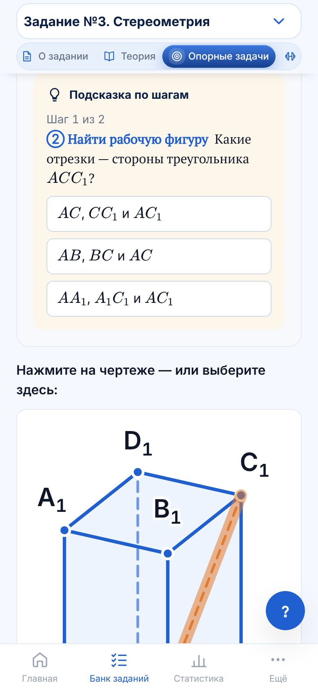 |
| Итог блока | 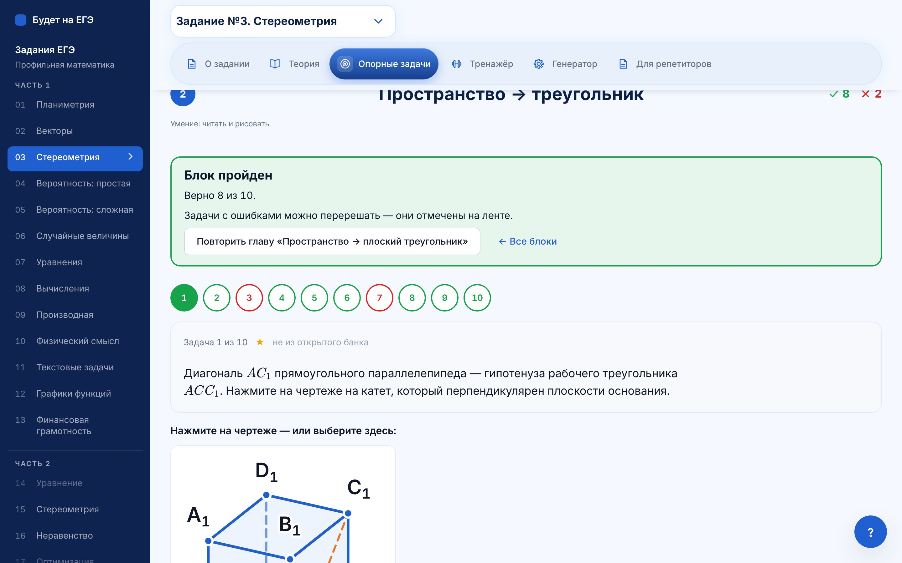 | 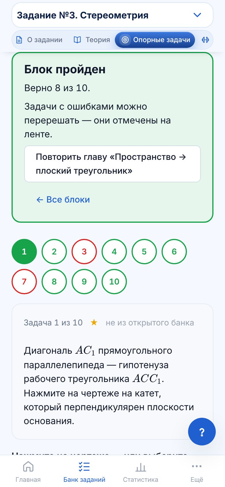 |

## Что заметно на снимках

- Вопрос подсказки по шагам набран шрифтом с засечками — это общий стиль подсказок №11. Его можно поменять по макетам.

## Дальше

- Ждём макеты дизайна по этим снимкам.
- **Этап 2** — остальные главы теории по новому оглавлению.
- **Этап 3** — остальные 11 блоков опорных задач.
- Каждый этап — отдельной веткой и PR.
