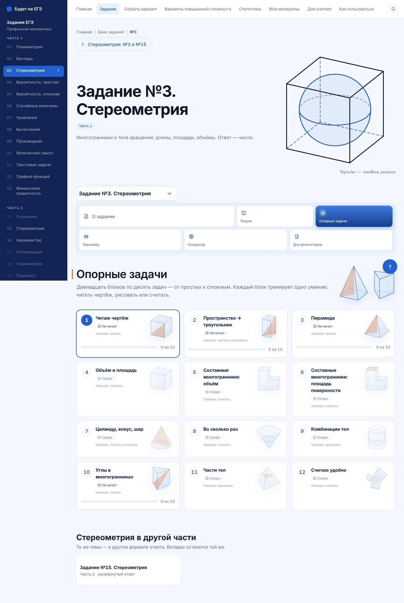
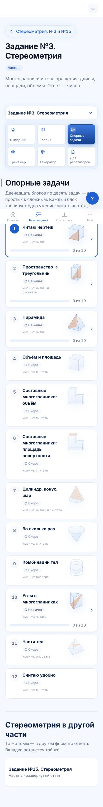
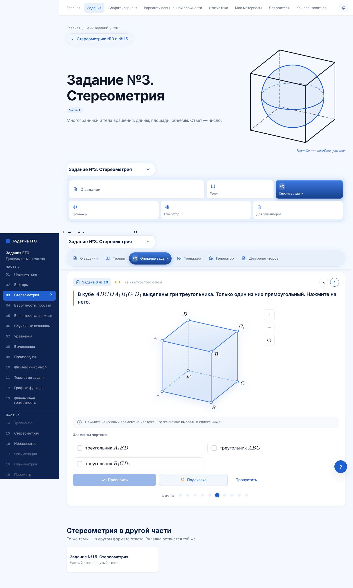
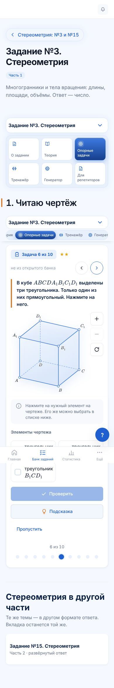
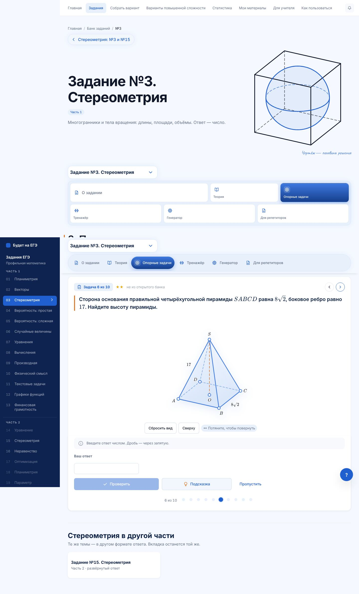
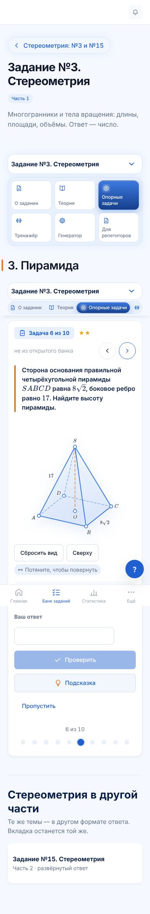
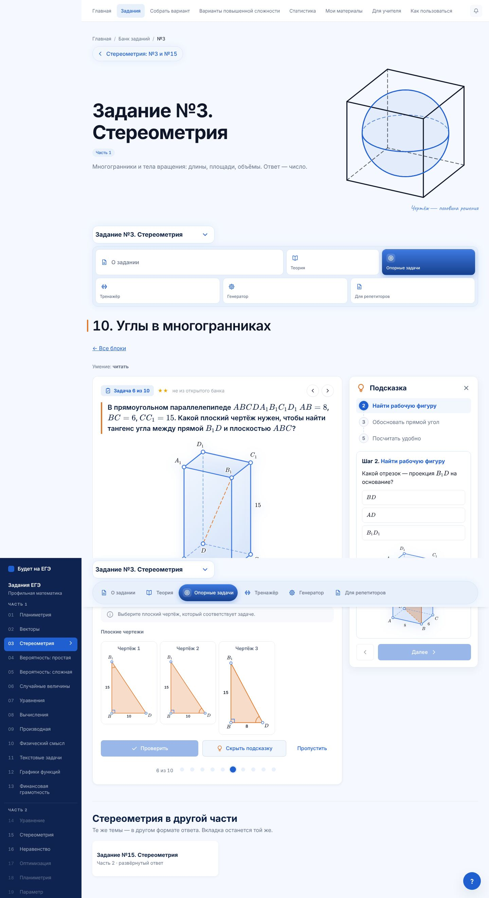
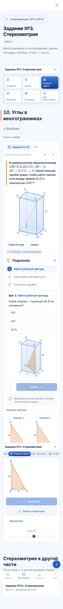

# №3 · опорные задачи · партия 1: блоки 1, 3, 10

Этап 3 методики №3 — остальные 11 блоков опорных задач. Делается партиями по три блока, каждая — отдельный PR:

| Партия | Блоки |
|---|---|
| 1 | 1 Читаю чертёж · 3 Пирамида · 10 Углы в многогранниках |
| 2 | 4 Объём и площадь · 5 Составные: объём · 6 Составные: площадь |
| 3 | 7 Цилиндр, конус, шар · 8 Во сколько раз · 9 Комбинации тел |
| 4 | 11 Части тел · 12 Считаю удобно |

Эта партия — PR поверх #249. Ветка: `claude/opornye-3-partiya-1`.

## Шаг 0: общее для всех блоков

- **Своя глава теории у каждого блока** (`BLOKI_3.glava`). Ссылка «Повторить теорию» и название главы в итоге блока теперь свои, а не глава 2 у всех.
- **Задачи блоков** берутся из таблицы «блок → задачи» (`bloki.ts`).
- **`test:stereo-metodika` проверяет все написанные блоки:**
  - десять задач, ключи `o3-<блок>-01…10`;
  - уровни не убывают, не меньше трёх форматов ответа;
  - ответ совпадает с пересчётом по координатам чертежа;
  - подписи чертежа не налезают — в обеих темах (на странице блока чертёж в теме «экран»);
  - ответ не стоит открыто в условии (цифры из рисунка знака корня больше не путаются с ответом);
  - глава теории блока есть в оглавлении.
- **Метка «банк».** Задача с такой меткой должна быть в снимке открытого банка ФИПИ №3, номер задачи — в поле `fipi`.

## Блоки

В открытом банке ФИПИ №3 сейчас 57 задач. Все они на объёмы, части тел и тела вращения, задач на пирамиду, углы и чтение чертежа там нет. Поэтому в блоках 1, 3 и 10 все числа свои, метка — «не из открытого банка». Задачи банка войдут в блоки партий 2–4.

| Блок | ★ / ★★ / ★★★ | Форматы | Что тренирует |
|---|---|---|---|
| **1. Читаю чертёж** (глава 1) | 4 / 4 / 2 | нажми ×5, выбор ×2, плоский чертёж, число ×2 | ребро, перпендикулярное грани; угол, который на рисунке тупой, а на деле прямой; середина ребра на проекции; параллельные рёбра; перпендикуляр к основанию пирамиды; единственный прямоугольный треугольник; отрезок, равный диагонали грани; истинный вид треугольника $BDD_1$; угол $A_1BD$; сколько рёбер перпендикулярны $AB$ |
| **3. Пирамида** (глава 3) | 3 / 4 / 3 | нажми ×2, выбор ×2, плоский чертёж, число ×5 | где апофема; куда падает высота; апофема, высота, боковое ребро через рабочий треугольник; шестиугольная пирамида ($OA$ = стороне); треугольная (центр делит медиану $2:1$); боковая поверхность через апофему |
| **10. Углы в многогранниках** (глава 8) | 4 / 4 / 2 | нажми ×2, выбор ×2, плоский чертёж, число ×5 | куда перенести прямую; углы $45^\circ$ и $60^\circ$ в кубе; углы в правильной шестиугольной призме; угол прямой с плоскостью основания и его тангенс; скрещивающиеся прямые через перенос |

У каждой задачи:
- подсказка — вопросы по шагам главного алгоритма, число ответа в ней не называется;
- решение учителя по этапам и разбор для ученика «что делаем и почему»;
- чертёж нашим движком.

Тексты написаны своими словами.

## Проверено

| Проверка | Результат |
|---|---|
| `test:stereo-metodika` | 13 351 проверка, все блоки 1, 2, 3, 10 |
| `test:stereo-nav`, `test:stereo-engine` | 720 и 49 856 проверок |
| `math-markup` | исходники и 651 страница — математики вне KaTeX нет |
| `secrets` | ответов, разборов и параметров рисунков в бандле нет |
| Браузер: все 30 задач на 1440, 390 и 320 px, с подсказкой | прокрутки вбок нет, ошибок в консоли нет |
| `lint`, `typecheck`, сборка с `LEGAL_DRAFT=1` | чисто |

## Снимки

`docs/stereometry-snimki/opornye-partiya-1/`

| | Компьютер | Телефон |
|---|---|---|
| Список блоков |  |  |
| Блок 1, задача 6 |  |  |
| Блок 3, задача 6 |  |  |
| Блок 10, подсказка |  |  |

## Ограничения

- **«Плоский чертёж»** — только прямоугольный треугольник: истинный вид сечения-прямоугольника так не показать.
- **«Нажми на чертеже»** — только отрезок или многоугольник. Вопрос «какая точка — середина» сделан выбором ответа.
