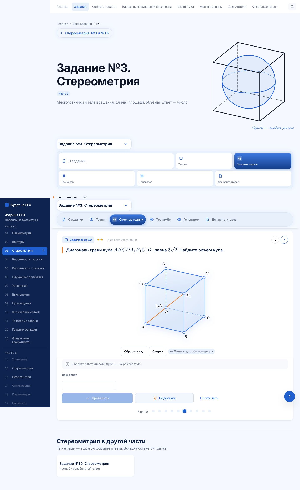
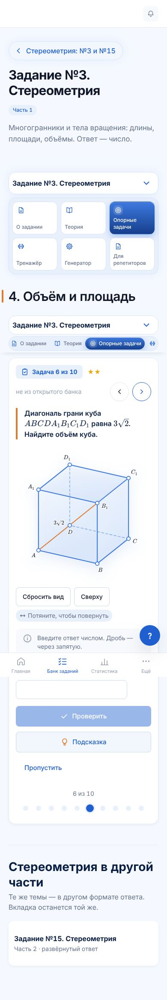
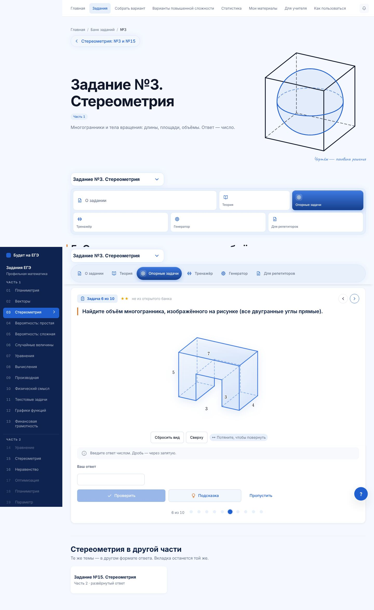
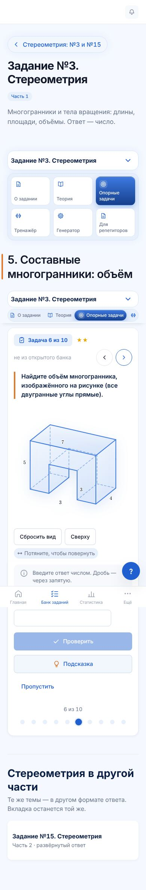
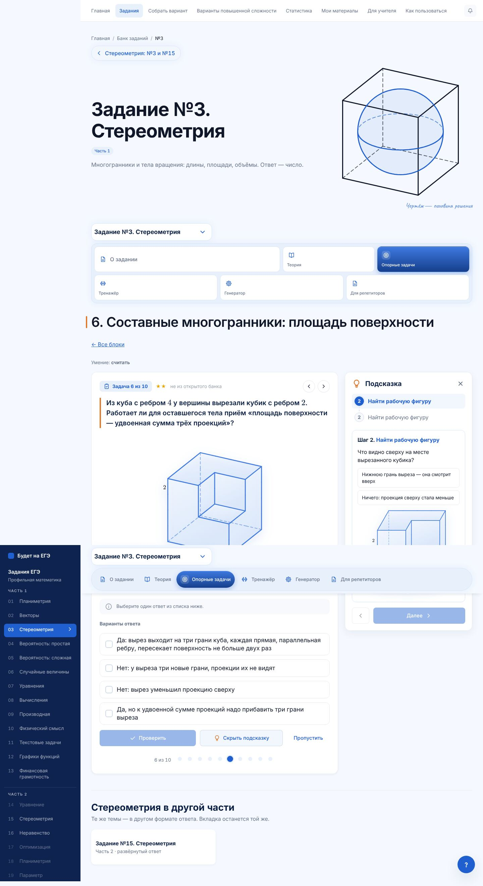
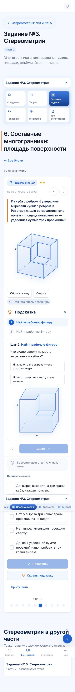

# №3 · опорные задачи · партия 2: блоки 4, 5, 6

Продолжение этапа 3 (план и шаг 0 — `n3-etap-3-partiya-1.md`). PR поверх партии 1 (#252), ветка `claude/opornye-3-partiya-2`.

## Блоки

| Блок | ★ / ★★ / ★★★ | Форматы | Что тренирует |
|---|---|---|---|
| **4. Объём и площадь** (глава 4) | 4 / 4 / 2 | число ×6, выбор, нажми ×2, плоский чертёж | поверхность куба, объём параллелепипеда, формула объёма призмы (ловушка $\frac13$), грань нужной площади, высота наклонной призмы, объём куба по диагонали грани, боковая поверхность призмы через периметр; **две задачи открытого банка ФИПИ** — призма, отсечённая плоскостью через среднюю линию основания (боковая поверхность и объём) |
| **5. Составные многогранники: объём** (глава 4) | 4 / 4 / 2 | число ×6, выбор ×2, нажми ×2 | разрез на две коробки, ступенька сложением, уголок, брусок с вырезом, буква «П» как прямая призма, «сложить или вычесть», ямка, рамка со сквозным отверстием, три бруска из одного угла (угловой кубик посчитан трижды) |
| **6. Составные многогранники: площадь поверхности** (глава 4) | 4 / 4 / 2 | число ×5, выбор ×2, нажми ×3 | когда работает приём «удвоенная сумма трёх проекций», грань, которую не видно ни с одной стороны (стенка ямки, внутренняя стенка «П»), куб с ямкой, вырез у вершины, тело с выступом, «П» со сквозным проёмом, сквозное отверстие |

Задачи с меткой «банк» в блоке 4 — `1F4550` и `5C9973`: текст задачи банка, ответ пересчитан по чертежу. Автотест сверяет номера со снимком открытого банка. Задач на составные многогранники в открытом банке №3 сейчас нет, поэтому в блоках 5 и 6 все числа свои.

Тела из коробок нарисованы движком через `kubiki` (из #249), стыки граней одной плоскости не рисуются. Тела с ямкой показаны ракурсом повыше, чтобы ямку было видно.

## Исправлено попутно

**Варианты ответа на узком телефоне.** На ширине до 400 px кнопки-варианты теперь в одну колонку, а не в две. Подпись «горизонтальный разрез» на 320 px вылезала вбок.

## Проверено

| Проверка | Результат |
|---|---|
| `test:stereo-metodika` | 16 073 проверки, блоки 1–6 и 10 |
| `test:stereo-nav` | 720 |
| `math-markup` | исходники и 654 страницы — математики вне KaTeX нет |
| `secrets` | ответов, разборов и параметров рисунков в бандле нет |
| Браузер: все 30 задач на 1440, 390 и 320 px, с подсказкой; блоки 1 и 2 после правки стилей | прокрутки вбок нет, ошибок в консоли нет |
| `lint`, `typecheck`, сборка с `LEGAL_DRAFT=1` | чисто |

## Снимки

`docs/stereometry-snimki/opornye-partiya-2/`

| | Компьютер | Телефон |
|---|---|---|
| Блок 4, задача 6 |  |  |
| Блок 5, задача 6 |  |  |
| Блок 6, подсказка |  |  |
