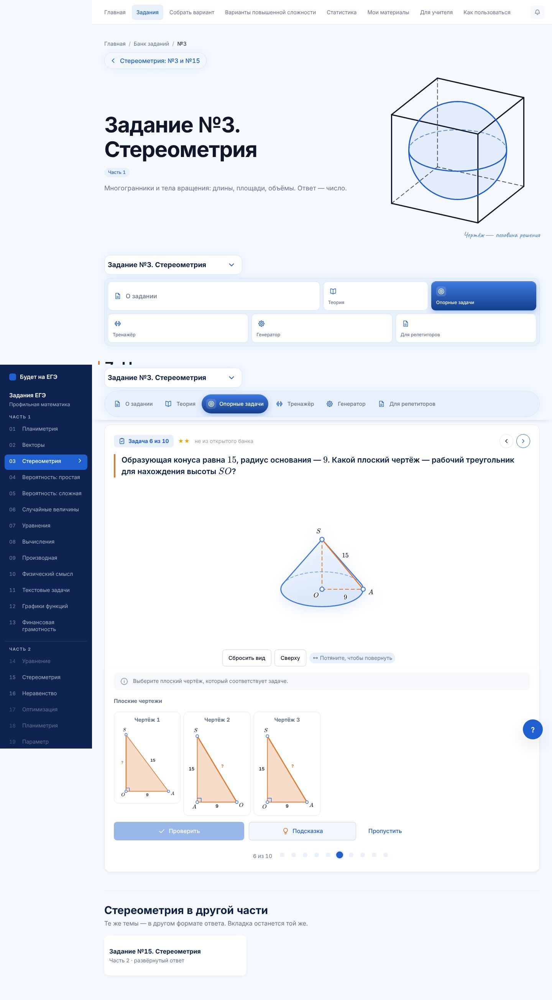
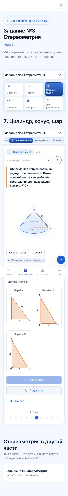
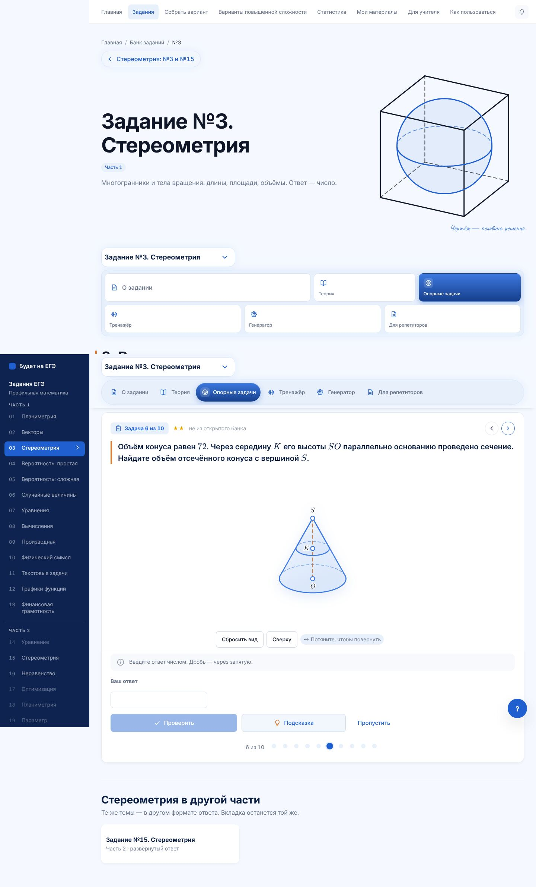
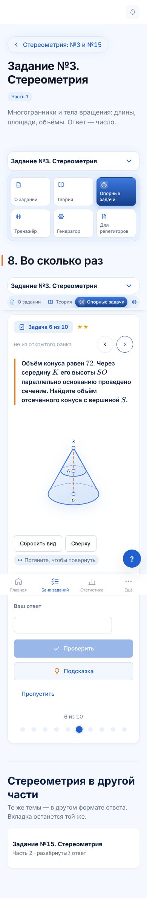
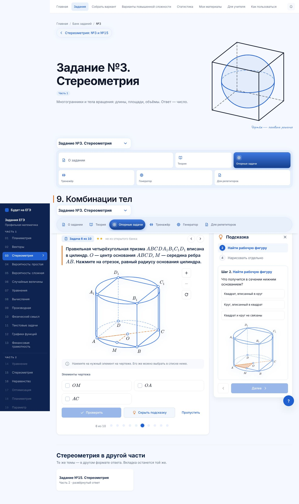
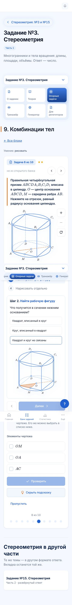

# №3 · опорные задачи · партия 3: блоки 7, 8, 9

Продолжение этапа 3 (план — `n3-etap-3-partiya-1.md`). PR поверх партии 2 (#253), ветка `claude/opornye-3-partiya-3`.

## Блоки

| Блок | ★ / ★★ / ★★★ | Форматы | Задачи открытого банка ФИПИ | Что тренирует |
|---|---|---|---|---|
| **7. Цилиндр, конус, шар** (глава 5) | 4 / 4 / 2 | нажми, выбор ×2, плоский чертёж, число ×6 | `FcFB97`, `135723`, `37164B` | образующая, формулы боковых поверхностей (ловушки $\pi rh$, $\pi r^2h$), рабочий треугольник осевого сечения, ответ «делённый на $\pi$», диаметр вместо радиуса, поверхность шара через большой круг, цилиндр и конус с общим основанием |
| **8. Во сколько раз** (глава 6) | 4 / 4 / 2 | нажми, выбор, плоский чертёж, число ×7 | `33B18F`, `E71725`, `61D99A` | коэффициент подобия, $k$, $k^2$, $k^3$, изменение радиуса и высоты, отсечённый конус, уровень жидкости в конусе, переливание в широкий цилиндр, «сколько долить» |
| **9. Комбинации тел** (глава 7) | 4 / 4 / 2 | нажми ×2, выбор, плоский чертёж, число ×6 | `48EB9B`, `1D9551`, `D5AC0C` | радиус вписанного и описанного шара куба, шар в цилиндре, конус в шаре, цилиндр в параллелепипеде, призма в цилиндре, шар около цилиндра через рабочий треугольник |

- **Задачи с меткой «банк».** Текст — как в банке, ответ пересчитан по размерам тел на чертеже. Автотест сверяет номера со снимком открытого банка.
- **Части шара** движок по-прежнему не рисует — таких задач нет.
- **Плоский чертёж** — только прямоугольный треугольник. Поэтому «круг в квадрате» и «треугольник в круге» объяснены словами в подсказке, а плоский чертёж дан там, где есть рабочий прямоугольный треугольник (шар около цилиндра, жидкость в конусе, высота конуса).

## Проверено

| Проверка | Результат |
|---|---|
| `test:stereo-metodika` | 18 767 проверок, блоки 1–10 |
| `test:stereo-nav` | 720 |
| `math-markup` | исходники и 657 страниц — математики вне KaTeX нет |
| `secrets` | ответов, разборов и параметров рисунков в бандле нет |
| Браузер: все 30 задач на 1440, 390 и 320 px, с подсказкой | прокрутки вбок нет, ошибок в консоли нет |
| `lint`, `typecheck`, сборка с `LEGAL_DRAFT=1` | чисто |

## Снимки

`docs/stereometry-snimki/opornye-partiya-3/`

| | Компьютер | Телефон |
|---|---|---|
| Блок 7, задача 6 |  |  |
| Блок 8, задача 6 |  |  |
| Блок 9, подсказка |  |  |
