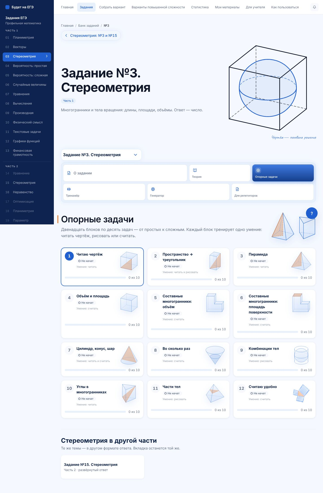
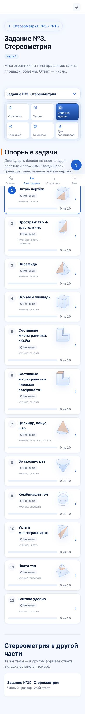
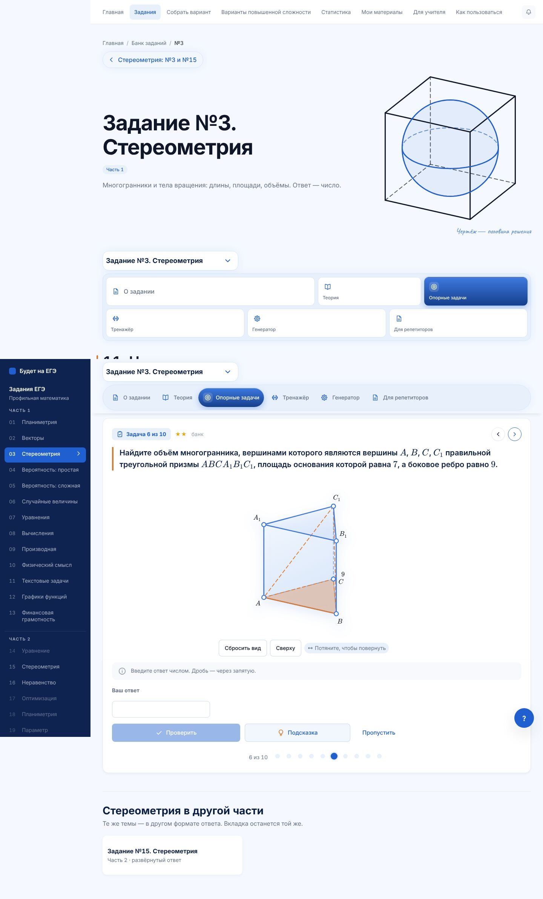
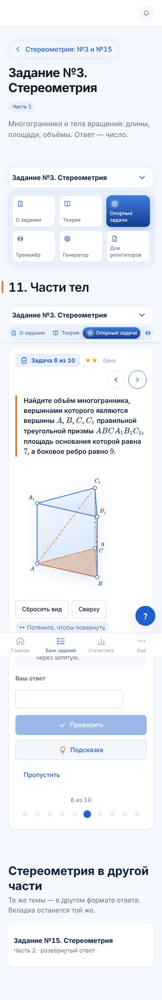
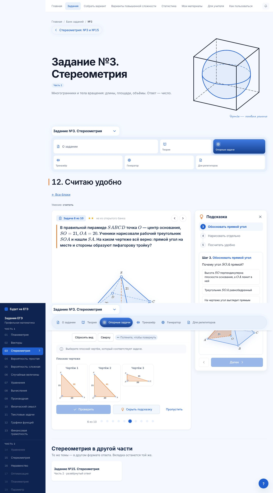
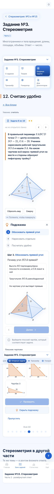

# №3 · опорные задачи · партия 4: блоки 11, 12 и итог этапа 3

Последняя партия этапа 3 (план — `n3-etap-3-partiya-1.md`). PR поверх партии 3 (#255), ветка `claude/opornye-3-partiya-4`.

## Блоки

| Блок | ★ / ★★ / ★★★ | Форматы | Задачи открытого банка ФИПИ | Что тренирует |
|---|---|---|---|---|
| **11. Части тел** (глава 4) | 4 / 4 / 2 | нажми ×2, выбор, число ×7 | `29FE0E`, `ADF4FE`, `2359E0` | высота пирамиды внутри параллелепипеда, пирамида — треть призмы, призма — половина параллелепипеда, тетраэдр от куба ($\frac16$), часть цилиндра и конуса по центральному углу, тетраэдр через середины рёбер ($k^3$) |
| **12. Считаю удобно** (глава 9) | 4 / 3 / 3 | выбор ×3, плоский чертёж, число ×6 | — | разность квадратов, тройки и кратные им, корень разложением, квадрат диагонали без корня во второй Пифагор, ответ «делённый на $\pi$», правдоподобие ответа |

- **Части тел** нарисованы движком: части цилиндра и конуса — `sektorCilindra`, `sektorKonusa` из #249. Части шара нет: её движок не рисует.
- **Задача `2359E0`** нарисована в удобных пропорциях, а не в масштабе условия: с площадью основания 7 и ребром 9 призма выходила очень тонкой. Ответ всё равно пересчитывается по координатам — как доля пирамиды от призмы, умноженная на объём из условия.

## Итог этапа 3

Все 12 блоков опорных задач №3 написаны: **120 задач**.

| Партия | PR | Блоки | Задач банка ФИПИ |
|---|---|---|---|
| 1 | #252 | 1, 3, 10 (+ шаг 0) | 0 |
| 2 | #253 | 4, 5, 6 | 2 |
| 3 | #255 | 7, 8, 9 | 9 |
| 4 | этот | 11, 12 | 3 |

**Задачи с меткой «банк».** Их 14 — из открытого банка ФИПИ, их номера автотест сверяет со снимком банка. Остальные задачи свои. В открытом банке №3 нет задач на чтение чертежа, пирамиду, углы, составные многогранники и устный счёт, поэтому в этих блоках все числа свои.

**Что есть у каждой задачи:**
- ответ пересчитывается по координатам чертежа;
- подсказка вопросами по шагам, число ответа в ней не называется;
- решение учителя по этапам и разбор для ученика;
- закрытый вид на странице (ответы в коде сайта не лежат).

## Проверено

| Проверка | Результат |
|---|---|
| `test:stereo-metodika` | 21 412 проверок, все 12 блоков |
| `test:stereo-nav` | 720 |
| `math-markup` | исходники и 659 страниц — математики вне KaTeX нет |
| `secrets` | ответов, разборов и параметров рисунков в бандле нет |
| Браузер: все 120 задач на 1440, 390 и 320 px, с подсказкой | прокрутки вбок нет, ошибок в консоли нет |
| `lint`, `typecheck`, сборка с `LEGAL_DRAFT=1` | чисто |

## Снимки

`docs/stereometry-snimki/opornye-partiya-4/`

| | Компьютер | Телефон |
|---|---|---|
| Все 12 блоков |  |  |
| Блок 11, задача 6 |  |  |
| Блок 12, подсказка |  |  |
