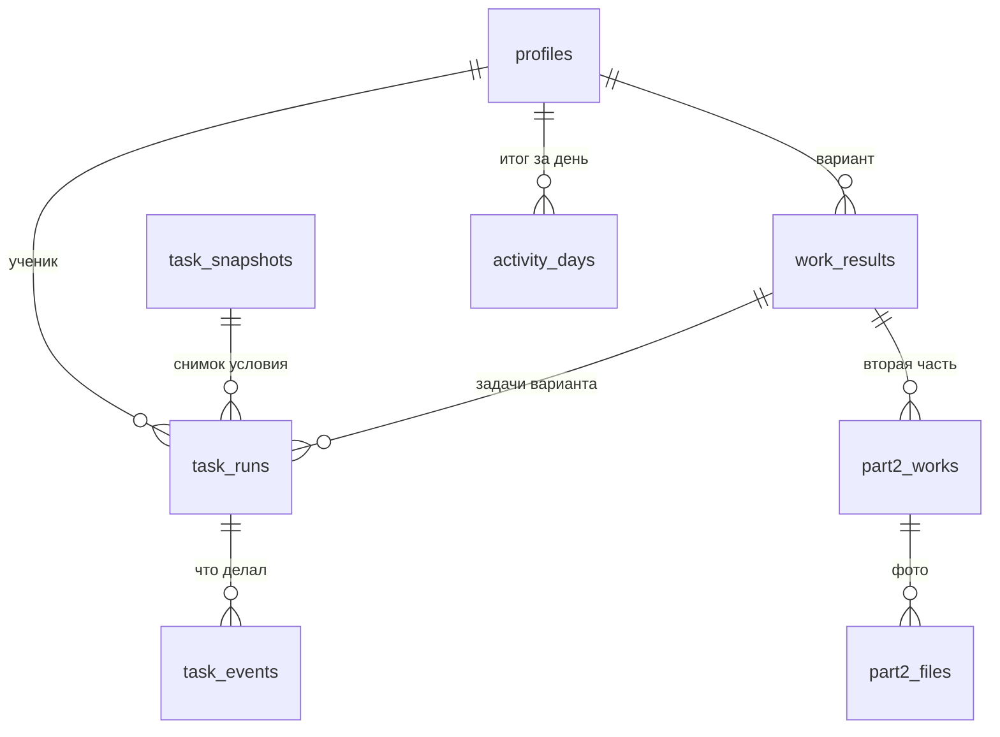

# Кабинеты, версия 2: прогресс учеников, новая выдача ДЗ, уведомления

План от 22.11.2026. Вход через VK и MAX сюда не входит — отдельная задача.

Содержание: [вопросы владельцу](#0-вопросы-которые-решает-владелец) ·
[что уже есть](#1-что-уже-есть) · [флаги](#2-флаги) ·
[модель данных](#3-модель-данных) · [этапы и PR](#4-этапы-и-pr) ·
[персональные данные](#5-персональные-данные) · [тесты](#6-тесты) ·
[риски](#7-риски)

## 0. Вопросы, которые решает владелец

У каждого вопроса есть вариант по умолчанию. Если ответа нет, работа идёт
по нему; всё, что по умолчанию стоит денег или меняет правовые документы,
без ответа не включается (остаётся за флагом).

### Блокируют этапы 2–3 (нужны ответы до их начала)

1. **Серверный код для уведомлений.** Сейчас на сервере нет ни одной
   своей программы: только PostgreSQL, GoTrue, PostgREST и Caddy; писем,
   кроме «подтвердите почту» и «сброс пароля», сервер не шлёт. Очередь,
   напоминания по времени, почта и web push без своей программы
   невозможны.
   *По умолчанию:* пятый контейнер `notifier` (Node, оценка 60–100 МБ
   памяти, на тарифе 2 ГБ помещается; замер — в том же CI, что и сервер).
   Тариф не меняется. **Согласны?**
2. **Фото второй части.** Загрузки фото на сайте сейчас нет: есть только
   тексты и стили под неё. Файлового хранилища на сервере тоже нет
   (решение ноября 2026: «Storage не ставим»). Чтобы фото появились,
   нужны: контейнер Storage (ещё 60–120 МБ) и бакет в Yandex Object
   Storage (отдельная небольшая плата за хранение).
   *По умолчанию:* ставить Storage + Yandex Object Storage, фото до 10 МБ,
   не больше 6 на задачу, хранить 12 месяцев после проверки.
   **Согласны на эту плату и на срок хранения?** Без ответа «вторая часть
   с фото» в этапах 1 и 2 делается последней и остаётся выключенной.
3. **Web push и «нет трансграничной передачи».** Push-сообщения доставляют
   серверы Apple, Google и Mozilla — они за границей. Политика (§5.4) и
   уведомление в РКН (§6) сейчас говорят, что трансграничной передачи нет.
   *По умолчанию:* в push уходит только обезличенный текст («Новое
   домашнее задание», без имени, класса и названия ДЗ), а подробности
   ученик видит уже на сайте; адрес подписки браузера всё равно
   передаётся за рубеж. Это нужно показать юристу и, вероятно, отразить в
   политике и в письме в РКН. **Делать push на таких условиях, или
   отложить его и оставить колокольчик и почту?**
4. **Письма: согласие и лимиты.** В спецификации кабинета (§3.0) записано:
   письма-напоминания — только при отдельном согласии на рассылку.
   Новые письма — служебные (о выданном ДЗ), но напоминания о сроке ближе к
   рассылке.
   *По умолчанию:* отдельная галочка «Получать письма о домашних
   заданиях» в настройках, для новых учеников включена при вступлении в
   класс с явным текстом; в каждом письме «Отписаться» в один клик без
   входа. **Подходит ли такой порядок юристу?**
   Отдельно: ящик `noreply@budetege.ru` на Yandex 360 имеет суточный
   лимит отправки. Его нужно уточнить в тарифе Yandex 360: класс из 30
   учеников × 3 письма на ДЗ — это уже 90 писем на одно задание.
   *По умолчанию:* очередь шлёт не быстрее 1 письма в 2 секунды и
   сворачивает несколько событий в одно письмо.
5. **Ветки и PR.** Эта сессия может писать только в одну ветку
   (`claude/gracious-ritchie-r8zsjz`). «Каждый этап — отдельный PR»
   тогда означает: PR этапа открывается, после слияния ветка начинается
   заново от `main` и идёт следующий этап.
   *По умолчанию:* так и делать — следующий этап начинается после слияния
   предыдущего PR. **Или разрешить отдельные ветки
   `claude/cabinet-v2-etap-N`** (тогда PR можно готовить, не дожидаясь
   слияния)?

### Нужны к этапу 1 (работа идёт по умолчаниям, поправить можно до слияния PR)

6. **Сколько хранить подробный журнал.** Каждая попытка, шаг подсказки и
   время — это много строк.
   *По умолчанию:* подробные события — 12 месяцев, дальше остаются только
   итоги по задаче (решена/нет, время, число попыток); всё удаляется
   вместе с аккаунтом. Срок попадёт в политику (§6).
7. **Что видит учитель из прошлого ученика.** Ученик мог решать задачи до
   вступления в класс.
   *По умолчанию:* учитель видит весь журнал ученика, пока ученик у него
   в классе (так уже работает доступ к попыткам); после выхода из класса —
   ничего. Альтернатива: только с даты вступления.
8. **Ученик младше 18 без согласия родителя.** Сейчас такому ученику
   прогресс на сервер не пишется и в класс он вступить не может.
   *По умолчанию:* журнал подчиняется тому же правилу — без согласия
   родителя не пишется ничего.
9. **Сказать ли ученику, что учитель видит время и подсказки.**
   *По умолчанию:* да — одна строка при вступлении в класс («Учитель
   класса видит решённые задачи, ответы, время и открытые подсказки») и
   пункт в политике. Без этого журнал для учителя не включается.
10. **«Подозрительно быстро».**
    *По умолчанию:* пометка «очень быстро» (серый значок с часами, подсказка
    «Верный ответ за N с — быстрее обычного для этой задачи») ставится,
    когда верный ответ с первой попытки дан быстрее, чем за 15 % обычного
    времени этого типа задач и быстрее 10 секунд (до накопления статистики —
    быстрее 5 секунд для №8 и 8 секунд для №5). Слов «списал» и
    «подозрительно» в интерфейсе нет. Ученик пометку не видит.
11. **Выгрузка в PDF.**
    *По умолчанию:* PDF делается так же, как листы на сайте: страница для
    печати, кнопка «Сохранить в PDF» открывает печать браузера. Excel —
    готовый файл `.xlsx` сразу (такой код на сайте уже есть). Настоящий
    PDF-файл одной кнопкой потребует встраивать шрифты в сборку — можно
    позже, если печати окажется мало.
12. **Карточки №8.** У №8 колоды карточек нет (у №5 есть).
    *По умолчанию:* в пробе на №5 и №8 карточки проверяются только на №5.

### К этапу 3

13. **Часовой пояс.** В профиле пояса сейчас нет.
    *По умолчанию:* пояс берётся из браузера при первом входе, хранится в
    профиле, меняется в настройках; тихие часы 22:00–8:00 считаются по
    Москве, как в задаче, а показ дедлайнов — в поясе пользователя с
    подписью «МСК», если пояс не московский.
14. **Дайджест учителю.**
    *По умолчанию:* выключен, пока учитель сам не выберет «за день» (в 8:00
    МСК) или «за неделю» (понедельник, 8:00 МСК).

## 1. Что уже есть

Источники: миграции `supabase/migrations/`, `docs/kabinet-roli-dz.md`,
`docs/kabinet-dz-8.md`, `docs/AUTH.md`, `docs/SERVER.md`,
`docs/hosting-lite.md`, `docs/trenazher-sessiya.md`,
`docs/variant-onlayn.md`, код `app/src`.

| Что | Состояние | Где |
|---|---|---|
| Регистрация и вход | работает: почта и пароль, подтверждение почты, согласия, согласие родителя до 18 | GoTrue; `lib/auth/*`; `…_soglasiya.sql`, `…_probnyy_vhod.sql` |
| Роли | `student`, `tutor`, `admin` (один); роль читается из `profiles`, из браузера не меняется | `…_kabinet.sql` |
| Классы | создание, код из 6 знаков, вступление по коду и ссылке, имя ученика «для себя», архив | `…_dz.sql`; `components/dz/ClassScreen.tsx` |
| «Учитель видит только своих» | функции `is_my_student`, `owns_class`, `owns_homework` + RLS на каждой таблице; тесты `rls.test.sql`, `dz.test.sql` | `…_kabinet.sql`, `…_dz.sql` |
| «Выдать ДЗ» | **только №8**: типы × количество или задачи вручную, «у каждого свои», срок, 1/2/∞ попыток, когда показывать решение, «Запомни» и пример, работа над ошибками, печать. Ответ проверяет сервер | `lib/dz/*`, `components/dz/*`, `/kabinet/dz-vydat/`, `/kabinet/domashka/` |
| Старое пробное ДЗ | в браузере, служебные страницы `page.dev.tsx`, в сборку сайта не попадает | `lib/kabinet/localApi.ts` |
| Тренажёры | 5 разных движков + отдельные экраны; общая оболочка сессии `TrainerSessionHost` (пауза, активное время сессии, итог) | `components/tasks/session/*` |
| Журнал попыток | в браузере, одна запись на **закрытую** задачу: исход и секунды. Отдельных попыток, шагов подсказки, «Пропустить» нет. Копируется в аккаунт целиком (`user_storage`) — учитель его не видит | `lib/progressLog/*`, `lib/accountSync/*` |
| Опорные задачи | прогресс в браузере: решено/нет; времени нет; у №8 неверные ответы и «Пропустить» не сохраняются вовсе | `components/tasks/opornye/*`, `Podgotovka8Screen`, `Opornye45Blok` |
| Карточки | коробки Лейтнера в браузере, в аккаунт не копируются; у №8 колоды нет | `components/kartochki/*` |
| Варианты | «Собрать вариант», серии, повышенной сложности, ежемесячные — один экран решения; первичный и тестовый балл считаются; архив работ — только на устройстве (IndexedDB) | `components/variant/online/*`, `lib/variant/online/*` |
| Варианты через кабинет | таблицы в базе есть (`variant_works` и др.), экраны — служебные, на сайте выключены | `…_variant_works.sql` |
| Фото второй части | **нет**: только тексты и стили; хранилища нет | `content/variantOnline/chast2Text.ts` |
| Карта в кабинете | строится из журналов браузера | `lib/karta/*`, `components/karta/*` |
| Уведомления | страница-заглушка `/uvedomleniya/`; колокольчик в шапке приложения нарисован и выключен; очереди, писем и push нет | `content/appNav.ts` (`NE_GOTOVY`), `components/ui/Topbar.tsx` |
| Сервер | PostgreSQL 17, GoTrue, PostgREST, Caddy на одном сервере 2 ГБ; своей программы и расписаний, кроме копии и проверки здоровья, нет | `infra/lite/*` |

Что из этого следует:

- **Задачу можно показать учителю такой же.** №8: ссылка
  «прототип|seed|уровень» → `makeTask` даёт те же числа. №5: задачи из
  постоянного банка, ссылка «прототип:номер». Вариант: `VariantTask.ref`.
  Но генератор со временем меняется, поэтому вместе со ссылкой хранится
  снимок условия (см. 3.1).
- **Единой точки, через которую проходят все ответы, нет.** Журнал
  подключается в каждый экран отдельно; общие — только оболочка сессии и
  счётчик активного времени. Отсюда порядок «сначала №5 и №8».
- **Ответы тренажёра проверяет браузер**, ответы ДЗ — сервер. Журнал
  тренажёра — это рассказ браузера ученика; для оценок годится только ДЗ
  и работы, выданные через кабинет (см. риски).

## 2. Флаги

Сайт — статическая сборка, поэтому флаги ставятся при сборке (как
`NEXT_PUBLIC_AUTH_ENABLED`): переменные GitHub → `deploy.yml` →
`next.config.ts` → `app/src/lib/flags.ts`. Выключенный флаг — кода в
сборке нет (проверка в `check-dev-pages.mjs`, как для пробного кабинета).

| Флаг | Что включает |
|---|---|
| `NEXT_PUBLIC_KAB2_ZHURNAL` | запись журнала событий и статистика ученика |
| `NEXT_PUBLIC_KAB2_UCHITEL` | экраны прогресса у учителя, выгрузки |
| `NEXT_PUBLIC_KAB2_DZ` | корзина, новая выдача, «Мои домашки» |
| `NEXT_PUBLIC_KAB2_UVEDOMLENIYA` | колокольчик и настройки; подфлаги `…_POCHTA`, `…_PUSH` |
| `NEXT_PUBLIC_KAB2_FOTO` | фото второй части (после решения по вопросу 2) |
| `NEXT_PUBLIC_KAB2_RAZDELY` | список разделов: `5,8` → потом `all` |

На сервере новые таблицы и функции появляются миграциями заранее и без
включённого сайта ничем не заняты. Программа уведомлений имеет свой
выключатель в `.env` (`NOTIFIER_CHANNELS=site,email,push`).

Все флаги требуют включённого входа (`AUTH_ON`).

## 3. Модель данных

Общие правила, как в существующих миграциях: `revoke all` и точечные
права; запись — только функциями `security definer` с `search_path = ''`;
чтение — RLS; владелец строки — колонка `user_id` с каскадным удалением
(так строка сама попадает в «Выгрузить мои данные» и удаляется с
аккаунтом); у анонимного посетителя нет ни одной функции. Старые
миграции не правятся — только новые файлы, дописанные в
`infra/lite/migrations.txt`. Время — `timestamptz` (UTC).

### 3.1. Журнал (этап 1)

| Таблица | Поля | Зачем |
|---|---|---|
| `task_snapshots` | `hash` PK (sha256 условия), `task_no`, `kind`, `statement_html`, `figure` (SVG), `answer`, `created_at` | снимок задачи, каким его видел ученик; одинаковые задачи хранятся один раз. Ученик читает снимок без `answer` (колонка закрыта правами, как `alias`) |
| `task_runs` | `id` (uuid от браузера — защита от дублей), `user_id`, `source` (`trainer` / `opornye` / `cards` / `variant` / `homework`), `task_no`, `kind` (тип/прототип), `task_ref` (ссылка для генератора), `gen_version`, `snapshot_hash`, `session_id`, `work_id`, `homework_id`, `element_id`, `position`, `started_at`, `closed_at`, `outcome` (`right` / `hinted` / `wrong` / `revealed` / `skipped` / `open`), `attempts`, `first_right`, `hint_steps`, `property_shown`, `solution_shown`, `total_ms`, `active_ms` | одна строка — одна показанная ученику задача. Итоговые поля пересчитывает сервер из событий |
| `task_events` | `run_id`, `user_id`, `seq`, `type` (`attempt` / `hint_open` / `hint_step` / `hint_miss` / `property` / `solution` / `skip` / `similar`), `answer` (как введён, до 200 знаков), `ok`, `step`, `at`, `active_ms` (активное время задачи к этому моменту); PK (`run_id`, `seq`) | каждое действие. `hint_miss` — на каком вопросе подсказки ошибка |
| `work_results` | `id`, `user_id`, `kind` (`sobrat` / `seriya` / `povyshennye` / `ezhemesyachnye` / `kabinet`), `code` (код варианта), `variant`, `mode`, `started_at`, `finished_at`, `primary_score`, `max_score`, `test_score`, `total_ms`, `active_ms`, `homework_id` | результат варианта; задачи — строки `task_runs` с `work_id` (ответ ученика, верный ответ из снимка, время) |
| `part2_works` | `id`, `user_id`, `work_id` / `homework_id`, `task_no`, `position`, `submitted_at`, `score`, `max_score`, `comment`, `checked_by`, `checked_at`, `returned_at` | вторая часть: баллы и комментарий учителя |
| `part2_files` | `id`, `part2_id`, `user_id`, `path`, `mime`, `bytes`, `created_at` | фото; сам файл — в Storage (вопрос 2) |
| `activity_days` | `user_id`, `day` (день по Москве), `task_no`, `runs`, `right`, `active_ms`, `total_ms` | итог за день: календарь, тепловая карта, «давно не заходил». Обновляется той же функцией, что принимает события |

Функции:

- `journal_push(p jsonb)` — ученик; пачка задач и событий из браузера.
  Повтор той же пачки ничего не меняет (ключи `id`, `seq`). Проверяет
  роль, `can_save_progress`, размеры, порядок времени; `active_ms` не
  больше `total_ms`, время события не из будущего.
- `teacher_class_overview(p_class, p_from, p_to, p_task_no)` — таблица
  «ученики × задания», активность за неделю, кто давно не заходил, кто не
  начал текущее ДЗ. Проверяет `owns_class`.
- `teacher_student_summary(p_student, p_from, p_to, p_task_no)`,
  `teacher_student_feed(p_student, p_before, p_limit, …)`,
  `teacher_work(p_work)`, `teacher_task_run(p_run)` — сводка, лента,
  вариант, задача. Проверяют `is_my_student` **на сервере**; RLS на
  таблицах даёт то же правило при прямом чтении.
- `my_summary(p_from, p_to)` — ученик о себе: без пометок для учителя.
- `journal_fold()` — служебная: через 12 месяцев удаляет `task_events`,
  итоги в `task_runs` остаются (вопрос 6).

В браузере (`app/src/lib/zhurnal/`):

- `aktivnoeVremya` — счётчик: идёт, пока вкладка видна и было действие
  (клавиша, касание, мышь, прокрутка) не позже 2 минут назад; иначе пауза.
  Общее время — от показа задачи до закрытия.
- очередь событий в IndexedDB → `journal_push` пачками (раз в 15 с, при
  закрытии задачи, при уходе со страницы через `sendBeacon`-совместимый
  `fetch keepalive`); без сети копится и уходит позже.
- `useZhurnal(task)` — то, что вызывает экран: `popytka(ответ, верно)`,
  `podskazka(шаг)`, `oshibkaPodskazki(шаг)`, `svoystvo()`, `reshenie()`,
  `propusk()`, `zakryt(исход)`.

Старые журналы браузера (`lib/progressLog`) остаются: карта и «Мои ошибки»
работают как раньше, в том числе без входа.

### 3.2. Домашние задания (этап 2)

Основа — существующие `homework`, `homework_recipients`,
`homework_tasks`, `homework_keys`, `homework_answers` (ДЗ №8 уже на них).
Новое — элементы разных видов и настройки. Выданные сейчас ДЗ №8
продолжают работать: при миграции каждое получает один элемент вида
«задачи».

| Таблица | Поля | Зачем |
|---|---|---|
| `homework` + колонки | `status` (`draft` / `scheduled` / `published` / `closed`), `starts_at`, `late_policy` (`allow` / `closed`), `hints_allowed`, `attempts_limit` (1–10 или без ограничения), `solutions_when` + `never`, `kontrolnaya`, `time_limit_min`, `template_of`, `revision`, `edited_at` | настройки; `due_at` уже есть |
| `homework_classes` | `homework_id`, `class_id` | несколько классов |
| `homework_elements` | `id`, `homework_id`, `position`, `type` (`tasks` / `opornye` / `trainer` / `cards` / `variant` / `part2` / `theory`), `task_no`, `config` jsonb (блок или список задач; типы и условие «N задач» / «K верных подряд»; колода; код варианта или серия; глава теории), `title` | из чего состоит ДЗ |
| `homework_tasks` + `element_id` | — | готовые задачи элемента (общие или личные — «индивидуальные числа»), как сейчас |
| `homework_progress` | `homework_id`, `element_id`, `user_id`, `state` (`new` / `started` / `done`), `done`, `total`, `streak`, `read_at`, `updated_at` | прогресс ученика по элементу; считает сервер |
| `homework_recipients` + колонки | `returned_at`, `return_note`, `late`, `seen_revision` | «Вернуть на доработку», «с опозданием», видел ли правку |
| `homework_comments` | `id`, `homework_id`, `user_id` (ученик), `author_id`, `element_id`, `text`, `created_at` | комментарий учителя ученику |
| `homework_templates` | `id`, `tutor_id`, `title`, `payload` jsonb, `created_at` | шаблоны; «Повторить ДЗ» копирует выданное в черновик |

Функции: `hw_save_draft`, `hw_publish` (создаёт получателей, личные
задачи, событие «новое ДЗ»; с `starts_at` в будущем — публикует программа
уведомлений по времени), `hw_edit` (правка после выдачи + событие),
`hw_element_event` (тренажёр и карточки внутри ДЗ: считает «N задач» и
«K подряд» на сервере из `journal_push`), `hw_mark_read`, `hw_submit`
(проверяет `late_policy`), `hw_return`, `hw_comment`, `hw_check_part2`,
`hw_table(p_homework)` — таблица «ученики × элементы».

Статус ученика по ДЗ (считается, не хранится): не начал / в процессе /
сдал / сдал с опозданием / не сдал (срок прошёл и ДЗ закрыто).

Корзина — в браузере учителя (`budetege:dz-korzina:v1`); «Собрать ДЗ»
превращает её в черновик на сервере. Кнопка «В домашку» видна только
учителю.

Тренажёр, опорные задачи, карточки и вариант внутри ДЗ — те же экраны,
что в разделах, запущенные со ссылкой на элемент ДЗ: задачи и ключи
приходят с сервера, ответы проверяет сервер, подсказки и «Запомни»
подчиняются настройкам ДЗ. «Индивидуальные числа» работают там, где есть
генератор (№8); у №5 банк постоянный — каждому свой набор задач банка.

### 3.3. Уведомления (этап 3)

| Таблица | Поля | Зачем |
|---|---|---|
| `notifications` | `id`, `user_id`, `kind`, `object_id`, `title`, `body`, `href`, `created_at`, `read_at`, `dedupe_key` (уникален: вид + объект + получатель + повод) | центр уведомлений; дублей не бывает по построению |
| `notification_outbox` | `id`, `notification_id`, `channel`, `status` (`queued` / `sending` / `sent` / `failed` / `skipped`), `attempts`, `not_before`, `next_try_at`, `last_error`, `sent_at`; уникально (`notification_id`, `channel`) | очередь и она же журнал отправок |
| `notification_prefs` | `user_id`, `kind`, `channel`, `enabled` | какие события в какие каналы |
| `notification_settings` | `user_id`, `timezone`, `quiet_from`, `quiet_to`, `digest` (`off` / `day` / `week`), `email_ok`, `unsub_hash` | настройки; тихие часы по умолчанию 22:00–8:00 МСК |
| `push_subscriptions` | `id`, `user_id`, `endpoint`, `p256dh`, `auth`, `created_at`, `last_ok_at`, `failed_at` | подписки web push |
| `channel_links` | `user_id`, `channel`, `address`, `confirmed_at` | задел под MAX и ВКонтакте (пока пусто) |

События ученику: `hw_new`, `hw_due_24h`, `hw_due_3h` (только если не
сдано), `hw_due_passed`, `hw_returned`, `hw_comment`, `hw_part2_checked`,
`hw_edited`. Учителю: `hw_submitted`, `hw_not_started` (накануне срока —
список), `digest_day` / `digest_week`.

Программа `infra/lite/notifier/` (Node, один процесс):

- раз в минуту зовёт `notify_plan()` — функция в базе создаёт
  напоминания, «срок прошёл», дайджесты, публикует отложенные ДЗ;
- берёт строки очереди `for update skip locked`, шлёт, отмечает итог;
  ошибка — повтор через 1, 5, 30 минут, 2 и 12 часов, потом `failed`;
- тихие часы: событие ночью получает `not_before` = 8:00 МСК; напоминание
  «за 3 часа», попавшее на ночь, уходит утром, если ДЗ ещё не сдано;
  колокольчик на сайте пополняется всегда;
- каналы — модули `channels/site.js`, `email.js`, `webpush.js` с одним
  интерфейсом `{ id, enabled(settings), render(n), send(target, msg) }` и
  реестром; MAX и ВКонтакте добавляются файлом и строкой в
  `channel_links`, без правок очереди;
- почта: SMTP того же ящика `noreply@budetege.ru`, письмо таблицей в
  цветах сайта, кнопка «Открыть домашку», ссылка «Отписаться»
  (`/uvedomleniya/otpiska/?t=…` → адрес программы за Caddy, без входа),
  заголовок `List-Unsubscribe`;
- push: ключи VAPID создаются на сервере (`gen-env.sh`), `public/sw.js` и
  `manifest.json` на сайте; на iPhone вне экрана «Домой» — пошаговая
  инструкция с картинками вместо кнопки «Включить».

## 4. Этапы и PR

Каждый PR: миграция + тест в базе, код за флагом, тесты в браузере,
снимки 375 px и 1280 px в `docs/kabinet-v2-snimki/etap-N/`.

| PR | Что | Проба |
|---|---|---|
| 0 | этот план | — |
| 1а | Журнал: миграция, `journal_push`, счётчик активного времени, очередь в браузере, подключение к тренажёру, опорным задачам, карточкам, вариантам и ДЗ; упрощённая статистика ученика | №5 и №8 |
| 1б | Учитель: класс (тепловая карта, активность, отстающие), ученик (сводка, календарь, лента), провал в вариант и задачу, фильтры, Excel и печать в PDF, пометка «очень быстро»; тест «чужих не видно» | №5 и №8 |
| 2а | ДЗ: элементы и настройки, корзина и «В домашку», черновики, шаблоны, «Повторить», выдача нескольким классам, отложенная публикация | №5 и №8 |
| 2б | ДЗ у ученика («Мои домашки», решение внутри, «Сдать», опоздание) и у учителя (таблица статусов, комментарий, «Вернуть на доработку») | №5 и №8 |
| 3а | Уведомления: таблицы, программа с очередью, колокольчик и центр, настройки, тихие часы | — |
| 3б | Почта и web push, инструкция для iPhone, отписка | — |
| 4 | Фото и проверка второй части (после ответа на вопрос 2) | варианты |
| 5… | Остальные разделы по движкам: банк (№1, 2, 6, 7, 9, 10, 11, 12, 13, 21 и база) → фильтры (№12 по типам, №18) → №3, №14, №19, №4 | по одному PR на движок |

Этапы 1 и 2 разбиты на два PR каждый: иначе PR выходит слишком большим
для проверки. Если нужен строго один PR на этап — части сливаются в один.

Экраны (все — в стекле, синий и оранжевый акценты, формулы в KaTeX):

- учитель: `/kabinet/klassy/progress/?id=`, `/kabinet/uchenik/?id=`,
  `/kabinet/uchenik/rabota/?id=`, `/kabinet/uchenik/zadacha/?id=`,
  `/kabinet/dz/` (список, черновики, шаблоны), `/kabinet/dz/sobrat/`,
  `/kabinet/dz/tablica/?id=`;
- ученик: `/kabinet/domashki/`, `/kabinet/domashki/reshat/?id=`,
  `/kabinet/statistika/`;
- оба: `/uvedomleniya/`, `/uvedomleniya/nastroyki/`.

Таблицы учителя на телефоне: первая колонка (ученик) закреплена, остальное
прокручивается; на 375 px у ученика таблиц нет — только карточки.

Адреса существующих страниц не меняются; `/kabinet/dz-vydat/` и
`/kabinet/domashka/` остаются для ДЗ №8, пока новая выдача за флагом, и
заменяются ею по правилам переноса страниц из `CLAUDE.md`.

## 5. Персональные данные

Для политики конфиденциальности, согласия и письма в Роскомнадзор.

Уже собирается (не меняется): почта, имя, роль, класс обучения, год
рождения и почта родителя (до 18), согласия с IP-адресом, прогресс
(журналы и сессии тренажёров, ответы ДЗ и работ), имя ученика «для себя»
у учителя, ник в устном счёте.

Добавляется:

| Данные | Чьи | Зачем | Срок | Кто видит |
|---|---|---|---|---|
| Журнал решения: задача и её числа, каждый введённый ответ, верно/неверно, номер попытки, время действия | ученик | показать прогресс ученику и его учителю | подробно — 12 мес., итоги — до удаления аккаунта | ученик; учитель, пока ученик в его классе |
| Открытые подсказки, шаги, «Показать свойство», «Показать решение», «Пропустить» | ученик | то же | то же | то же |
| Время: общее и активное по задаче, дни активности, дата последнего входа в занятия | ученик | то же | то же | то же |
| Результаты вариантов: дата, первичный и тестовый балл, ответы по задачам | ученик | то же | до удаления аккаунта | то же |
| Фото решений второй части (может попасть почерк, лист, случайно — лицо или имя) | ученик | проверка учителем | 12 мес. после проверки (вопрос 2) | ученик; учитель, проверяющий работу |
| Баллы и комментарии учителя | ученик, учитель | обратная связь | до удаления аккаунта ученика | ученик и его учитель |
| Статус ДЗ: начал, сдал, с опозданием, возвращено | ученик | ведение ДЗ | до удаления аккаунта | то же |
| Часовой пояс, тихие часы, выбор событий и каналов | все | доставка уведомлений | до удаления аккаунта | только владелец |
| Адрес подписки web push и ключи браузера | все | push | до отписки или удаления аккаунта | только сервер; **передаётся службам доставки Apple, Google, Mozilla** (вопрос 3) |
| Журнал отправок: кому, какое событие, канал, время, итог | все | повторы, отсутствие дублей, разбор сбоев | 90 дней | администратор |

Не собирается: геолокация, отпечаток устройства, история страниц вне
решения задач, содержимое буфера обмена, запись экрана и камеры (кроме
фото, которое ученик выбирает сам). Пометка «очень быстро» нигде не
хранится — считается при показе.

Что нужно в документах: новые категории и цели (ведение ДЗ, показ
прогресса учителю, уведомления); сроки (§6 политики); обработчики —
без новых, если push выключен; при включённом push — раздел о передаче
адреса подписки зарубежным службам доставки; новая редакция
(`operator.json`, `legal_editions`) и повторное согласие. Тексты — от
юриста; в коде меняется только то, что `docs/legal/README.md` разрешает
менять.

## 6. Тесты

В базе (`supabase/tests/*.test.sql`, запуск `pnpm test:kabinet-sql`):

- `zhurnal.test.sql` — запись журнала, повтор без дублей, отказ без
  согласия родителя, пересчёт итогов, границы времени;
- `dostup-uchitelya.test.sql` — **отдельный тест прав**: учитель не видит
  журнал, работы, фото, снимки с ответами и ДЗ чужих учеников ни прямым
  чтением таблиц, ни одной из функций `teacher_*` / `hw_*`; ученик не
  видит чужое; после выхода из класса доступ пропадает; аноним не видит
  ничего;
- `dz2.test.sql` — черновик → публикация → личные задачи → прогресс
  элементов («N задач», «K подряд») → сдача, опоздание, закрытие,
  возврат, правка после выдачи;
- `uvedomleniya.test.sql` — напоминания за 24 и 3 часа только несдавшим,
  без дублей при повторном запуске `notify_plan()`, тихие часы и перенос
  на утро, настройки каналов, отписка.

В браузере (Playwright, как `check-auth.mjs`: статическая сборка и
подставной сервер; подставной сервер расширяется теми же функциями):

- `test:zhurnal-site` — активное время (уход со вкладки, 2 минуты без
  действий), события №5 и №8 во всех пяти местах, очередь без сети;
- `test:uchitel-site` — класс → ученик → вариант → задача с теми же
  числами; фильтры; файл Excel; печать;
- `test:dz2-site` — корзина из двух разделов → выдача → «Мои домашки» →
  решение с уходом и возвратом → «Сдать» → таблица учителя с ответами и
  временем;
- снимки ключевых экранов на 375 и 1280 px — в каждый PR.

На настоящем наборе сервера (`infra/lite/test/scenario.mjs`, CI
`lite-server.yml`) — **полный цикл**: выдать → уведомление в колокольчике
и письмо в Mailpit → решить → сдать → учитель видит ответы и время;
напоминание и тихие часы с подменой времени; память нового контейнера.

`pnpm test:links` и `pnpm test:dev-pages` — в каждом PR; с выключенными
флагами сборка сайта не должна измениться.

## 7. Риски

| Риск | Что делается |
|---|---|
| Журнал тренажёра пишет браузер — ученик с навыками может подделать время и ответы | оценки и статусы ДЗ опираются только на проверку сервером; в плане и в подсказках учителю журнал тренажёра назван «по данным устройства ученика»; сервер отсекает невозможное (время из будущего, активное больше общего, сотни событий в секунду) |
| Генератор изменили — та же ссылка даёт другие числа | рядом со ссылкой хранится снимок условия и чертежа; учителю показывается снимок |
| Объём журнала на диске 40 ГБ | снимки без повторов; подробные события живут 12 месяцев; оценка: активный ученик ≈ 30 задач в день ≈ 150 строк ≈ 30 КБ → 1000 учеников ≈ 1 ГБ в месяц до свёртки. При росте — раньше сворачивать или увеличить диск |
| Память сервера 2 ГБ: ещё один-два контейнера | лимиты памяти в `compose.yml`, замер в CI; Storage ставится только по решению |
| Подставной сервер в тестах браузера расходится с настоящей базой | правила доступа проверяются только на настоящем PostgreSQL; полный цикл — на настоящем наборе в CI |
| Движков тренажёра много — журнал подключается к каждому отдельно | сначала №5 и №8; дальше по одному движку за PR; тест сверяет, что в каждом включённом разделе пишутся все виды событий |
| Письма: лимит ящика, попадание в спам | темп отправки, сворачивание событий, `List-Unsubscribe`, SPF/DKIM/DMARC домена проверить до включения; при блокировке — колокольчик работает всегда |
| Web push на iPhone работает только с экрана «Домой»; у части учеников не включится | инструкция; почта и колокольчик как запас |
| Тихие часы и напоминание «за 3 часа» при дедлайне в 9:00 | напоминание уходит в 8:00; при выдаче учитель видит предупреждение «срок попадает на утро — напоминание придёт в 8:00» |
| Правка ДЗ после выдачи, когда часть учеников уже решала | менять можно срок, текст и настройки показа решений; состав задач — только добавлять; всё остальное — «Повторить ДЗ» новым заданием |
| Две системы ДЗ на время перехода | старые ДЗ №8 переносятся миграцией в новую модель; старые экраны убираются одним PR с 301 по `CLAUDE.md` |
| Правовые документы отстают от кода | флаги `…_UCHITEL`, `…_PUSH`, `…_FOTO` включаются только после новой редакции документов |
| Миграции нельзя править после применения | до слияния PR миграции этапа на боевой сервер не применяются; каждая проверяется в CI с нуля и поверх копии |
