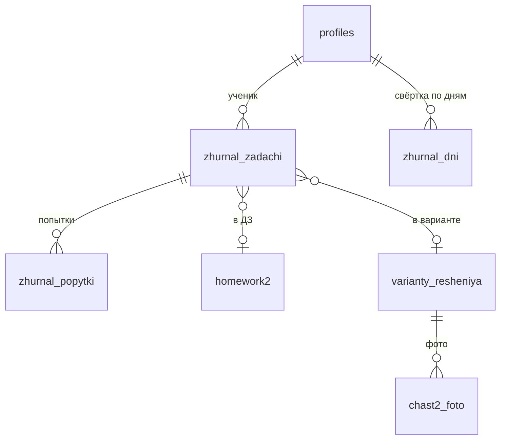

# Кабинет v2: прогресс учеников, новая выдача ДЗ, уведомления

План большого этапа. Вход через VK и MAX сюда не входит, это отдельная
задача.

Порядок: этап 1 — журнал и прогресс, этап 2 — новая выдача ДЗ, этап 3 —
уведомления. Каждый этап — отдельный PR, всё новое прячется за флагами.
ДЗ и прогресс сначала обкатываются на заданиях №5 и №8, потом
включаются для остальных разделов.

---

## 0. Решения владельца (22.11.2026)

План утверждён. По вопросам ниже:

- В-1, В-2, В-3, В-7, В-8, В-9, В-10, В-11, В-12, В-13 — по рекомендации.
- **В-4** — по рекомендации, Yandex Object Storage. Аккаунт и бакет
  владелец создаёт сам по инструкции [../setup-object-storage.md](../setup-object-storage.md).
  PR 1в идёт после PR 1 и остальные этапы не блокирует.
- **В-5** — в push только тип события и ссылка. Push включается
  последним шагом этапа 3, своим флагом; сначала колокольчик и почта.
- **В-6 — нет.** Где это роль аккаунта, везде «учитель»: регистрация,
  вход, кабинет, письма, уведомления, приветственный тур. Ключ роли
  `tutor` в базе не меняется. Вкладки «Для репетиторов» в разделах пока
  не трогаются — их список: [repetitor-mesta.md](repetitor-mesta.md).
- №6 скрыт по структуре ЕГЭ-2027: в журнал, «В домашку» и тепловую
  карту не подключается. Номера заданий на экранах — по ЕГЭ-2027.
- Тексты кабинета — без «мы».

«№5 и №8» в этом плане — номера хранения разделов (как в коде и в
базе): «Сложная вероятность» и «Вычисления». На экранах они — задания
5 и 7 ЕГЭ-2027.

Этап 1 разбит на два PR: **1а** — журнал (база, запись из браузера,
права, тесты; [../kabinet-zhurnal.md](../kabinet-zhurnal.md)) и **1б** —
экраны учителя и ученика с выгрузкой.

## 0а. Вопросы, которые решаете вы

У каждого вопроса есть рекомендация. Ответ «по рекомендации» тоже
подходит: тогда работа идёт по ней.

| № | Вопрос | Рекомендация |
|---|---|---|
| В-1 | **Хранить ли введённые ответы.** Сейчас журнал прогресса нарочно хранит только исход («верно/неверно»), без ответов (`lib/progressLog/model.ts`). Для провала внутрь нужен ответ ученика как есть | Да. До 40 знаков на попытку, не больше 20 попыток на задачу. Ответ — число или выражение, не текст: личных сведений в нём нет |
| В-2 | **Сколько хранить журнал.** | Подробные записи: до конца следующего учебного года (около 2 лет), потом они сворачиваются в счётчики по дням. При удалении аккаунта всё удаляется сразу |
| В-3 | **Видит ли учитель то, что ученик делал до того, как вступил в его класс.** | Нет. Учитель видит записи с даты связи «учитель — ученик» (`tutor_students.linked_at`) и до её окончания (`ended_at`). Ученик, который сменил учителя, не приносит новому свою историю |
| В-4 | **Фото второй части: где хранить и сколько.** Загрузки фото на сайте пока нет — есть только тексты экрана. На сервере нет хранилища файлов (`docs/hosting-lite.md`, «Storage и Studio не ставим») | Контейнер Storage на сервере, сами файлы — в бакете Yandex Object Storage (отдельная небольшая плата). До 6 фото к задаче, до 1,5 МБ после сжатия в браузере. Хранить до конца учебного года, в котором ДЗ выдано. Видят только ученик и учитель этого ДЗ |
| В-5 | **Web push идёт через серверы браузеров** (Google для Chrome и Android, Apple, Mozilla) — они за рубежом. В уведомлении можно не передавать ничего личного: «Новое домашнее задание» и ссылка | Включить, но в push только тип события и ссылка, без имён и названий ДЗ. Подробности — на сайте после входа. Это нужно упомянуть в политике |
| В-6 | **Слово в интерфейсе: «учитель» или «репетитор».** Сейчас в кабинете везде «репетитор» | Оставить «репетитор» в интерфейсе (так написано в документах и при регистрации), в этом плане — «учитель» |
| В-7 | **Порог «подозрительно быстро».** | Верный ответ с первой попытки, без подсказок, задача сложности «повышенная» или выше, активное время меньше 8 с или меньше 15 % от медианы этого типа у всех учеников. Пометка — серый значок «очень быстро», без слов «списал» |
| В-8 | **Дайджест учителю по умолчанию.** | Ежедневный, в 19:00 по Москве; можно переключить на еженедельный (воскресенье) или выключить |
| В-9 | **Попытки в новом ДЗ.** | Выбор: 1, 2, 3 или без ограничения; по умолчанию — без ограничения, для контрольной — 1 |
| В-10 | **Что делать с нынешней «Выдать ДЗ» №8** (`/kabinet/dz-vydat/`) после включения новой выдачи. | Выданные ДЗ остаются и решаются как раньше. Новые выдаются только через новую выдачу; старая кнопка ведёт в корзину. Старый адрес — заглушка с 301 по правилам `CLAUDE.md` |
| В-11 | **PDF-выгрузка.** | Страница для печати с кнопкой «Сохранить PDF» (как печать листов сейчас): KaTeX и чертежи выходят как на экране. Excel — файлом (`lib/xlsx.ts` уже умеет) |
| В-12 | **Письма ученикам младше 18.** | Только на почту самого ученика и только сервисные (ДЗ, сроки, проверка). Родителю — ничего, пока нет отдельной задачи «кабинет родителя» |
| В-13 | **Тихие часы для учителя.** | Те же 22:00–8:00, отключаются в настройках. Колокольчик на сайте пишется всегда, тихие часы касаются только почты и push |

---

## 1. Что уже есть

| Что | Где | Что важно для v2 |
|---|---|---|
| Вход и регистрация | `/voyti/`, GoTrue на `api.budetege.ru`, `docs/AUTH.md` | Сессия в хранилище браузера, роль не меняется после регистрации |
| Роли | `profiles.role`: `student`, `tutor`, `admin` | Проверки ролей в функциях базы (`security definer`) и RLS |
| Классы и привязка | `classes`, `class_members`, `tutor_students`, код класса, `join_class` (`20261111120000_dz.sql`) | `is_my_student()` — готовая основа проверки «только свои ученики» |
| ДЗ №8 | `homework`, `homework_tasks`, `homework_keys`, `homework_answers`, `issue_homework_tasks`, `homework_check` | Ответ проверяется на сервере, ключ ученик не читает, решения — по `solutions_when`. В `homework_answers.entries` уже есть ответы ДЗ |
| Онлайн-вариант | `variant_works`, `variant_attempts`, `variant_answers`, `variant_check`, `variant_submit` | Контрольная с таймером считается базой; баллы и ключ — после завершения |
| Тренажёры | общий экран `components/tasks/trening/EkranZadachi.tsx` (№3, №4–5, №8, банк), у остальных разделов — свои экраны | Ответ сверяется в браузере по «отпечатку» (`readSealed`): сервер исход не проверяет |
| Журнал попыток | `lib/progressLog`, ключи `budetege:<раздел>:log:v1` | Одна запись на закрытую задачу: исход, секунды, без ответов. Синхронизируется через `user_storage` |
| Активное время тренировки | `components/tasks/session/TrainerSessionHost.tsx` | Пауза и скрытая вкладка не считаются; бездействия нет — его надо добавить |
| Подсказки-вопросы | `components/tasks/trening/PodskazkaVoprosy.tsx` | Шаги вопросами, неверная кнопка на шаге, «Показать свойство» (№1) — состояние держит экран задачи |
| Задача по id | `прототип|seed|уровень` (№8 — `lib/vychisleniya/session.ts`) | По id та же задача собирается заново: те же числа и чертёж, пока генератор не менялся |
| Карточки | `lib/kartochki` (Лейтнер) | Своего журнала нет |
| Собрать вариант | `lib/variant`, код партии | Тот же код собирает лист и разборы |
| Фото второй части | только тексты `content/variantOnline/chast2Text.ts` | Загрузки и хранилища нет — строится с нуля |
| Карта в кабинете | `components/karta/KartaUchenika.tsx` | Читает журналы разделов |
| Выгрузка Excel | `lib/xlsx.ts` | Есть, без зависимостей |
| Сервер | 2 ГБ, 1 ядро: PostgreSQL, GoTrue, PostgREST, Caddy | Своего кода приложения на сервере нет, фоновых заданий в базе нет (pg_cron не стоит) |
| Service worker, manifest | нет | Нужны для push и для экрана «Домой» на iPhone |

---

## 2. Флаги

Флаги сборки — Variables репозитория, как `NEXT_PUBLIC_AUTH_ENABLED`.
Флаги базы — таблица `public.kabinet_flags`, её меняет только сервер
(кнопка «Сервер: миграции»): база отказывает в записи, если флаг
выключен, даже если сайт собран со старым флагом.

| Флаг | Что включает |
|---|---|
| `NEXT_PUBLIC_ZHURNAL` | запись журнала событий на сервер |
| `NEXT_PUBLIC_ZHURNAL_RAZDELY` | разделы через запятую: `5,8` → потом все |
| `NEXT_PUBLIC_PROGRESS_UCHITEL` | экраны учителя: класс, ученик, провал внутрь, выгрузка |
| `NEXT_PUBLIC_PROGRESS_UCHENIK` | «Моя статистика» у ученика |
| `NEXT_PUBLIC_DZ2` | корзина «В домашку», новая выдача, «Мои домашки» |
| `NEXT_PUBLIC_DZ2_RAZDELY` | разделы, у которых есть кнопка «В домашку» |
| `NEXT_PUBLIC_UVEDOMLENIYA` | колокольчик и настройки |
| `NEXT_PUBLIC_UVEDOMLENIYA_KANALY` | `pochta,push` |
| `kabinet_flags.zhurnal`, `.dz2`, `.uvedomleniya` | то же на стороне базы и рассыльщика |

Всё выключено по умолчанию. Включённый флаг без роли учителя не
показывает экранов учителя.

---

## 3. Модель данных

Все новые таблицы — под RLS, колонка `user_id` — владелец строки
(ученик): по ней работают `export_my_data()` и каскадное удаление.
Ученик пишет только через функции. Учитель читает только через
функции, которые первым делом проверяют `is_my_student()` и даты
связи (В-3); прямого `select` у учителя на журнал нет.

### 3.1. Журнал (этап 1)



**`zhurnal_zadachi`** — одна строка на задачу, которую ученик открыл и
закрыл (верно, неверно, пропустил, ушёл).

| Колонка | Что |
|---|---|
| `id` uuid | ставит браузер: повторная отправка не создаёт дубль (`unique (user_id, id)`) |
| `user_id` | ученик |
| `task_no` | раздел (номер хранения, как в `ege_tasks`) |
| `kind` | тип/прототип («8.A») |
| `task_ref` | id задачи: `прототип|seed|уровень` |
| `gen_hash` | короткий отпечаток генератора прототипа на момент решения |
| `uslovie_tex` | условие в TeX до 2 КБ — запасной вариант, если генератор с тех пор изменился |
| `place` | `trenazher`, `opornye`, `kartochki`, `variant`, `povyshennye`, `dz` |
| `place_ref` | id тренировки, блока опорных, варианта или ДЗ |
| `outcome` | `right`, `hinted`, `wrong`, `revealed`, `skipped`, `left` |
| `verified` | исход проверила база (ДЗ, вариант), а не браузер |
| `attempts_n` | число попыток |
| `hint_steps` | сколько шагов подсказки открыто |
| `hint_wrong` | номера шагов, на которых была неверная кнопка |
| `shown_fact`, `shown_solution`, `skipped` | открыты ли «Показать свойство», «Показать решение»; «Пропустить» |
| `active_ms`, `total_ms` | активное и общее время |
| `started_at`, `closed_at` | по часам браузера, но не позже `received_at` и не раньше чем за 7 дней до него |
| `received_at` | время сервера |

**`zhurnal_popytki`** — каждая попытка ответа.

| Колонка | Что |
|---|---|
| `zadacha_id`, `n` | задача и номер попытки |
| `answer` | ответ как есть, до 40 знаков (В-1) |
| `ok` | верно ли |
| `kind` | `answer`, `format` (неверная запись — попытка не тратится), `fraction` |
| `at` | время |

**`zhurnal_dni`** — свёртка: `user_id, day (по Москве), task_no, kind,
solved, right, active_ms`. Пополняется триггером при вставке в
`zhurnal_zadachi`. Тепловая карта, активность за неделю и календарь
читаются отсюда, а не из сырых записей: на одном ядре сервера это
важно.

**`varianty_resheniya`** — вариант, решённый целиком (свой «Собрать
вариант», серия, «Варианты повышенной сложности»): `id`, `user_id`,
`set_code`, `variant_no`, `source`, `started_at`, `finished_at`,
`primary_score`, `test_score`, `variant_attempt_id` (если это выданная
работа — ссылка на `variant_attempts`, баллы считает база). Задачи
варианта — строки `zhurnal_zadachi` с `place = 'variant'`, верный
ответ учитель получает из ключа партии (код партии собирает тот же
вариант).

**`chast2_foto`** — `id`, `user_id`, `reshenie_id` или `homework2_item`,
`task_no`, `pos`, `object_key` (путь в хранилище), `bytes`,
`created_at`. **`chast2_ocenki`** — баллы учителя и комментарий:
`tutor_id`, `score`, `max_score`, `comment`, `checked_at`.

Запись — одна функция `zhurnal_push(batch jsonb)`:

- только `student`, только при `can_save_progress()` и флаге базы;
- до 50 задач за вызов, до 20 попыток на задачу, ограничение частоты;
- идемпотентна: та же задача, присланная ещё раз, дополняет строку,
  а не создаёт новую;
- раздел из `kabinet_flags.zhurnal_razdely`, иначе молча пропуск.

Браузер копит записи в очереди (`localStorage`, ключ
`budetege:zhurnal:ochered:v1`) и отправляет пачками: раз в 10 с, при
скрытии вкладки (`sendBeacon` нельзя — нужен заголовок с токеном,
поэтому `fetch` с `keepalive`) и при входе на страницу. Без сети
записи ждут. Гостю очередь не пишется.

**Активное время.** Общий таймер `lib/zhurnal/aktivnoe.ts`: идёт,
когда вкладка видна и было действие (нажатие, ввод, прокрутка) не
дольше 2 минут назад. После 2 минут бездействия — пауза; первое
действие снова запускает таймер, прошедшие 2 минуты в активное время не
входят. Общее время — от показа задачи до закрытия.

**Учителю — функции чтения** (все проверяют связь с учеником):
`uchitel_klass_karta(class_id, from, to, task_no)`,
`uchitel_klass_aktivnost(class_id)`, `uchitel_uchenik_svodka(user_id,
from, to, task_no)`, `uchitel_uchenik_lenta(user_id, from, to, cursor)`,
`uchitel_zadacha(zadacha_id)`, `uchitel_variant(reshenie_id)`.
Пометку «очень быстро» считает только функция учителя (В-7): ученику
её никто не отдаёт.

Ученику — `moya_statistika(from, to)` без пометок.

### 3.2. Новая выдача ДЗ (этап 2)

Нынешние таблицы ДЗ №8 остаются для уже выданных (В-10). Новые:

| Таблица | Что |
|---|---|
| `homework2` | `id`, `tutor_id`, `title`, `note`, `status` (`draft`, `scheduled`, `published`, `closed`), `publish_at`, `due_at` (UTC), `after_due` (`late_ok`, `closed`), `hints_allowed`, `attempts_limit`, `solutions_when` (`instant`, `after_due`, `never`), `individual`, `kontrol` (тогда «Запомни» и пример выключены), `timer_minutes`, `template_of`, `copied_from`, `edited_at` |
| `homework2_targets` | кому: `class_id` или `user_id`; при публикации раскрывается в получателей |
| `homework2_items` | элементы по порядку: `kind` (`opornye`, `trenazher`, `kartochki`, `variant`, `chast2`, `teoriya`), `task_no`, `spec` jsonb (блок и задачи опорных; типы тренажёра и цель `{count: N}` или `{streak: K}`; набор карточек; код партии и таймер; задачи второй части; глава теории) |
| `homework2_tasks`, `homework2_keys` | готовые задачи и ключи, как `homework_tasks`/`homework_keys` сейчас; при «индивидуальных числах» — у каждого ученика свои строки. Наборы собирает браузер учителя тем же генератором, ключи ученик не читает |
| `homework2_recipients` | `user_id`, `status` (`not_started`, `in_progress`, `submitted`, `late`, `missed`, `returned`), `started_at`, `submitted_at`, `returned_at`, `comment` |
| `homework2_item_progress` | по ученику и элементу: сделано, цель, выполнено ли; считает база из `zhurnal_zadachi` с `place = 'dz'` |
| `homework2_templates` | шаблоны учителя: тот же `spec` без получателей и дат |

Ответы ДЗ проверяет база (`homework2_check`), как сейчас у №8, —
поэтому учитель видит проверенный исход (`verified`). Тренажёр внутри
ДЗ: задачи выдаются браузеру по одной из заранее собранного запаса
(до 60 на тип), цель «K верных подряд» считает база.

Корзина «В домашку» — в браузере учителя (`budetege:dz2:korzina:v1`):
элементы из разных разделов, из корзины открывается мастер выдачи.

Редактирование после публикации: меняются текст, сроки и элементы,
которых ученик ещё не касался. Каждое изменение — событие
`dz_izmeneno` для уведомлений.

### 3.3. Уведомления (этап 3)

| Таблица | Что |
|---|---|
| `notifications` | колокольчик: `user_id`, `event`, `payload` (id ДЗ, без текста ДЗ), `created_at`, `read_at` |
| `notify_prefs` | по пользователю: событие × канал вкл/выкл, `quiet_from`, `quiet_to` (по умолчанию 22:00–8:00), `tz` (по умолчанию `Europe/Moscow`), `digest` (`day`, `week`, `off`) |
| `notify_outbox` | очередь: `id`, `user_id`, `channel`, `event`, `dedupe_key` (уникальный: `hw:<id>:remind24:<user>:pochta`), `send_after` (UTC, уже сдвинуто тихими часами), `status` (`wait`, `sending`, `sent`, `failed`, `cancelled`), `tries`, `last_error`, `sent_at` |
| `notify_log` | журнал отправок: что, кому, каким каналом, ответ сервиса, время. Хранится 90 дней |
| `push_subscriptions` | `endpoint`, ключи шифрования, `created_at`, `last_ok_at`. Без названия браузера и устройства |
| `email_unsubscribe` | одноразовые токены «Отписаться» (хеш) |

События создаёт база: триггеры на публикацию, сдачу, возврат и
проверку ДЗ, и функция `notify_tick()` раз в минуту — напоминания за
24 ч и 3 ч (только если ДЗ не сдано), «дедлайн прошёл», «накануне
дедлайна не начали», дайджест. Дубль невозможен: `dedupe_key`
уникален. Перед отправкой рассыльщик ещё раз проверяет условие
(вдруг ДЗ уже сдано) и отменяет письмо.

**Рассыльщик** — новый маленький контейнер `notifier` (Node 22, лимит
памяти 96 МБ): раз в минуту вызывает `notify_tick()`, забирает
очередь (`for update skip locked`), отправляет, ставит повтор с
нарастающей паузой (1, 5, 30 мин, 2 ч, потом `failed`). Каналы — модули
с одним интерфейсом:

```ts
interface Kanal {
  id: 'pochta' | 'push' | 'max' | 'vk';
  mozhno(user: Poluchatel): boolean;
  otpravit(msg: Soobshchenie): Promise<Itog>; // ok | povtor | navsegda
}
```

MAX и ВКонтакте потом добавляются новым модулем и строкой в
`notify_prefs`, без переделки очереди.

- **Почта** — SMTP Яндекс 360 с `noreply@budetege.ru`, письмо в стиле
  сайта (шаблоны рядом с `supabase/templates/`), кнопка «Открыть
  домашку», ссылка «Отписаться» и заголовок `List-Unsubscribe`.
- **Web push** — VAPID; `sw.js` и `manifest.webmanifest` в
  `app/public/`. На iPhone push работает только у сайта, добавленного
  на экран «Домой» (iOS 16.4+): сайт узнаёт это и показывает
  инструкцию «Поделиться → На экран „Домой“».
- **Тихие часы**: событие, попавшее на 22:00–8:00 в поясе пользователя,
  получает `send_after` = 8:00. Напоминание «за 3 часа», перенесённое
  за дедлайн, не отправляется — вместо него утром «дедлайн прошёл».

Дедлайны хранятся в UTC (`timestamptz`), показываются в поясе
пользователя (`notify_prefs.tz`, по умолчанию Москва); учитель задаёт
дату и время по Москве.

---

## 4. Экраны

Адреса — под `/kabinet/`, страницы статические, данные по `?id=`, как
сейчас. Хвосты адресов — в `lib/paths.ts`.

| Адрес | Кто | Что |
|---|---|---|
| `/kabinet/klass-progress/?id=` | учитель | тепловая карта «ученики × задания», активность за 7 дней, «давно не заходил» (больше 7 дней), «не начал текущее ДЗ»; фильтры периода и раздела; выгрузка |
| `/kabinet/uchenik/?id=` | учитель | сводка за период (активное время, решено, точность по заданиям, тестовый балл по вариантам, 5 слабых типов), календарь активности, лента |
| `/kabinet/uchenik/zadacha/?id=` | учитель | задача, как её видел ученик: те же числа и чертёж, попытки, подсказки, время |
| `/kabinet/uchenik/variant/?id=` | учитель | вариант по задачам; вторая часть — фото, баллы, комментарий |
| `/kabinet/uchenik/pechat/?id=` | учитель | страница для PDF (В-11) |
| `/kabinet/statistika/` | ученик | своя статистика без пометок |
| `/kabinet/domashki/` | ученик | «Мои домашки»: активные, просроченные, сданные; прогресс и обратный отсчёт |
| `/kabinet/domashki/reshat/?id=` | ученик | решение внутри ДЗ, «Сдать» |
| `/kabinet/dz2/` | учитель | корзина и мастер выдачи; черновики, шаблоны |
| `/kabinet/dz2/itogi/?id=` | учитель | «ученики × элементы» со статусами, комментарий, «Вернуть на доработку», проверка второй части |
| `/kabinet/uvedomleniya/` | все | центр уведомлений и настройки |

Ученик — телефон 375 px прежде всего. Учитель — таблицы на компьютере;
на телефоне тепловая карта прокручивается по горизонтали с закреплённым
столбцом имён, а у ученика открывается списком. Стиль — стеклянные
карточки (`components/ui`), синий и оранжевый акценты, формулы KaTeX.

Время учителю — активное; общее — во всплывающей подсказке. Пометка
«очень быстро» — серый значок с подсказкой «Верный ответ за N с —
быстрее, чем обычно на этом типе».

---

## 5. Этапы и PR

| PR | Что | Флаги |
|---|---|---|
| 0 | этот план | — |
| 1а | **Журнал.** Миграция журнала, `zhurnal_push`, очередь в браузере, активный таймер с паузой; запись из тренажёра, опорных и карточек №5 и №8, из «Собрать вариант» и онлайн-варианта | `ZHURNAL`, разделы `5,8` |
| 1б | **Экраны прогресса**: класс, ученик, задача, вариант, «Моя статистика»; Excel и печать в PDF | `PROGRESS_*` |
| 1в | Хранилище фото и загрузка второй части (зависит от В-4): контейнер Storage, бакет, загрузка со сжатием и очередью, проверка учителем | там же |
| 2 | **Новая выдача ДЗ** на №5 и №8: корзина, все виды элементов, мастер, «индивидуальные числа», черновики, шаблоны, «Повторить ДЗ», «Мои домашки», итоги ДЗ, возврат на доработку | `DZ2`, разделы `5,8` |
| 3 | **Уведомления**: колокольчик, рассыльщик, почта, push, настройки, тихие часы, дайджест | `UVEDOMLENIYA` |
| 4 | Остальные разделы: журнал и «В домашку» для №1–4, 6–7, 9–21 | только списки разделов |

Порядок внутри этапа 1: сначала журнал и его тесты, потом экраны.
Остальные разделы подключаются после обкатки №5 и №8: у №3, №4–5, №8 и
банка общий экран `EkranZadachi` — их подключение дешёвое; у остальных
свои экраны, каждый подключается отдельно через общий хук
`useZapisZadachi`.

**Этап 4 по PR** (опись разделов — 24.11.2026):

| PR | Что |
|---|---|
| 4а | общие места: сложность всех разделов (`lib/zhurnal/uroven.ts`), №4 целиком (тренажёр уже на общем экране №4–5, опорные — кнопка ДЗ), «В домашку» у глав теории во всех разделах (общая оболочка) |
| 4б | общий тренажёр банка (`EkranBanka`): журнал и «В домашку» для №1, 2, 7, 9, 10, 11, 12, 13, 21 |
| 4в | опорные на общем экране банка (№7, 10, 21): журнал и «В домашку»; ответ уходит в браузер закрытым ключом задачи, как разбор |
| 4г | опорные на своих экранах: №1, 2, 9, 11, 13; чертежи и таблицы условия в ДЗ (и у тренажёра 4б) |
| 4д | №3: тренажёр и опорные (задачи с выбором — без ДЗ) |
| 4е | общий тренажёр `TrenazherEkran`: №12 по типам и №18 (у №18 нет адаптера — свой запас) |
| 4ж | вторая часть, только журнал: №14, №19; ДЗ для них — отдельное решение (ключ не число) |

№15, №16 (тренажёр), №17 и №20 — заглушки или без экранов: подключать
пока нечего. Карточки общие — у разделов с карточками они включаются
одним списком разделов.

---

## 6. Тесты

| Проверка | Что |
|---|---|
| `pnpm test:kabinet-sql` (дополняется) | права: **учитель не видит чужих учеников** — отдельный файл `supabase/tests/zhurnal-prava.test.sql`: чужой учитель, учитель до `linked_at` и после `ended_at`, ученик не читает чужое и пометки учителя, аноним; идемпотентность `zhurnal_push`, пределы, флаг базы |
| `pnpm test:zhurnal` | модель журнала и таймер: пауза после 2 мин, скрытая вкладка, несколько вкладок |
| `pnpm test:dz2-site` | полный цикл: выдать → уведомление в колокольчике и в очереди → решить → сдать → учитель видит ответы и время |
| `pnpm test:uvedomleniya` | напоминания за 24 и 3 ч, только несданным; тихие часы (событие в 23:00 → 8:00); без дублей при двух прогонах `notify_tick`; повторы и `failed` |
| Playwright-снимки | ключевые экраны на 375 px и 1280 px — в каждом PR, папки `docs/kabinet-v2-snimki/<этап>/` |
| `pnpm build && pnpm test:links` | как требует `CLAUDE.md` |

---

## 7. Персональные данные (для политики и уведомления в РКН)

Новое, что начинает собираться:

| Данные | Чьи | Зачем | Срок |
|---|---|---|---|
| Журнал решения задач: задача, введённые ответы, верно/неверно, подсказки, время решения, даты и время активности | ученик | статистика ученику и его учителю | В-2 |
| Баллы за варианты | ученик | то же | В-2 |
| Фото решений второй части (почерк, возможно — подписанное имя) | ученик | проверка учителем | В-4 |
| Баллы и комментарии учителя | ученик (о нём) | обратная связь | пока есть аккаунт |
| Статус ДЗ: начал, сдал, с опозданием | ученик | итоги ДЗ | пока есть ДЗ |
| Настройки уведомлений, часовой пояс | все | рассылка | пока есть аккаунт |
| Уведомления в колокольчике: событие, ДЗ, когда прочитано (без текста ДЗ и комментариев) | все | колокольчик на сайте | 180 дней |
| Очередь отправки: событие, канал, время, результат | все | рассылка | 90 дней после отправки |
| Подписка на push (`push_subscriptions`, PR 3г): адрес сервиса push, ключи браузера, когда принят последний push, счётчик сбоев — без названия браузера и устройства | все, кто включил | push | до «Выключить на этом устройстве»; удаляется, когда сервис ответил «подписки нет» (404/410) или полгода только отказывал |
| Журнал отправок (`notify_log`, PR 3в): событие, канал, время, результат, ответ почтового сервера без адреса | все | разбор сбоев | 90 дней |
| Письмо уведомления: адрес почты аккаунта, название ДЗ, срок, имя ученика (только в письме учителю о сдаче) — без текста ДЗ и комментариев | все, у кого включена почта | рассылка через Яндекс 360 | не хранится: копию держит только ящик получателя |

Не собирается: IP в журнале, название устройства и браузера,
геолокация, данные родителей сверх уже существующих.

Передача третьим лицам и за рубеж: почта уходит через Яндекс 360
(Россия); push — через сервисы браузеров (Google, Apple, Mozilla — за
рубежом), в push только тип события и ссылка (В-5). Файлы фото — Yandex
Object Storage (Россия).

Новые цели обработки для уведомления в РКН: «ведение статистики
обучения и передача её репетитору ученика», «рассылка сервисных
уведомлений».

---

## 8. Риски

| Риск | Что делать |
|---|---|
| **Исход тренажёра проверяет браузер.** Ученик со знаниями JavaScript может прислать «верно» | Учителю видна пометка `verified`: в ДЗ и вариантах исход проверяет база. В статистике тренажёра это честно названо «самостоятельная тренировка» |
| **Генератор изменился — по seed собирается другая задача** | `gen_hash` при решении; не совпал — учитель видит сохранённое `uslovie_tex` и строку «Задача показана по записи: генератор с тех пор обновлён» |
| **Объём журнала.** 100 учеников × 50 задач в день ≈ 5 тыс. строк задач и 8 тыс. попыток в день, около 1,5 ГБ в год с индексами | Свёртка `zhurnal_dni` для экранов, сворачивание старых записей (В-2); замер на пробе; копии растут — сжатие уже есть |
| **Одно ядро сервера** | экраны читают свёртки; лента — постранично; выгрузка класса — одна функция, не N запросов |
| **Память 2 ГБ**: Storage (60–120 МБ) и рассыльщик (до 96 МБ) | замер на пробе `lite-server.yml` перед включением, как в `hosting-lite.md` §4 |
| **Почта в спам и лимиты Яндекс 360 на рассылку** | SPF, DKIM, DMARC уже проверяются; дайджест вместо пачки писем; лимиты уточнить у Яндекс 360 до включения, при росте — сервис рассылок в России |
| **Push на iPhone** работает только с экрана «Домой», на Android/Chrome доставка через Google может быть нестабильной в России | колокольчик — основной канал, push — дополнительный; почта — запасной для важных событий |
| **Очередь в браузере и несколько вкладок** | одна очередь на браузер, отправку держит одна вкладка (`navigator.locks`), сервер идемпотентен |
| **Часы ученика неверные** | `received_at` сервера; `started_at` прижимается к окну 7 дней |
| **Двадцать разделов со своими экранами** | общий хук и подключение по разделу; список разделов — флагом, без пересборки логики |
| **Ученик младше 18 до согласия родителя** | журнал не пишется (`can_save_progress`), учитель видит «прогресс не сохраняется до согласия родителя» |
| **Старые адреса ДЗ №8** | заглушка «Страница переехала» и 301 в `.htaccess` только для внешних ссылок; внутри сайта ссылки сразу на новый адрес, `pnpm test:links` |
