# Реестр картинок первой части (шаг 0 редизайна)

Собран скриптом по `app/public` на коммите main `a298724`. Картинки в редизайне **не меняются**: ни файл, ни формат, ни прозрачность. Контрольные суммы всех файлов — в [redesign-kartinki.sha256](redesign-kartinki.sha256); каждый PR сверяет их до и после.

**Как читать.** «Размер» — пиксели исходника (самый крупный вариант семейства). «Варианты» — готовые размеры и форматы одного и того же рисунка. «Показ сейчас» — фактическая ширина на снимках «до» (телефон 375 / компьютер 1280) на вкладках раздела; «—» значит, что на снятых страницах картинки нет (она появляется внутри задачи тренажёра, в блоке опорных задач или на печатном листе). Пометка ⚠ — показана плохо, редизайн должен показать лучше.

В реестр не входят: заставка и главная (`/intro`, `/hero`), «Об авторе», онбординг, вторая часть — их задача не трогает.

## №1

Семейств: 1, файлов: 8, вес: 1.6 МБ.

| | Картинка | Роль | Размер | Варианты · вес | Прозрачность | Показ сейчас, px (375 / 1280) | Где видна на снимках | Где подключена | Замечание |
|---|---|---|---|---|---|---|---|---|---|
| 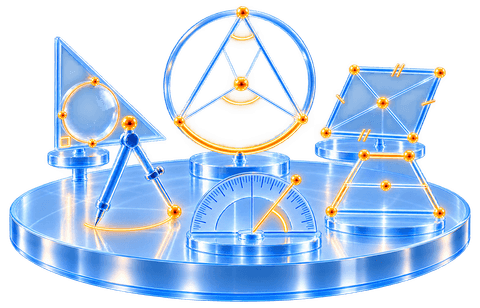 | `zadanie-01/shapka-planimetriya` | шапка раздела | 1536×984 | 1536·png, 1536·webp, 1200·png, 1200·webp, 768·png, 768·webp, 480·png, 480·webp · 1599 КБ | да | — / 337 | №1/kartochki, №1, №1/opornye-zadachi, №1/trenazher | `content/zadanie1.ts` |  |

## №2

Семейств: 1, файлов: 1, вес: 0.0 МБ.

| | Картинка | Роль | Размер | Варианты · вес | Прозрачность | Показ сейчас, px (375 / 1280) | Где видна на снимках | Где подключена | Замечание |
|---|---|---|---|---|---|---|---|---|---|
| 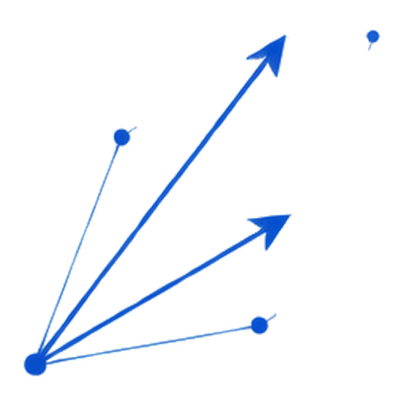 | `task` | обложка-иконка раздела | 512×512 | webp · 44 КБ | да | — / — | — | `app/about/page.tsx`, `app/zadaniya/TaskBank.tsx`, `components/layout/AppShell.tsx` |  |

## №3

Семейств: 1, файлов: 1, вес: 0.0 МБ.

| | Картинка | Роль | Размер | Варианты · вес | Прозрачность | Показ сейчас, px (375 / 1280) | Где видна на снимках | Где подключена | Замечание |
|---|---|---|---|---|---|---|---|---|---|
| 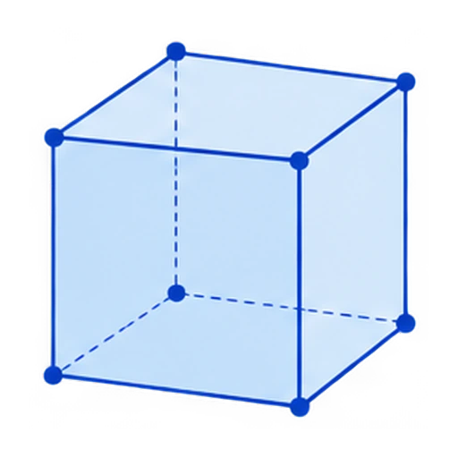 | `task` | обложка-иконка раздела | 512×512 | webp · 32 КБ | да | — / — | — | `app/about/page.tsx`, `app/zadaniya/TaskBank.tsx`, `components/layout/AppShell.tsx` |  |

## №4

Семейств: 24, файлов: 81, вес: 15.9 МБ.

| | Картинка | Роль | Размер | Варианты · вес | Прозрачность | Показ сейчас, px (375 / 1280) | Где видна на снимках | Где подключена | Замечание |
|---|---|---|---|---|---|---|---|---|---|
| 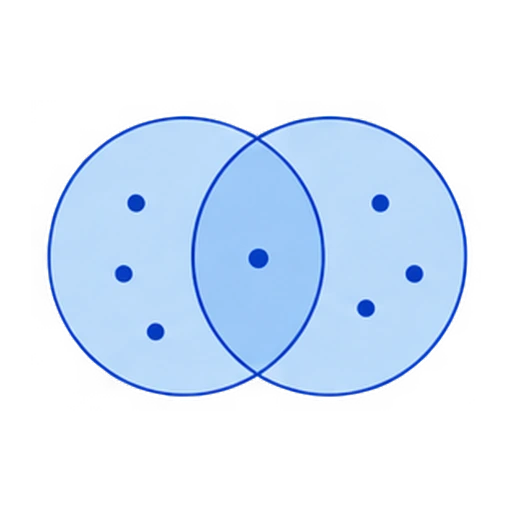 | `task` | обложка-иконка раздела | 512×512 | webp · 29 КБ | да | — / — | — | `app/about/page.tsx`, `app/zadaniya/TaskBank.tsx`, `components/layout/AppShell.tsx` |  |
| 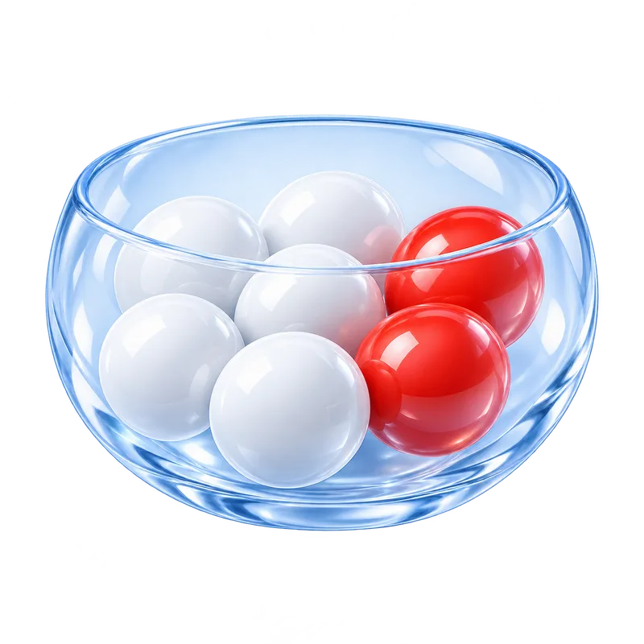 | `veroyatnost-4/chasha` | картинка к задаче | 800×800 | webp · 78 КБ | да | 88 / 132 | №4/opornye-zadachi | `lib/veroyatnost/podgotovka4.ts` | ⚠ мелко: 88 px при исходнике 800 |
| 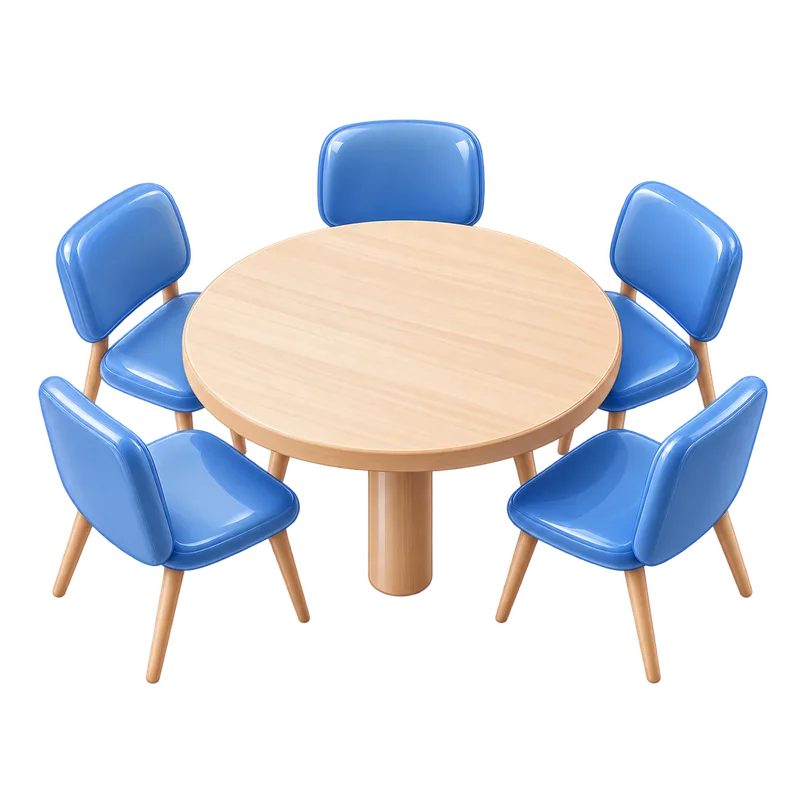 | `veroyatnost-4/kruglyj-stol` | картинка к задаче | 800×800 | webp · 73 КБ | да | 88 / 132 | №4/opornye-zadachi | `lib/veroyatnost/podgotovka4.ts` | ⚠ мелко: 88 px при исходнике 800 |
| 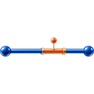 | `veroyatnost-4/metody/geometricheskoe` | иконка метода | 192×192 | webp · 3 КБ | да | 72 / 96 | №4/trenazher | `components/tasks/veroyatnost/MetodKartinka.tsx` |  |
| 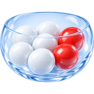 | `veroyatnost-4/metody/klassicheskaya` | иконка метода | 192×192 | webp · 13 КБ | да | 72 / 96 | №4/trenazher | `components/tasks/veroyatnost/MetodKartinka.tsx` |  |
| 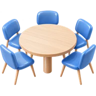 | `veroyatnost-4/metody/kruglyy-stol` | иконка метода | 192×192 | webp · 13 КБ | да | 72 / 96 | №4/trenazher | `components/tasks/veroyatnost/MetodKartinka.tsx` |  |
|  | `veroyatnost-4/metody/kubiki` | иконка метода | 192×192 | webp · 13 КБ | да | 72 / 96 | №4/trenazher | `components/tasks/veroyatnost/MetodKartinka.tsx` |  |
|  | `veroyatnost-4/metody/monety` | иконка метода | 192×192 | webp · 20 КБ | да | 72 / 96 | №4/trenazher | `components/tasks/veroyatnost/MetodKartinka.tsx`, `content/veroyatnost-teoriya.ts` |  |
| 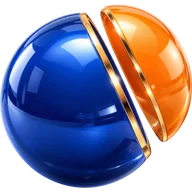 | `veroyatnost-4/metody/protivopolozhnye` | иконка метода | 192×192 | webp · 13 КБ | да | 72 / 96 | №4/trenazher | `components/tasks/veroyatnost/MetodKartinka.tsx` |  |
|  | `veroyatnost-4/metody/statisticheskoe` | иконка метода | 192×192 | webp · 16 КБ | да | 72 / 96 | №4/trenazher | `components/tasks/veroyatnost/MetodKartinka.tsx` |  |
| 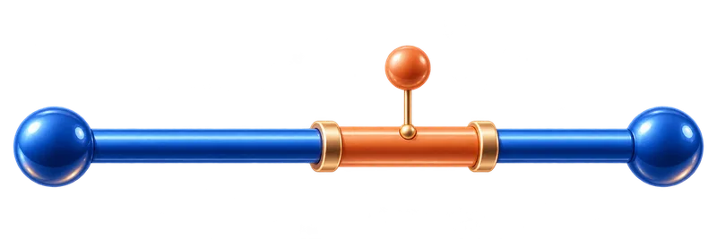 | `veroyatnost-4/otrezok` | картинка к задаче | 800×267 | webp · 17 КБ | да | 88 / 132 | №4/opornye-zadachi | `content/veroyatnost-syuzhety.ts`, `lib/veroyatnost/podgotovka4.ts` | ⚠ мелко: 88 px при исходнике 800 |
|  | `veroyatnost-4/syuzhety/p4` | сюжет задачи | 800×800 | 800·webp, 800·webp, 800·webp, 800·webp, 800·webp, 800·webp, 800·webp, 800·webp, 800·webp, 800·webp, 800·webp, 800·webp, 800·webp, 800·webp, 800·webp, 800·webp, 800·webp, 800·webp, 800·webp, 800·webp · 1922 КБ | да | — / — | — | `app/zadaniya/4/dannye/razbory/[kind]/route.ts`, `content/generator45.ts`, `content/sheet4-baza.js` |  |
| 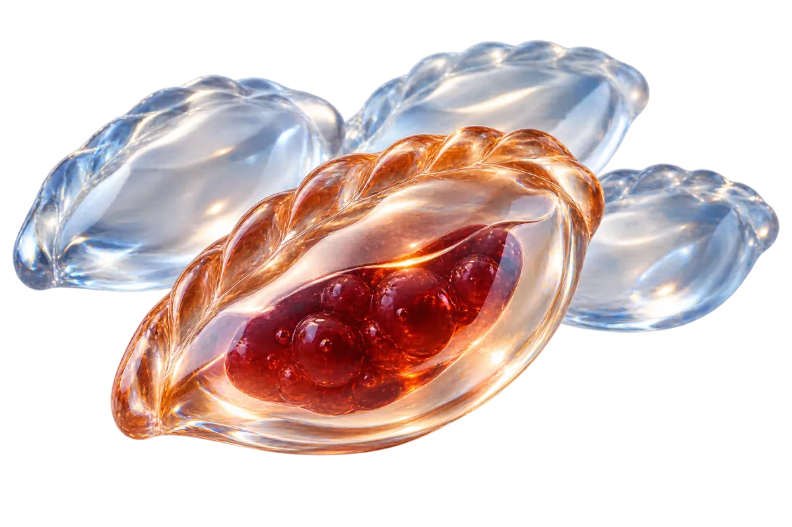 | `veroyatnost/zadanie-4/k4` | картинка к задаче | 1200×800 | 1200·webp, 1200·webp, 1200·webp, 1200·webp, 1200·webp, 1200·webp, 1200·webp, 1200·webp, 1200·webp, 1200·webp, 1200·webp, 1200·webp, 1200·webp, 1200·webp, 1200·webp, 1200·webp, 1200·webp, 1200·webp · 4062 КБ | да | 301 / 320 | №4/opornye-zadachi/geometricheskaya | `app/styleguide/veroyatnost-4/page.tsx`, `lib/veroyatnost/bank4/konspekt.ts`, `lib/veroyatnost/illyustratsii.ts` |  |
| 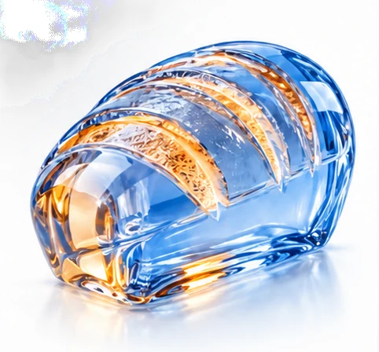 | `veroyatnost/zadanie-4/p4` | картинка к задаче | 1200×800 | 1200·webp, 1200·webp, 1200·webp, 1200·webp, 1200·webp, 1200·webp, 1200·webp, 1200·webp, 1200·webp, 1200·webp, 1200·webp, 1200·webp, 1200·webp, 1200·webp, 1200·webp, 1200·webp, 1200·webp, 1200·webp, 1200·webp, 1145·webp, 1145·webp, 482·webp · 6894 КБ | частично | — / — | — | `app/zadaniya/4/dannye/razbory/[kind]/route.ts`, `content/generator45.ts`, `content/sheet4-baza.js` |  |
|  | `zadanie-04/dvenadtsat-mesyatsev` | иллюстрация теории / «О задании» | 1000×563 | webp · 136 КБ | нет | 220 / 150 | №4/teoriya | `content/veroyatnost-teoriya.ts` |  |
| 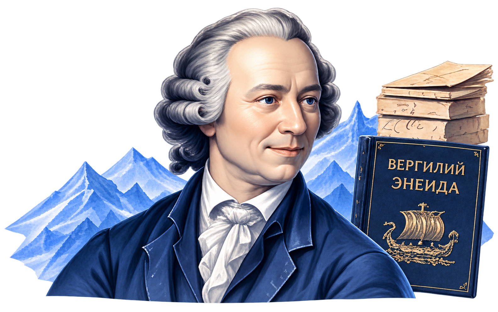 | `zadanie-04/eyler-portret` | иллюстрация теории / «О задании» | 1583×993 | png · 1902 КБ | да | 293 / 714 | №4/teoriya | `content/veroyatnost-teoriya.ts` |  |
| 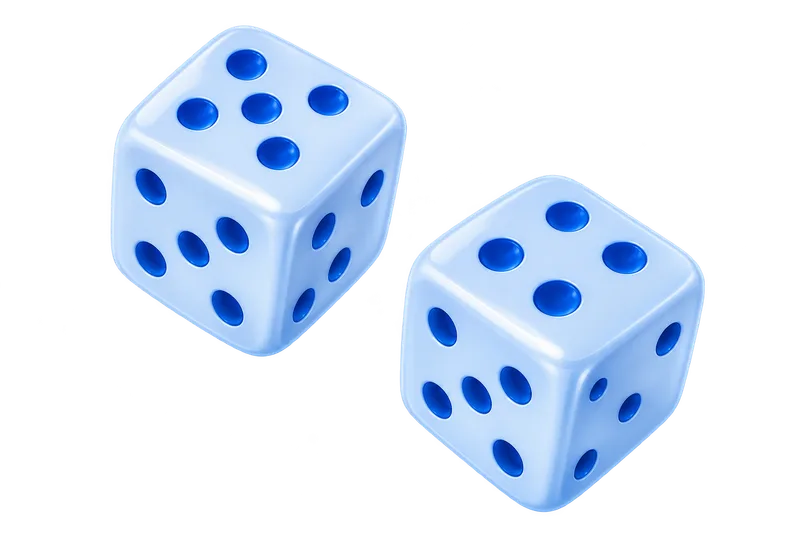 | `zadanie-04/igralnye-kosti` | иллюстрация теории / «О задании» | 800×533 | webp · 36 КБ | да | 220 / 200 | №4/teoriya | `content/veroyatnost-teoriya.ts` |  |
| 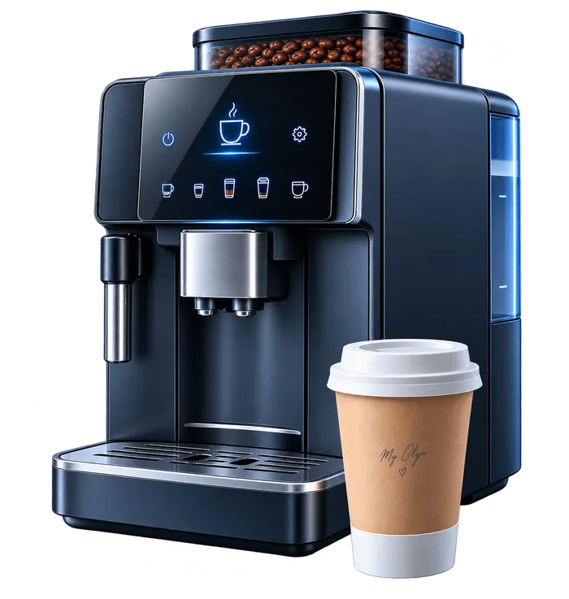 | `zadanie-04/kofeynyy-avtomat` | иллюстрация теории / «О задании» | 700×737 | webp · 52 КБ | да | 200 / 118 | №4/teoriya | `content/veroyatnost-teoriya.ts` |  |
| 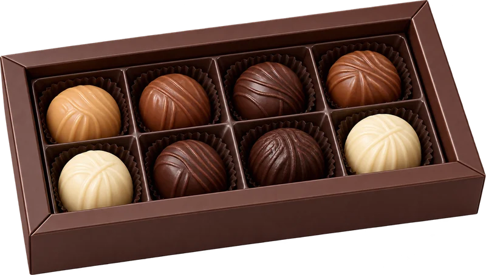 | `zadanie-04/korobka-konfet` | иллюстрация теории / «О задании» | 800×454 | webp · 57 КБ | да | 301 / 338 | №4/teoriya | `content/veroyatnost-teoriya.ts` |  |
|  | `zadanie-04/monety` | иллюстрация теории / «О задании» | 800×400 | webp · 58 КБ | да | 200 / 118 | №4/teoriya | `components/tasks/veroyatnost/MetodKartinka.tsx`, `content/veroyatnost-teoriya.ts` |  |
| 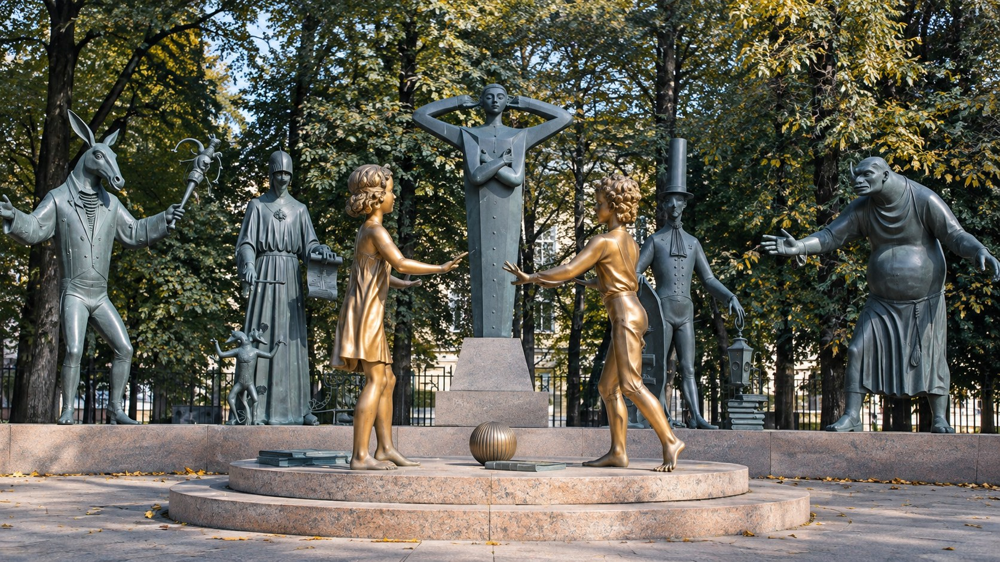 | `zadanie-04/pamyatnik-porokam` | иллюстрация теории / «О задании» | 1672×941 | jpeg · 584 КБ | нет | 335 / 476 | №4 | `content/veroyatnost-o-zadanii.ts` |  |
|  | `zadanie-04/podsnezhniki` | иллюстрация теории / «О задании» | 800×533 | webp · 149 КБ | да | 301 / 135 | №4/teoriya | `content/veroyatnost-teoriya.ts` |  |
| 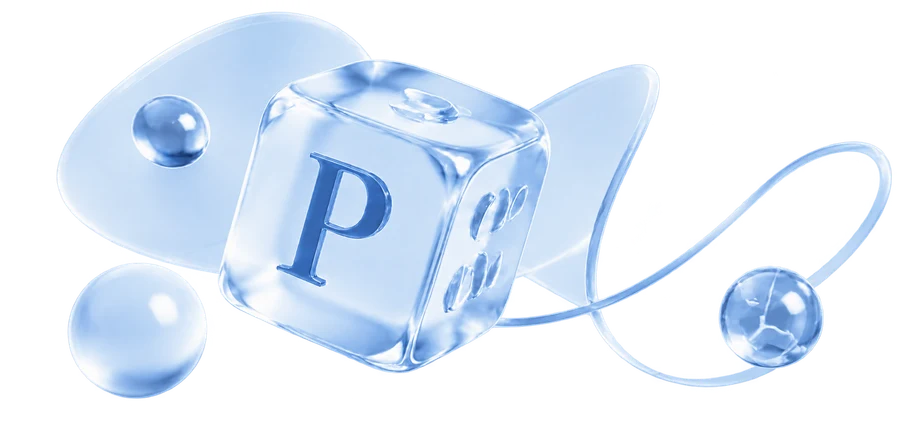 | `zadanie-04/shapka-veroyatnost-prostaya` | иллюстрация теории / «О задании» | 900×423 | webp · 64 КБ | да | — / 337 | №4, №4/kartochki, №4/metody, №4/teoriya | `content/veroyatnost.ts` |  |
| 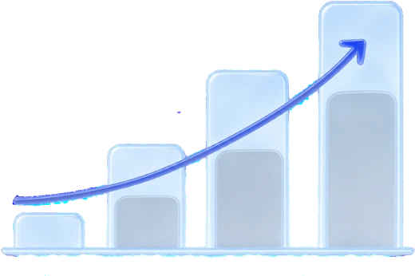 | `zadanie-04/veroyatnost-rost` | иллюстрация теории / «О задании» | 520×346 | webp · 46 КБ | да | — / 176 | №4/teoriya, №5/teoriya | `content/veroyatnost-teoriya.ts` |  |

## №5

Семейств: 16, файлов: 63, вес: 13.0 МБ.

| | Картинка | Роль | Размер | Варианты · вес | Прозрачность | Показ сейчас, px (375 / 1280) | Где видна на снимках | Где подключена | Замечание |
|---|---|---|---|---|---|---|---|---|---|
| 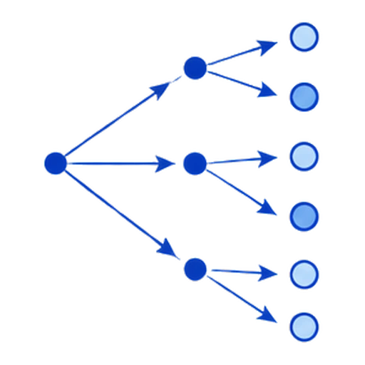 | `task` | обложка-иконка раздела | 512×512 | webp · 49 КБ | да | — / — | — | `app/about/page.tsx`, `app/zadaniya/TaskBank.tsx`, `components/layout/AppShell.tsx` |  |
| 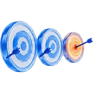 | `veroyatnost-5/metody/do-uspeha` | иконка метода | 192×192 | webp · 11 КБ | да | 72 / 96 | №5/trenazher | `components/tasks/veroyatnost/MetodKartinka.tsx` |  |
| 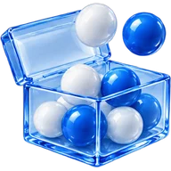 | `veroyatnost-5/metody/dva-predmeta` | иконка метода | 192×192 | webp · 17 КБ | да | 72 / 96 | №5/trenazher | `components/tasks/veroyatnost/MetodKartinka.tsx` |  |
|  | `veroyatnost-5/metody/hotya-by` | иконка метода | 192×192 | webp · 11 КБ | да | 72 / 96 | №5/trenazher | `components/tasks/veroyatnost/MetodKartinka.tsx` |  |
| 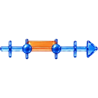 | `veroyatnost-5/metody/koordinatnaya` | иконка метода | 192×192 | webp · 6 КБ | да | 72 / 96 | №5/trenazher | `components/tasks/veroyatnost/MetodKartinka.tsx` |  |
|  | `veroyatnost-5/metody/nesovmestnye` | иконка метода | 192×192 | webp · 7 КБ | да | 72 / 96 | №5/trenazher | `components/tasks/veroyatnost/MetodKartinka.tsx` |  |
| 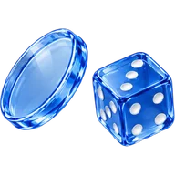 | `veroyatnost-5/metody/nezavisimye` | иконка метода | 192×192 | webp · 13 КБ | да | 72 / 96 | №5/trenazher | `components/tasks/veroyatnost/MetodKartinka.tsx` |  |
| 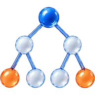 | `veroyatnost-5/metody/polnaya` | иконка метода | 192×192 | webp · 15 КБ | да | 72 / 96 | №5/trenazher | `components/tasks/veroyatnost/MetodKartinka.tsx` |  |
|  | `veroyatnost-5/metody/protivopolozhnoe` | иконка метода | 192×192 | webp · 13 КБ | да | 72 / 96 | №5/trenazher | `components/tasks/veroyatnost/MetodKartinka.tsx` |  |
|  | `veroyatnost-5/metody/sovmestnye` | иконка метода | 192×192 | webp · 10 КБ | да | 72 / 96 | №5/trenazher | `components/tasks/veroyatnost/MetodKartinka.tsx` |  |
|  | `veroyatnost-5/metody/uslovnaya` | иконка метода | 192×192 | webp · 13 КБ | да | 72 / 96 | №5/trenazher | `components/tasks/veroyatnost/MetodKartinka.tsx` |  |
| 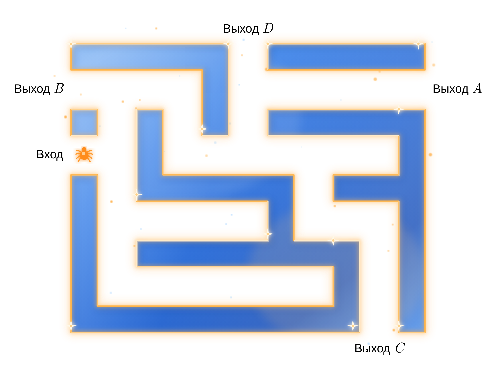 | `veroyatnost/labirint-glass` | картинка к задаче (лабиринт) | 2724×2064 | png · 1504 КБ | да | — / — | — | `components/tasks/card/problem-card.css`, `lib/sheet/probability-sheet.css`, `lib/veroyatnost/labirint.ts` |  |
| 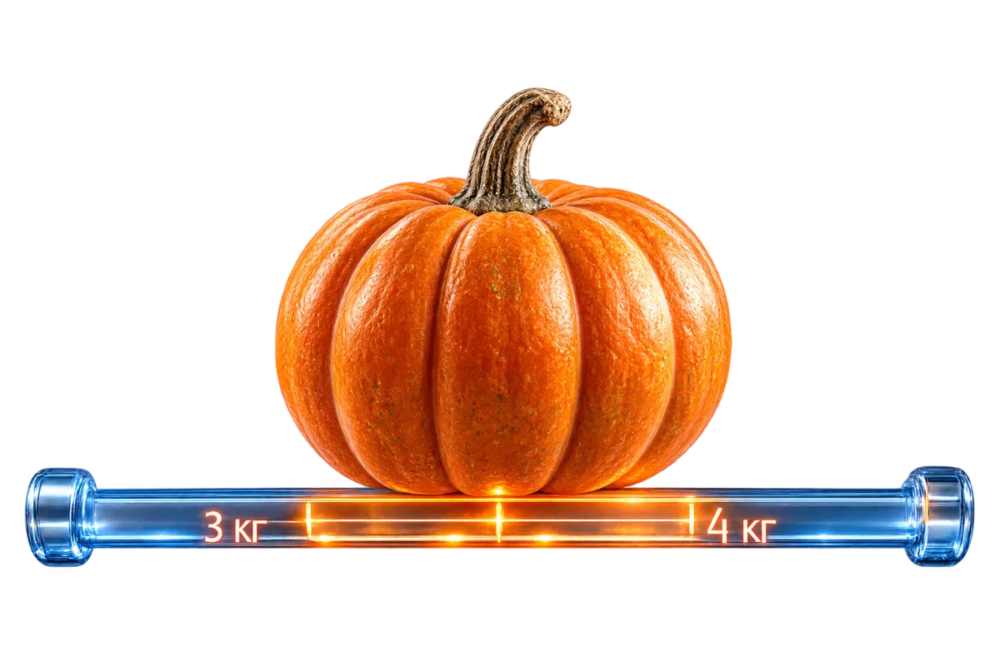 | `veroyatnost/zadanie-5/k5` | картинка к задаче | 1200×600 | 1200·webp, 1200·webp, 1200·webp, 1200·webp, 1200·webp, 1200·webp, 1200·webp, 1200·webp, 1200·webp, 1200·webp, 1200·webp, 1200·webp, 1200·webp, 1200·webp, 1200·webp, 1200·webp, 1200·webp, 1200·webp, 1200·webp, 1200·webp, 1200·webp, 1200·webp, 1200·webp, 1200·webp, 1200·webp, 1200·webp, 1200·webp, 1200·webp, 1200·webp, 1200·webp, 1200·webp, 1200·webp, 1200·webp, 1200·webp, 1199·webp, 1199·webp, 1024·webp, 1024·webp · 8528 КБ | да | — / — | — | `lib/veroyatnost/illyustratsii.ts`, `lib/veroyatnost/podgotovka5-podskazki.ts`, `lib/veroyatnost/podgotovka5.ts` |  |
| 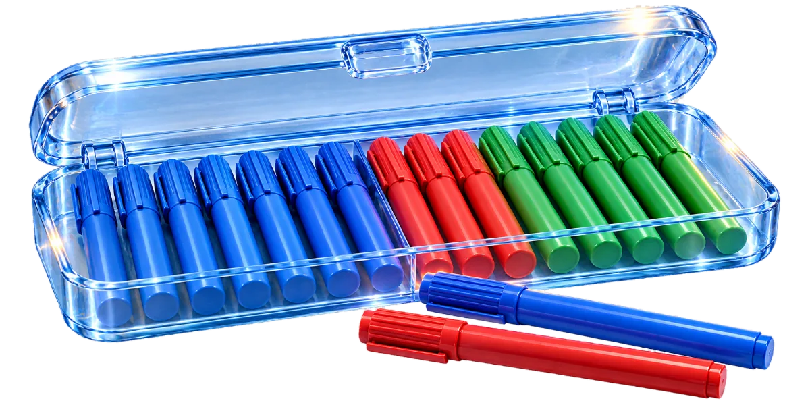 | `veroyatnost/zadanie-5/p5` | картинка к задаче | 1200×1200 | 1200·webp, 1200·webp, 1200·webp, 1200·webp, 1200·webp, 1200·webp, 1200·webp, 1200·webp, 1200·webp, 1200·webp, 1024·webp · 2904 КБ | да | — / — | — | `app/styleguide/veroyatnost-4/page.tsx`, `app/zadaniya/5/dannye/razbory/[kind]/route.ts`, `lib/veroyatnost/bank5/formuly.ts` |  |
| 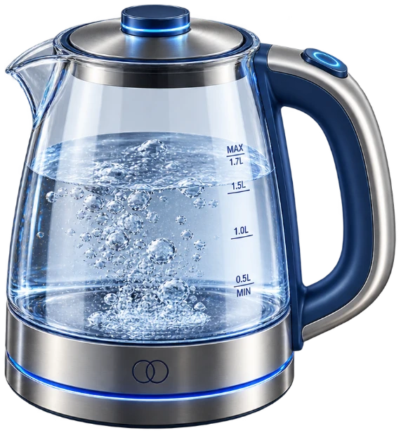 | `zadanie-05/chaynik-kipit` | иллюстрация теории | 571×616 | webp · 118 КБ | да | 185 / 185 | №5/teoriya | `content/veroyatnost-teoriya.ts` |  |
| 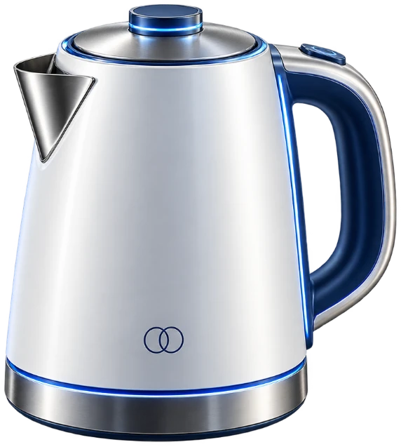 | `zadanie-05/chaynik-vyklyuchen` | иллюстрация теории | 572×637 | webp · 59 КБ | да | 180 / 180 | №5/teoriya | `content/veroyatnost-teoriya.ts` |  |

## №6

Семейств: 1, файлов: 1, вес: 0.0 МБ.

| | Картинка | Роль | Размер | Варианты · вес | Прозрачность | Показ сейчас, px (375 / 1280) | Где видна на снимках | Где подключена | Замечание |
|---|---|---|---|---|---|---|---|---|---|
| 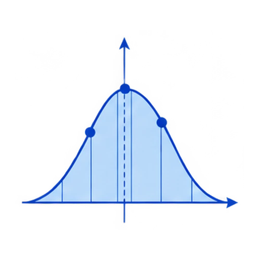 | `task` | обложка-иконка раздела | 512×512 | webp · 25 КБ | да | — / — | — | `app/about/page.tsx`, `app/zadaniya/TaskBank.tsx`, `components/layout/AppShell.tsx` |  |

## №7

Семейств: 1, файлов: 1, вес: 0.1 МБ.

| | Картинка | Роль | Размер | Варианты · вес | Прозрачность | Показ сейчас, px (375 / 1280) | Где видна на снимках | Где подключена | Замечание |
|---|---|---|---|---|---|---|---|---|---|
| 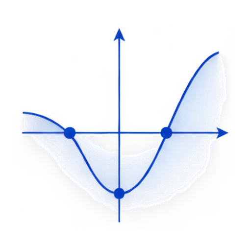 | `task` | обложка-иконка раздела | 512×512 | webp · 57 КБ | да | — / — | — | `app/about/page.tsx`, `app/zadaniya/TaskBank.tsx`, `components/layout/AppShell.tsx` |  |

## №8

Семейств: 1, файлов: 1, вес: 0.0 МБ.

| | Картинка | Роль | Размер | Варианты · вес | Прозрачность | Показ сейчас, px (375 / 1280) | Где видна на снимках | Где подключена | Замечание |
|---|---|---|---|---|---|---|---|---|---|
| 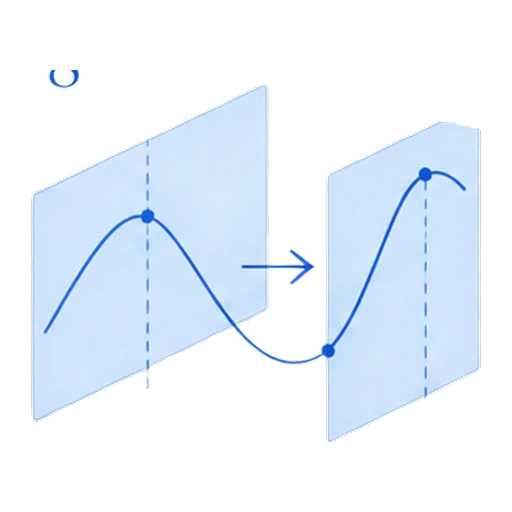 | `task` | обложка-иконка раздела | 512×512 | webp · 40 КБ | да | — / — | — | `app/about/page.tsx`, `app/zadaniya/TaskBank.tsx`, `components/layout/AppShell.tsx` |  |

## №9

Семейств: 1, файлов: 1, вес: 0.0 МБ.

| | Картинка | Роль | Размер | Варианты · вес | Прозрачность | Показ сейчас, px (375 / 1280) | Где видна на снимках | Где подключена | Замечание |
|---|---|---|---|---|---|---|---|---|---|
| 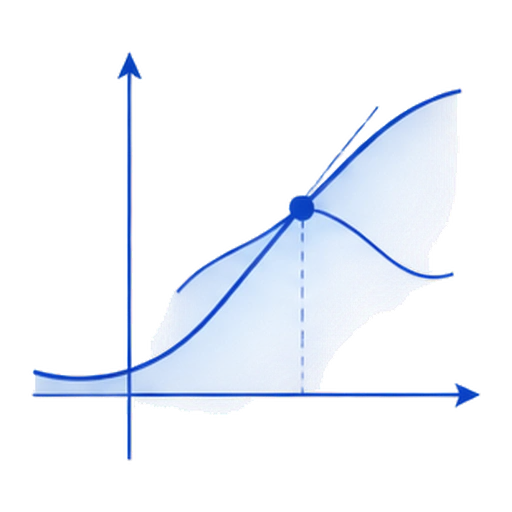 | `task` | обложка-иконка раздела | 512×512 | webp · 47 КБ | да | — / — | — | `app/about/page.tsx`, `app/zadaniya/TaskBank.tsx`, `components/layout/AppShell.tsx` |  |

## №10

Семейств: 31, файлов: 61, вес: 6.4 МБ.

| | Картинка | Роль | Размер | Варианты · вес | Прозрачность | Показ сейчас, px (375 / 1280) | Где видна на снимках | Где подключена | Замечание |
|---|---|---|---|---|---|---|---|---|---|
|  | `zadanie-10/P01` | картинка к задаче | 960×640 | 960·webp, 640·png · 305 КБ | да | 301 / 336 | №10, №10/opornye-zadachi, №10/teoriya | `lib/zadanie10/illyustracii.ts` |  |
|  | `zadanie-10/P02` | картинка к задаче | 960×640 | 960·webp, 640·png · 190 КБ | да | 301 / 336 | №10, №10/teoriya | `lib/zadanie10/illyustracii.ts` |  |
|  | `zadanie-10/P03` | картинка к задаче | 960×640 | 960·webp, 640·png · 194 КБ | да | 301 / 336 | №10, №10/teoriya | `lib/zadanie10/illyustracii.ts` |  |
|  | `zadanie-10/P04` | картинка к задаче | 960×640 | 960·webp, 640·png · 166 КБ | да | 301 / 336 | №10, №10/teoriya | `lib/zadanie10/illyustracii.ts` |  |
| 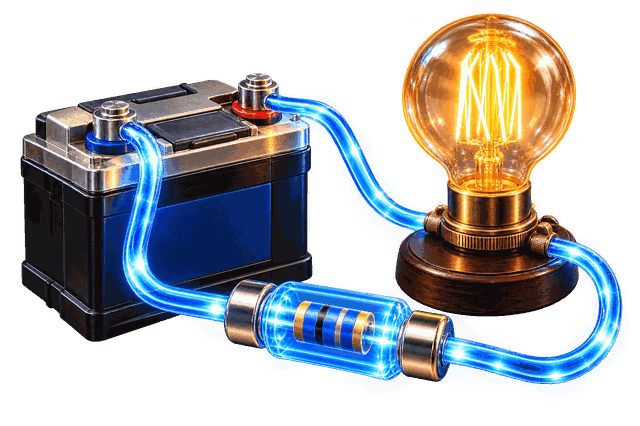 | `zadanie-10/P05` | картинка к задаче | 960×640 | 960·webp, 640·png · 221 КБ | да | 301 / 336 | №10, №10/teoriya | `lib/zadanie10/illyustracii.ts` |  |
|  | `zadanie-10/P06` | картинка к задаче | 960×640 | 960·webp, 640·png · 160 КБ | да | 301 / 336 | №10, №10/teoriya | `lib/zadanie10/illyustracii.ts` |  |
| 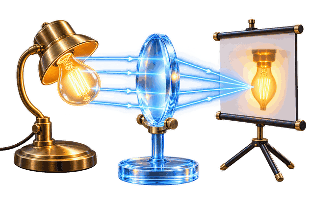 | `zadanie-10/P07` | картинка к задаче | 960×640 | 960·webp, 640·png · 183 КБ | да | 301 / 336 | №10, №10/teoriya | `lib/zadanie10/illyustracii.ts` |  |
| 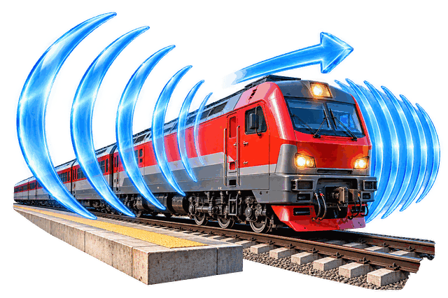 | `zadanie-10/P08` | картинка к задаче | 960×640 | 960·webp, 640·png · 261 КБ | да | 301 / 336 | №10, №10/teoriya | `lib/zadanie10/illyustracii.ts` |  |
| 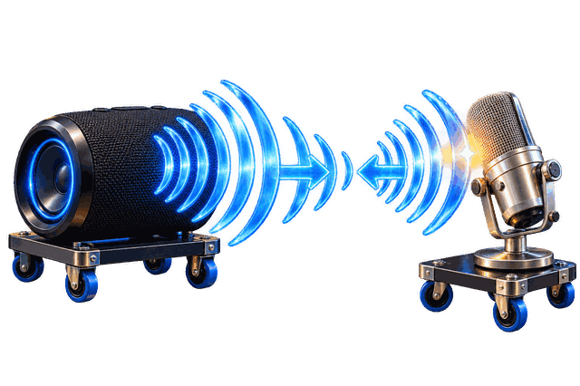 | `zadanie-10/P09` | картинка к задаче | 960×640 | 960·webp, 640·png · 182 КБ | да | 301 / 336 | №10, №10/teoriya | `lib/zadanie10/illyustracii.ts` |  |
| 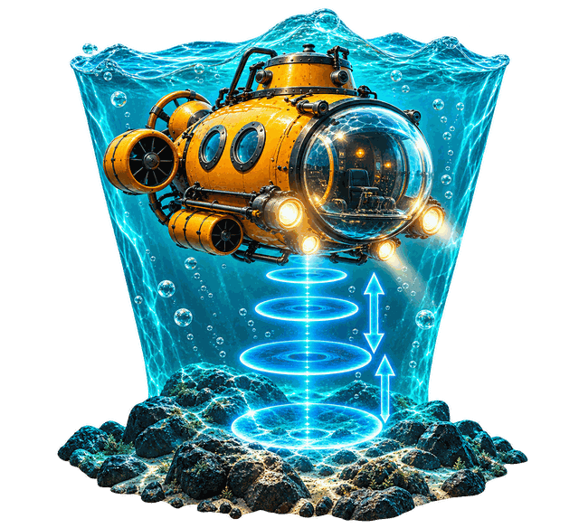 | `zadanie-10/P10` | картинка к задаче | 960×877 | 960·webp, 640·png · 361 КБ | да | 301 / 336 | №10, №10/teoriya | `lib/zadanie10/illyustracii.ts` |  |
|  | `zadanie-10/P11` | картинка к задаче | 960×640 | 960·webp, 640·png · 235 КБ | да | 301 / 336 | №10, №10/opornye-zadachi, №10/teoriya | `lib/zadanie10/illyustracii.ts` |  |
|  | `zadanie-10/P12` | картинка к задаче | 960×640 | 960·webp, 640·png · 294 КБ | да | 301 / 336 | №10, №10/opornye-zadachi, №10/teoriya, №10/opornye-zadachi/edinicy | `lib/zadanie10/illyustracii.ts` |  |
| 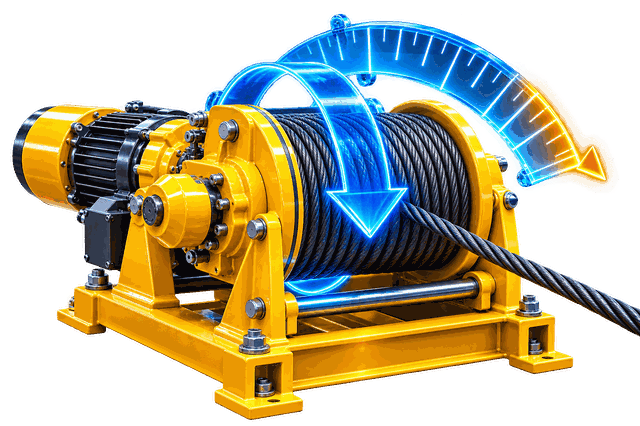 | `zadanie-10/P13` | картинка к задаче | 960×640 | 960·webp, 640·png · 221 КБ | да | 301 / 336 | №10, №10/teoriya | `lib/zadanie10/illyustracii.ts` |  |
|  | `zadanie-10/P14` | картинка к задаче | 960×640 | 960·webp, 640·png · 166 КБ | да | 301 / 336 | №10, №10/opornye-zadachi, №10/teoriya | `lib/zadanie10/illyustracii.ts` |  |
|  | `zadanie-10/P15` | картинка к задаче | 640×960 | 640·webp, 426·png · 246 КБ | да | 213 / 213 | №10, №10/teoriya | `lib/zadanie10/illyustracii.ts` |  |
| 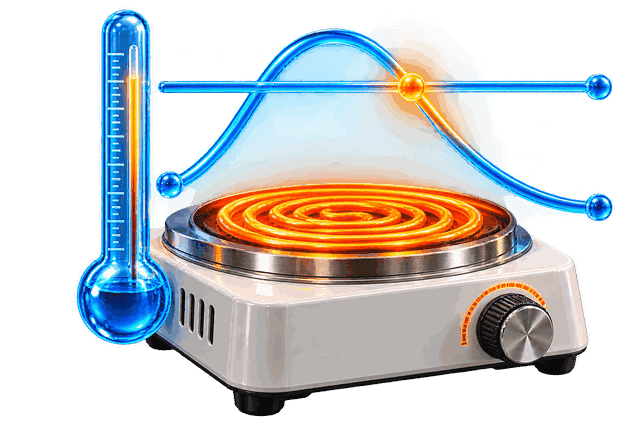 | `zadanie-10/P16` | картинка к задаче | 960×640 | 960·webp, 640·png · 187 КБ | да | 301 / 336 | №10, №10/teoriya | `lib/zadanie10/illyustracii.ts` |  |
|  | `zadanie-10/P17` | картинка к задаче | 640×960 | 640·webp, 426·png · 168 КБ | да | 213 / 213 | №10, №10/teoriya | `lib/zadanie10/illyustracii.ts` |  |
|  | `zadanie-10/P18` | картинка к задаче | 960×640 | 960·webp, 640·png · 192 КБ | да | 301 / 336 | №10, №10/opornye-zadachi, №10/teoriya | `lib/zadanie10/illyustracii.ts` |  |
|  | `zadanie-10/P19` | картинка к задаче | 960×640 | 960·webp, 640·png · 261 КБ | да | 301 / 336 | №10, №10/teoriya, №10/opornye-zadachi/edinicy | `lib/zadanie10/illyustracii.ts` |  |
| 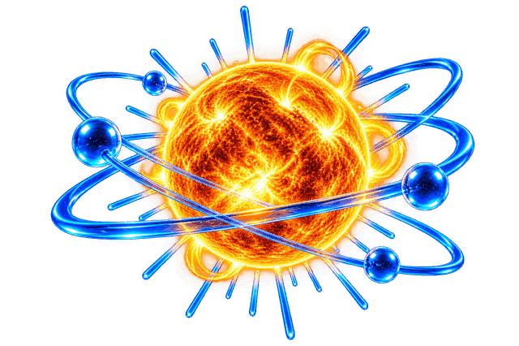 | `zadanie-10/P20` | картинка к задаче | 960×640 | 960·webp, 640·png · 272 КБ | да | 301 / 336 | №10, №10/teoriya | `lib/zadanie10/illyustracii.ts` |  |
|  | `zadanie-10/P21` | картинка к задаче | 960×640 | 960·webp, 640·png · 234 КБ | да | 301 / 336 | №10, №10/teoriya | `lib/zadanie10/illyustracii.ts` |  |
|  | `zadanie-10/P22` | картинка к задаче | 960×640 | 960·webp, 640·png · 185 КБ | да | 301 / 336 | №10, №10/opornye-zadachi, №10/teoriya | `lib/zadanie10/illyustracii.ts` |  |
|  | `zadanie-10/P23` | картинка к задаче | 960×877 | 960·webp, 640·png · 407 КБ | да | 301 / 336 | №10, №10/teoriya | `lib/zadanie10/illyustracii.ts` |  |
|  | `zadanie-10/P24` | картинка к задаче | 960×640 | 960·webp, 640·png · 131 КБ | да | 301 / 336 | №10, №10/teoriya, №10/opornye-zadachi/edinicy | `lib/zadanie10/illyustracii.ts` |  |
| 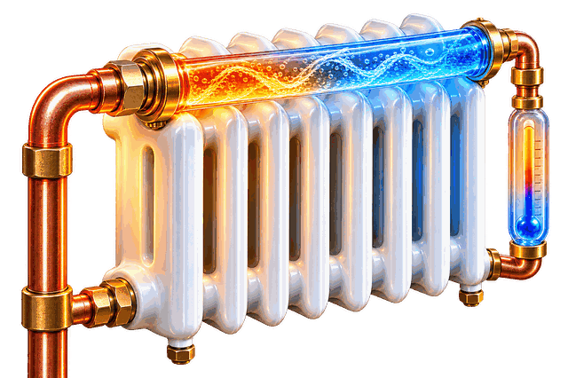 | `zadanie-10/P25` | картинка к задаче | 960×640 | 960·webp, 640·png · 193 КБ | да | 301 / 336 | №10, №10/teoriya | `lib/zadanie10/illyustracii.ts` |  |
| 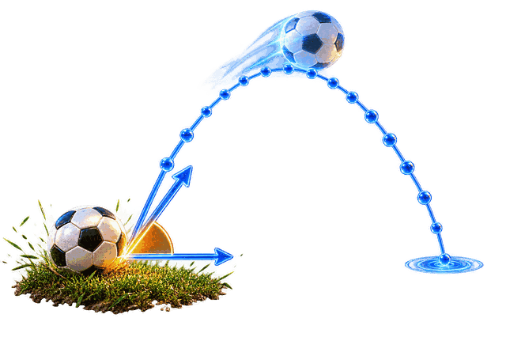 | `zadanie-10/P26` | картинка к задаче | 960×640 | 960·webp, 640·png · 141 КБ | да | 301 / 336 | №10, №10/opornye-zadachi, №10/teoriya | `lib/zadanie10/illyustracii.ts` |  |
|  | `zadanie-10/P27` | картинка к задаче | 960×640 | 960·webp, 640·png · 181 КБ | да | 301 / 336 | №10, №10/teoriya | `lib/zadanie10/illyustracii.ts` |  |
| 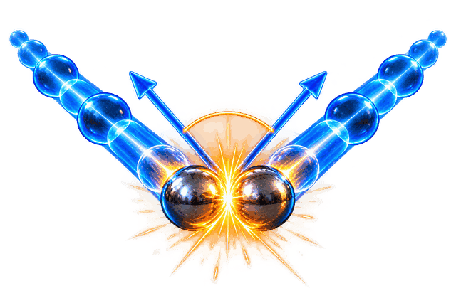 | `zadanie-10/P28` | картинка к задаче | 960×640 | 960·webp, 640·png · 175 КБ | да | 301 / 336 | №10, №10/teoriya | `lib/zadanie10/illyustracii.ts` |  |
| 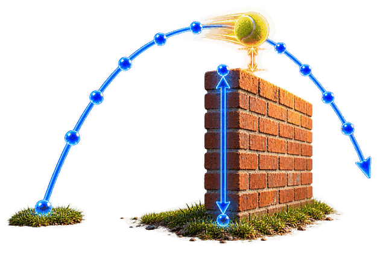 | `zadanie-10/P29` | картинка к задаче | 960×640 | 960·webp, 640·png · 196 КБ | да | 301 / 336 | №10, №10/teoriya | `lib/zadanie10/illyustracii.ts` |  |
| 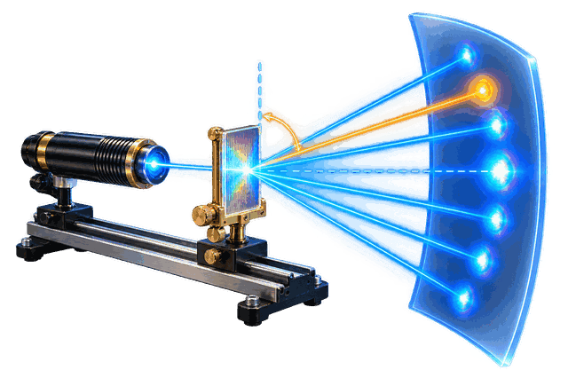 | `zadanie-10/P33` | картинка к задаче | 960×640 | 960·webp, 640·png · 179 КБ | да | 301 / 336 | №10, №10/teoriya | `lib/zadanie10/illyustracii.ts` |  |
| 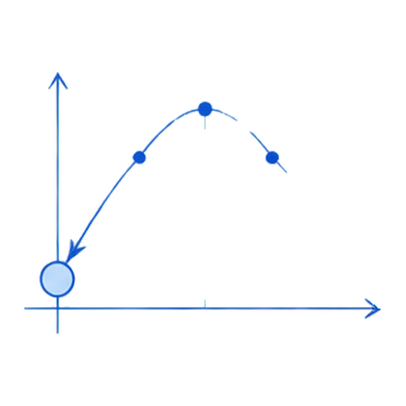 | `task` | обложка-иконка раздела | 512×512 | webp · 21 КБ | да | — / — | — | `app/about/page.tsx`, `app/zadaniya/TaskBank.tsx`, `components/layout/AppShell.tsx` |  |

## №11

Семейств: 5, файлов: 5, вес: 0.2 МБ.

| | Картинка | Роль | Размер | Варианты · вес | Прозрачность | Показ сейчас, px (375 / 1280) | Где видна на снимках | Где подключена | Замечание |
|---|---|---|---|---|---|---|---|---|---|
| 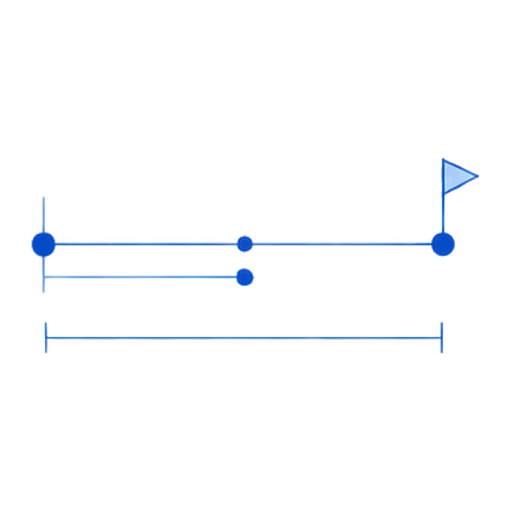 | `task` | обложка-иконка раздела | 512×512 | webp · 12 КБ | да | — / — | — | `app/about/page.tsx`, `app/zadaniya/TaskBank.tsx`, `components/layout/AppShell.tsx` |  |
|  | `zadanie-11/smesi/gel` | иллюстрация теории (смеси) | 480×480 | webp · 62 КБ | да | 180 / 146 | №11/teoriya | `content/teoriya11.ts` |  |
|  | `zadanie-11/smesi/kokteyl` | иллюстрация теории (смеси) | 480×480 | webp · 45 КБ | да | 180 / 146 | №11/teoriya | `content/teoriya11.ts` |  |
|  | `zadanie-11/smesi/sahar` | иллюстрация теории (смеси) | 480×480 | webp · 56 КБ | да | 180 / 146 | №11/teoriya | `content/teoriya11.ts` |  |
|  | `zadanie-11/smesi/sok` | иллюстрация теории (смеси) | 480×480 | webp · 53 КБ | да | 180 / 146 | №11/teoriya | `content/teoriya11.ts` |  |

## №12

Семейств: 18, файлов: 61, вес: 9.6 МБ.

| | Картинка | Роль | Размер | Варианты · вес | Прозрачность | Показ сейчас, px (375 / 1280) | Где видна на снимках | Где подключена | Замечание |
|---|---|---|---|---|---|---|---|---|---|
|  | `lightbulb` | иллюстрация («О задании» / теория вида) | 200×181 | webp · 9 КБ | да | 24 / 24 | №12/quadratic, №12/quadratic/dlya-repetitorov, №12/rational, №12/trigonometric | `components/tasks/TopicAbout.tsx` |  |
|  | `pyramid-network` | иллюстрация («О задании» / теория вида) | 1400×504 | webp · 286 КБ | да | — / — | — | `app/zadaniya/TaskBank.tsx`, `components/tasks/FunctionTopicPage.tsx` |  |
|  | `razdely/12/exponential` | обложка-плитка вида функции | 384×346 | 384·png, 384·webp, 192·png, 192·webp, 96·png, 96·webp · 135 КБ | да | 104 / 112 | №12, №12/quadratic, №12/quadratic/opornye-zadachi, №12/quadratic/trenazher | `app/styleguide/graph-12/galereya/page.dev.tsx`, `content/exponential.ts`, `content/prepSkills.ts` |  |
|  | `razdely/12/irrational` | обложка-плитка вида функции | 384×346 | 384·png, 384·webp, 192·png, 192·webp, 96·png, 96·webp · 136 КБ | да | 104 / 112 | №12, №12/quadratic, №12/quadratic/opornye-zadachi, №12/quadratic/trenazher | `content/irrational.ts`, `content/prepSkills.ts`, `content/skills12.ts` |  |
|  | `razdely/12/linear` | обложка-плитка вида функции | 384×346 | 384·png, 384·webp, 192·png, 192·webp, 96·png, 96·webp · 133 КБ | да | 112 / 194 | №12, №12/quadratic, №12/quadratic/opornye-zadachi, №12/quadratic/trenazher | `app/styleguide/chertyozh/chertyozh.css`, `app/styleguide/steklo/steklo.css`, `app/styleguide/steklo/tokens-steklo.css` |  |
|  | `razdely/12/logarithmic` | обложка-плитка вида функции | 384×346 | 384·png, 384·webp, 192·png, 192·webp, 96·png, 96·webp · 134 КБ | да | 104 / 176 | №12, №12/quadratic, №12/quadratic/opornye-zadachi, №12/quadratic/trenazher | `app/styleguide/graph-12/galereya/page.dev.tsx`, `content/logarithmic.ts`, `content/prepSkills.ts` |  |
|  | `razdely/12/quadratic` | обложка-плитка вида функции | 384×346 | 384·png, 384·webp, 192·png, 192·webp, 96·png, 96·webp · 135 КБ | да | 104 / 112 | №12, №12/rational, №12/trigonometric, №12/generator | `components/tasks/FunctionTopicPage.tsx`, `components/tasks/MethodsTab.tsx`, `components/tasks/about/TypesDisclosure.tsx` |  |
|  | `razdely/12/rational` | обложка-плитка вида функции | 384×346 | 384·png, 384·webp, 192·png, 192·webp, 96·png, 96·webp · 136 КБ | да | 104 / 112 | №12, №12/quadratic, №12/quadratic/opornye-zadachi, №12/quadratic/trenazher | `components/tasks/MethodsTab.tsx`, `components/tasks/ReadMark.tsx`, `components/tasks/TopicProgress.tsx` |  |
|  | `razdely/12/trig` | обложка-плитка вида функции | 384×346 | 384·png, 384·webp, 192·png, 192·webp, 96·png, 96·webp · 141 КБ | да | 104 / 176 | №12, №12/quadratic, №12/quadratic/opornye-zadachi, №12/quadratic/trenazher | — |  |
|  | `sloth-dependencies` | иллюстрация («О задании» / теория вида) | 1517×1024 | webp · 293 КБ | да | — / — | — | `content/theoryLinear.ts` |  |
|  | `sloth-pointer-mistake` | иллюстрация («О задании» / теория вида) | 1472×999 | webp · 342 КБ | да | — / — | — | `content/theoryLinear.ts` |  |
|  | `task` | обложка-иконка раздела | 512×512 | webp · 36 КБ | да | — / — | — | `app/about/page.tsx`, `app/zadaniya/TaskBank.tsx`, `components/layout/AppShell.tsx` |  |
|  | `theory/12/apollonius-antique` | иллюстрация теории | 1254×1254 | 1254·png, 800·webp · 2410 КБ | да | — / — | — | `content/theoryQuadratic.ts` |  |
|  | `theory/12/apollonius-modern` | иллюстрация теории | 1254×1254 | 1254·png, 800·webp · 2198 КБ | да | — / — | — | `content/theoryQuadratic.ts` |  |
|  | `theory/12/cone-parabola` | иллюстрация теории | 1254×1254 | 1254·png, 1000·webp · 1106 КБ | да | — / — | — | `content/theoryQuadratic.ts` |  |
|  | `theory/12/hyperbola-apollonius` | иллюстрация теории | 1672×941 | webp · 253 КБ | да | — / — | — | `content/theoryRational.ts` |  |
|  | `theory/12/parabola-history` | иллюстрация теории | 2172×724 | png · 1234 КБ | да | — / — | — | `content/theoryQuadratic.ts`, `content/theoryRational.ts` |  |
|  | `zadaniya/12/hero` | «статуэтки» — иллюстрация шапки | 1152×768 | 1152·png, 1152·webp, 768·png, 768·webp, 480·png, 480·webp · 696 КБ | да | 255 / 460 | №12/trenazher, №12, №12/zachyot | — |  |

## №13

Семейств: 1, файлов: 1, вес: 0.0 МБ.

| | Картинка | Роль | Размер | Варианты · вес | Прозрачность | Показ сейчас, px (375 / 1280) | Где видна на снимках | Где подключена | Замечание |
|---|---|---|---|---|---|---|---|---|---|
|  | `task` | обложка-иконка раздела | 512×512 | webp · 32 КБ | да | — / — | — | `app/about/page.tsx`, `app/zadaniya/TaskBank.tsx`, `components/layout/AppShell.tsx` |  |

## Общие картинки разделов

Семейств: 3, файлов: 3, вес: 0.4 МБ.

| | Картинка | Роль | Размер | Варианты · вес | Прозрачность | Показ сейчас, px (375 / 1280) | Где видна на снимках | Где подключена | Замечание |
|---|---|---|---|---|---|---|---|---|---|
|  | `mountains-network` | банк заданий / оболочка | 900×329 | webp · 102 КБ | да | — / 240 | №1/kartochki, №1, №1/opornye-zadachi, №1/trenazher | `components/layout/AppShell.tsx` |  |
|  | `open-book` | банк заданий / оболочка | 700×445 | webp · 38 КБ | да | — / — | — | `app/zadaniya/TaskBank.tsx` |  |
|  | `trophy-glass` | итоги тренировки (№9 и общий экран итогов) | 1147×1201 | webp · 282 КБ | да | — / — | — | `components/tasks/proizvodnaya/Trenazher9Result.tsx`, `components/tasks/session/TrainerSummary.tsx` |  |
