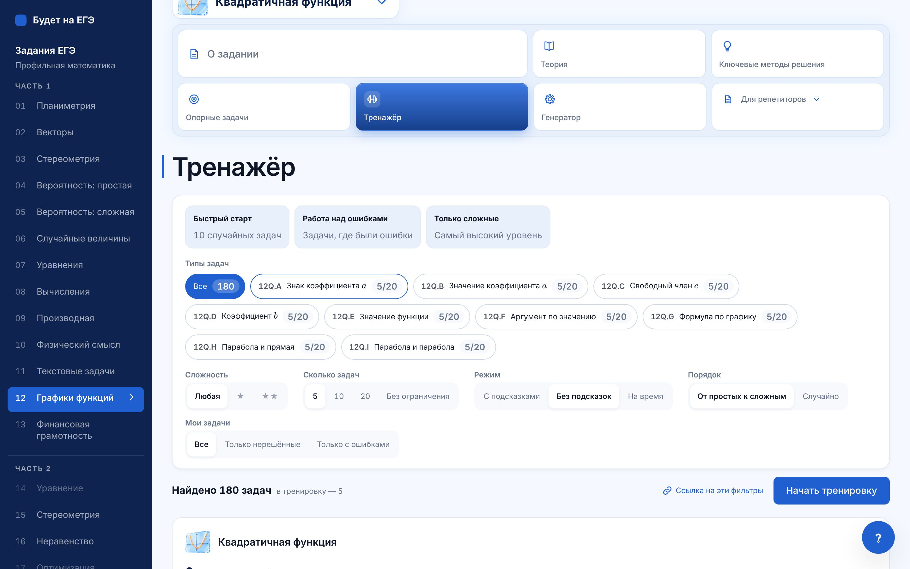
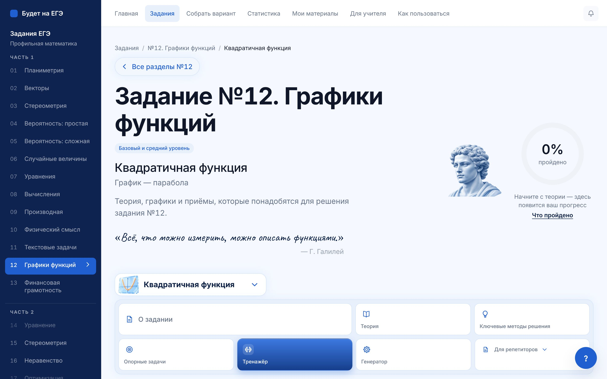
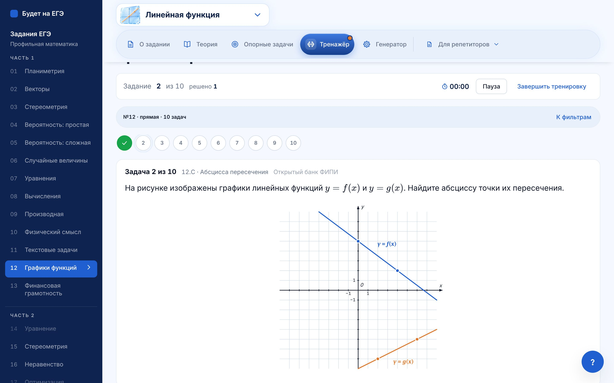
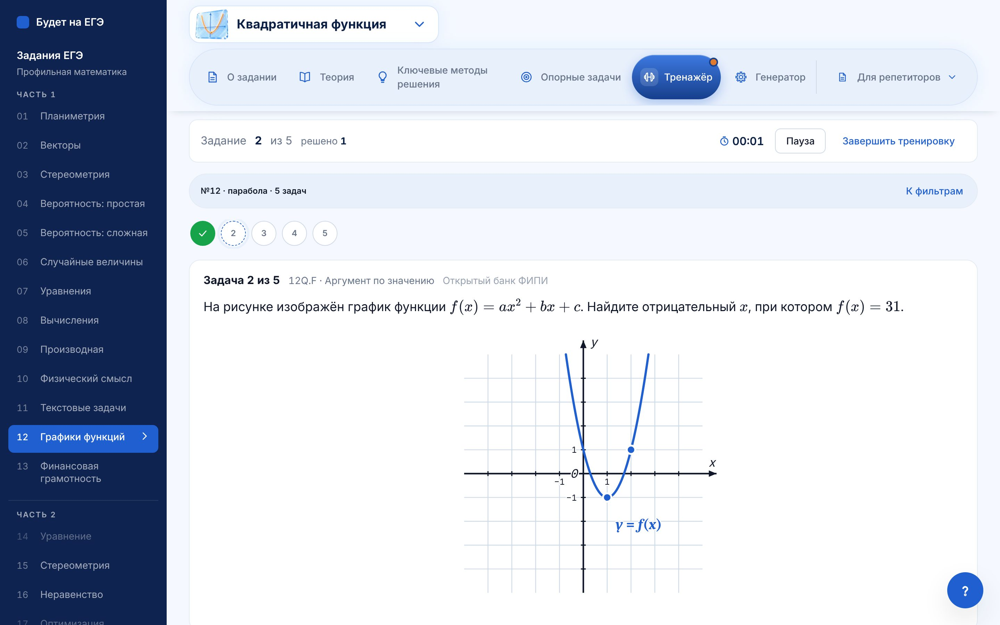
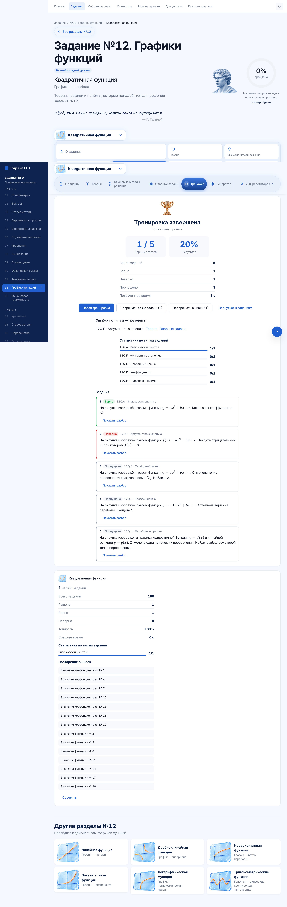
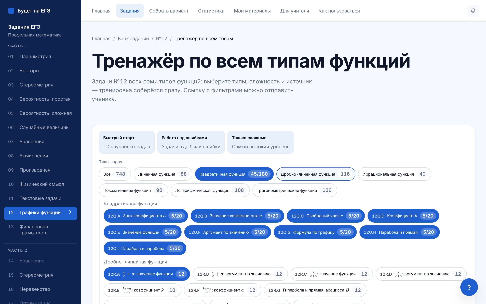
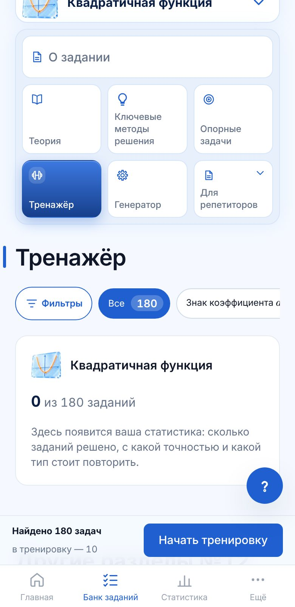
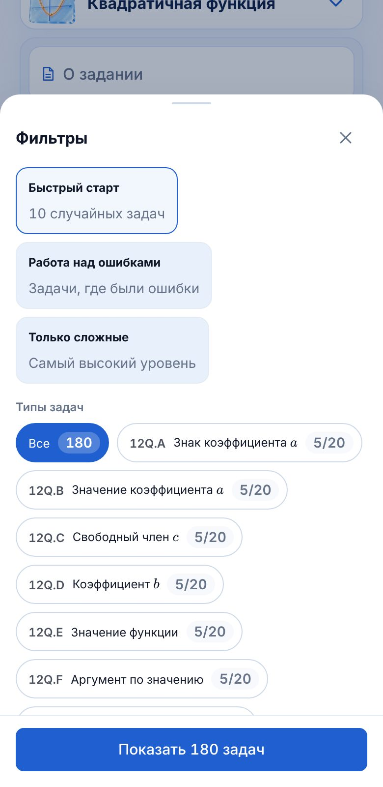
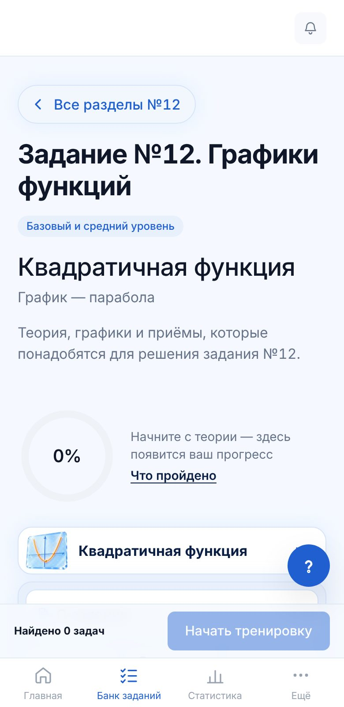
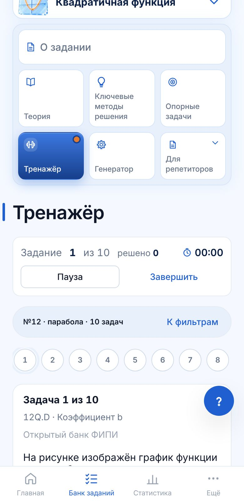

# Тренажёр с фильтрами сверху · пилот №12

План и решения — `01-plan.md`. Здесь — что сделано в пилоте, как проверено и что дальше.

## Что сделано

- **Общая логика фильтров** `app/src/lib/trenazher/`:
  - `filtr.ts`: что подходит под фильтр, числа на чипах, ссылка, «Расширить», «Сбросить», готовые наборы, строка-сводка, состав тренировки;
  - `sessiya.ts`: формат записи сессии;
  - `zapomnit.ts`: последние фильтры раздела в памяти браузера и в адресе.
- **Общая панель фильтров** `components/filtry/FiltrPanel.tsx`. Порядок полей: типы задач (чипы с числом задач, на чипе «решено/всего»), источник, сложность, сколько задач, режим, порядок, мои задачи. Живой счётчик «Найдено N», активные фильтры чипами с крестиком, «Сбросить», готовые наборы, «Ссылка на эти фильтры». Чип без задач неактивен. Если не найдено ничего — сообщение и «Расширить фильтры».
- **Телефон.** Строка «Фильтры (N)» и чипы типов с прокруткой вбок, всё остальное в нижней шторке с кнопкой «Показать N задач». «Начать тренировку» — липкая панель над навигацией сайта.
- **Общий экран тренировки** `components/trenazher/`:
  - строка-сводка «№12 · парабола · ★★ · 10 задач»; по нажатию — «К фильтрам» с паузой;
  - лента номеров: не начата, начата, верно, ошибка, с подсказкой, пропущена; переход по номерам свободный, у каждой задачи своё состояние;
  - карточка: условие, рисунок, поле ответа, «Проверить», «Подсказка по шагам», «Пропустить», «Похожая задача». Источник — нейтральной меткой рядом с номером;
  - режимы:
    - «С подсказками» — вторая попытка, после второй ошибки разбор открывается сам;
    - «Без подсказок» — одна попытка, разбор после ответа;
    - «На время» — то же и секундомер на каждую задачу;
  - итог: верно X из N, время, разбивка по типам, «Перерешать ошибки» (те же шаблоны с новыми числами), ссылки на теорию и опорные задачи по типам с ошибками. В режиме «На время» — время каждой задачи.
- **Плагин раздела** — `KartochkaRazdela`: раздел даёт условие, поле ответа, проверку, подсказку по шагам и разбор. У №12 это `components/tasks/trainer/Zadacha12.tsx` — прежние подсказки №12 без изменений. Таблица №13 подключится так же — своим полем ответа.
- **Оболочка сессии** (`TrainerSessionHost`) научилась «К фильтрам»: тренировка встаёт на паузу, над фильтрами плашка «Тренировка на паузе — Продолжить тренировку».
- **№12: адаптер** `lib/ves12/trenazher12.ts`. Список задач — 748 шаблонов наборов (числа в шаблоне движок даёт новые), поэтому числа на чипах честные. Уровень — «удачные / неудачные» числа (★ / ★★). Источник — поле `source` наборов.
- **№12: тренажёр подтемы** — та же вкладка, чипы — её наборы.
- **№12: тренажёр по всем типам** — новая страница `/zadaniya/12/trenazher/`, рядом с генератором по всем типам. Карточка «Тренажёр по всем типам» добавлена в «Весь раздел».
- **Статистика.** В хранилище тренажёра №12 появился список решённых задач (`solved`). Отсюда «Только нерешённые» и «8/12» на чипах. «Только с ошибками» — из прежнего списка ошибок.
- **Прежние ярлыки** `/zadaniya/12/<подтема>/trenazher/<режим>/` открывают тренажёр с фильтром ярлыка:
  - «Отработка» → от простых к сложным;
  - «Повтор ошибок» → только с ошибками;
  - «Контроль» → без подсказок;
  - правило ответа — отдельным фильтром со своей подписью.
- **Старые незавершённые тренировки №12** открываются: рецепты «набор, seed, задача» переносятся с тем же seed, отметки на местах.
- **Удалено:** прежние `TrainerBuilder`, `TrainerConfigurator`, `TrainerScreen` №12. Стили окна-шторки генератора вынесены в `components/generator/okno.css` и общие с тренажёром.

## Проверено

| Проверка | Результат |
|---|---|
| `pnpm test:trenazher-filtry` (новый, без браузера; 8 конфигов №12: по всем типам и 7 подтем) | 68 988 проверок: числа на чипах = число задач, ссылка 1:1, «Расширить», «Мои задачи», состав, перенос старых сессий |
| `pnpm test:trenazher-filtry-site` (новый, браузер) | 62 проверки: фильтры из ссылки 1:1; числа на чипах; пусто и «Расширить»; пауза и продолжение; старая тренировка; 320, 375, 390 px — без прокрутки вбок (фильтры, шторка, пусто, тренировка, итоги); липкая кнопка не закрывает фильтры |
| `pnpm test:trainer-sessions` (все тренажёры сайта) | 348 проверок, расхождений 0 |
| `test:trainer-session`, `test:generator` (4125), `test:ves12-site`, `test:zachyot-12`, `test:first-load`, `test:sticky-tabs`, `test:razdely-nav`, `test:topic-progress-site`, `test:math-markup` (исходники и сайт) | чисто |
| `check-mobile-overflow` №12 (подтемы, тренажёры, генератор) | 186 страниц × 4 ширины, прокрутки 0 |
| `pnpm lint`, `pnpm typecheck` | чисто |

## Снимки

| Компьютер: фильтры | Пустой результат | Тренировка | Ошибка |
|---|---|---|---|
|  |  |  |  |

| Итоги | Тренажёр по всем типам |
|---|---|
|  |  |

| Телефон: фильтры | Шторка | Пусто | Тренировка | Итоги |
|---|---|---|---|---|
|  |  |  |  |  |

## Разделы: что изменилось и что дальше

| № | Что изменилось в пилоте | Что требует решения |
|---|---|---|
| 12 | Новый тренажёр: подтемы и по всем типам, все фильтры | — |
| 1–11, 13 | Не тронуты: подключаются партиями (план, п. 5) | Сложность не размечена у №2, 3, 4, 5, 6, 7, 9, 10 — фильтр там будет скрыт |
| Генератор | Окно-шторка общее с тренажёром | Источник, звёзды и строка активных фильтров генератора переходят на общую панель — PR 2 плана |

**Скриншоты двух других разделов** («всё одинаково») будут в первой партии (№11, №1, №13): в пилоте подключён только №12.
