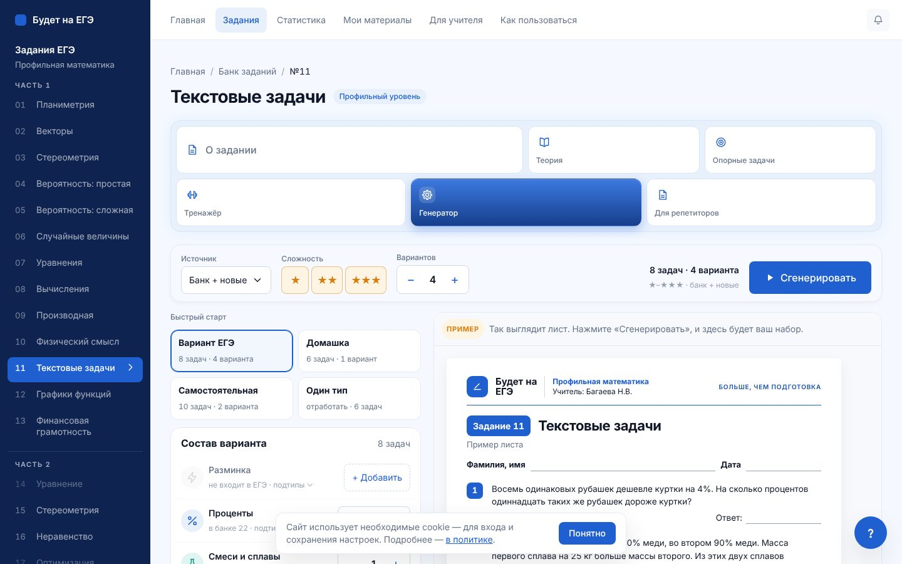
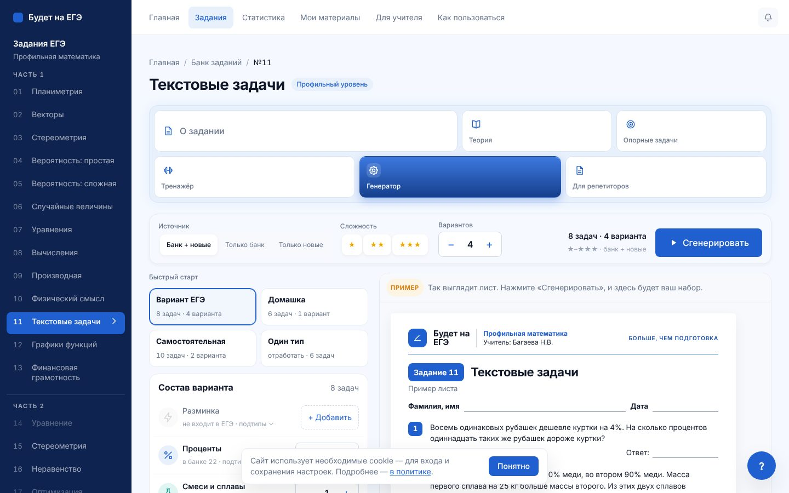
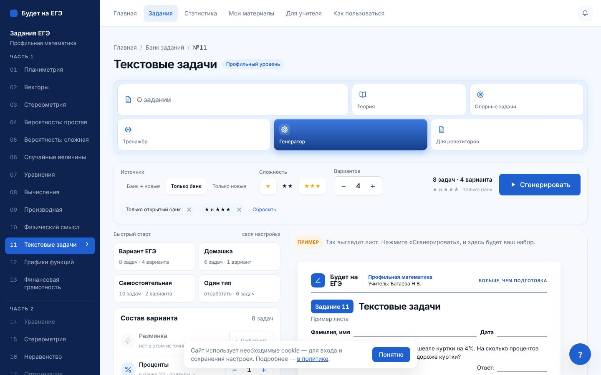
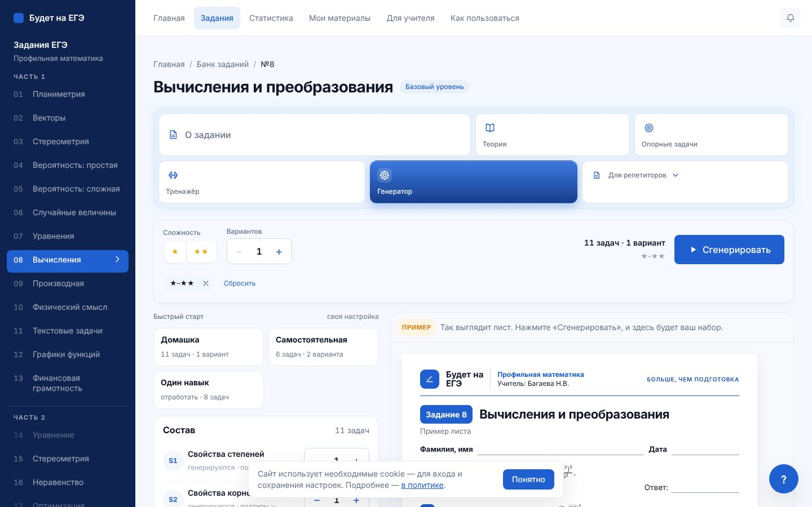
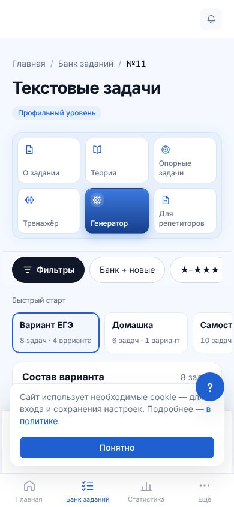

# Генератор на общей панели фильтров · PR 2

План — `01-plan.md`, п. 5. Пилот тренажёра — `02-pilot-12.md`.

## Что сделано

- **Общие части панели** вынесены в `components/filtry/chasti.tsx`: поле с подписью, переключатель «одно из», звёзды сложности, активные фильтры чипами с крестиком и «Сбросить», кнопка «Фильтры (N)» для телефона. Панель тренажёра собрана из них же, её вид не изменился.
- **Генератор №1, №2, №8, №9, №11, №12** (общий `components/generator/Generator.tsx`):
  - источник — переключатель вместо выпадающего списка; пояснение к источнику — во всплывающей подсказке, в окне «Фильтры» — строкой под переключателем;
  - сложность — те же звёзды, что в тренажёре;
  - активные фильтры — строкой под полосой: всё, что изменено против начального состояния раздела (источник, уровни). Крестик возвращает поле к начальному, «Сбросить» — оба поля сразу;
  - телефон: «Фильтры (N)» — та же кнопка, что в тренажёре; рядом остаётся «N вариантов»; источник и звёзды больше не дублируются в полосе — они в строке активных фильтров;
  - окно «Фильтры» на телефоне: источник и звёзды — те же переключатели, под звёздами — что значит каждая. «Варианты» и «Дополнительно» — как были.
- «Состав» со степперами, пресеты, лист, комплекты — не менялись: они задают, сколько задач каждого типа, и у тренажёра аналога нет.
- Невыбранные звёзды в тренажёре стали заметнее (были почти не видны).
- Удалено: выпадающий список источника генератора (`GenPopover`) и его стили, радиокнопки источника и прежние кнопки звёзд.

## Проверено

| Проверка | Результат |
|---|---|
| `pnpm lint`, `pnpm typecheck` | чисто |
| `test:generator`, `test:komplekty` | 4356 из 4356; 3000 комплектов, 15 807 задач на листах — расхождений 0 |
| `test:trenazher-filtry`, `test:trenazher-filtry-site` | 68 988 и 62 проверки — чисто |
| Браузер, №11 и №8, 1440 и 390 px: в начале активных фильтров нет; после выбора источника и звезды — чипы; «Сбросить» — чипов нет; прокрутки вбок нет | чисто |
| `check-mobile-overflow` генераторов №1, №2, №8, №9, №11, №12 и тренажёра №12 | 10 страниц × 4 ширины (60 проверок), прокрутки вбок 0 |

## Снимки

| | До | После |
|---|---|---|
| Компьютер |  |  |
| Компьютер, выбраны фильтры | — |  |
| №8 (только сложность) | — |  |
| Телефон |  |  |
| Телефон, окно «Фильтры» |  |  |

## Дальше

Партия 1 (план, п. 5): тренажёры №11, №1, №13 на общей панели.
