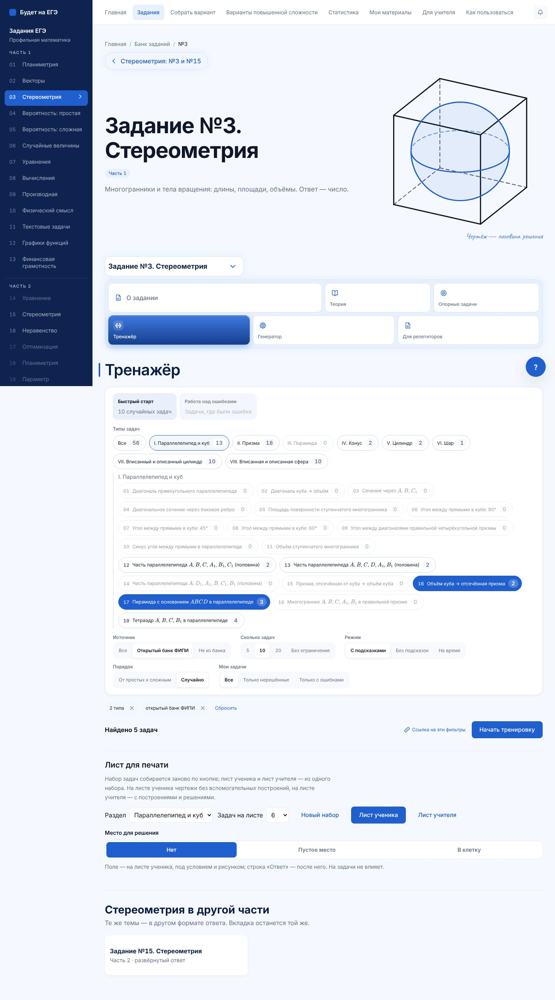
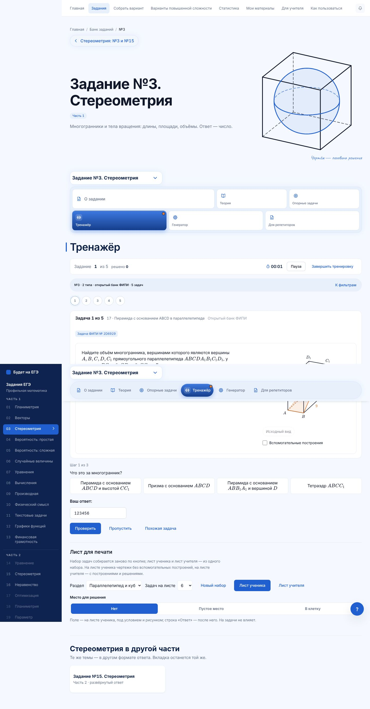
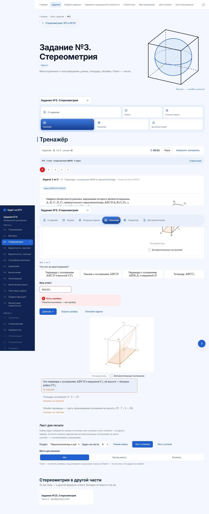
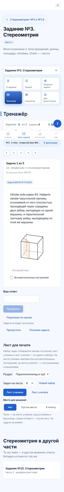
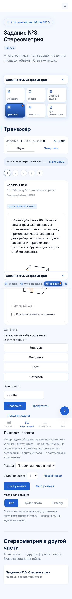
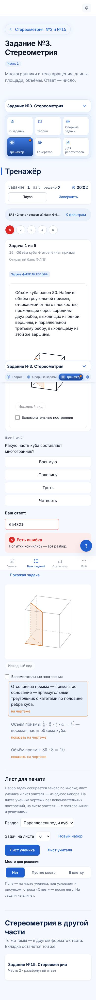

# Тренажёр с фильтрами · №3 (стереометрия)

План — `01-plan.md`, п. 3 («№3 делается вместе со стереометрией»). Основа — партия 1 (`04-partiya-1.md`) и доработка тренажёра №3 (PR #250: тип из ссылки, подсказки-вопросы, открытый банк ФИПИ).

## Что сделано

- **Вкладка «Тренажёр» №3 на общем тренажёре** (`components/trenazher/`): фильтры сверху, лента номеров, итоги — те же, что у №12, №11, №1, №13.
- **Фильтры:**
  - темы — разделы I–VIII, чипы — 92 прототипа (названия с формулами — KaTeX на сборке);
  - источник — открытый банк ФИПИ (57 задач) или не из банка;
  - сложности у №3 нет — фильтра по звёздам нет.
- **Список задач** — 920 вариантов банка (по десять на прототип). Числа на чипах честные.
- **Ссылка с разбора типа** `?tipy=P03-17,P03-18` открывает тренажёр с этими прототипами, как и раньше.
- **Карточка задачи** (`components/tasks/solid3/Zadacha3.tsx`):
  - условие и чертёж (у многогранников — живой);
  - у задачи открытого банка — «Задача ФИПИ № …»;
  - ответ числом: 0,5 / 0.5 / 1/2 засчитываются одинаково, у ответов «в долях π» — пояснение под полем;
  - подсказка — вопросы по шагам (подсказки всех 92 прототипов), ответ после шагов вводит ученик;
  - разбор по шагам, шаг подсвечивает элементы чертежа.
- **Похожая задача** — другой вариант того же прототипа.
- **Итоги** — у прототипов с ошибкой ссылка на главу теории их типа.
- **Статистика:**
  - прежнее хранилище №3, ключ тот же;
  - добавлен список решённых задач — для фильтра «Только нерешённые»;
  - «Только с ошибками» берёт прежний список ошибок.
- **Незавершённая тренировка прежнего экрана** открывается в новом: те же задачи на тех же местах, отметки сохранены.

## Удалено

- Прежний экран выбора и решения №3 (`Solid3Trainer`) и блок статистики под ним (`Solid3Stats`, `solid3Ui`).
- Неиспользуемые функции прежней записи сессии и сводки статистики.

## Проверено

| Проверка | Результат |
|---|---|
| `test:trenazher-filtry` | 240 941 проверка, разделов 12 (добавлен №3). Для №3 отдельно: ключи читаются обратно, источник совпадает с таблицей ФИПИ (57), ссылка `?tipy=` |
| `test:trainer-sessions --only №3` | 41, не прошло 0 |
| Браузер, 1440 и 390 px | фильтры по ссылке разбора, задача, подсказка, разбор после второй ошибки, перенос прежней тренировки; прокрутки вбок нет, ошибок в консоли нет |
| `test:zadanie3` | банк сходится, открытый банк ФИПИ — 57 из 57 |
| `secrets` | ответов, разборов и параметров рисунков в бандле нет (№3 — 920 вариантов) |
| `math-markup --site` | 648 страниц, математики вне KaTeX нет |
| `test:first-load` | 17 проверок, расхождений нет |
| `lint`, `typecheck`, сборка с `LEGAL_DRAFT=1` | чисто |

## Снимки

| | Фильтры / задача | Подсказка | Разбор после второй ошибки |
|---|---|---|---|
| Компьютер |  |  |  |
| Телефон |  |  |  |
